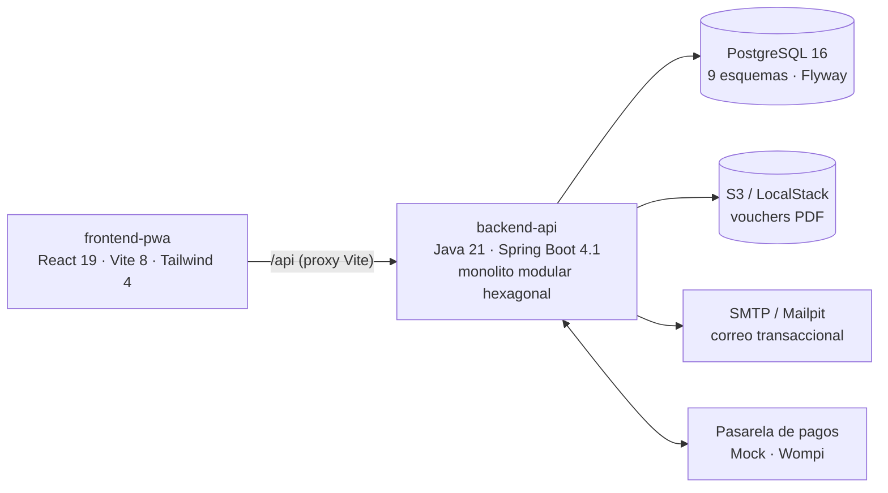

# Intégrate

**Plataforma transaccional de turismo comunitario** para colectivos de víctimas del conflicto armado y
comunidades campesinas de Colombia (Ley 1448 de 2011). Intégrate publica experiencias comunitarias
(senderismo de memoria, agroturismo, talleres), vende sus cupos sin sobreventa, cobra en COP con
custodia de fondos (*escrow*) y entrega al turista un voucher criptográfico con código QR que puede
validarse en territorio sin conexión.

---

## Contenido

- [Qué hace](#qué-hace)
- [Arquitectura](#arquitectura)
- [Estructura del repositorio](#estructura-del-repositorio)
- [Inicio rápido](#inicio-rápido)
- [Pruebas y calidad](#pruebas-y-calidad)
- [Documentación](#documentación)
- [Estado del proyecto](#estado-del-proyecto)
- [Cómo contribuir](#cómo-contribuir)

---

## Qué hace

| Actor | Lo que puede hacer |
| :--- | :--- |
| **Turista** | Explorar y filtrar experiencias (texto, departamento/municipio DIVIPOLA, categoría, intensidad), elegir fecha y franja, bloquear cupos, pagar y recibir el voucher PDF/QR por correo. |
| **Gestor de Enlace Comunitario** | Todo lo del turista, más enrolar anfitriones de su asociación sin conectividad, emitir códigos de activación y consultar el estado de sus anfitriones. |
| **Anfitrión comunitario** | Activar su cuenta con el código que le entrega el Gestor, gestionar sus autorizaciones de datos y prestar la experiencia. |
| **Administrador** | Moderar experiencias y verificar anfitriones (hoy por la API; sus pantallas llegan en una fase posterior). |

Garantías técnicas principales:

- **Cero sobreventa:** bloqueo pesimista (`SELECT … FOR UPDATE`) sobre la franja, reserva `PENDING` con TTL de 15 minutos y liberación automática de cupos vencidos.
- **Pagos idempotentes:** adaptador de pasarela (Mock en desarrollo, Wompi en despliegue), webhook idempotente y escrow del 85 % para la comunidad.
- **Voucher verificable offline:** JWT firmado RS256 embebido en un QR y en un PDF/A-2b.
- **Correo confiable:** *transactional outbox* con reintentos y voucher adjunto.
- **Protección de datos:** consentimiento Habeas Data auditado, cifrado AES-256-GCM de datos que revelan la condición de víctima, contraseñas Argon2id.
- **PWA mobile-first:** diseñada para smartphones de 360–430 px, contraste WCAG AAA para uso bajo sol, áreas táctiles ≥ 44 px y vistas de escritorio dedicadas.

## Arquitectura



| Capa | Tecnología | Decisión |
| :--- | :--- | :--- |
| Backend | Java 21, Spring Boot 4.1.1, Spring Security (JWT RS256), Flyway, errores RFC 9457 | [ADR-0002](docs/architecture/adr/ADR-0002-stack-base-backend-spring-boot.md), [ADR-0003](docs/architecture/adr/ADR-0003-estructura-comun-errores-rfc9457-trazabilidad.md) |
| Módulos | `auth`, `catalog`, `booking`, `payment`, `voucher`, `notification` | [Guía de backend](docs/architecture/backend_guidelines.md) |
| Base de datos | PostgreSQL 16 con esquemas `auth`, `catalog`, `booking`, `payments`, `voucher`, `offline`, `audit`, `notification` | [Modelo relacional](docs/modelo_relacional.md) |
| Frontend | React 19, TypeScript, Vite 8, Tailwind 4, TanStack Query, React Router, Zod | [ADR-0004](docs/architecture/adr/ADR-0004-boilerplate-frontend-pwa-vite-react.md) |
| Infraestructura local | Docker Compose: PostgreSQL, LocalStack S3, Mailpit | [ADR-0001](docs/architecture/adr/ADR-0001-infraestructura-local-docker-compose.md) |

## Estructura del repositorio

```text
integrate/
├── backend-api/        API REST Spring Boot (código, pruebas y migraciones Flyway)
├── frontend-pwa/       PWA del Turista y del Gestor de Enlace
├── infra/
│   ├── docker/         docker-compose.yml (PostgreSQL, LocalStack, Mailpit)
│   ├── env/            .env.example — única plantilla de variables versionada
│   ├── postgres/       bootstrap de roles y semilla de datos de prueba
│   └── localstack/     creación del bucket S3 local
├── qa/                 pruebas de carga k6 y generador del informe de evidencias
└── docs/               especificación, arquitectura (ADR), API, calidad, reglas y manual de usuario
```

## Inicio rápido

Requisitos: **Docker** (con Compose), **Java 21**, **Node.js ≥ 22.12** y **OpenSSL** para generar llaves.

```bash
# 1. Variables de entorno (una sola vez): copie la plantilla y reemplace cada placeholder
cp infra/env/.env.example infra/env/.env.development

# 2. Infraestructura: PostgreSQL + LocalStack + Mailpit
cd infra/docker
docker compose --env-file ../env/.env.development --profile full up -d
cd ../..

# 3. Backend en http://localhost:8080 (aplica las migraciones Flyway al arrancar)
cd backend-api
./mvnw spring-boot:run -Dspring-boot.run.profiles=dev

# 4. PWA en http://localhost:5173 (en otra terminal)
cd frontend-pwa
npm install
npm run dev
```

Abra <http://localhost:5173>. Los correos enviados (registro, voucher, restablecer contraseña) se ven en
Mailpit: <http://localhost:8025>.

La guía completa — generación de llaves, carga de la semilla con un usuario por rol, recarga en caliente y
solución de problemas — está en **[docs/guia-desarrollo.md](docs/guia-desarrollo.md)**.

> **Seguridad:** `infra/env/.env.development` y `infra/env/.env.test-users` están en `.gitignore` y nunca se
> comitean. Ninguna credencial real va en el código, en los workflows ni en la documentación
> ([política de secretos](docs/security/security_secrets_policy.md)).

## Pruebas y calidad

```bash
# Backend: pruebas unitarias e integración
cd backend-api && ./mvnw verify

# PWA: Quality Gate obligatorio (los 5 comandos deben pasar)
cd frontend-pwa
npm run typecheck && npm run lint && npm run format:check && npm test && npm run build
```

La suite trazable al Plan de Gestión de la Calidad ([ADR-0019](docs/architecture/adr/ADR-0019-suite-calidad-trazable-plan-gestion-calidad.md))
cubre los 30 RNF. Último informe (2026-10-11): 180 pruebas JUnit y 165 pruebas Vitest sin fallos; 18 RNF
cumplen, 6 quedan para la Fase 2. Detalle en [evidencias métricas](docs/quality/evidencias-metricas.md),
[matriz de trazabilidad](docs/quality/matriz-trazabilidad-rnf.md) y [pruebas de carga k6](qa/k6/README.md).

## Documentación

El índice completo está en **[docs/README.md](docs/README.md)**. Accesos directos:

| Para… | Documento |
| :--- | :--- |
| Usar la aplicación | [Manual de usuario](docs/manual/README.md) |
| Instalar y desarrollar | [Guía de desarrollo](docs/guia-desarrollo.md) · [Infraestructura local](infra/README.md) |
| Entender el producto | [Especificación técnica](docs/especificacion_tecnica.md) (RF-01…RF-20, RNF-01…RNF-30) |
| Entender las decisiones | [Registro de ADR](docs/README.md#decisiones-de-arquitectura-adr) |
| Integrarse con la API | [OpenAPI 3](docs/api/openapi.yaml) · [DTOs del contrato](docs/api/dtos_contrato_api.md) |
| Saber en qué va el proyecto | [Estado del proyecto](docs/status/PROJECT_STATUS.md) · [Roadmap](docs/roadmap_ejecucion.md) |

## Estado del proyecto

El trabajo se divide en dos etapas ([roadmap](docs/roadmap_ejecucion.md)):

- **Etapa 1 — Núcleo transaccional (en curso, rama `feature/fase-1-mvp-transaccional`).** Backend completo:
  autenticación y RBAC, catálogo y moderación, enrolamiento asistido, reserva concurrente, pagos con escrow,
  voucher criptográfico y correo con outbox. PWA: catálogo, ficha con datos de recorrido, reserva, checkout,
  confirmación con voucher, sesión, recuperación de contraseña, enrolamiento móvil del gestor y vistas de
  escritorio.
- **Etapa 2 — Validación territorial offline y dispersión (pendiente).** Service Worker e IndexedDB,
  validación de QR sin conexión con anti-doble canje, sincronización diferida, split payment 85/15,
  política de cancelación de 72 h y despliegue en AWS.

## Cómo contribuir

1. Todo cambio estructural del backend empieza con un ADR aprobado ([flujo ADR](docs/rules/adr-workflow.md)).
2. El trabajo en la PWA sigue la [directiva de frontend FE-DIR-001](docs/rules/frontend-rules.md).
3. Ramas, commits (Conventional Commits) y Pull Requests siguen el [flujo de Git](docs/rules/git-workflow.md).
4. Antes de cada commit se revisa la [lista de verificación de secretos](docs/security/security_secrets_policy.md).
