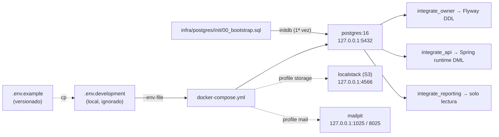

# ADR-0001: Orquestar la infraestructura local con Docker Compose y variables de entorno segregadas por plantilla

- **Estado:** Aceptado (2026-10-05)
- **Proyecto / Módulo:** Intégrate · `infra/` (Fase 0 · T-0.1 / T-0.2)
- **Fecha:** 2026-10-05

## Contexto
El repositorio ya contiene el bootstrap de clúster (`infra/postgres/init/00_bootstrap.sql`, que lee `INTEGRATE_OWNER_PASSWORD`, `INTEGRATE_API_PASSWORD` e `INTEGRATE_REPORTING_PASSWORD` vía `\getenv`) y las migraciones Flyway `V1`–`V10`, pero no existe forma reproducible de levantar PostgreSQL 16 ni los servicios de soporte previstos en el roadmap (S3 para vouchers PDF, SMTP para notificaciones). Tampoco existe `.gitignore` raíz.

Restricciones: SEC-DIR-004 prohíbe credenciales en `docker-compose.yml` y solo permite versionar `.env.example` (`.env.*` ignorado). Esto choca con el árbol de `backend_guidelines.md` §2, que lista `.env.development` y `.env.production` como archivos de `infra/env/`; y §4 de la directiva prohíbe `.env` en producción. Además, `backend_guidelines.md` §6.1 documenta timeouts (`30s`/`15s`) distintos a los que realmente aplica `00_bootstrap.sql` (`15s`/`30s` + `lock_timeout 2s`).

## Decisión
1. **Un único `infra/docker/docker-compose.yml`** (nombre de proyecto `integrate`) con:
   - `postgres` — imagen `postgres:16-alpine` fijada por versión menor; monta `infra/postgres/init/` en `/docker-entrypoint-initdb.d/` (solo lectura) para que el bootstrap corra **una vez** sobre volumen vacío; volumen nombrado `integrate_pgdata`; `healthcheck` con `pg_isready`; puerto publicado solo en `127.0.0.1`.
   - `localstack` (S3) y `mailpit` (SMTP + UI web) bajo **perfiles de Compose** (`--profile storage`, `--profile mail`, o `--profile full`), para que `docker compose up` por defecto levante solo PostgreSQL, que es lo que bloquea T-0.2/T-0.5.
   - Red interna dedicada `integrate_net`. Sin servicio del backend todavía: el `Dockerfile` se agrega cuando exista `pom.xml` (T-0.3).
2. **Todas las credenciales entran por interpolación `${VAR:?mensaje}`** desde un archivo `.env` local: Compose falla de inmediato (*fail-fast*) si falta una variable obligatoria; no hay valores por defecto para secretos.
3. **Plantillas de entorno:**
   - `infra/env/.env.example` — **único archivo versionado**, con todas las variables (superusuario, tres roles de login, puertos, S3, SMTP, y las que usará Spring: `DATABASE_URL`, `DATABASE_USERNAME`, `FLYWAY_USER`…) con placeholders descriptivos.
   - `infra/env/.env.development` — copia local generada por el desarrollador (`cp .env.example .env.development`), **ignorada por Git**. Compose la consume con `--env-file ../env/.env.development`.
   - **No se crea `.env.production`**: producción usa AWS Secrets Manager / SSM (SEC-DIR-004 §4). Se corrige el árbol de `backend_guidelines.md` §2 en consecuencia.
4. **`.gitignore` raíz** con el bloque obligatorio de SEC-DIR-004 §2.1, más exclusiones de build (`target/`, `node_modules/`, `.idea/`).
5. **`infra/README.md`** breve con el flujo de arranque, reinicio limpio (`down -v`) y la advertencia de que el bootstrap no se re-ejecuta sobre un volumen existente.
6. Corregir `backend_guidelines.md` §6.1 para que refleje los timeouts reales de `00_bootstrap.sql` (fuente de verdad).

## Alternativas Descartadas
- **Credenciales con valor por defecto en el compose (`${VAR:-postgres}`):** cómodo, pero viola la tolerancia cero de SEC-DIR-004 y oculta configuraciones incompletas.
- **Versionar `.env.development` con contraseñas "de juguete":** la directiva prohíbe explícitamente credenciales funcionales de prueba en archivos versionados; además el patrón `.env.*` lo ignoraría.
- **MinIO en lugar de LocalStack:** más liviano, pero el roadmap y `backend_guidelines.md` fijan LocalStack, que además permite emular SSM/Secrets Manager en fases posteriores.
- **Varios archivos compose (`compose.db.yml`, `compose.full.yml`):** los perfiles logran lo mismo con un solo archivo y menos deriva.

## Consecuencias
- **Positivas:** entorno reproducible con un comando; fallo explícito si falta un secreto; superficie de red mínima (loopback); roles segregados listos para Flyway (`integrate_owner`) y runtime (`integrate_api`); cumple el DoD de Fase 0 (arranque limpio con `docker compose up`).
- **Negativas / Riesgos asumidos:** el bootstrap solo corre con volumen vacío — cambiar contraseñas exige `docker compose down -v` (pérdida de datos locales); `--env-file` con ruta relativa obliga a ejecutar desde `infra/docker/` (se documenta); LocalStack añade ~1 GB de imagen para quien active el perfil.

## Contrato o Esquema Conceptual

Variables (nombres, sin valores): `POSTGRES_SUPERUSER_PASSWORD`, `INTEGRATE_OWNER_PASSWORD`, `INTEGRATE_API_PASSWORD`, `INTEGRATE_REPORTING_PASSWORD`, `POSTGRES_PORT`, `DATABASE_URL`, `DATABASE_USERNAME`, `DATABASE_PASSWORD`, `FLYWAY_USER`, `FLYWAY_PASSWORD`, `AWS_REGION`, `AWS_S3_BUCKET_NAME`, `AWS_ENDPOINT_URL`, `SMTP_HOST`, `SMTP_PORT`.
