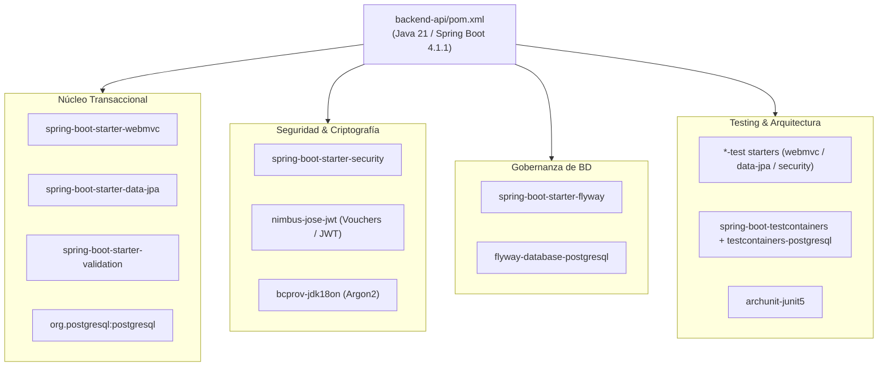

# ADR-0002: Definición del Stack Base de Construcción y Dependencias del Backend (Spring Boot 4.1.x, Java 21, Maven)

- **Estado:** Aceptado (2026-10-05)
- **Proyecto / Módulo:** Intégrate · `backend-api/` (Fase 0 · T-0.3 / T-0.4 / T-0.5)
- **Fecha:** 2026-10-05

## Contexto
El entorno de base de datos local y servicios complementarios ya está estabilizado y verificado mediante Docker Compose (ADR-0001), contando con las migraciones Flyway `V1` a `V10` en `backend-api/src/main/resources/db/migration/`. Sin embargo, el directorio `backend-api/` carece de descriptor de construcción (`pom.xml`), configuración de runtime y Maven Wrapper.

Restricciones técnicas aplicables:
1. **Entorno local:** Java 21 LTS está instalado en la máquina anfitriona (`openjdk 21.0.12.1`), pero la CLI global `mvn` no se encuentra en el `PATH` del sistema. Se requiere un mecanismo reproducible y autónomo (Maven Wrapper `mvnw` / `mvnw.cmd`) para compilar y ejecutar pruebas sin depender de variables de entorno globales.
2. **Gobernanza de BD segregada:** El runtime de la aplicación debe conectarse bajo el rol `integrate_api` (privilegios estrictos de DML), mientras que Flyway debe migrar bajo `integrate_owner` (propietario de esquemas DDL).
3. **Criptografía y Firma:** Los requerimientos RNF-18, RF-01, RF-07 y las directrices de `backend_guidelines.md` §1.2 exigen hashing BCrypt/Argon2, cifrado AES-256-GCM para datos sensibles de víctimas (Ley 1581) y firmas asimétricas RSA/Ed25519 empaquetadas en JWT para vouchers offline.
4. **Soporte de versiones:** A la fecha (2026-10), la línea Spring Boot 3.3.x se encuentra fuera de soporte OSS (sin parches de seguridad públicos) y la 3.5.x está al final de su ventana OSS. Las líneas vigentes son 4.0.x y 4.1.x (última estable publicada: **4.1.1**). Para un sistema que custodia datos sensibles de víctimas, iniciar sobre una línea sin parches no es aceptable.
5. **Modularización de Spring Boot 4:** La autoconfiguración se divide por tecnología. Flyway ya no se autoconfigura solo con `flyway-core`: requiere `spring-boot-starter-flyway`, y el motor PostgreSQL requiere `flyway-database-postgresql`. Las pruebas por capa (`@WebMvcTest`, `@DataJpaTest`) viven en starters `*-test` dedicados.

## Decisión
1. **Adopción de Spring Boot 4.1.x (4.1.1) con Java 21 LTS** gestionado a través de `pom.xml` con `spring-boot-starter-parent` como POM padre para alineación de versiones transitivas probadas (Spring Framework 7, Spring Security 7, Hibernate 7, Jakarta EE 11, Flyway 12, Testcontainers 2). Se actualizan las referencias "Spring Boot 3.x" de `backend_guidelines.md`, `especificacion_tecnica.md` y `roadmap_ejecucion.md`.
2. **Conjunto estricto de dependencias iniciales en `backend-api/pom.xml`:**
   - **Core Web & Persistencia:** `spring-boot-starter-webmvc`, `spring-boot-starter-data-jpa`, `org.postgresql:postgresql` (alcance `runtime`).
   - **Validación declarativa:** `spring-boot-starter-validation` (para cumplimiento estricto de contratos OpenAPI).
   - **Migraciones:** `spring-boot-starter-flyway` y `org.flywaydb:flyway-database-postgresql`.
   - **Seguridad & RBAC:** `spring-boot-starter-security`.
   - **Criptografía y JWT:**
     - `com.nimbusds:nimbus-jose-jwt` (vouchers y tokens JWT; RSA y AES-GCM se resuelven con los proveedores JCA nativos de Java 21).
     - `org.bouncycastle:bcprov-jdk18on`, justificado por `Argon2PasswordEncoder` de Spring Security (RNF-18), que depende de la implementación Argon2 de BouncyCastle. **No** se incluye `bcpkix-jdk18on` mientras no exista manejo de certificados X.509 / PEM.
     - Si la decisión de firma de vouchers (ADR futuro) adopta Ed25519 sobre Nimbus, deberá añadirse `com.google.crypto.tink:tink` (requisito de Nimbus para `OctetKeyPair`), no BouncyCastle.
   - **Productividad:** `org.projectlombok:lombok` declarado `<optional>true</optional>` y registrado explícitamente en `annotationProcessorPaths` de `maven-compiler-plugin` (robusto ante JDK 23+, donde el procesamiento implícito de anotaciones está deshabilitado), y excluido del JAR ejecutable.
   - **Testing y Calidad:** `spring-boot-starter-webmvc-test`, `spring-boot-starter-data-jpa-test`, `spring-boot-starter-security-test` (JUnit 5, Mockito, AssertJ, `spring-security-test`), `spring-boot-testcontainers` + `org.testcontainers:testcontainers-postgresql` + `org.testcontainers:testcontainers-junit-jupiter` (pruebas de integración reales), `com.tngtech.archunit:archunit-junit5` (reglas de arquitectura hexagonal de `backend_guidelines.md` §5).
   - Las versiones no gestionadas por el BOM de Spring Boot (Nimbus, BouncyCastle, ArchUnit) se fijan como propiedades explícitas en el `pom.xml`.
3. **Inclusión de Maven Wrapper 3.3.x (tipo `only-script`)** en la raíz de `backend-api/` (`mvnw`, `mvnw.cmd`, `.mvn/wrapper/maven-wrapper.properties`) fijado en Apache Maven 3.9.x, con verificación de integridad `distributionSha256Sum`. No se versiona ningún binario (`maven-wrapper.jar`), y `.gitignore` lo excluye preventivamente.
4. **Configuración de Perfiles de Propiedades (`application.yml` y `application-dev.yml`)** — se implementa en T-0.4:
   - Segregación estricta de DataSource: `spring.datasource` con usuario `integrate_api` y `spring.flyway` con usuario `integrate_owner`, ambas credenciales inyectadas por variables de entorno (SEC-DIR-004 §5.2).
   - Esquemas administrados por Flyway: `auth,catalog,booking,payments,voucher,offline,audit,notification`.
   - Activación de HikariCP con timeouts coherentes con `00_bootstrap.sql` (`lock_timeout = 2s`).

## Alternativas Descartadas
- **Spring Boot 3.3.x / 3.5.x:** Descartado; 3.3 está fuera de soporte OSS y 3.5 al final de su ventana, lo que obligaría a una migración mayor a 4.x en plena Fase 1–3 con código ya escrito. Migrar ahora tiene costo cero.
- **Gradle:** Descartado para mantener coherencia estricta con la convención estándar del proyecto documentada en `docs/architecture/backend_guidelines.md` §1.2 y §2.
- **Un único usuario de base de datos para Spring Boot y Flyway:** Descartado; viola el principio de mínimo privilegio y rompe la segregación de roles DDL/DML garantizada en el bootstrap.
- **Librería JWT `jjwt`:** Descartada en favor de Nimbus JOSE por su soporte completo de JWS/JWE/JWK (claves públicas exportables como JWK para verificación offline vía Web Crypto API en la PWA) y por ser la librería que Spring Security usa internamente para OAuth2/JOSE.
- **BouncyCastle como proveedor criptográfico general:** Descartado; Java 21 provee AES-256-GCM, RSA y Ed25519 de forma nativa. BC se limita a Argon2 para reducir superficie de ataque.

## Consecuencias
- **Positivas:** Línea de framework con soporte y parches de seguridad vigentes; compilación reproducible sin requerir instalación manual de Maven global y con verificación de integridad de la distribución; soporte nativo para migraciones automáticas sobre PostgreSQL 16; validación arquitectónica automatizada con ArchUnit; base criptográfica sólida y mínima para vouchers y Habeas Data.
- **Negativas / Riesgos asumidos:**
  - La descarga inicial de dependencias y de la distribución de Maven requiere conectividad en la primera compilación (~150 MB en `~/.m2`).
  - Spring Boot 4 trae cambios de API frente a la documentación/ejemplos 3.x más difundidos (Jackson 3 con paquete `tools.jackson`, Spring Security 7 sin `WebSecurityConfigurerAdapter`, starters modulares, Testcontainers 2 con artefactos `testcontainers-*`); el equipo debe consultar la documentación 4.x.
  - Con `spring-boot-starter-security` en el classpath, todos los endpoints quedan protegidos por defecto (usuario generado en arranque) hasta que la Fase 1 configure la cadena de filtros JWT stateless.
  - El `pom.xml` no puede empaquetar (`spring-boot:repackage`) hasta que T-0.4 cree `IntegrateApplication.java`; la verificación de T-0.3 se limita a resolución de dependencias y `test-compile`.

## Contrato o Esquema Conceptual

