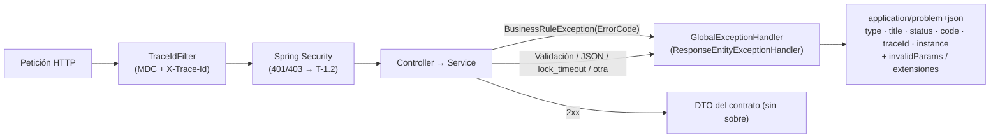

# ADR-0003: Estructura base común — errores RFC 9457, catálogo de códigos y trazabilidad `X-Trace-Id`

- **Estado:** Aceptado (2026-10-05)
- **Proyecto / Módulo:** Intégrate · `backend-api/` (Fase 0 · T-0.6)
- **Fecha:** 2026-10-05

## Contexto
El backend ya arranca y migra (T-0.4, T-0.5), pero carece de los componentes transversales que todos los módulos de la Fase 1 consumirán: manejo global de errores, payloads comunes y configuración base. El contrato vigente (`docs/api/openapi.yaml`, `docs/api/dtos_contrato_api.md` §2) fija reglas no negociables: **todo** error se emite como `application/problem+json` (RFC 9457) con `type`, `title`, `status`, `traceId` obligatorios, `code` estable (`^[A-Z][A-Z0-9_]+$`), `invalidParams[]` por campo, extensiones por caso (`lockedUntil`, `availableSlots`, `requiredPurposes`, `policyVersion`), validación semántica en **422** (no el 400 por defecto de Spring), `lock_timeout` de PostgreSQL en **503** con `Retry-After: 1`, y la cabecera `X-Trace-Id` en **cada** respuesta.

Existe una contradicción documental: `backend_guidelines.md` (§2, §3 y §5) prevé un sobre `common/payload/ApiResponse` para respuestas JSON, mientras que el contrato OpenAPI define las respuestas exitosas como DTOs planos (`AuthTokenResponse`, `BookingLockResponse`, …) sin envoltorio. El contrato es la fuente de verdad para la PWA; el nombre `ApiResponse`, además, colisiona con la anotación `io.swagger.v3.oas.annotations.responses.ApiResponse` de cualquier herramienta OpenAPI futura.

## Decisión
1. **Sin sobre de éxito.** Las respuestas 2xx devuelven el DTO del contrato directamente. Se elimina `ApiResponse` de `backend_guidelines.md`; `common/payload/` contiene solo tipos compartidos del contrato (`InvalidParam`).
2. **Errores sobre el soporte nativo de Spring Framework 7** (`org.springframework.http.ProblemDetail`), sin librería externa:
   - **`ErrorCode` (enum, `common/exception`)**: catálogo único de `dtos_contrato_api.md` §2. Cada constante lleva `status` HTTP, `slug` (→ `type = https://api.integrate.co/problems/<slug>`) y `title` estable. Los códigos de protocolo (`MALFORMED_REQUEST`, 400) usan `type = about:blank`. Los módulos de Fase 1 agregan aquí sus códigos; no se aceptan `code` en texto libre.
   - **`BusinessRuleException` (no verificada)**: excepción de dominio única que transporta `ErrorCode`, `detail` opcional y un mapa de extensiones (`availableSlots`, `lockedUntil`, …) y cabeceras (`Retry-After`). Los servicios lanzan `new BusinessRuleException(ErrorCode.BOOKING_INSUFFICIENT_SLOTS).with("availableSlots", 2)`; ninguna capa construye respuestas HTTP de error a mano.
   - **`GlobalExceptionHandler` (`@RestControllerAdvice`, extiende `ResponseEntityExceptionHandler`)**, que cubre también las excepciones del framework:
     | Origen | Respuesta |
     |---|---|
     | `BusinessRuleException` | `status`/`type`/`title`/`code` del `ErrorCode` + extensiones |
     | `MethodArgumentNotValidException`, `HandlerMethodValidationException`, `ConstraintViolationException` | **422** `VALIDATION_FAILED` + `invalidParams[]` (`participants[1].docNumber`) |
     | `HttpMessageNotReadableException`, `MethodArgumentTypeMismatchException` | **400** `MALFORMED_REQUEST`, `type: about:blank` |
     | `PessimisticLockingFailureException` / SQLState `55P03` | **503** `CONCURRENCY_LOCK_TIMEOUT` + `Retry-After: 1` |
     | `NoResourceFoundException` | **404** `RESOURCE_NOT_FOUND` |
     | Cualquier otra `Exception` | **500** genérico **sin `detail`**; se registra el stacktrace con el `traceId` (nunca se expone, coherente con `server.error.include-*: never`) |
   - Todo `ProblemDetail` incluye `traceId` e `instance` (ruta invocada).
3. **Trazabilidad `X-Trace-Id` (`common/web/TraceIdFilter`)**: `OncePerRequestFilter` con precedencia máxima (antes de la cadena de Spring Security, para que 401/403 también lo lleven). Genera un id aleatorio por petición, o reutiliza el `X-Trace-Id` entrante **solo** si cumple `^[A-Za-z0-9-]{8,64}$` (evita inyección en logs). Lo publica en el MDC (`traceId`), en la cabecera de respuesta y en el atributo de la petición que lee el handler. El patrón de log incluye `[traceId]`.
4. **`config/TimeConfig`**: bean `java.time.Clock` en UTC inyectable, para que las reglas temporales (TTL de 15 min, regla de 72 h, desfase de reloj offline) sean deterministas en pruebas. Prohibido `Instant.now()` / `LocalDateTime.now()` sin `Clock` en código de dominio.
5. **Reglas ArchUnit iniciales (`src/test/.../architecture/`)**: `common` no depende de `modules` ni de `security`; ninguna clase fuera de `common.exception` extiende `ResponseEntityExceptionHandler` ni declara `@RestControllerAdvice`.
6. **Pruebas**: test de slice MVC sobre un controlador de prueba que verifica cada fila de la tabla anterior (status, `Content-Type: application/problem+json`, `code`, `traceId` = `X-Trace-Id`, `invalidParams`, ausencia de `detail` en 500) y test unitario del filtro (id generado, id entrante válido reutilizado, id malicioso descartado).

## Alternativas Descartadas
- **Mantener `ApiResponse` como sobre `{success, data, error}`:** Rompe el contrato OpenAPI ya consolidado y la PWA, duplica la señal del código HTTP y choca de nombre con las anotaciones Swagger.
- **Jerarquía de excepciones por caso (`InsufficientSlotsException`, `AccountLockedException`, …):** Multiplica clases sin comportamiento propio; el enum `ErrorCode` da el mismo tipado con un catálogo central verificable.
- **Librería `zalando/problem-spring-web`:** Redundante desde Spring 6 (`ProblemDetail` nativo) y sin soporte asegurado para Spring Framework 7.
- **Micrometer Tracing (`traceparent` W3C) para el id de correlación:** Adecuado cuando haya trazas distribuidas (Fase 4, AWS); hoy añade dependencias y su formato no coincide con el `X-Trace-Id` del contrato. Puede adoptarse después reutilizando el mismo MDC.
- **`OpenApiConfig` con springdoc en esta tarea:** El proyecto es *contract-first* (`openapi.yaml` validado con Redocly); generar otra especificación desde código crearía dos fuentes de verdad. Se reevaluará al exponer Swagger UI.

## Consecuencias
- **Positivas:** Un único punto de traducción error→HTTP alineado al contrato; catálogo de códigos centralizado y comprobable; ningún stacktrace ni mensaje interno filtrado; correlación log↔respuesta por `traceId` desde el día uno; tiempo determinista en pruebas.
- **Negativas / Riesgos asumidos:**
  - Los 401/403 que genera Spring Security **no** pasan por `@RestControllerAdvice`; sus `AuthenticationEntryPoint`/`AccessDeniedHandler` en formato problem+json se implementan en T-1.2 reutilizando `ErrorCode`.
  - Cada módulo nuevo debe registrar sus códigos en `ErrorCode` (punto de edición compartido; conflictos de merge triviales).
  - Se corrige `backend_guidelines.md` (§2 árbol, §3 tabla `common/`, §5 manejo de errores) para eliminar `ApiResponse` y referenciar RFC 9457 en lugar de RFC 7807.

## Contrato o Esquema Conceptual


```text
com.integrate
├── common/
│   ├── exception/   ErrorCode (enum), BusinessRuleException, GlobalExceptionHandler
│   ├── payload/     InvalidParam (record)
│   └── web/         TraceIdFilter
└── config/          TimeConfig (Clock UTC)
```
