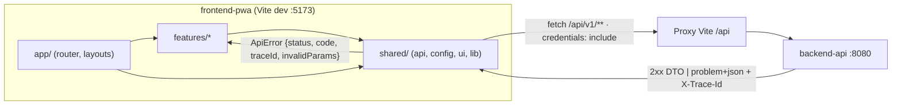

# ADR-0004: Boilerplate de `frontend-pwa` — Vite 8 + React 19 + TypeScript 6 + Tailwind CSS 4, estructura por *features*

- **Estado:** Aceptado (2026-10-05) · enmendado en implementación: ESLint 10 + `eslint-plugin-jsx-a11y-x` (ver Enmienda)
- **Proyecto / Módulo:** Intégrate · `frontend-pwa/` (Fase 0 · T-0.7)
- **Fecha:** 2026-10-05

## Contexto
La Fase 0 cierra con la inicialización de la PWA. La especificación (§4.1) fija React 18+ con Vite, TypeScript, Tailwind CSS, Workbox e IndexedDB (Dexie.js o `idb`); RNF-04 exige operación sin red del Gestor de Enlace, RNF-07 WCAG 2.1 AA / NTC 5854 con contraste para luz solar, y `offline_data_indexeddb.md` prohíbe persistir tokens en IndexedDB. El contrato de autenticación (`openapi.yaml`) entrega el access token (900 s) en el cuerpo y el refresh token en una cookie `HttpOnly; Secure; SameSite=Strict; Path=/api/v1/auth`, por lo que la PWA debe llamar a la API **desde el mismo sitio** y con `credentials: 'include'`. Los errores llegan como `application/problem+json` con `code` y `traceId` (ADR-0003).

Las versiones vigentes en npm (2026-10-05) imponen restricciones reales: TypeScript 7.0 (compilador nativo) **no** es compatible con `typescript-eslint` 8.71 (peer `typescript <6.1`), y `eslint-plugin-jsx-a11y` 6.10 no admite ESLint 10. Esta tarea solo construye el esqueleto: Service Worker/IndexedDB son T-2.1, catálogo y reservas T-1.8, autenticación real T-1.2.

## Decisión
1. **Toolchain (versiones fijadas con `~` y `package-lock.json`, npm como gestor, `engines.node >=22.12`):**
   | Pieza | Versión | Motivo |
   |---|---|---|
   | Vite + `@vitejs/plugin-react` | 8.3 / 6.1 | Requerido por la especificación; compatible con `vite-plugin-pwa` 2.0 para T-2.1 |
   | React / React DOM | 19.3 | "18+" de la especificación; exigido por React Router 8 |
   | TypeScript | **6.0** (no 7.0) | Última versión soportada por `typescript-eslint`; `strict`, `noUncheckedIndexedAccess`, `verbatimModuleSyntax` |
   | Tailwind CSS + `@tailwindcss/vite` | 4.3 | Configuración CSS-first (`@theme`) sin `tailwind.config.js` ni PostCSS |
   | React Router | 8.4 (modo *data*, `createBrowserRouter`) | Rutas anidadas por rol y `errorElement` por ruta |
   | ESLint | **9.x** (no 10) | Necesario para `eslint-plugin-jsx-a11y` (RNF-07); + `typescript-eslint`, `react-hooks` |
   | Prettier | 3.9 | Formato único |
   | Vitest + Testing Library + jsdom | 5.0 / 16.3 / 30 | Pruebas de componentes y de la capa HTTP |
2. **Estructura por *features* con capas compartidas**, y reglas de dependencia verificadas por ESLint (`no-restricted-imports`), equivalentes a las reglas ArchUnit del backend:
   ```text
   frontend-pwa/src/
   ├── app/        router, layouts (Turista / Gestor), providers, página 404 y de error
   ├── features/   un directorio por módulo de negocio; T-0.7 solo crea `home/` (placeholder)
   ├── shared/
   │   ├── api/    cliente HTTP y tipos ProblemDetail (RFC 9457)
   │   ├── config/ lectura y validación de variables de entorno (fail-fast)
   │   ├── ui/     componentes accesibles base (SkipLink, Button)
   │   └── lib/    utilidades puras
   └── styles/     tokens de diseño Tailwind (@theme)
   ```
   `shared` no importa de `features` ni de `app`; una *feature* no importa el interior de otra (solo su `index.ts`). Los directorios `offline/` (T-2.1) y los módulos de negocio se crean en sus tareas, no vacíos ahora.
3. **Cliente HTTP propio sobre `fetch` (`shared/api/httpClient.ts`), sin Axios:** base `VITE_API_BASE_URL`, `credentials: 'include'`, cabecera `Authorization` desde un proveedor de token inyectable (token **solo en memoria**, nunca en `localStorage`/IndexedDB; lo cablea T-1.2), y traducción de toda respuesta `application/problem+json` a un `ApiError` tipado (`status`, `code`, `title`, `traceId`, `invalidParams`). Los errores de red se distinguen de los HTTP para que la cola offline (T-3.1) decida reintentos.
4. **Configuración y secretos (SEC-DIR-004):** la única variable es `VITE_API_BASE_URL` (no secreta), validada al arrancar sin valor por defecto (la app muestra un error claro si falta). Se versiona `frontend-pwa/.env.example`; el desarrollador copia a `.env.development.local` (ignorado por `.env.*`). En desarrollo vale `/api` y el *proxy* de Vite reenvía `/api` → `http://localhost:8080`, de modo que la cookie `SameSite=Strict` funciona sin CORS. En producción la PWA se sirve en el mismo sitio que la API (`*.integrate.co`); la configuración CORS se resuelve en T-4.4.
5. **Accesibilidad desde el día uno (RNF-07):** `lang="es-CO"`, *skip link*, landmarks (`header`/`nav`/`main`), foco visible de alto contraste, paleta de tokens con contraste ≥ 4,5:1 (≥ 7:1 para texto principal, pensando en luz solar), respeto de `prefers-reduced-motion`, y `jsx-a11y` en modo `strict` en el lint.
6. **Scripts:** `dev`, `build` (`tsc -b && vite build`), `preview`, `typecheck`, `lint`, `format`, `test`. **Verificación de cierre:** `typecheck`, `lint`, `test` y `build` en verde; arranque en el navegador con navegación entre rutas y página 404; proxy `/api` contra el backend local (respuesta 401 con `X-Trace-Id` traducida a `ApiError`).
7. **`.gitignore` raíz:** se añaden `node_modules/`, `dist/`, `coverage/` y `*.local` de `frontend-pwa/`.

## Alternativas Descartadas
- **TypeScript 7.0 (nativo):** más rápido, pero rompe `typescript-eslint` hoy; se migrará cuando esa herramienta lo soporte (cambio de una línea).
- **ESLint 10:** sin soporte de `eslint-plugin-jsx-a11y`, que es la verificación automática más barata de RNF-07.
- **Axios (citado en `roadmap_ejecucion.md`):** añade ~13 KB gzip a dispositivos de gama baja; `fetch` es nativo, es lo que intercepta Workbox y basta con un envoltorio de ~80 líneas para problem+json.
- **Next.js / Remix (SSR):** requieren servidor Node; la PWA debe funcionar como estático cacheado sin red y desplegarse en S3/CloudFront o ECS sin runtime adicional.
- **Estructura por tipo técnico (`components/`, `hooks/`, `services/`):** dispersa cada módulo de negocio en varias carpetas y no permite expresar fronteras entre módulos, a diferencia de la estructura por *features*.
- **Instalar ahora `vite-plugin-pwa`, Dexie/`idb`, TanStack Query o Zod:** pertenecen a T-2.1, T-1.8 y T-1.2; añadirlos sin uso real crea decisiones sin validar. El ADR de T-2.1 elegirá entre Dexie e `idb`.
- **Token de acceso en `localStorage`:** expuesto a XSS y contrario a `offline_data_indexeddb.md` §1.

## Consecuencias
- **Positivas:** esqueleto mínimo y verificable con las mismas garantías que el backend (tipado estricto, reglas de dependencia comprobadas, fail-fast de configuración, errores RFC 9457 tipados); accesibilidad verificada por lint desde el primer componente; flujo de cookies de refresh correcto en desarrollo sin CORS.
- **Negativas / Riesgos asumidos:**
  - Se fijan dos versiones por debajo de la última (TypeScript 6, ESLint 9) por compatibilidad de herramientas; queda deuda de actualización registrada aquí.
  - El cliente `fetch` propio es código a mantener (reintentos, cancelación, *timeouts* se añaden cuando un caso real los pida).
  - La PWA aún **no** es instalable ni funciona sin red: el manifiesto y el Service Worker llegan en T-2.1.
  - El despliegue en producción debe mantener API y PWA en el mismo sitio, o la cookie `SameSite=Strict` dejará de enviarse.

## Enmienda (2026-10-05, implementación)
Al instalar, npm marcó **ESLint 9.39 como fuera de soporte** (`deprecated`), y `eslint-plugin-jsx-a11y` no publica desde 2024-10. Se sustituyó por **ESLint 10.12 + `eslint-plugin-jsx-a11y-x` 0.2** (fork mantenido por `es-tooling`, mismas reglas, soporta ESLint 9 y 10) con su configuración `strict`. Se mantiene TypeScript 6.0 por `typescript-eslint`. Se descarta así la alternativa "ESLint 9" de la decisión 1; el resto del ADR queda igual.

## Contrato o Esquema Conceptual


```text
Rutas iniciales (placeholders)
/              Layout Turista  → Inicio (catálogo en T-1.8)
/gestor        Layout Gestor   → Panel de jornada (offline en Fase 2)
*              Página 404 accesible
```

## Nota de renumeración (2026-10-07)
El backlog se reorganizó en dos etapas, con el backend antes que el frontend en cada una (`PROJECT_STATUS.md` §3). Las referencias de este ADR equivalen a:

| En este ADR | Ahora | Tarea |
|---|---|---|
| T-2.1 (Service Worker, IndexedDB, directorio `offline/`, elección Dexie/`idb`) | **T-2.8** | Infraestructura offline en la PWA |
| T-1.8 (catálogo y reserva, TanStack Query) | **T-1.10a–e** | Flujo turista móvil |
| T-1.2 (cableado del token y la sesión en el cliente, Zod) | **T-1.11** | Autenticación móvil (sobre los endpoints de T-1.2) |
| T-3.1 (cola offline que decide reintentos) | **T-2.13** | Cola de asistencias y Background Sync |

La delimitación móvil posterior (viewport 360–430 px, contenedor `max-w-md`, navegación inferior y sticky bottom bar; `PROJECT_STATUS.md` §1.2) no está contemplada en este ADR y requerirá una enmienda antes de T-1.10. **Resuelta por ADR-0012 (2026-10-09):** shell móvil `max-w-md`, navegación inferior, `StickyActionBar` y TanStack Query.
