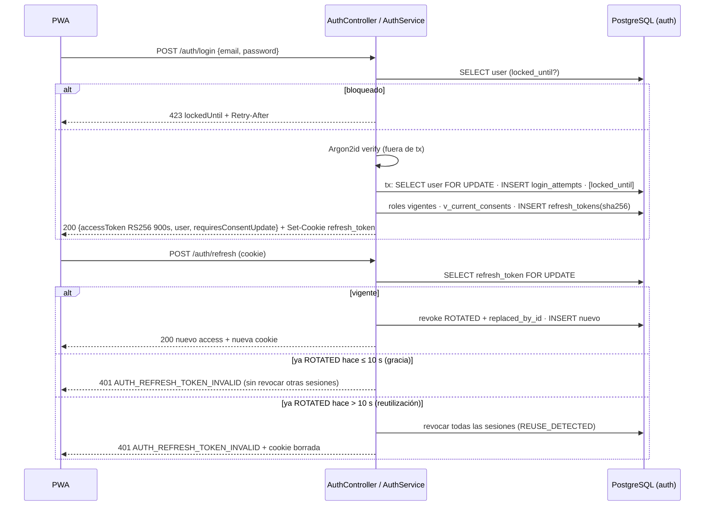

# ADR-0005: Autenticación JWT RS256, sesiones con refresh rotativo y RBAC del módulo `auth`

- **Estado:** Aceptado (2026-10-05), con ajustes de revisión: endpoints `/me/consents`, seed de política solo dev/test, bootstrap del primer `ADMIN` y ventana de gracia en la detección de reutilización
- **Proyecto / Módulo:** Intégrate · `backend-api/` — `modules/auth`, `security/` (Fase 1 · T-1.1 y T-1.2)
- **Fecha:** 2026-10-05

## Contexto
La Fase 1 abre con identidad y RBAC: todo endpoint transaccional posterior (catálogo administrable, lock de cupos, webhook, voucher) depende de un `sub` autenticado y de sus roles. El esquema `auth` ya existe (V2, V10: `users`, `roles`, `user_roles`, `privacy_policies`, `habeas_data_consents` append-only, `login_attempts`, `refresh_tokens`) y el contrato fija las reglas: access token **JWT RS256 de 900 s** con claims `sub`, `roles` (`ROLE_*`), `iat`, `exp`, `jti` y `kid` en el header; refresh token **opaco, rotativo, 7 días**, en cookie `refresh_token; HttpOnly; Secure; SameSite=Strict; Path=/api/v1/auth`, persistido solo como SHA-256; bloqueo de **15 min tras 5 fallos en 10 min** (423 + `lockedUntil`); `requiresConsentUpdate` en el login (RF-02); hash **Argon2id o BCrypt ≥ 12** (RNF-01), restringido por el `CHECK ck_users_password_hash` a `$argon2id$…` / `$2[aby]$…`.

Hay tres brechas entre documentos que esta tarea debe cerrar: (1) la especificación (§5.1) y el roadmap exigen `POST /api/v1/auth/register`, pero `openapi.yaml` no lo define; (2) no hay forma de otorgar un consentimiento por autoservicio después del registro, y el lock de reservas (T-1.4) responde 428 si falta `HEALTH_EMERGENCY`; (3) `auth.privacy_policies` está vacía, de modo que ningún registro puede referenciar una política vigente. Además, `backend_guidelines.md` §2 prevé un `JwtAuthenticationFilter` propio, y ADR-0003 dejó pendiente que los 401/403 de Spring Security salgan en `application/problem+json`.

## Decisión

### 1. Validación del access token con el *resource server* de Spring Security (sin filtro JWT propio)
- Se agrega el starter de *OAuth2 Resource Server* de Spring Boot 4 (`spring-boot-starter-security-oauth2-resource-server`; nombre y versión se verifican contra el BOM 4.1.1 al implementarlo). Aporta `BearerTokenAuthenticationFilter`, `NimbusJwtDecoder` y `NimbusJwtEncoder` sobre la Nimbus ya declarada en ADR-0002.
- `JwtAuthenticationConverter` mapea el claim `roles` tal cual a `GrantedAuthority` (`ROLE_TOURIST`, `ROLE_HOST`, `ROLE_LINK_MANAGER`, `ROLE_ADMIN`) y el `sub` a `UUID`.
- Validadores: firma RS256, `exp`/`iat` con tolerancia de 30 s, `iss = integrate-api`. Se rechaza cualquier `alg` distinto de RS256.
- Se elimina `JwtAuthenticationFilter` del árbol de `backend_guidelines.md` §2 y se reemplaza por `security/jwt/` (emisor y configuración del decoder).

### 2. Llave de firma de sesión por variable de entorno (SEC-DIR-004)
- `JWT_SIGNING_KEY` (RSA-2048 en PKCS#8 PEM, codificado en Base64 en una sola línea) y `JWT_SIGNING_KEY_ID` (el `kid`), **obligatorias y sin valor por defecto** en todos los perfiles: si faltan o la llave no es RSA ≥ 2048, el arranque aborta.
- Se parsea con `KeyFactory` del JDK (sin `bcpkix`); la llave pública se deriva de la privada (`RSAPrivateCrtKey`).
- Es una llave **distinta** de la de firma de vouchers (T-1.7), cuya pública sí se distribuye a la PWA. La de sesión nunca sale del servidor y no se publica JWKS mientras el único verificador sea el propio backend.
- `infra/env/.env.example` documenta el comando `openssl` para generar la llave local en `.env.development` (ignorado). Las pruebas generan una llave efímera en memoria.

### 3. Hash de contraseñas: Argon2id directo
- `Argon2PasswordEncoder` (BouncyCastle, ya en ADR-0002) con parámetros OWASP: memoria 19 MiB, 2 iteraciones, paralelismo 1, sal de 16 B y hash de 32 B. Produce `$argon2id$v=19$…`, compatible con el `CHECK`.
- **No** se usa `DelegatingPasswordEncoder`: su prefijo `{argon2}` viola `ck_users_password_hash`.
- Política de contraseña (NIST SP 800-63B): 12 a 128 caracteres, sin carácter nulo, sin reglas de composición.
- Si el correo no existe, se ejecuta igual una verificación contra un hash ficticio para igualar el tiempo de respuesta y no revelar qué cuentas existen.

### 4. Flujo de login (RF-01)
1. Si `locked_until > now` → **423** `AUTH_ACCOUNT_LOCKED` + `lockedUntil` + `Retry-After`, **sin** verificar la contraseña.
2. Se verifica la contraseña **fuera** de la transacción (Argon2 tarda decenas de ms y no debe retener locks ni conexiones).
3. Transacción corta con `SELECT … FOR UPDATE` sobre la fila del usuario: se inserta el intento en `login_attempts` y, si falló, se cuentan los fallos desde el último éxito dentro de los últimos 10 min; al quinto se fija `locked_until = now + 15 min`. El lock de fila evita que intentos concurrentes superen el umbral.
4. Respuestas: correo inexistente, contraseña errónea o `credential_status = PENDING_RESET` → **401** `AUTH_INVALID_CREDENTIALS`, idénticos entre sí; `status = SUSPENDED` (solo tras validar la contraseña) → **403** `AUTH_ACCOUNT_SUSPENDED`; `ANONYMIZED` o `deleted_at` no nulo → 401.
5. Éxito: `last_login_at`, roles vigentes (`user_roles.revoked_at IS NULL`), access token, refresh token y cálculo de consentimiento (§7).
- La IP se toma de `request.getRemoteAddr()`. Detrás del balanceador de AWS (Fase 4) se activará `server.forward-headers-strategy` solo para proxies de confianza.

### 5. Refresh token rotativo
- 32 bytes de `SecureRandom` en Base64URL; en BD solo `token_sha256`. Vigencia **deslizante de 7 días**: cada rotación emite un token nuevo de 7 días (`Max-Age=604800`, igual al contrato).
- `POST /refresh`: `SELECT … FOR UPDATE` del token por hash. Si está vigente → se revoca con `ROTATED`, se enlaza `replaced_by_id` y se emite un par nuevo. Se releen estado y roles del usuario, así que una suspensión o un cambio de rol se aplica en la siguiente rotación (403 si quedó `SUSPENDED`).
- **Detección de reutilización**: presentar un token ya revocado como `ROTATED` revoca **todas** las sesiones activas del usuario (`REUSE_DETECTED`) y responde 401. Como el esquema no tiene `family_id`, revocar todo es la aproximación segura a "revocar la familia".
- **Ventana de gracia (10 s, `auth.refresh.reuse-grace`)**: si el token rotado se presenta dentro de los 10 s siguientes a su rotación, se responde 401 **sin** revocar las demás sesiones. Cubre dos pestañas que refrescan a la vez y los reintentos de red en campo; pasada la ventana, la reutilización se trata como robo. La PWA, además, serializa el refresh entre pestañas con `navigator.locks` (T-1.8).
- Token desconocido, expirado o revocado → **401** `AUTH_REFRESH_TOKEN_INVALID` y la cookie se borra.
- **CSRF**: los endpoints que usan la cookie (`/auth/refresh`, `/auth/logout`) quedan protegidos por `SameSite=Strict`, por el `Path` restringido y porque la respuesta solo la puede leer el origen permitido por CORS. Spring Security corre en modo *stateless* con CSRF desactivado; ningún endpoint autenticado por cookie modifica datos de negocio.

### 6. Contrato: cuatro endpoints nuevos en `openapi.yaml` y `dtos_contrato_api.md`
| Método | Ruta | Seguridad | Éxito | Errores |
|---|---|---|---|---|
| POST | `/api/v1/auth/register` | público | 201 `RegisterResponse` `{userId, email, roles: [ROLE_TOURIST]}` + `Location` | 400, 409 `AUTH_USER_ALREADY_EXISTS`, 422 |
| POST | `/api/v1/auth/logout` | cookie `refresh_token` | 204, cookie borrada (idempotente) | — |
| GET | `/api/v1/me/consents` | `bearerAuth` | 200 `ConsentStatusResponse` | 401 |
| POST | `/api/v1/me/consents` | `bearerAuth` | 200 `ConsentStatusResponse` | 400, 401, 422 |

- **Registro**: autoservicio **solo para `TOURIST`**. El campo `role` del ejemplo de la especificación se elimina, porque permitiría escalar privilegios. Los anfitriones entran por `register-assisted` y los gestores y administradores por asignación del administrador. El cuerpo lleva `email, password, fullName, docType, docNumber, phone, consent{policyVersion, purposes}`; `purposes` debe incluir `PERSONAL_DATA` y `policyVersion` debe ser la vigente, si no → 422 (RF-02, "rechazo de política"). Usuario, rol y consentimiento (`channel = SELF_SERVICE`) se crean en una sola transacción. Si el correo (sin distinguir mayúsculas) o el documento ya existen → 409, también cuando la colisión la detecta el índice único en una carrera. No inicia sesión: el cliente llama después a `/login`, que sigue siendo el único punto que emite tokens y cookies. El 409 revela que la cuenta existe; evitarlo exige verificar el correo antes de crear la cuenta, lo que depende de la notificación de T-1.7 (mejora de la Fase 4).
- **Logout**: revoca el refresh token presentado con `LOGOUT` y borra la cookie. Si la cookie falta o no es válida, responde 204 igual.
- **Consentimientos (`/me`, porque son datos del titular y no de la sesión)**: `GET` devuelve, por finalidad aplicable al usuario, si está vigente para la política actual, la versión vigente y las finalidades pendientes. La PWA lo usa antes de reservar para mostrar el modal en lugar de recibir un 428. `POST {policyVersion, purposes}` otorga finalidades de la política vigente (`PERSONAL_DATA`, `HEALTH_EMERGENCY`; `SENSITIVE_VICTIM` solo si tiene `ROLE_HOST`, si no → 422). Inserta una fila append-only por finalidad, omite las que ya están vigentes (idempotente) y devuelve el estado resultante. Resuelve la revalidación tras un cambio de versión (RF-02) y la precondición 428 del lock (T-1.4). La revocación (`REVOKED`) queda para la Fase 4.

### 7. Consentimiento en el login
`requiresConsentUpdate` se calcula con `auth.v_current_consents` sobre las finalidades **exigidas por rol**: `PERSONAL_DATA` para todos y además `SENSITIVE_VICTIM` para `ROLE_HOST`. `HEALTH_EMERGENCY` **no** se exige en el login: es precondición del lock (428). El login no se bloquea: la obligación de revalidar "antes de transar" la hacen cumplir los endpoints transaccionales.

### 8. Política vigente: seed solo en dev/test; la `v1.0` real llega por migración
- Una política publicada es inmutable (`trg_privacy_policy_freeze`) y Flyway fija el checksum de cada migración. Por eso un texto legal en borrador **no** entra en las migraciones de todos los entornos.
- **Ahora**: `db/seed-dev/R__dev_privacy_policy.sql`, un script repetible e idempotente (`ON CONFLICT (version) DO NOTHING`, y solo marca `is_current` si no hay otra vigente). Inserta `v0.1` "Borrador de desarrollo — no apto para producción" con un `content_sha256` del texto de prueba. Esa ubicación se agrega a `spring.flyway.locations` **solo** en los perfiles `dev` y `test`.
- **Antes del despliegue (Fase 4)**: cuando el equipo apruebe el texto, la `v1.0` real entra como migración versionada en todos los entornos. Las versiones siguientes siguen el mismo camino; el panel de administración de políticas no entra en esta tarea.

### 9. RBAC y cadena de seguridad
- `SecurityFilterChain` *stateless*: públicos `/api/v1/auth/{login,register,refresh,logout}`; todo lo demás autenticado por defecto (*deny by default*). Los endpoints públicos de catálogo se abren en su propio ADR.
- Autorización con reglas por URL y `@PreAuthorize("hasRole('ADMIN')")` (`@EnableMethodSecurity`).
- `AuthenticationEntryPoint` y `AccessDeniedHandler` delegan en el `HandlerExceptionResolver`, así que los 401 y 403 de la cadena de filtros salen por `GlobalExceptionHandler` en RFC 9457 con `traceId`. Esto cierra lo pendiente de ADR-0003.
- CORS: lista blanca por la propiedad `CORS_ALLOWED_ORIGINS` (en local, el proxy de Vite hace todo *same-origin*).
- **Primer `ADMIN` (`AdminBootstrapRunner`)**: un `ApplicationRunner` que solo se activa si existen `BOOTSTRAP_ADMIN_EMAIL` y `BOOTSTRAP_ADMIN_PASSWORD`. Valida la contraseña con la misma política del registro. Es idempotente: no hace nada si ya existe un `ADMIN` vigente; si no, crea el usuario con roles `ADMIN` y `TOURIST`. Registra en el log que lo creó (nunca la contraseña). Las variables solo viven en el `.env` local o en Secrets Manager y se retiran tras el primer arranque (SEC-DIR-004). `full_name`, `doc_type`, `doc_number` y `phone` se toman de `BOOTSTRAP_ADMIN_*` opcionales, con valores neutros por defecto.
- **Fuera de alcance**: los endpoints de administración de roles y suspensión (RF-03) y `register-assisted` (RF-06), que requieren `catalog.host_profiles`, AES-GCM y S3 y pertenecen a T-3.4/T-3.5.

### 10. Actor de la transacción para PostgreSQL
Las columnas `created_by` y los historiales leen `common.current_actor()` (`integrate.actor_id`). Un aspecto ordenado **dentro** de la transacción ejecuta `set_config('integrate.actor_id', :uuid, true)` con el `sub` autenticado, con alcance de transacción y sin fugas entre conexiones del pool. En el autorregistro queda `NULL`, como dice el comentario de `auth.users.created_by`.

### 11. Estructura y entidades
```text
modules/auth/
├── controller/AuthController            # login, register, refresh, logout
├── controller/MeConsentController       # GET/POST /api/v1/me/consents
├── bootstrap/AdminBootstrapRunner       # primer ADMIN por variables de entorno
├── dto/request|response/                # records del contrato (+ validadores de clase)
├── entity/                              # User, Role, UserRole, PrivacyPolicy, HabeasDataConsent, LoginAttempt, RefreshToken
├── repository/                          # incluye findByIdForUpdate / findByTokenSha256ForUpdate (PESSIMISTIC_WRITE)
└── service/ (+ impl/)                   # AuthService, RegistrationService, ConsentService, PasswordPolicy
security/
├── SecurityConfig, ProblemAuthenticationEntryPoint, ProblemAccessDeniedHandler, ActorPropagationAspect
└── jwt/ JwtKeyProperties, AccessTokenIssuer (puerto usado por auth), JwtDecoderConfig
```
- Mapeos: `INET` → `java.net.InetAddress`; los dominios `common.*` como `String` (se verifica que `ddl-auto: validate` los acepte, con `columnDefinition` si hiciera falta); enums de estado como `@Enumerated(STRING)`. Las relaciones son escalares (`UUID userId`) también dentro del esquema, por simplicidad y para evitar cargas perezosas en el filtro.
- `ErrorCode` no cambia: los códigos `AUTH_*` ya existen.

### 12. Pruebas (criterio de aceptación de T-1.1/T-1.2)
- **Integración con Testcontainers (PostgreSQL 16 + Flyway V1–V10 + seed dev)**: login correcto (claims, cookie y atributos); 5 fallos → 423 con `lockedUntil`; login durante el bloqueo sin verificar contraseña; 401 idéntico para correo inexistente y contraseña errónea; 403 para suspendido; rotación (el token viejo queda `ROTATED` con `replaced_by_id`); reutilización dentro de la ventana de gracia → 401 sin revocar otras sesiones; fuera de ella → todas las sesiones `REUSE_DETECTED`; logout idempotente; registro con 201, 409 por duplicado (correo con otra capitalización) y 422 sin consentimiento o con política no vigente; `requiresConsentUpdate` y `GET /me/consents` tras publicar una política nueva de prueba; `POST /me/consents` idempotente y 422 para `SENSITIVE_VICTIM` sin `ROLE_HOST`; bootstrap del `ADMIN` (crea una vez, no duplica, inactivo sin variables).
- **Unitarias**: emisor y decoder (`alg`, `kid`, expiración, `iss`), política de contraseña y parseo de la llave (formato inválido, RSA < 2048).
- **MVC/Security**: 401 y 403 en problem+json con `X-Trace-Id`; ruta protegida sin token; rol insuficiente.
- **ArchUnit**: `modules.auth.controller` no depende de `repository`; `security` no depende de `modules.*.repository`.

## Alternativas Descartadas
- **`JwtAuthenticationFilter` propio (guía §2):** reimplementa la extracción del *bearer*, la validación de firma y las excepciones que Spring Security ya resuelve y prueba. Es más superficie de error en el componente más sensible.
- **JWT HS256 con secreto compartido:** el contrato exige RS256 con `kid`. Un secreto simétrico obliga a compartirlo con cualquier verificador futuro.
- **Llave de sesión efímera generada al arrancar en `dev`:** cada reinicio invalidaría las sesiones de la PWA y el comportamiento divergiría entre perfiles. Se prefiere una variable obligatoria uniforme.
- **BCrypt (costo 12):** válido según RNF-01, pero Argon2id es *memory-hard* y ya está en el stack (ADR-0002). BCrypt además trunca a 72 bytes, por debajo del máximo de 128 caracteres.
- **Sesión absoluta de 7 días (el token heredado conserva el `expires_at` original):** más estricta, pero cierra la sesión del gestor en campo a mitad de jornada. Se deja como endurecimiento opcional de la Fase 4.
- **Refresh token en el cuerpo o en `localStorage`:** queda expuesto a XSS; el contrato fija la cookie `HttpOnly`.
- **Elegir el rol en el autorregistro (`role` del ejemplo de la especificación):** permitiría registrarse como `ADMIN` o `LINK_MANAGER`.
- **Registrar sin política sembrada (consentimiento sin `policy_id`):** viola la FK y RF-02 (prueba de qué versión aceptó el titular).
- **Política `v1.0` en borrador como migración versionada (V11):** dejaría para siempre un texto legal no aprobado en el historial de producción (trigger de inmutabilidad y checksum de Flyway).
- **Primer `ADMIN` con contraseña en un seed SQL:** viola SEC-DIR-004.
- **Consulta del estado del usuario en cada petición para aplicar la suspensión al instante:** una consulta a la BD por request; el refresh ya relee el estado cada 15 min como máximo.
- **Reutilización sin ventana de gracia:** expulsaría a usuarios legítimos con pestañas concurrentes o reintentos de red en campo.

## Consecuencias
- **Positivas:** validación de tokens delegada en componentes maduros de Spring Security; RF-01 completo (bloqueo, rotación, detección de reutilización) verificado contra PostgreSQL real; RF-02 operativo (registro con consentimiento, revalidación y precondición del lock); 401/403 coherentes con RFC 9457; el actor queda propagado a la BD para los historiales de las fases siguientes; ningún secreto en el repositorio.
- **Negativas / Riesgos asumidos:**
  - El access token es *stateless*: una suspensión o revocación de rol tarda hasta 15 min en surtir efecto.
  - La ventana de gracia de 10 s debilita de forma acotada la detección de reutilización: un token robado y usado dentro de esos 10 s solo recibe 401, sin revocar la sesión legítima. La PWA serializa el refresh con `navigator.locks` (T-1.8).
  - El 423 y el 409 revelan que la cuenta existe; lo impone el contrato. La limitación por IP (`ix_login_attempts_ip`) queda para el endurecimiento de la Fase 4.
  - Se modifican `openapi.yaml`, `dtos_contrato_api.md`, `especificacion_tecnica.md` §5.1 (sin `role`), `backend_guidelines.md` §2 y `.env.example` (`JWT_SIGNING_KEY`, `JWT_SIGNING_KEY_ID`, `CORS_ALLOWED_ORIGINS`, `BOOTSTRAP_ADMIN_*`).
  - Se añade una dependencia (el starter del *resource server*). **Bloqueante para producción**: sin la migración de la `v1.0` aprobada, el registro en `prod` responde 422 porque no hay política vigente.
  - Las pruebas de integración requieren Docker en la máquina de desarrollo y en CI.

## Contrato o Esquema Conceptual


## Notas de implementación (T-1.1 / T-1.2, 2026-10-05)
Desviaciones respecto del texto aceptado, sin cambio de decisión:
- **§10 Actor:** en lugar de un aspecto AOP (requería añadir `spring-boot-starter-aspectj`), `ActorPropagatingTransactionManager` extiende el `JpaTransactionManager` y ejecuta `set_config('integrate.actor_id', :sub, true)` en `doBegin`. Reemplaza al autoconfigurado (`@ConditionalOnMissingBean`) y cubre cualquier transacción, sea declarativa o con `TransactionTemplate`.
- **§11 Puerto de emisión:** la interfaz `AccessTokenIssuer` vive en `modules/auth/service` (puerto del módulo) y su implementación `JwtAccessTokenIssuer` en `security/jwt`, para que `auth` no dependa de `security`.
- **§11 Mapeos:** los dominios `common.*` se declaran en `columnDefinition` (`PgDomains`) porque PostgreSQL los reporta como `Types.DISTINCT` y `ddl-auto: validate` los rechazaba.
- **§9 Bearer en endpoints públicos:** en `POST /api/v1/auth/{login,register,refresh,logout}` se ignora la cabecera `Authorization` (`PublicAuthEndpoints` como `BearerTokenResolver`). Sin esto, la PWA que llama a `/refresh` con su access token ya expirado recibiría 401 del filtro antes de llegar al controlador.