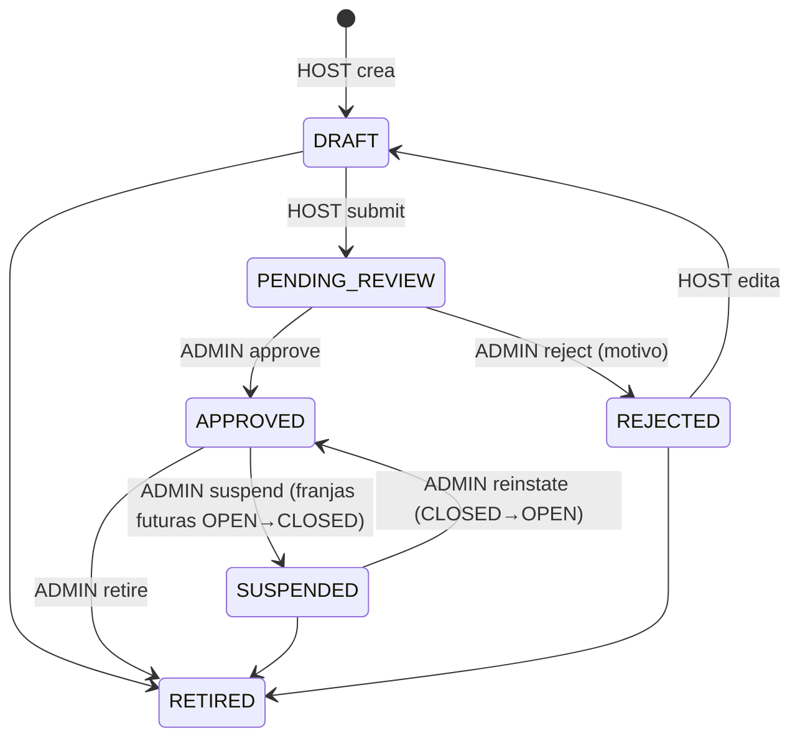

# ADR-0006: Catálogo territorial — experiencias, franjas, moderación y consulta pública

- **Estado:** Aceptado (2026-10-07), con autorización para descargar el listado DIVIPOLA de datos.gov.co
- **Proyecto / Módulo:** Intégrate · `backend-api/` — `modules/catalog` (Fase 1 · T-1.3)
- **Fecha:** 2026-10-05

## Contexto
T-1.3 debe dejar el catálogo listo para que el motor de reservas (T-1.4) tenga franjas `OPEN` de experiencias `APPROVED` sobre las cuales bloquear cupos, y para que la PWA (T-1.8) muestre el catálogo público (RF-04). El esquema `catalog` (V3) ya modela experiencias, franjas, categorías, imágenes, asociaciones y perfiles. Sus triggers imponen la máquina de estados de la experiencia (`DRAFT → PENDING_REVIEW → APPROVED | REJECTED`, `APPROVED ↔ SUSPENDED`, `→ RETIRED`), el tope de aforo de la franja frente a `max_capacity_per_slot` (1–30) y el historial append-only con actor y motivo (`integrate.actor_id`, `integrate.status_reason`). El contrato solo define `GET /experiences/{id}/availability`; la especificación (§5.2) menciona además `GET /experiences` con filtros, sin esquema.

Hay tres bloqueos para publicar siquiera una experiencia: (1) `catalog.municipalities` está **vacía** (V3 la deja para "una migración de datos posterior", supuesto S5 del modelo relacional) y `experiences.municipality_code` es FK obligatoria; (2) toda experiencia exige un `host_profiles.id` que a su vez exige una `community_associations.id`, y hoy ningún endpoint crea asociaciones ni perfiles (el registro asistido es T-3.5); (3) los flujos del Gestor de Enlace (registro asistido de experiencias RF-06, revisión RF-07 por el gestor y jurisdicción RF-03) dependen de `host_manager_assignments`, que el roadmap sitúa en la Fase 3 (T-3.4/T-3.5).

## Decisión

### 1. Alcance de T-1.3: anfitrión autónomo + moderación del administrador
- **Entra**: RF-04 (consulta pública), RF-05 (el anfitrión registra y edita sus propuestas), RF-07 (revisión **por el administrador**), RF-08 (suspensión, reactivación y retiro por el administrador) y la gestión de franjas por el anfitrión.
- **Se difiere a la Fase 3** (T-3.4/T-3.5): todo lo del Gestor de Enlace (RF-06, revisión RF-07 por el gestor, asignaciones RF-03) y los datos de víctima del anfitrión (AES-GCM, T-4.1).
- **Se difiere a después de T-1.7** (cuando exista el cliente S3): las imágenes (`experience_images`, subida con URL prefirmada y `alt_text` obligatorio). La PWA usa un marcador visual mientras tanto.

### 2. Municipios DIVIPOLA por migración versionada (`V11__divipola_municipalities.sql`)
Se genera a partir del listado oficial DIVIPOLA del DANE publicado en datos.gov.co (datos abiertos): unos 1.120 municipios, con `code` de 5 dígitos, `department_code` y nombre. Es dato de referencia real, igual en todos los entornos, y se carga con `ON CONFLICT (code) DO NOTHING`. El archivo fuente se descarga una vez y se cita en la cabecera de la migración (URL, fecha de corte y conteo). **Requiere autorizar la descarga** (ver Consecuencias).

### 3. Alta de asociaciones y anfitriones por el administrador (RF-03, mínimo viable)
| Método | Ruta | Rol | Éxito |
|---|---|---|---|
| POST | `/api/v1/admin/associations` | `ADMIN` | 201 |
| GET | `/api/v1/admin/associations` | `ADMIN` | 200 (paginado) |
| POST | `/api/v1/admin/host-profiles` `{userId, associationId}` | `ADMIN` | 201 |

- Dar de alta un anfitrión = crear su `host_profiles` (sin datos de víctima) y otorgarle el rol `HOST` en `auth.user_roles`, en una sola transacción. El módulo `catalog` lo pide a la interfaz pública de `auth` (`RoleAssignmentService.grant`), nunca a sus repositorios (guía §5.1).
- El usuario debe existir y estar `ACTIVE`. Si ya tiene un perfil vigente → 409 (índice `uq_host_profiles_user_active`). Si la asociación no está `ACTIVE` → 409.
- No se exponen edición, baja de asociaciones ni gestión de gestores en esta tarea.

### 4. Experiencias: autoría del anfitrión y máquina de estados
| Método | Ruta | Rol | Notas |
|---|---|---|---|
| POST | `/api/v1/host/experiences` | `HOST` | Crea en `DRAFT` para el perfil vigente del invocador |
| GET | `/api/v1/host/experiences` | `HOST` | Las propias, cualquier estado |
| GET / PUT | `/api/v1/host/experiences/{id}` | `HOST` (titular) | Edición solo en `DRAFT` o `REJECTED` |
| POST | `/api/v1/host/experiences/{id}/submit` | `HOST` (titular) | `DRAFT → PENDING_REVIEW` (desde `REJECTED` pasa primero a `DRAFT` al editar) |
| GET | `/api/v1/admin/experiences?status=` | `ADMIN` | Cola de revisión (`ix_experiences_review_queue`) |
| POST | `/api/v1/admin/experiences/{id}/approve` | `ADMIN` | `PENDING_REVIEW → APPROVED` |
| POST | `/api/v1/admin/experiences/{id}/reject` `{reason}` | `ADMIN` | `→ REJECTED`; motivo obligatorio (RF-07) |
| POST | `/api/v1/admin/experiences/{id}/suspend` `{reason}` | `ADMIN` | `APPROVED → SUSPENDED` + franjas futuras `OPEN → CLOSED` (RF-08) |
| POST | `/api/v1/admin/experiences/{id}/reinstate` | `ADMIN` | `SUSPENDED → APPROVED` + franjas futuras `CLOSED → OPEN` |
| POST | `/api/v1/admin/experiences/{id}/retire` `{reason}` | `ADMIN` | `→ RETIRED`; franjas futuras `→ CLOSED` |

- Las transiciones se validan **en el servicio** antes del `UPDATE` y responden 409 `CATALOG_INVALID_STATUS_TRANSITION` (nuevo código). El trigger `fn_experience_guard` queda como segunda línea de defensa.
- Titularidad: el anfitrión solo ve y modifica experiencias de su perfil vigente. Una ajena responde **404**, no 403, para no revelar que existe.
- El motivo de cada transición viaja a la bitácora con `set_config('integrate.status_reason', :reason, true)` en la misma transacción. El actor ya lo propaga el `ActorPropagatingTransactionManager` (ADR-0005 §10).
- Campos editables: `title`, `description`, `safetyGuidelines`, `physicalIntensity`, `durationMinutes`, `municipalityCode`, `vereda`, `meetingPoint`, `latitude/longitude`, `maxCapacityPerSlot` (1–30), `unitPriceCop` (> 0, entero), `categoryCodes[]`. `timezone` queda fija en `America/Bogota` (el contrato la declara constante).
- Si el anfitrión baja `maxCapacityPerSlot` por debajo del aforo de franjas futuras abiertas, responde 422 antes de que lo rechace el trigger.

### 5. Franjas (`schedules`)
| Método | Ruta | Rol | Notas |
|---|---|---|---|
| POST | `/api/v1/host/experiences/{id}/schedules` | `HOST` (titular) | Lote de 1 a 60 franjas `{localStart, localEnd, totalSlots}` |
| GET | `/api/v1/host/experiences/{id}/schedules?dateFrom&dateTo` | `HOST` (titular) | Todas, cualquier estado |
| POST | `/api/v1/host/schedules/{id}/cancel` `{reason}` | `HOST` (titular) | `OPEN/CLOSED → CANCELLED` |

- Se crean en experiencias `DRAFT`, `PENDING_REVIEW`, `REJECTED` o `APPROVED`, y siempre en el futuro. Las horas llegan como **hora local** (`America/Bogota`) y se guardan en UTC. `totalSlots ≤ maxCapacityPerSlot`.
- El lote es atómico. Una franja duplicada (`uq_schedules_experience_start`) responde 409 `CATALOG_SCHEDULE_CONFLICT` (nuevo código) e indica cuál en `invalidParams`.
- **Cancelar una franja con cupos vendidos** (`available_slots < total_slots`) responde 409 en esta fase. El flujo de contingencia y reembolso (RF-08, política de 72 h) llega en la Fase 3; mientras tanto, el administrador puede suspender la experiencia, lo que cierra las franjas sin tocar reservas.

### 6. Consulta pública (RF-04) — sin JWT
| Método | Ruta | Notas |
|---|---|---|
| GET | `/api/v1/experiences` | Solo `APPROVED` y sin `deleted_at`. Filtros: `departmentCode`, `municipalityCode`, `category`, `intensity`, `q` (título, `pg_trgm`), `dateFrom`/`dateTo` + `minSlots` (al menos una franja `OPEN` futura con cupos). Paginado. |
| GET | `/api/v1/experiences/{id}` | Detalle público; 404 si no está `APPROVED` |
| GET | `/api/v1/experiences/{id}/availability` | Tal como ya está en el contrato (404/409, máximo 60 días, hora local) |
| GET | `/api/v1/catalog/categories` | Catálogo de categorías |
| GET | `/api/v1/catalog/departments` y `/api/v1/catalog/departments/{code}/municipalities` | Para los filtros y el formulario del anfitrión |

- **Privacidad (R-05):** las respuestas públicas muestran la asociación (`legalName`) y el municipio, **nunca** el nombre, el documento ni ningún dato del anfitrión. La condición de víctima no se infiere de ningún campo público.
- **Paginación común** (`common/payload/PageResponse`): `?page=0&size=20` (máximo 50) → `{items, page, size, totalElements, totalPages}`. Orden estable por `created_at DESC, id`.
- **JWT en endpoints públicos:** sin token se atiende como anónimo. Con un token válido se aplican las reglas por rol de `availability` (409 para `ADMIN`). Con un token inválido o expirado se responde 401, y la PWA renueva la sesión antes de reintentar (mismo criterio que el resto de la API).
- `availableSlots` es una lectura sin bloqueo; la garantía de cupo solo la da `POST /bookings/lock` (T-1.4).

### 7. Errores, contrato y estructura
- Tres `ErrorCode` nuevos, todos 409: `CATALOG_INVALID_STATUS_TRANSITION` (`invalid-status-transition`), `CATALOG_SCHEDULE_CONFLICT` (`schedule-conflict`) y `CATALOG_HOST_PROFILE_EXISTS` (`host-profile-exists`, perfil vigente duplicado o asociación no activa). Se reutilizan `RESOURCE_NOT_FOUND`, `VALIDATION_FAILED` y `CATALOG_EXPERIENCE_NOT_APPROVED`.
- Se agregan a `openapi.yaml` y `dtos_contrato_api.md` todos los endpoints de §3–§6 con sus esquemas.
- Estructura: `modules/catalog/{controller (Public, Host, Admin), dto, entity, repository, service(+impl)}`. Las entidades usan relaciones escalares; los dominios `common.*` se declaran en `columnDefinition` como en `auth`. `auth` expone `RoleAssignmentService` como interfaz pública. La consulta pública con filtros usa JPQL dinámico por `Specification` (sin SQL nativo, salvo el filtro `q` por `pg_trgm`).
- `catalog.schedules` se mapea aquí, pero sus mutaciones de cupos (`available_slots`) pertenecen al motor de reservas (T-1.4) y no se exponen en este módulo.

### 8. Pruebas (criterio de aceptación de T-1.3)
- **Integración (Testcontainers):** alta de asociación y anfitrión (rol `HOST` otorgado, 409 por perfil duplicado); ciclo completo `DRAFT → PENDING_REVIEW → REJECTED (motivo) → DRAFT → PENDING_REVIEW → APPROVED → SUSPENDED → APPROVED`; transiciones inválidas → 409; historial con actor y motivo correctos; aislamiento entre anfitriones (404); franjas (conversión hora local → UTC, tope de aforo, lote atómico, duplicado 409, cancelación con cupos vendidos 409); suspensión cierra y reactivación reabre solo las franjas futuras; la consulta pública solo ve `APPROVED`, filtra por municipio, categoría, intensidad, texto y cupos, y no expone datos del anfitrión; `availability` con sus 404/409/422 y el límite de 60 días.
- **ArchUnit:** `catalog` no depende de `auth.repository` ni de `auth.entity`.

## Alternativas Descartadas
- **Seed de municipios solo en dev (unos pocos):** destraba el desarrollo, pero deja producción sin poder crear experiencias y duplica el trabajo después. DIVIPOLA es dato público y estable: corresponde a una migración real.
- **Adelantar el registro asistido (T-3.5) para crear anfitriones:** arrastra cifrado AES-GCM, S3 y el consentimiento `ASSISTED_PROXY` a la Fase 1. El alta mínima por administrador cubre el MVP sin datos sensibles.
- **Que el anfitrión se autodeclare (`role` en el registro):** escalada de privilegios. Ya se descartó en ADR-0005 §6.
- **Revisión RF-07 también por el Gestor de Enlace en esta fase:** exige jurisdicción (`host_manager_assignments`), que es Fase 3.
- **Validar transiciones solo con el trigger:** el error llegaría como `check_violation` genérico (500 o un mapeo frágil por mensaje). Validar antes en el servicio da un 409 con código estable.
- **Responder 403 ante experiencias ajenas:** revela qué identificadores existen.
- **Búsqueda con Elasticsearch u OpenSearch:** desproporcionado para el volumen del MVP. `pg_trgm` y los índices parciales de V3 bastan.

## Consecuencias
- **Positivas:** el turista puede descubrir y consultar experiencias reales con su disponibilidad; el motor de reservas (T-1.4) recibe franjas `OPEN` con aforo consistente; la moderación queda trazada (actor y motivo); los datos del anfitrión no aparecen en las respuestas públicas; el catálogo territorial es el oficial del DANE.
- **Negativas / Riesgos asumidos:**
  - **Requiere autorización para descargar** el listado DIVIPOLA de datos.gov.co (unos 1.120 registros, datos abiertos del DANE). Sin él, T-1.3 solo puede avanzar con un seed parcial de desarrollo.
  - En la Fase 1, el Gestor de Enlace no participa en el catálogo. Sus flujos (RF-06, RF-07 compartido, RF-03) llegan completos en la Fase 3.
  - Sin imágenes hasta después de T-1.7.
  - Cancelar una franja con reservas queda bloqueado hasta la Fase 3; la vía de contingencia es suspender la experiencia.
  - Se agregan unos 20 endpoints al contrato y tres códigos de error.

## Contrato o Esquema Conceptual

```text
modules/catalog/
├── controller/  PublicCatalogController · HostExperienceController · AdminCatalogController
├── dto/         request/ · response/ (ExperienceSummary, ExperienceDetail, ExperienceAvailabilityResponse, …)
├── entity/      Experience, Schedule, Category, ExperienceCategory, CommunityAssociation, HostProfile, Department, Municipality
├── repository/  … + ExperienceSpecifications (filtros públicos)
└── service/     CatalogQueryService · HostExperienceService · CatalogModerationService · CatalogAdminService (+ impl/)
modules/auth/service/RoleAssignmentService   ← interfaz pública usada por catalog
```

## Notas de implementación (T-1.3, 2026-10-07)
Desviaciones respecto del texto aceptado, sin cambio de decisión:
- **§2 DIVIPOLA:** `V11__divipola_municipalities.sql` se generó a partir de `https://www.datos.gov.co/resource/gdxc-w37w.json` (descargado el 2026-10-07): 1.122 entidades (1.103 municipios, 18 áreas no municipalizadas y 1 isla). Sus 33 códigos de departamento coinciden con los de V3. Los nombres se conservan como los publica el DANE (en mayúsculas); la capitalización es tarea del cliente.
- **§7 Errores:** se agregó un cuarto código, `CATALOG_ASSOCIATION_EXISTS` (409, `association-exists`), para NIT o RNT duplicados. Reutilizar `CATALOG_HOST_PROFILE_EXISTS` habría dado un código engañoso.
- **§7 ArchUnit:** la regla prohíbe que `catalog` dependa de `auth.repository`, `auth.service.impl` y `auth.controller`. Sí puede usar `auth.entity.RoleCode`, que es el tipo del parámetro de `RoleAssignmentService.grant`.
- **§6 Paginación:** `PageResponse` vive en `common/payload` y `PageRequests` en `common/web`. El orden es siempre `created_at DESC, id`.
- **§5 Franjas:** `localStart`/`localEnd` aceptan `HH:mm` o `HH:mm:ss`. Las respuestas siempre incluyen los segundos.

## Nota de renumeración y enmienda de alcance (2026-10-07)
Con la reorganización en dos etapas, **este ADR corresponde a T-1.4** (no a T-1.3, como dicen el encabezado, §1, §8 y el commit `436e760`). Equivalencias del resto de referencias:

| En este ADR | Ahora | Tarea |
|---|---|---|
| T-1.3 (esta tarea) | **T-1.4** | Catálogo territorial |
| T-1.4 (motor de reservas, `POST /bookings/lock`) | **T-1.5** | Bloqueo pesimista |
| T-1.7 (cliente S3, imágenes después) | **T-1.8** | Voucher (primer uso de S3) |
| T-1.8 (PWA) | **T-1.10** | Frontend PWA móvil |
| T-3.4/T-3.5 (Gestor de Enlace, registro asistido) | **T-1.3** | Enrolamiento asistido |
| T-4.1 (AES-GCM) | **T-1.3** (datos de víctima) / **T-2.12** (auditoría) | — |

**Enmienda de §1:** el registro asistido y los datos de víctima del anfitrión ya **no se difieren a la Fase 3**: llegan con **T-1.3 (Etapa 1)**, que tendrá su propio ADR. Siguen en la Etapa 2 la revisión RF-07 por el gestor y la creación de experiencias a nombre de anfitriones (DoD de la Fase 3), y el flujo de contingencia para cancelar franjas con reservas (Fase 3, política de 72 h). El alta mínima por administrador de §3 se conserva: convive con el enrolamiento asistido.
