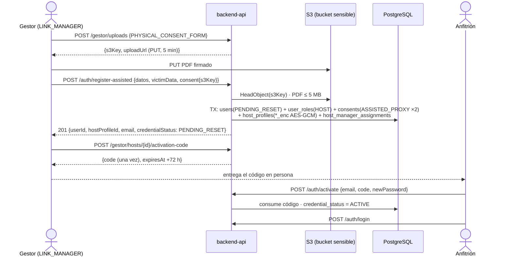

# ADR-0007: Enrolar anfitriones por intermediación del Gestor de Enlace con datos de víctima cifrados y consentimiento asistido

- **Estado:** Aceptado (2026-10-07)
- **Proyecto / Módulo:** Intégrate · `backend-api/` — `modules/catalog`, `modules/auth`, `common/crypto`, `common/storage` (Etapa 1 · Fase 1.1 · T-1.3)
- **Fecha:** 2026-10-07

## Contexto

T-1.3 debe permitir que un Gestor de Enlace acreditado registre a un anfitrión comunitario sin conectividad ni alfabetización digital, lo vincule a su asociación y deje constancia inmutable del consentimiento Habeas Data (Ley 1581/2012) y del tratamiento de datos de víctima (Ley 1448/2011). El esquema ya lo soporta: `catalog.host_profiles` tiene columnas `*_enc` (`common.ciphertext`: IV de 12 bytes ‖ texto cifrado ‖ tag de 16, V1) con `sensitive_key_version`; `catalog.link_manager_profiles` modela la acreditación (`ACTIVE | SUSPENDED | REVOKED`); `catalog.host_manager_assignments` impone "misma asociación" con FK compuestas y prohíbe solapamientos con `EXCLUDE`; `auth.habeas_data_consents` acepta `channel = ASSISTED_PROXY` solo con `captured_by` y `physical_consent_form_s3_key` (V10); `auth.users.credential_status = PENDING_RESET` bloquea el login (ADR-0005). El contrato congelado define `POST /api/v1/auth/register-assisted` (`openapi.yaml`, `dtos_contrato_api.md` §3.3–3.4).

Hay cinco huecos que impiden implementar el contrato tal cual: (1) **no existe ningún gestor**: nada crea `link_manager_profiles` ni otorga `ROLE_LINK_MANAGER`; (2) el formato físico firmado debe estar "subido previamente" a S3, pero **no hay forma de subirlo** ni dependencia de AWS en el backend; (3) no hay **llave ni componente de cifrado** AES-GCM; (4) un anfitrión creado con `PENDING_RESET` **nunca podrá iniciar sesión**, porque no existe el "restablecimiento asistido" que el contrato menciona; (5) el backlog nombra la tarea por `/api/v1/gestor/hosts`, ruta que el contrato no define.

## Decisión

### 1. Alcance y rutas

Se respeta el contrato: el registro va por **`POST /api/v1/auth/register-assisted`**. El prefijo **`/api/v1/gestor/**`** (`ROLE_LINK_MANAGER`) agrupa las operaciones de trabajo del gestor y cubre la ruta del backlog.

| Método | Ruta | Rol | Respuesta |
|---|---|---|---|
| POST | `/api/v1/auth/register-assisted` | `LINK_MANAGER`, `ADMIN` | 201 (contrato vigente) |
| POST | `/api/v1/gestor/uploads` `{kind}` | `LINK_MANAGER`, `ADMIN` | 201 `{s3Key, uploadUrl, expiresAt}` |
| GET | `/api/v1/gestor/hosts` | `LINK_MANAGER` | 200 `PageResponse` de anfitriones con asignación vigente |
| POST | `/api/v1/gestor/hosts/{hostProfileId}/activation-code` | `LINK_MANAGER` | 201 `{code, expiresAt}` |
| POST | `/api/v1/auth/activate` `{email, code, newPassword}` | público | 204 |
| POST | `/api/v1/admin/link-managers` `{userId, associationId, accreditedOn}` | `ADMIN` | 201 |
| POST | `/api/v1/admin/link-managers/{id}/{suspend\|reinstate\|revoke}` | `ADMIN` | 200 |

`GET /gestor/hosts` devuelve nombre, teléfono, correo, asociación y estado de credencial; **nunca** datos de víctima ni el documento completo (se muestran los 4 últimos dígitos).

### 2. Acreditación de gestores por el administrador (RF-03)

Igual que el alta de anfitriones de ADR-0006 §3, para un usuario existente y en una sola transacción: crear `link_manager_profiles` (`ACTIVE`, `accredited_by` = administrador) y otorgar `ROLE_LINK_MANAGER` mediante `RoleAssignmentService.grant`. Un usuario tiene a lo sumo una acreditación vigente (índice `uq_link_manager_user_active`), o el sistema responde 409. `suspend`, `reinstate` y `revoke` cambian `accreditation_status` (`REVOKED` es terminal). Un gestor sin acreditación `ACTIVE` recibe 403 `ENROLLMENT_MANAGER_NOT_ACTIVE` en todo `/gestor/**` y en `register-assisted`, aunque su JWT conserve el rol.

### 3. Registro asistido: una sola transacción

1. **Gestor efectivo.** Si invoca un `LINK_MANAGER`, es su propia acreditación `ACTIVE`. Si invoca un `ADMIN`, `linkManagerId` es obligatorio (400 si falta, 404 si no existe, 409 si no está `ACTIVE`). La asociación del anfitrión es **la del gestor**: el cliente no la elige, así que la regla de misma asociación (RF-03) se cumple por construcción y las FK compuestas la respaldan. Esta vinculación inicial no contradice que la jurisdicción la administre solo `ADMIN` (RF-03): el gestor no reasigna anfitriones ajenos, solo vincula al que él mismo enrola, como ya fija el contrato.
2. **Validaciones previas, con 422 y sin escribir nada:**
   - la política indicada es la vigente;
   - las finalidades son exactamente `{PERSONAL_DATA, SENSITIVE_VICTIM}`;
   - si `victimCondition = false`, no puede venir el RUV, el hecho victimizante ni el soporte (si vienen, 400);
   - las llaves S3 cumplen §5.
3. **Cuenta** (interfaz pública nueva de `auth`, `AssistedAccountService`):
   - el usuario se crea con `credential_status = PENDING_RESET` y un hash Argon2id de 32 bytes aleatorios que no se conservan ni se revelan;
   - se otorga el rol `HOST`;
   - el consentimiento queda en `ConsentLedger` con `channel = ASSISTED_PROXY`, `captured_by` = invocador, la IP y el user agent de su terminal y `physical_consent_form_s3_key`;
   - si el correo o el documento ya existen, 409 `AUTH_USER_ALREADY_EXISTS`.
4. **Correo sintético** cuando no se envía: `{docType}{docNumber}@comunidad.integrate.co` en minúsculas. Para `CC` coincide con el contrato (`cc1094857483@…`) y en los demás tipos evita colisiones entre documentos iguales de distinto tipo. La respuesta incluye `emailIsSynthetic = true`.
5. **Perfil y vínculo** (`catalog`):
   - el `host_profiles.id` se genera en la aplicación para poder usarlo como AAD (§4);
   - se guardan las columnas `*_enc` y `sensitive_key_version`;
   - se crea `host_manager_assignments` con `valid_from = now()`.
6. **Auditoría:** `created_by` sale de `integrate.actor_id` = invocador (ADR-0005). Así queda la traza "creador técnico = gestor, titular = anfitrión" que pide RF-06.

`auth` sigue sin depender de `catalog`: la orquestación vive en `catalog` y consume la interfaz pública de `auth`, como en ADR-0006 §7.

### 4. Cifrado AES-256-GCM de datos de víctima (`common/crypto`)

- **Puerto `SensitiveDataCipher`:** `encrypt(plaintext, aad) → (bytes, keyVersion)` y `decrypt(bytes, keyVersion, aad)`. Usa JCA `AES/GCM/NoPadding` con un IV aleatorio de 12 bytes por valor y un tag de 128 bits, y produce la disposición de `common.ciphertext`.
- **AAD:** `"catalog.host_profiles.<columna>:<hostProfileId>"`. Un ciphertext copiado a otra fila o columna no descifra.
- **Llaves:** `integrate.crypto.sensitive.keys.<versión>` (Base64 de 32 bytes) y `integrate.crypto.sensitive.current-version`, leídas de variables de entorno (`SENSITIVE_DATA_KEY_V1`, `SENSITIVE_DATA_KEY_CURRENT_VERSION`). Se cifra con la versión vigente y se descifra con la versión de la fila. El arranque **falla** si falta la llave vigente o no mide 32 bytes.
  - En `dev` la llave se genera en `.env.development`, que está ignorado y nunca se imprime.
  - `.env.example` solo lleva marcadores.
  - En producción vendrá de Secrets Manager (SEC-DIR-004).
- **Valores:** el booleano se cifra como `"true"`/`"false"` en UTF-8, y se cifra siempre, porque el anfitrión lo declaró.
- **Lectura:** T-1.3 no expone ningún endpoint que descifre. La verificación del administrador (`is_verified`) y la rotación (re-cifrado por lotes) quedan fuera de alcance.
- **Guardia ArchUnit:** solo `common.crypto` puede usar `javax.crypto`.

### 5. Documentos en S3: subida prefirmada (`common/storage`)

- **Puerto `DocumentStorage`** con un adaptador de AWS SDK v2 (`s3` + `S3Presigner`). En local apunta a LocalStack (`AWS_ENDPOINT_URL`, `forcePathStyle`).
- **Bucket propio** para documentos sensibles: `AWS_S3_SENSITIVE_BUCKET_NAME`, creado por el hook de LocalStack con bloqueo de acceso público y, en producción, SSE-KMS. Se separa del bucket de vouchers porque estos documentos revelan la condición de víctima.
- **Subida:** `POST /gestor/uploads {kind: PHYSICAL_CONSENT_FORM | VICTIM_SUPPORT_DOC}` genera **en el servidor** una llave sin datos personales:
  - formato físico: `consents/physical/{yyyy}/{MM}/{uuid}.pdf`;
  - soporte: `host-support/{yyyy}/{MM}/{uuid}.pdf`.

  Devuelve una URL `PUT` firmada por 5 minutos y atada a `Content-Type: application/pdf`. El cliente sube el archivo directo a S3; el backend no recibe el binario.
- **Verificación en `register-assisted`, con 422 `ENROLLMENT_DOCUMENT_INVALID` si falla:**
  - la llave tiene el prefijo correcto para su campo;
  - el objeto existe (`HeadObject`), es `application/pdf` y pesa 5 MB o menos;
  - la llave no está referenciada ya por otro consentimiento o perfil.
- **Pruebas:** usan un doble en memoria del puerto. LocalStack solo hace falta para la verificación de punta a punta en `dev` (`--profile full`).

### 6. Activación asistida de la cuenta (`PENDING_RESET → ACTIVE`)

- **Emisión:** el gestor con asignación vigente sobre el anfitrión emite un código de activación (`POST /gestor/hosts/{id}/activation-code`).
  - Son 10 caracteres de base32 Crockford, se muestran una sola vez al gestor y vencen a las 72 h.
  - Se guarda solo su SHA-256.
  - Emitir uno nuevo invalida el anterior.
  - Si la cuenta ya está `ACTIVE`, el sistema responde 409.
- **Activación:** el anfitrión (o el gestor a su lado, en la terminal del anfitrión) llama al endpoint público `POST /auth/activate {email, code, newPassword}`.
  - La contraseña nueva cumple `PasswordPolicy`.
  - El código se consume y la cuenta pasa a `ACTIVE` en una transacción.
  - Correo inexistente, código erróneo, vencido o consumido responden igual: 401 `AUTH_ACTIVATION_INVALID`.
  - 5 intentos fallidos invalidan el código.
- **Login:** no cambia. `PENDING_RESET` sigue respondiendo 401, como fija ADR-0005.
- **Migración nueva `V12__credential_activation_codes.sql`:** crea la tabla `auth.credential_activation_codes` con
  - `id`, `user_id`, `code_hash`, `issued_by`, `expires_at`, `failed_attempts`, `consumed_at`, `revoked_at` y `created_at`;
  - un índice único parcial de un solo código vivo por usuario;
  - privilegios de `integrate_app` según el patrón de V9.

### 7. Errores nuevos (`ErrorCode`)

| Código | HTTP | Cuándo |
|---|---|---|
| `ENROLLMENT_MANAGER_NOT_ACTIVE` | 403 | El invocador `LINK_MANAGER` no tiene acreditación `ACTIVE` |
| `ENROLLMENT_DOCUMENT_INVALID` | 422 | La llave S3 no existe, no es PDF, excede 5 MB, tiene prefijo ajeno o ya está usada |
| `ENROLLMENT_MANAGER_EXISTS` | 409 | El usuario ya tiene una acreditación vigente |
| `AUTH_ACTIVATION_INVALID` | 401 | Código de activación inválido, vencido, consumido o agotado |

El resto reutiliza los códigos existentes: `AUTH_USER_ALREADY_EXISTS`, `VALIDATION_FAILED`, `RESOURCE_NOT_FOUND` y `CATALOG_INVALID_STATUS_TRANSITION` para las acciones de acreditación.

### 8. Seguridad, contrato y pruebas

- **`SecurityConfig`:**
  - `/api/v1/gestor/hosts/**` requiere `hasRole(LINK_MANAGER)`;
  - `/api/v1/gestor/uploads` y `/auth/register-assisted` requieren `hasAnyRole(LINK_MANAGER, ADMIN)`;
  - `POST /auth/activate` es público y entra en `PublicAuthEndpoints`.
- **Contrato:** se agregan a `openapi.yaml` y `dtos_contrato_api.md` las 6 operaciones nuevas de §1. `register-assisted` cambia solo en documentación: el correo sintético para tipos distintos de `CC`.
- **Pruebas de integración (Testcontainers y MockMvc):**
  - registro por gestor y por administrador;
  - 403 para `HOST`/`TOURIST` y para un gestor suspendido;
  - 409 por documento duplicado;
  - 422 por política, finalidades o documento S3 inválidos;
  - 400 por datos de víctima incoherentes;
  - la base guarda ciphertext, no texto claro, y una fila manipulada no descifra con otra AAD;
  - la respuesta no trae datos de víctima;
  - el gestor solo ve sus anfitriones;
  - flujo completo de activación → login; reutilización, vencimiento y agotamiento de intentos;
  - acreditación y suspensión del gestor.
- **Pruebas unitarias:** `SensitiveDataCipher` (ida y vuelta, IV distinto, tag alterado, versión de llave).
- **ArchUnit:** las reglas de módulos vigentes, más la guardia de `javax.crypto`.

### 9. Fuera de alcance

Siguen fuera de alcance:
- la reasignación de anfitriones entre gestores por el administrador (RF-03);
- RF-06 (experiencias a nombre del anfitrión) y la revisión RF-07 por el gestor, que siguen sin tarea en el backlog;
- la verificación administrativa de la condición de víctima y el descifrado para consulta;
- la rotación de llaves con re-cifrado y el cifrado de sobre con KMS (endurecimiento, T-2.16);
- el inicio de sesión por número de documento;
- la revocación de consentimientos;
- la interfaz del gestor (T-1.12).

## Alternativas Descartadas

- **Mover el registro a `POST /api/v1/gestor/hosts`:** rompe el contrato congelado que ya consumen el frontend y la documentación, y obliga a cambiar `openapi.yaml` sin beneficio. Se conserva el contrato; `/gestor/**` queda para las operaciones propias del gestor.
- **Recibir el PDF como `multipart` en `register-assisted`:** mezcla un binario de hasta 5 MB con una transacción de base de datos, hace pasar datos sensibles por el backend y contradice el contrato, que recibe llaves S3. La subida prefirmada mantiene el backend fuera del camino del binario.
- **Aceptar la llave S3 sin verificarla:** el consentimiento asistido es evidencia legal. Una llave que apunta a un objeto inexistente o reutilizado invalida esa evidencia.
- **Cifrar en PostgreSQL con `pgcrypto`:** la llave viajaría a la base en cada consulta y quedaría en logs y en `pg_stat_statements`. V1 ya decidió cifrar en la aplicación, con la llave fuera de la base.
- **Que el gestor fije la contraseña inicial del anfitrión:** el gestor conocería una credencial ajena y permanente. El código de un solo uso con vencimiento limita esa exposición a 72 h y obliga a que la contraseña final la elija el titular.
- **Nuevo módulo `enrollment`:** añade una frontera más para una orquestación sobre tablas que ya son de `catalog`. `catalog` → API pública de `auth` es la dependencia que ADR-0006 ya estableció.

## Consecuencias

- **Positivas:**
  - Cumple el contrato vigente sin romperlo.
  - Los datos de víctima nunca quedan en claro en la base, los logs ni las respuestas, y el ciphertext queda atado a su fila y columna.
  - El consentimiento asistido queda con evidencia física verificada y trazable al gestor.
  - Los anfitriones enrolados pueden activar su cuenta y trabajar el catálogo de T-1.4 en la Etapa 1.
  - La regla de misma asociación se cumple por construcción y por FK.
- **Negativas / Riesgos asumidos:**
  - Entra la dependencia AWS SDK v2 y un bucket nuevo. La verificación de punta a punta en `dev` exige LocalStack (`--profile full`).
  - La llave AES única por versión, sin KMS, es un punto único de compromiso hasta el endurecimiento. Si se pierde, los datos de víctima son irrecuperables, así que hay que respaldarla fuera de la base.
  - El código de activación se entrega fuera de banda (gestor → anfitrión). Su seguridad depende del gestor acreditado durante 72 h.
  - La interfaz pública de `auth` crece: `AssistedAccountService` y la activación.
  - Se agrega la migración `V12`.

## Contrato o Esquema Conceptual

## Notas de implementación (T-1.3, 2026-10-07)

Desviaciones respecto del texto aceptado, sin cambio de decisión:

- **§3 y §7 Códigos de estado:** donde el ADR decía 400 (falta `linkManagerId` cuando invoca un `ADMIN`; datos de víctima incoherentes), se responde **422 `VALIDATION_FAILED`** con `invalidParams`. Es el mismo criterio que el resto de errores semánticos por campo del contrato; el 400 queda reservado para JSON mal formado.
- **§2 y §6 Conflictos de estado:** se reutiliza `CATALOG_INVALID_STATUS_TRANSITION` (409, con `currentStatus`) en tres casos:
  - transición de acreditación no permitida;
  - gestor indicado por el administrador que no está `ACTIVE`;
  - código pedido para una cuenta ya activa.

  No se agregó un quinto código de error.
- **§3 Interfaces públicas de `auth`:**
  - además de `AssistedAccountService` se agregaron `CredentialActivationService` (emitir y canjear códigos) y `UserDirectory` (datos de contacto para `GET /gestor/hosts`);
  - la persistencia de identidades se extrajo de `RegistrationServiceImpl` a `IdentityWriter`, compartido por el autorregistro, el primer administrador y el registro asistido.
- **§4 Identificador del perfil:** `host_profiles.id` se asigna en la aplicación también en el alta mínima del administrador (ADR-0006 §3), porque la entidad ya no lo genera. El precio es una `SELECT` extra antes del `INSERT` (`merge`).
- **§5 Credenciales de S3:**
  - el perfil `dev` lee `.env.development` como propiedades de Spring, no como variables del proceso, así que la cadena por defecto del SDK no veía `AWS_ACCESS_KEY_ID`. Se detectó en la verificación de punta a punta;
  - `integrate.storage.access-key-id` y `secret-access-key` son opcionales: con valor se usan credenciales estáticas (LocalStack) y vacías la cadena por defecto (rol IAM en despliegue).
- **§5 LocalStack:**
  - el hook crea el bucket `AWS_S3_SENSITIVE_BUCKET_NAME` con bloqueo de acceso público y una regla CORS de `PUT` para el origen de Vite (`localhost:5173`), necesaria para la subida desde la PWA en T-1.12;
  - las pruebas usan `InMemoryDocumentStorage`.
- **§6 Esquema de `V12`:** las columnas son `code_sha256` (dominio `common.sha256_hex`) e `issued_at`, este último fijado por la aplicación igual que `refresh_tokens.issued_at`. No hay restricción frente a `created_at`, porque el reloj de la aplicación y el de la base pueden diferir. El TTL es configurable en `integrate.auth.activation-code-ttl` (72 h por defecto).
- **§8 Pruebas:**
  - 18 nuevas: 6 de `AesGcmSensitiveDataCipher`, 3 de `ActivationCodes`, 8 de integración de la API del enrolamiento y la guardia ArchUnit de `javax.crypto`;
  - la suite pasa 99/99;
  - verificado de punta a punta contra el backend `dev` y LocalStack real: URL prefirmada → `PUT` del PDF → registro asistido → listado → código → activación → login.

## Enmienda (ADR-0014, 2026-10-09)

§6: una cuenta de anfitrión con correo sintético (`@comunidad.integrate.co`) no puede usar la recuperación por correo. Su gestor puede emitirle un código de activación aunque la cuenta ya esté `ACTIVE`; la cuenta no pasa a `PENDING_RESET` y, al canjear el código, se revocan sus sesiones. Una cuenta activa con correo real sigue respondiendo 409.

## Enmienda (ADR-0038, 2026-10-30)

- **§3.4 (correo sintético):** la fórmula `{docType}{docNumber}@comunidad.integrate.co` queda **reemplazada** por `h-<10 caracteres aleatorios>@comunidad.integrate.co`: dejaba el número de documento completo a la vista en la lista del gestor y anulaba el enmascarado a los últimos 4 dígitos. El sufijo no cambia. Las cuentas pendientes de activación se renombraron (migración `V16`); las activas conservan su correo y la lista lo muestra enmascarado.
- **§5 (documentos en S3):** además del tipo y del tamaño, el objeto debe empezar por la firma `%PDF-` (`DocumentStorage.readPrefix`).
- **§2 (acreditación):** revocar la acreditación quita también `ROLE_LINK_MANAGER` (`RoleAssignmentService.revoke`) y deja la entrada de auditoría `LINK_MANAGER_ROLE_REVOKED`; suspender no toca el rol.
