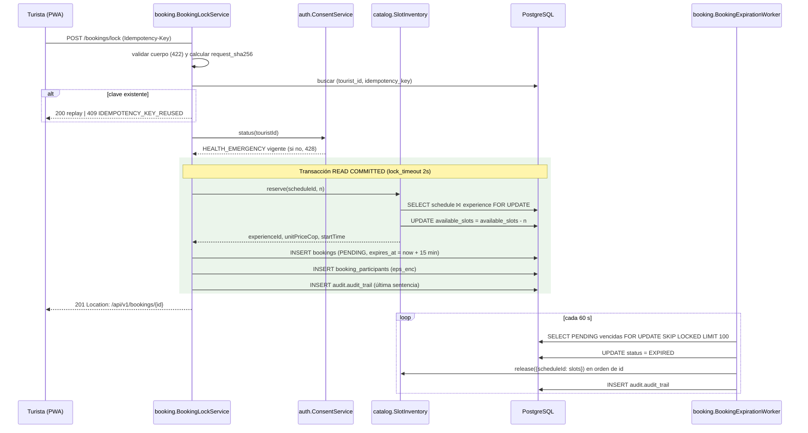

# ADR-0008: Reservar cupos con bloqueo pesimista sobre la franja y liberarlos con un worker TTL `SKIP LOCKED`

- **Estado:** Aceptado (2026-10-09)
- **Proyecto / Módulo:** Intégrate · `backend-api/` — `modules/booking` (nuevo), `modules/catalog`, `modules/auth`, `common/audit` (nuevo) (Etapa 1 · Fase 1.1 · Proceso 2 · T-1.5 y T-1.6)
- **Fecha:** 2026-10-09

## Contexto

T-1.5 debe garantizar 0% de sobreventa con < 200 ms por bloqueo (RF-09, RNF-02) y T-1.6 debe devolver los cupos de las reservas que vencen sin pago (RF-11). Ambas operan sobre el mismo contador: `catalog.schedules.available_slots` (desnormalización D1/D8, `CHECK 0 ≤ available ≤ total`, conciliable con `booking.v_schedule_slot_reconciliation`). Se tratan en un solo ADR porque descontar y restituir deben compartir orden de bloqueos, reglas de auditoría y pruebas de conciliación. El esquema ya existe (V4, V10): `booking.bookings` con `idempotency_key`/`request_sha256` e índice único `(tourist_id, idempotency_key)`, participantes con `eps_enc`, triggers que validan la franja, el precio vigente y el rol `TOURIST` al insertar, máquina de estados E3 e historial append-only. El contrato está congelado (`openapi.yaml` `lockBookingSlots`, `dtos_contrato_api.md` §5) y los códigos de error ya están en `ErrorCode` (`BOOKING_INSUFFICIENT_SLOTS`, `BOOKING_SCHEDULE_NOT_BOOKABLE`, `IDEMPOTENCY_KEY_REUSED`, `CONSENT_HEALTH_EMERGENCY_REQUIRED`, `CONCURRENCY_LOCK_TIMEOUT` → 503 + `Retry-After: 1` ya mapeado desde SQLState 55P03).

Huecos detectados: (1) `catalog.schedules` es de `catalog`, y `ModuleBoundariesTest` prohíbe tocar repositorios ajenos; (2) **nada escribe aún `audit.audit_trail`**, y su trigger de encadenamiento toma `FOR UPDATE` sobre la fila única `audit.chain_head`, es decir, es un punto de serialización global; (3) la respuesta 201 exige `Location`, pero el contrato no define `GET /bookings/{id}`; (4) el contrato fija `status: const PENDING` también en el replay 200, aunque la reserva reproducida pudo haber expirado o confirmado; (5) `StatusReasonContext` (motivo para el historial) vive en `catalog.repository` y `booking` lo necesita.

## Decisión

### 1. Alcance y rutas

| Método | Ruta | Rol | Respuesta |
|---|---|---|---|
| POST | `/api/v1/bookings/lock` + `Idempotency-Key` | `TOURIST` | 201 + `Location` / 200 + `Idempotency-Replayed: true` (contrato vigente) |
| GET | `/api/v1/bookings/{bookingId}` | `TOURIST` (dueño) | 200 `BookingLockResponse`; 404 si no existe o es ajena (**adición al contrato**, destino de `Location` y base de la cuenta regresiva de T-1.10d) |

El worker TTL no expone endpoints.

### 2. Frontera entre módulos: `catalog` es el dueño del inventario

`catalog` publica una interfaz nueva, **`SlotInventory`** (paquete `modules.catalog.service`), con `propagation = MANDATORY` para obligar a que corra dentro de la transacción de quien la llama:

- `ReservedSlots reserve(UUID scheduleId, int slots, Instant now)`: `SELECT … FOR UPDATE` de la franja + experiencia, valida y descuenta con un `UPDATE … SET available_slots = available_slots - :n WHERE id = :id AND available_slots >= :n` nativo (`@Modifying`; no reescribe columnas ni dispara `trg_schedule_capacity_guard`). Devuelve `experienceId`, `unitPriceCop` vigente y `startTime`.
- `void release(Map<UUID, Integer> slotsBySchedule)`: `UPDATE … SET available_slots = available_slots + :n`, recorriendo las franjas **en orden ascendente de id**.

`booking` depende solo de esa interfaz y de `ConsentService` (`auth`). Reglas ArchUnit nuevas: `booking` no depende de `catalog`/`auth` salvo `..service` (interfaces) y `..service.model`; `catalog` y `auth` no dependen de `booking`. `StatusReasonContext` se mueve a `common/persistence` (igual que `PgDomains` en ADR-0006).

### 3. `POST /bookings/lock`: orden exacto

**Fuera de la transacción (lecturas, sin bloqueos):**

1. **Validación del cuerpo** (422 con `invalidParams`, sin escribir nada): `1 ≤ requestedSlots ≤ 10`; `participants.size() == requestedSlots`; `(docType, docNumber)` único en el arreglo; exactamente un `isHolder = true`; formatos del contrato (E.164, `DocNumber`, longitudes). Un tipo no numérico es 400 (Jackson).
2. **Idempotencia:** `request_sha256` = SHA-256 de la serialización canónica del request validado (campos en orden de declaración, cadenas recortadas, participantes en el orden recibido). Se busca `(tourist_id, idempotency_key)`:
   - mismo hash y `created_at` hace ≤ 24 h → **replay 200** con `Idempotency-Replayed: true` y `ttlSecondsRemaining` recalculado (mínimo 0);
   - hash distinto, o la misma clave con más de 24 h → 409 `IDEMPOTENCY_KEY_REUSED`.
3. **Consentimiento:** `ConsentService.status(touristId)` debe tener `HEALTH_EMERGENCY` vigente sobre la política actual → si no, 428 con `requiredPurposes` y `policyVersion`.

**Dentro de una transacción `READ COMMITTED`** (el `lock_timeout = 2s` ya está fijado en el rol `integrate_api` por `00_bootstrap.sql`; no se repite con `SET LOCAL`):

4. `SlotInventory.reserve`:
   - franja inexistente o experiencia no `APPROVED`/eliminada → 404 `RESOURCE_NOT_FOUND`;
   - franja no `OPEN` o `start_time ≤ now` → 409 `BOOKING_SCHEDULE_NOT_BOOKABLE`;
   - `requestedSlots > available_slots` → 409 `BOOKING_INSUFFICIENT_SLOTS` con `availableSlots` e `invalidParams[requestedSlots]`;
   - si el lock no llega en 2 s → 55P03 → 503 `CONCURRENCY_LOCK_TIMEOUT` (handler existente).
5. `INSERT booking.bookings` con `id` generado en la aplicación (se usa en el AAD), `status = PENDING`, `created_at = now` y `expires_at = now + 15 min` tomados del `Clock` UTC, precio unitario devuelto por `reserve` y `total = unit × slots`. El trigger de inserción revalida franja, precio y rol como defensa en profundidad.
6. `INSERT booking.booking_participants` (uno por cupo).
7. `INSERT audit.audit_trail` como **última** sentencia (§6) y `COMMIT`.

**Carrera de la misma clave:** si dos peticiones con la misma clave pasan a la vez el paso 2, la segunda viola `uq_bookings_idempotency` en el paso 5. Su transacción se revierte (incluido el descuento de cupos) y se reevalúa el paso 2 fuera de ella: replay 200 o 409. Nunca se descuentan cupos dos veces.

**Orden de bloqueos:** el lock toma **franja → (fila nueva de reserva)**; el worker y el futuro webhook (T-1.7) toman **reserva → franja**. El lock nunca bloquea reservas existentes, así que no hay ciclo posible.

### 4. Cifrado de datos de salud y emergencia

Se reutiliza `SensitiveDataCipher` (ADR-0007 §4, misma llave versionada y misma versión para todas las columnas de la fila):

- `bookings.emergency_contact_name_enc` y `_phone_enc`: AAD `"booking.bookings.<columna>:<bookingId>"`.
- `booking_participants.eps_enc`: AAD `"booking.booking_participants.eps_enc:<bookingId>:<docType>:<docNumber>"`. El `id` del participante es `IDENTITY` y no se conoce antes del `INSERT`; `(booking_id, doc_type, doc_number)` es único (`uq_booking_participants_document`) y ata igual el ciphertext a su fila.

Ni la respuesta, ni los logs, ni la auditoría contienen EPS, contacto de emergencia ni documentos.

### 5. Respuesta y `GET /bookings/{bookingId}`

`BookingLockResponse` del contrato (201, o 200 en replay). **Desviación acordada (2026-10-09):** en el replay y en el `GET`, `status` refleja el estado **actual** de la reserva (`PENDING | CONFIRMED | EXPIRED | PAYMENT_FAILED | CANCELLED_*`…), no la constante `PENDING`: un cliente que reintenta después de vencer el TTL debe saberlo, no recibir un `PENDING` falso con `ttlSecondsRemaining = 0`. En el 201 sigue siendo siempre `PENDING`. Se actualiza el esquema (`status` pasa de `const` a `enum`) y `dtos_contrato_api.md` §5.2.

### 6. Auditoría (`common/audit`, primer escritor de `audit.audit_trail`)

- Puerto **`AuditTrail`** en `common/audit` con `record(AuditEntry)`, implementado con `JdbcTemplate` (`INSERT` nativo; el trigger asigna `id`, `prev_hash` y `row_hash`). `integrate_app` ya tiene `INSERT` (V9).
- Lock: `module = booking`, `entity = bookings`, `action = BOOKING_SLOTS_LOCKED`, `severity = INFO`, `actor_id`, IP y user agent del turista; `details = {scheduleId, slots, totalAmountCop, traceId}`. El `traceId` va en `details` porque `correlation_id` es `UUID` y el `X-Trace-Id` de ADR-0003 no lo es.
- Worker: `action = BOOKING_EXPIRED`, `actor_id = NULL` (sistema), `details = {scheduleId, releasedSlots}`.
- Debe ser la última sentencia: el trigger serializa **todas** las inserciones de auditoría sobre `audit.chain_head`, así que insertarla al final minimiza el tiempo que se retiene ese bloqueo global.

### 7. Worker de expiración (T-1.6)

- `@Scheduled(fixedDelayString = "${integrate.booking.expiration.interval:PT60S}")`, activable con `integrate.booking.expiration.enabled` (en `false` en las pruebas, que invocan el método directamente con `MutableClock`).
- Cada lote, en una transacción propia:
  1. `SELECT id, schedule_id, slots_count FROM booking.bookings WHERE status = 'PENDING' AND expires_at < :now ORDER BY expires_at LIMIT :batch FOR UPDATE SKIP LOCKED` (índice parcial `ix_bookings_pending_expiry`; lote de 100 por defecto).
  2. `UPDATE … SET status = 'EXPIRED'` de esas reservas, con motivo `TTL_EXPIRED` en `StatusReasonContext` (el trigger escribe el historial con `changed_by = NULL`).
  3. `SlotInventory.release` con los cupos agregados por franja, en orden de id.
  4. Una fila de auditoría por reserva y `COMMIT`.
- Se repite mientras el lote venga lleno. `SKIP LOCKED` permite varias instancias sin coordinación (sin ShedLock) y no bloquea al webhook que esté procesando la misma reserva; el orden por id de franja evita interbloqueos entre instancias.
- Log estructurado por lote: `expired`, `releasedSlots`, `durationMs` (RF-11).
- Reglas de cupos (alineadas con la vista de conciliación): liberan cupo `EXPIRED`, `PAYMENT_FAILED`, `CANCELLED_REFUNDED`, `CANCELLED_BY_PLATFORM`; `CANCELLED_NO_REFUND` no (supuesto S2). Este ADR solo implementa `PENDING → EXPIRED`; las demás transiciones llegan con T-1.7 y T-2.6 usando el mismo `SlotInventory.release`.

### 8. Configuración

`integrate.booking.hold-ttl` (`PT15M`), `integrate.booking.idempotency-window` (`PT24H`), `integrate.booking.expiration.{enabled,interval,batch-size}`. Valores por defecto en `application.yml`; sin secretos nuevos.

### 9. Pruebas

- **API (Testcontainers, cadena de seguridad real):** 201 con `Location`; replay 200 con la cabecera; 409 por clave reutilizada; 422 por participantes inconsistentes; 428 sin consentimiento; 404 (franja inexistente o experiencia no aprobada); 409 franja cerrada, iniciada o sin cupos (con `availableSlots`); 403 para un rol distinto de `TOURIST`; `GET` de una reserva ajena → 404; EPS y contacto cifrados en BD y descifrables solo con su AAD.
- **Concurrencia:** franja de 5 cupos, 20 hilos pidiendo 1 cupo cada uno con un `CountDownLatch` → exactamente 5 reservas, 15 respuestas 409 y `has_drift = false`. Misma clave enviada en paralelo por 2 hilos → una sola reserva y un solo descuento.
- **Lock timeout:** una transacción de prueba retiene la franja más de 2 s → 503 + `Retry-After: 1`.
- **Worker:** reserva vencida → `EXPIRED`, cupos restituidos, historial con `changed_by = NULL`, auditoría; reserva no vencida intacta; dos invocaciones en paralelo no expiran ni liberan dos veces.
- **ArchUnit:** las fronteras de §2.
- **Latencia:** se registra el p95 del lock en la prueba de concurrencia como referencia; la certificación < 200 ms con 200 usuarios queda en T-2.14.

### 10. Puntos de decisión resueltos con el desarrollador (2026-10-09)

| Punto | Decisión |
|---|---|
| `GET /api/v1/bookings/{bookingId}` | Se agrega al contrato (`openapi.yaml` y `dtos_contrato_api.md` §5), solo para el turista dueño; 404 si no existe o es ajena (§1). |
| `status` en el replay 200 | Se devuelve el estado real de la reserva; en el esquema, `status` pasa de `const: PENDING` a `enum`. El 201 sigue siendo siempre `PENDING` (§5). |
| Auditoría frente al bloqueo global de `audit.chain_head` | Síncrona, como última sentencia de la transacción del lock (§6). El impacto se mide en T-2.14; si no cumple < 200 ms, se reabre la alternativa del outbox. |

### 11. Fuera de alcance

Pago, webhook y retención en custodia (T-1.7, ADR propio), incluido el reembolso por aprobación tardía (S3); voucher (T-1.8); correo (T-1.9); cancelaciones por el turista y la regla de 72 h (T-2.6); listado `GET /me/bookings` (lo pedirá T-1.10e si hace falta); limitación de tasa por turista.

## Alternativas Descartadas

- **Bloqueo optimista (`@Version` sobre la franja):** bajo alta contención por los últimos cupos convierte cada colisión en un reintento del cliente y no da la garantía determinista que pide RF-09; el contrato ya fija `SELECT … FOR UPDATE`.
- **`UPDATE … WHERE available_slots >= n` sin `SELECT … FOR UPDATE`:** también es atómico, pero no permite distinguir en la misma lectura "franja cerrada / iniciada / sin cupos" para devolver el error exacto del contrato, ni leer el precio vigente bajo el mismo bloqueo. Se conserva esa condición en el `UPDATE` solo como defensa adicional.
- **Calcular la disponibilidad con `SUM(slots_count)` de las reservas activas:** elimina la desnormalización, pero exige agregar en cada bloqueo y no hay una fila que bloquear; el modelo (D1) la descarta por el SLA de 200 ms.
- **Que `booking` actualice `catalog.schedules` con su propio repositorio nativo:** más corto, pero rompe la frontera de módulos que ADR-0006 §7 y `ModuleBoundariesTest` imponen y reparte las reglas del inventario entre dos módulos.
- **Redis o un lock distribuido:** agrega infraestructura y un segundo origen de verdad para algo que PostgreSQL ya resuelve dentro de la misma transacción que crea la reserva.
- **Expirar en la lectura (sin worker):** los cupos quedarían retenidos hasta que alguien consulte; RF-11 exige un `@Scheduled` cada 60 s.

## Consecuencias

- **Positivas:** la garantía de cero sobreventa recae en una sola fila bloqueada y en el `CHECK` de la base; el inventario tiene un único dueño (`catalog`) que T-1.7 y T-2.6 reutilizarán para liberar cupos; la idempotencia sobrevive a carreras sin descontar dos veces; se estrena la auditoría encadenada que exigen RF-20 y T-2.7; el worker escala horizontalmente sin coordinación.
- **Negativas / Riesgos asumidos:**
  - **`audit.chain_head` es un cuello de botella global:** toda transacción que audita se serializa al final. Con 200 usuarios concurrentes puede dominar la latencia del lock; si T-2.14 lo confirma, la opción es auditar después del `COMMIT` en una cola (outbox), a costa de la atomicidad que hoy pide el contrato.
  - Las peticiones sobre una misma franja muy disputada se serializan; más allá de 2 s de espera el cliente recibe 503 y debe reintentar con la misma clave.
  - El `GET /bookings/{id}` y el `status` no constante en el replay son cambios de contrato que hay que propagar a `openapi.yaml` y `dtos_contrato_api.md`.
  - El reloj de la aplicación fija `expires_at`, mientras el trigger compara `start_time` con el `now()` de la base; una deriva de segundos entre ambos es tolerable, pero no nula.

## Contrato o Esquema Conceptual

Interfaces conceptuales:

| Componente | Módulo | Responsabilidad |
|---|---|---|
| `SlotInventory` (pública) | `catalog` | `reserve` / `release` del contador bajo `FOR UPDATE`, `propagation = MANDATORY` |
| `BookingLockService` | `booking` | Validación, idempotencia, consentimiento y transacción del lock |
| `BookingQueryService` | `booking` | `GET /bookings/{id}` del dueño |
| `BookingExpirationWorker` | `booking` | Lotes `SKIP LOCKED` → `EXPIRED` + `release` |
| `AuditTrail` (puerto) | `common/audit` | Inserción en `audit.audit_trail` dentro de la transacción en curso |
| `StatusReasonContext` | `common/persistence` | Motivo de transición para los historiales (movido desde `catalog`) |

## Notas de implementación (T-1.5 y T-1.6, 2026-10-09)

Desviaciones y precisiones respecto del texto aceptado:

1. **Fronteras (§2).** `booking` usa los enums públicos de `auth.entity` (`DocType`, `ConsentPurpose`), igual que `catalog` desde ADR-0007. La regla ArchUnit `bookingUsesOnlyThePublicCatalogAndAuthApis` prohíbe, en `catalog`, `repository`, `entity`, `service.impl` y `controller`, y en `auth`, `repository`, `service.impl` y `controller`. `catalogAndAuthDoNotDependOnBooking` cierra la dirección inversa.
2. **`SlotInventory` (§2)** suma `experienceOf(scheduleId)`, una lectura sin bloqueo, para que el replay y el `GET` devuelvan `experienceId` (la reserva no lo guarda).
3. **Bloqueo (§3 y diagrama).** `FOR UPDATE` toma solo la fila de la franja; la experiencia se lee sin bloqueo para no frenar su moderación. Una suspensión concurrente espera el bloqueo de la franja (`moveFutureSchedules`) y la cierra después del `COMMIT`; la reserva ya creada se gestionará con T-2.6.
4. **Instantes.** `created_at` y `expires_at` se truncan a microsegundos (precisión de `timestamptz`). Así, el 201 y las lecturas posteriores muestran el mismo valor; hallazgo de la verificación de punta a punta.
5. **Identificadores asignados en la aplicación.** Como en `HostProfile` (ADR-0007), `saveAndFlush` de `Booking` hace un `SELECT` por PK antes del `INSERT` (`merge`). Es una lectura por índice, aceptada frente al SLA.
6. **Worker (§7).** `BookingExpirationService.expireBatch` devuelve `ExpiredBatch(expired, releasedSlots)`. El worker registra `booking.expiration expired=… releasedSlots=… durationMs=…` solo cuando expiró algo. `@EnableScheduling` vive en `BookingSchedulingConfig`, condicionado a `integrate.booking.expiration.enabled` (apagado en el perfil `test`).
7. **Latencia (§9).** La prueba de concurrencia no mide p95. En la verificación de punta a punta contra el backend `dev`, el lock completo (HTTP incluido) tardó 83 ms. La certificación < 200 ms con 200 usuarios sigue en T-2.14.
8. **Validación (§3).** Además del contrato, se exige que `fullName` (participantes y contacto) tenga al menos 3 caracteres sin espacios externos, porque `ck_booking_participants_name` usa `btrim`. Los documentos duplicados se comparan sin distinguir mayúsculas.

