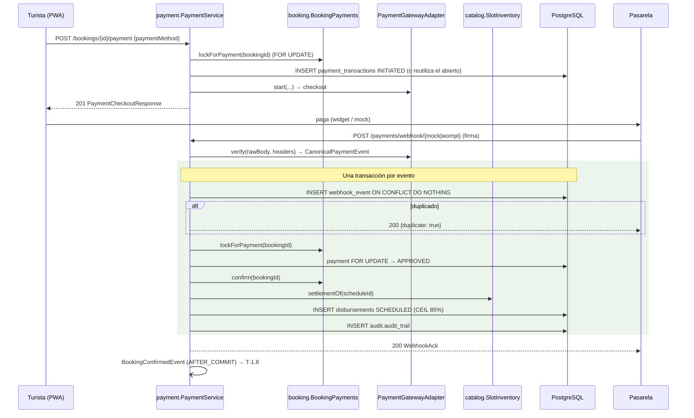

# ADR-0009: Cobrar con un `PaymentGatewayAdapter` desacoplado y confirmar la reserva con un webhook firmado e idempotente que deja el 85% en custodia

- **Estado:** Aceptado (2026-10-09)
- **Proyecto / Módulo:** Intégrate · `backend-api/` — `modules/payment` (nuevo), `modules/booking`, `modules/catalog`, `common/audit` (Etapa 1 · Fase 1.1 · Proceso 2 · T-1.7)
- **Fecha:** 2026-10-09

## Contexto

T-1.7 debe cobrar en COP mediante un adaptador desacoplado de la pasarela (RF-12: `MockPaymentGatewayAdapter` en el MVP y Wompi/ePayco en producción) y procesar el resultado con un webhook idempotente. Ese webhook confirma la reserva, programa el 85% de la comunidad en custodia (*escrow*) y deja lista la emisión del voucher (T-1.8). El esquema ya existe (V5, V10):
- `payments.payment_transactions`: varios intentos por reserva y uno solo `APPROVED`. Su trigger exige reserva `PENDING`, monto exacto, participantes completos y política vigente.
- `payments.payment_webhook_events`: `UNIQUE (provider, idempotency_key)`.
- `payments.disbursements`: un registro por pago, inmutable y con transiciones vigiladas.
- `payments.refunds`: con motivo `LATE_APPROVAL`.
- `payments.commission_policies`: `STANDARD_2026` 85/15 con 24 h de gracia.

El contrato fija `POST /api/v1/payments/webhook/{mock|wompi}`: firma `HMAC_SHA256(secreto, X-Timestamp + "." + raw_body)` con ventana de ±300 s, el `CanonicalPaymentEvent`, el `WebhookAck` y el mapeo de estados (`dtos_contrato_api.md` §6).

Huecos que impiden implementarlo tal cual:
1. **No existe forma de iniciar un pago.** El contrato solo define los webhooks, pero el webhook necesita un `payment_transactions` previo (y su trigger exige reserva `PENDING`, monto y participantes).
2. **La firma nativa de Wompi** es un checksum SHA-256 dentro del cuerpo (`signature.checksum` sobre `signature.properties` + `timestamp` + secreto de eventos), no el HMAC del contrato; el propio contrato lo deja como pendiente (§8).
3. **El disparo del voucher** ("encola la emisión") no tiene mecanismo definido y T-1.8 aún no existe.
4. **La aprobación tardía** (supuesto S3 del modelo: pago aprobado después de `EXPIRED`) no tiene flujo.
5. **El reparto necesita la asociación beneficiaria y el fin de la franja**, que viven en `catalog`.

## Decisión

### 1. Alcance y rutas

| Método | Ruta | Rol | Respuesta |
|---|---|---|---|
| POST | `/api/v1/bookings/{bookingId}/payment` `{paymentMethod}` | `TOURIST` (dueño) | 201 `PaymentCheckoutResponse` / 200 si ya hay un intento abierto (**adición al contrato**) |
| POST | `/api/v1/payments/webhook/mock` | firma HMAC | 200 `WebhookAck` (contrato vigente) |
| POST | `/api/v1/payments/webhook/wompi` | checksum nativo de Wompi | 200 `WebhookAck` (**ver punto de decisión A**) |
| POST | `/api/v1/dev/payments/{paymentId}/simulate` `{status}` | `TOURIST` dueño, **solo perfil `dev`** | 200 `WebhookAck` (**ver punto de decisión C**) |

### 2. Módulo `payment` y fronteras

- **Puerto `PaymentGatewayAdapter`** (`modules/payment/gateway`):
  - `start(PaymentStart) → GatewayCheckout`: datos para que el cliente pague.
  - `verify(rawBody, headers) → CanonicalPaymentEvent`: valida la firma y traduce al modelo canónico.
  - `provider()`.
- La implementación activa se elige con `integrate.payments.provider` (`MOCK` en `dev`/`test`). Se ubica en el módulo y no en `modules/integration/` como sugiere `backend_guidelines.md`, con el mismo criterio que `common/storage` en ADR-0007: el adaptador solo lo usa `payment`.
- **`booking` publica `BookingPayments`** (interfaz pública, `propagation = MANDATORY`), dueña de las transiciones de la reserva que origina el pago:
  - `lockForPayment(bookingId)`: `SELECT … FOR UPDATE` y devuelve el estado, el total, `scheduleId`, `touristId` y `expiresAt`;
  - `confirm(bookingId)`;
  - `failPayment(bookingId)`: `PAYMENT_FAILED` y devolución de cupos vía `SlotInventory.release`;
  - `voidPending(bookingId)`: `CANCELLED_REFUNDED` y devolución de cupos.

  Cada transición escribe su motivo con `StatusReasonContext`.
- **`catalog` amplía `SlotInventory`** con `settlementOf(scheduleId) → {associationId, endTime}`: la asociación del anfitrión de la experiencia y el fin de la franja, en lectura sin bloqueo.
- ArchUnit: `payment` solo usa `..service` / `..service.model` de `booking`, `catalog` y `auth`. Nadie depende de `payment`.

### 3. Inicio del pago (`POST /bookings/{id}/payment`)

1. `paymentMethod ∈ {PSE, CARD, NEQUI, DAVIPLATA}` (422 si no).
2. Transacción: `BookingPayments.lockForPayment`.
   - Si la reserva es ajena o no existe → 404.
   - Si no está `PENDING` o venció su TTL → 409 `PAYMENT_BOOKING_NOT_PAYABLE` (código nuevo) con `bookingStatus`.
3. **Un solo intento abierto por reserva.** Si ya hay uno `INITIATED | PENDING | ERROR` del mismo proveedor, se devuelve ese (200), así que un doble clic no crea dos cobros. Si no, se inserta `payment_transactions` con:
   - `INITIATED`, la política vigente (`valid_from ≤ now < valid_to`) y `amount = total_amount_cop`;
   - `idempotency_key = "pay:" + paymentId` (se envía a la pasarela, RNF-06);
   - `gateway_reference = paymentId`.
4. `adapter.start(...)` devuelve el `checkout`:
   - **Mock:** `{type: MOCK, reference}`, sin llamadas externas.
   - **Wompi:** parámetros del widget (`reference`, `amountInCents`, `currency`, `publicKey` y la firma de integridad `SHA-256(reference + amountInCents + currency + secreto de integridad)`), también sin llamadas externas. La firma de integridad **se recalcula en cada llamada y no se guarda**: al reutilizar un intento abierto después de rotar el secreto de integridad, el widget recibe una firma vigente.
5. Auditoría `PAYMENT_INITIATED` como última sentencia.

`PaymentCheckoutResponse`: `paymentId`, `bookingId`, `provider`, `paymentMethod`, `status`, `amountCop`, `currency`, `bookingExpiresAt`, `checkout`.

### 4. Webhook: verificación e idempotencia

1. El controlador recibe el **cuerpo crudo** (`byte[]`), porque la firma se calcula sobre los bytes exactos. `/payments/webhook/**` es público en `SecurityConfig` (sin JWT); la autenticidad la da la firma.
2. `adapter.verify` con comparación en tiempo constante (`MessageDigest.isEqual`) y una **ventana de tiempo por proveedor**:
   - **Mock:** ±300 s sobre `X-Timestamp`, como fija el contrato.
   - **Wompi:** sin ventana corta. Wompi reintenta un webhook no respondido con 200 hasta 3 veces (a los 30 min, 3 h y 24 h) conservando el `timestamp` original, que forma parte del checksum; una ventana de 300 s rechazaría esos reintentos legítimos. La protección contra repeticiones la dan el checksum y la clave única `(provider, eventId)`, y solo se rechaza un `timestamp` a más de 25 h del `Clock` (o más de 5 min en el futuro).
   - **Rotación sin cortes (Wompi):** se aceptan hasta dos secretos de eventos, `WOMPI_EVENTS_SECRET` y el opcional `WOMPI_EVENTS_SECRET_PREVIOUS`, y el evento es válido si su checksum coincide con cualquiera. Procedimiento: configurar el nuevo como actual y el viejo como anterior, rotar en el Dashboard de Wompi y retirar el anterior cuando pase la ventana de reintentos (≥ 25 h).

   Una firma inválida responde 401 `WEBHOOK_SIGNATURE_INVALID`, **no se guarda en `payment_webhook_events`** y se audita `PAYMENT_WEBHOOK_REJECTED` (`WARNING`) en una transacción propia. No se guarda porque, si se guardara, un atacante podría ocupar con un `eventId` falso la clave única y bloquear el evento legítimo.
3. Validación del evento canónico. Si `provider` no coincide con el path → 422 `PAYMENT_PROVIDER_MISMATCH`.
4. **Una transacción por evento:**
   1. `INSERT … ON CONFLICT (provider, idempotency_key) DO NOTHING RETURNING id`, con `payload`, `signature` y `signature_valid = true`. Si no devuelve fila, el evento es **duplicado**: se responde 200 con `duplicate = true` y los estados actuales, sin efectos.
   2. `BookingPayments.lockForPayment(bookingId)`. Si no existe → 422 `PAYMENT_BOOKING_NOT_FOUND` y se revierte (incluido el `INSERT` del evento, para que un reintento corregido pueda procesarse).
   3. Se bloquea el intento abierto de esa reserva y proveedor (`FOR UPDATE`) y se fija `gateway_transaction_id`. Si `amountCop` difiere del intento → 422 `PAYMENT_AMOUNT_MISMATCH` (código nuevo) y se revierte.
   4. Transición según §5, `processed_at = now()` en el evento y auditoría como última sentencia.

**Orden de bloqueos:** reserva → pago → franja. Es el mismo que usa el worker TTL (reserva → franja). El lock de T-1.5 solo crea filas nuevas de reserva, así que no hay ciclo. El worker usa `SKIP LOCKED`: si el webhook tiene la reserva, el worker la salta; si el worker la tiene, el webhook espera unos milisegundos y ve `EXPIRED` (§5, aprobación tardía).

### 5. Mapeo de estados

| Pasarela | Reserva `PENDING` | Reserva ya no `PENDING` (expirada, fallida, anulada) |
|---|---|---|
| `APPROVED` | pago `APPROVED` → reserva `CONFIRMED` → `disbursements` `SCHEDULED` por `CEIL(amount × community_pct / 100)` para la asociación de `settlementOf`, con `release_at = end_time + payout_grace_hours` → evento de confirmación (§6) | **Aprobación tardía (S3):** pago `APPROVED`; la reserva no se toca; `refunds` `LATE_APPROVAL` por el 100% en estado `REQUESTED`; sin dispersión; auditoría `HIGH` |
| `DECLINED` | pago `REJECTED` → reserva `PAYMENT_FAILED` → devuelve cupos | pago `REJECTED`; reserva sin cambio |
| `VOIDED` | pago `VOIDED` → reserva `CANCELLED_REFUNDED` → devuelve cupos | pago `VOIDED`; reserva sin cambio |
| `ERROR` | pago `ERROR`; la reserva sigue `PENDING` y su TTL corre | pago `ERROR` |
| `PENDING` (solo Wompi) | pago `PENDING`; sin más cambios (decisión de cierre #5) | igual |

- **Escrow:** la custodia es el registro `SCHEDULED` en `disbursements`. El 15% de la plataforma no se almacena, porque es `amount − disbursement`. La liberación y el pago a la cuenta de la asociación quedan para la Etapa 2 (T-2.5).
- Un pago en estado final no cambia (trigger de V5). Un evento posterior sobre un pago final se registra (`processed_at`, `processing_error = "payment already <status>"`) y responde 200 sin efectos.
- La ejecución del reembolso `LATE_APPROVAL` contra la pasarela (`REQUESTED → COMPLETED`) llega con T-2.6, que tendrá el flujo de reembolsos. Aquí solo nace la orden.

### 6. Disparo del voucher (T-1.8) sin acoplar módulos

`payment` publica `BookingConfirmedEvent(bookingId, paymentId)` con `@TransactionalEventListener(AFTER_COMMIT)`. T-1.8 lo escuchará para emitir de inmediato. La **durabilidad no depende del evento:** el worker de vouchers de T-1.8 también buscará "reservas `CONFIRMED` sin fila en `voucher.vouchers`", así que un reinicio entre el `COMMIT` y la emisión no pierde vouchers. No se usa `notification_outbox` para esto, porque esa tabla es de notificaciones (correo/SMS) y la llenará T-1.9.

### 7. Secretos y configuración (SEC-DIR-004)

- `integrate.payments.provider` (`MOCK` por defecto en `dev`/`test`; sin valor por defecto en el perfil base, para fallar rápido).
- `PAYMENT_WEBHOOK_SECRET_MOCK`: obligatorio con el proveedor `MOCK`, ≥ 32 bytes en Base64, sin eco en errores.
- Wompi: `WOMPI_PUBLIC_KEY`, `WOMPI_INTEGRITY_SECRET` y `WOMPI_EVENTS_SECRET`, obligatorios solo si el proveedor es `WOMPI`; `WOMPI_EVENTS_SECRET_PREVIOUS`, opcional, solo durante una rotación (§4).
- Las plantillas van en `infra/env/.env.example` con valores ficticios, y los secretos de pruebas se generan en memoria (como `TestKeys`).

### 8. Errores nuevos (`ErrorCode`)

| Código | HTTP | Uso |
|---|---|---|
| `PAYMENT_BOOKING_NOT_PAYABLE` | 409 | Inicio de pago sobre una reserva no `PENDING` o vencida (`bookingStatus`) |
| `PAYMENT_AMOUNT_MISMATCH` | 422 | Webhook con monto distinto al del intento |

`WEBHOOK_SIGNATURE_INVALID`, `PAYMENT_BOOKING_NOT_FOUND` y `PAYMENT_PROVIDER_MISMATCH` ya existen.

### 9. Pruebas

- **API:** el inicio crea el intento y responde 201; una segunda llamada devuelve el mismo intento (200); reserva vencida → 409; ajena → 404; rol distinto → 403.
- **Webhook Mock**, con firma real calculada en la prueba:
  - `APPROVED`: reserva `CONFIRMED`, dispersión `SCHEDULED` con `CEIL` y `release_at` correctos, evento publicado y auditoría;
  - duplicado: 200 con `duplicate = true` y sin segundos efectos;
  - `DECLINED`: `PAYMENT_FAILED` y cupos devueltos, con `has_drift = false`;
  - `VOIDED` y `ERROR`;
  - aprobación tardía tras el worker TTL: `refunds` `LATE_APPROVAL` 100% y sin dispersión;
  - firma inválida, timestamp fuera de ventana y proveedor cruzado → 401/401/422, sin fila en `payment_webhook_events`;
  - monto distinto → 422;
  - el mismo evento enviado en paralelo por 2 hilos → un solo procesamiento.
- **Wompi:** checksum válido e inválido; propiedades de `signature.properties` en orden variable; reintento con `timestamp` de 3 h aceptado y de 26 h rechazado; evento firmado con el secreto anterior aceptado durante la rotación; traducción de `amount_in_cents` y `eventId = SHA-256(checksum)`; firma de integridad distinta tras cambiar el secreto de integridad al reutilizar un intento.
- **ArchUnit:** las fronteras de §2.

### 10. Fuera de alcance

Voucher y PDF (T-1.8); correo (T-1.9); liberación y pago de dispersiones, lotes y comprobantes (T-2.5); cancelaciones del turista y ejecución de reembolsos (T-2.6); conciliación periódica contra la pasarela (consultar transacciones colgadas en `INITIATED`); ePayco.

## Puntos de decisión para el desarrollador

- **A. Wompi en T-1.7.**
  - *(Recomendado)* Implementar ya el adaptador Wompi: firma de integridad del widget, validación del checksum nativo del evento y traducción al modelo canónico. No requiere llamadas de red y el contrato ya define la ruta. Se prueba con eventos firmados en la prueba y se valida en el sandbox de Wompi más adelante (T-2.16).
  - Alternativa: solo Mock en T-1.7, con `/webhook/wompi` respondiendo 404 hasta una tarea posterior.

  En ambos casos se corrige el contrato para que `/webhook/wompi` use el checksum nativo y no `X-Signature`/`X-Timestamp`.
- **B. Ruta del inicio de pago.**
  - *(Recomendado)* `POST /api/v1/bookings/{bookingId}/payment`, colgado del recurso reserva.
  - Alternativa: `POST /api/v1/payments` `{bookingId, paymentMethod}`.
- **C. Simulador de pago en `dev`.**
  - *(Recomendado)* `POST /api/v1/dev/payments/{paymentId}/simulate`, que solo existe con el perfil `dev`. Pasa el evento por el mismo procesador del webhook, para que la PWA (T-1.10d) y las pruebas manuales completen el flujo sin herramientas externas.
  - Alternativa: sin simulador; el webhook firmado se envía a mano con un script.

**Resueltos con el desarrollador (2026-10-09):** A → Mock y Wompi en T-1.7, con `/webhook/wompi` validando el checksum nativo (se corrige el contrato); B → `POST /api/v1/bookings/{bookingId}/payment`; C → simulador `POST /api/v1/dev/payments/{paymentId}/simulate`, solo en el perfil `dev`.

## Alternativas Descartadas

- **Confirmar la reserva en la respuesta síncrona del inicio de pago (sin webhook):** las pasarelas colombianas (PSE, Nequi) confirman de forma asíncrona y el contrato exige webhook idempotente.
- **Guardar también los webhooks con firma inválida:** útil para forense, pero permite bloquear la clave única de un evento legítimo; basta con la auditoría.
- **Tabla de split explícita (85 y 15 en filas):** duplicaría un dato derivable y abriría la posibilidad de que no sumen el bruto; el modelo ya guarda solo el derecho de la comunidad.
- **Reembolsar o reconfirmar automáticamente una aprobación tardía si aún hay cupos:** reabrir una reserva liberada puede chocar con otra compra concurrente de esos cupos; el modelo (S3) ya eligió el reembolso.
- **Usar `notification_outbox` como cola del voucher:** mezcla notificaciones con emisión de documentos; el escaneo de reservas `CONFIRMED` sin voucher es durable y no necesita tabla nueva.
- **Que `payment` actualice `booking.bookings` con su propio repositorio:** rompería las fronteras de ADR-0006 §7 y ADR-0008 §2.

## Consecuencias

- **Positivas:**
  - La pasarela queda detrás de un puerto: el cambio Mock → Wompi es de configuración.
  - Un webhook repetido o concurrente nunca duplica la confirmación, la dispersión ni el voucher.
  - La comunidad tiene registrado su 85% (`CEIL`) desde el momento del cobro.
  - Ninguna transición de reserva sale de `booking`.
- **Negativas / Riesgos asumidos:**
  - Dos adiciones al contrato (inicio de pago y, si se acepta, el simulador de `dev`) y una corrección (firma de Wompi).
  - La validación del checksum de Wompi se implementa según su documentación pública y no se prueba contra el sandbox hasta T-2.16.
  - Una aprobación tardía deja un reembolso `REQUESTED` sin ejecutar hasta T-2.6; se audita con severidad `HIGH` para que el administrador lo vea.
  - Los intentos que se quedan en `INITIATED` (el turista abandona el checkout) no se cierran; el worker TTL expira la reserva y el intento queda huérfano hasta la conciliación posterior.
  - **Rotación mal hecha del secreto de eventos de Wompi:** si se rota en Wompi sin configurar antes el secreto nuevo, todos los webhooks fallan (401, auditados como `WARNING`). Tras los 3 reintentos (24 h), Wompi deja de avisar: el cobro existe, la reserva expiró y nadie emite la orden de reembolso. Solo lo cubre la **conciliación contra la API de Wompi** (consultar el estado de las transacciones abiertas), que queda fuera de alcance y se registra como pendiente del backlog.

## Contrato o Esquema Conceptual

| Componente | Módulo | Responsabilidad |
|---|---|---|
| `PaymentGatewayAdapter` + `MockPaymentGatewayAdapter` (+ `WompiPaymentGatewayAdapter`) | `payment` | Checkout, verificación de firma y traducción al modelo canónico |
| `PaymentCheckoutService` | `payment` | Inicio del pago, un intento abierto por reserva |
| `PaymentWebhookProcessor` | `payment` | Idempotencia, transición del pago, escrow, aprobación tardía |
| `BookingPayments` (pública) | `booking` | Transiciones de la reserva originadas por el pago, con devolución de cupos |
| `SlotInventory.settlementOf` | `catalog` | Asociación beneficiaria y fin de la franja |
| `BookingConfirmedEvent` | `payment` | Señal después del `COMMIT` para el voucher (T-1.8) |

## Notas de implementación (T-1.7, 2026-10-09)

Desviaciones y precisiones respecto del texto aceptado:

1. **Intento en `ERROR` (§3.3).** No se reutiliza: una nueva llamada crea otro intento (201). Wompi exige una referencia única por transacción, así que reabrir un intento fallido con la misma referencia podría rechazarse. "Abierto" para reutilizar = `INITIATED | PENDING`; para localizar el intento de un evento Mock también cuenta `ERROR`.
2. **Referencia de Wompi.** `data.transaction.reference` es el `paymentId` (no el `bookingId` que decía el contrato); la reserva se obtiene del intento. El contrato quedó corregido (`openapi.yaml`, `dtos_contrato_api.md` §6).
3. **HMAC en `common/crypto`.** `HmacSha256` vive allí porque la regla ArchUnit de ADR-0007 reserva `javax.crypto` a ese paquete.
4. **Bloqueo del intento (§4).** El intento se localiza sin bloqueo y después se bloquea con `EntityManager.refresh(…, PESSIMISTIC_WRITE)`, no con una consulta `FOR UPDATE`: la consulta devolvería la instancia ya cargada sin releer su estado y otro evento concurrente podría haberla cambiado mientras se esperaba la reserva.
5. **Doble aprobación.** Si otro intento ya cobró la reserva, el nuevo evento `APPROVED` no puede dejar dos pagos aprobados (`uq_payment_transactions_one_approved`). El intento queda en `ERROR` con `status_detail = DUPLICATE_APPROVAL` y se audita `PAYMENT_DUPLICATE_APPROVAL` con severidad `CRITICAL` para un reembolso manual.
6. **Aprobación dentro del minuto de gracia.** Si llega `APPROVED` con la reserva todavía `PENDING` pero con el TTL vencido (el worker aún no pasó), se confirma: los cupos siguen retenidos.
7. **`PayableBooking.status` es texto**, para que `payment` no dependa de `booking.entity`. La regla ArchUnit `paymentUsesOnlyPublicApis` prohíbe repositorios, entidades, `service.impl` y controladores de `booking`, `catalog` y `auth`; `nothingDependsOnPayment` cierra la dirección inversa.
8. **Simulador (punto C).** `DevPaymentSimulatorController` existe con los perfiles `dev` y `test`, para probarlo por HTTP.
9. **Eventos ignorados.** Un evento de Wompi con firma válida que no es `transaction.updated` responde 200 con `eventId`, `paymentStatus` y `bookingStatus` nulos (`WebhookAck.eventId` pasa a admitir nulo). El Mock rechaza `status = PENDING` (400): ese estado solo lo emite Wompi.
10. **Verificación.** 17 pruebas nuevas (10 de API con firma real, 7 unitarias de Wompi) y 2 reglas ArchUnit; suite 133/133. De punta a punta contra el backend `dev`: inicio 201 y retomado 200, webhook firmado con `openssl` → `CONFIRMED`, duplicado sin efectos, firma inválida 401, Wompi sin configurar 404, rechazo por el simulador → `PAYMENT_FAILED`, escrow 136.000 COP `SCHEDULED` con `release_at` = fin de la franja + 1 día, `has_drift = false` y `audit.verify_chain()` sin filas.

