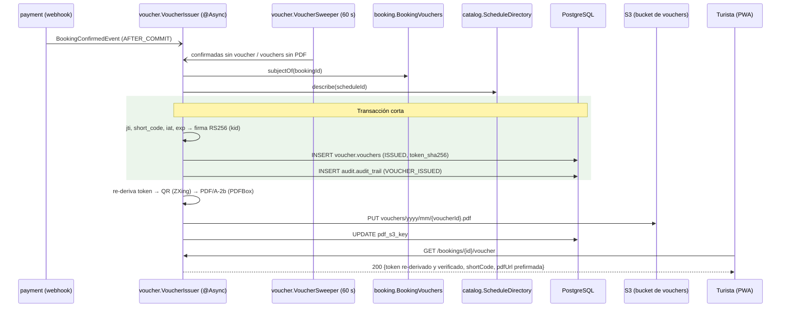

# ADR-0010: Emitir el voucher como JWT RS256 determinista en QR y PDF/A, con emisión asíncrona y barrido durable

- **Estado:** Aceptado (2026-10-09)
- **Proyecto / Módulo:** Intégrate · `backend-api/` — `modules/voucher` (nuevo), `modules/booking`, `modules/catalog`, `common/storage`, `common/crypto` (Etapa 1 · Fase 1.1 · Proceso 2 · T-1.8)
- **Fecha:** 2026-10-09

## Contexto

T-1.8 debe emitir, para cada reserva `CONFIRMED`, un voucher intransferible: un token firmado de forma asimétrica (RF-15, RNF-05: JWT RS256 de 2048 bits o Ed25519, con la llave privada solo en el backend), en un QR de alta densidad dentro de un PDF oficial en S3. La PWA del Gestor lo valida sin conexión con Web Crypto y la llave pública (RF-17), y la fecha del escaneo debe coincidir con la fecha local de la franja (`REJECTED_OUT_OF_DATE`, `dtos_contrato_api.md` §7.3).

El esquema existe (V6):
- `voucher.signing_keys`: llaves públicas con `kid`, una sola `ACTIVE`.
- `voucher.vouchers`: 1:1 con la reserva; `jti`, `token_sha256` y `short_code` son únicos; `short_code` cumple `^[A-HJ-NP-Z2-9]{8}$`. El trigger exige reserva `CONFIRMED` y llave `ACTIVE`, e impide modificar los datos firmados.
- **El JWT completo no se guarda** (G2): solo su hash.
- `pdf_s3_key` es nulo mientras el PDF se genera de forma asíncrona.

T-1.7 publica `BookingConfirmedEvent` después del `COMMIT` y fijó que la durabilidad la debe dar un barrido de "reservas `CONFIRMED` sin voucher" (ADR-0009 §6).

Huecos:
1. **La PWA necesita el token para mostrar el QR** (T-1.10e), pero el token no se guarda.
2. **No hay dependencias para QR ni PDF.**
3. **`common/storage` solo apunta al bucket sensible y solo firma subidas.** Falta escribir el PDF y entregar una URL de descarga del bucket de vouchers (`AWS_S3_BUCKET_NAME`, ya creado por LocalStack).
4. **No existe endpoint para que el turista obtenga su voucher.**
5. **La llave privada de vouchers no existe.** No debe ser la llave de sesión de ADR-0005: la de vouchers se distribuye a campo y tiene otro ciclo de rotación.

## Decisión

### 1. Alcance y rutas

| Método | Ruta | Rol | Respuesta |
|---|---|---|---|
| GET | `/api/v1/bookings/{bookingId}/voucher` | `TOURIST` (dueño) | 200 `VoucherResponse`; 404 si la reserva no existe, es ajena o no está `CONFIRMED`; 409 `VOUCHER_NOT_READY` + `Retry-After: 2` si está confirmada pero el voucher aún no se emitió (**adición al contrato**) |

`VoucherResponse`: `voucherId`, `jti`, `bookingId`, `shortCode`, `status`, `issuedAt`, `expiresAt`, `validDate`, `token` (o `null`, §3), `pdfStatus` (`READY | GENERATING`) y `pdfUrl` (URL prefirmada de 5 min, o `null` mientras se genera).

El endpoint público de llaves (`GET /vouchers/signing-keys`) y el padrón son de T-2.1.

### 2. Token: JWT RS256 con claims mínimos (RF-15, RNF-05)

- **Algoritmo RS256** con llave RSA de 2048 bits (**punto de decisión A**, resuelto por el desarrollador). Los turistas y los gestores de campo usarán teléfonos de gama baja, a menudo con navegadores sin actualizar; RS256 (`RSASSA-PKCS1-v1_5` con SHA-256) lo verifica Web Crypto en prácticamente cualquier Android o iOS, sin librerías adicionales.
- **Encabezado:** `{alg: RS256, typ: "voucher+jwt", kid}`.
- **JWS compacto propio:** `base64url(encabezado) . base64url(claims) . base64url(firma)`. Encabezado y claims se serializan con un orden de campos fijo (`LinkedHashMap` + Jackson) y se firman con `Signature.getInstance("SHA256withRSA")` del JDK. Controlar la serialización (en vez de delegarla a Nimbus) protege la re-derivación de §3 ante cambios de versión de una biblioteca.
- **Claims:**

| Claim | Valor |
|---|---|
| `iss` | `integrate` |
| `jti` | `vouchers.jti` |
| `bid` | id de la reserva |
| `sid` / `xid` | franja / experiencia |
| `vd` | fecha local de la franja en `America/Bogota` (`YYYY-MM-DD`), la que compara la PWA |
| `doc` | documento del **titular** como `TIPO:NÚMERO` (p. ej. `CC:1094000111`), para verificarlo contra el documento físico en campo (R-03) |
| `slots` | cupos amparados |
| `iat` | emisión, en segundos |
| `exp` | fin de la franja + 24 h |

- **Sin nombre, EPS, contacto ni montos (punto de decisión B).** Cualquiera puede decodificar un QR, así que viaja solo lo indispensable para validar (Ley 1581, minimización). El nombre del titular está en el padrón de la PWA y en el PDF.
- **Llave propia de vouchers:** `VOUCHER_SIGNING_KEY` (llave privada RSA de al menos 2048 bits en PKCS#8 PEM, codificada en Base64; fail-fast y sin eco) y `VOUCHER_SIGNING_KEY_ID` (`kid`). El cargador de ADR-0005 (`RsaSigningKeys`, que deriva la pública de la privada CRT) pasa a `common/crypto` para que lo usen la sesión y los vouchers.
- **Registro de la llave pública al arrancar:**
  - si el `kid` configurado no está en `voucher.signing_keys`, en una transacción se retira la `ACTIVE` anterior (`RETIRED`, `retired_at = now()`) y se inserta la nueva como `ACTIVE` con su PEM SPKI;
  - si el `kid` existe y está `RETIRED` o `COMPROMISED`, el arranque aborta.

### 3. Token re-derivable sin guardarlo

La firma RS256 (PKCS#1 v1.5) es **determinista**: con la misma llave, el mismo encabezado y los mismos claims serializados en el mismo orden, se obtiene el mismo token. Por eso el token no se guarda (G2), y cada `GET` lo reconstruye a partir de la base de datos:
- `jti`, `created_at` (que se guarda truncado al segundo y hace de `iat`) y `expires_at`;
- la reserva (titular y cupos, inmutables desde `CONFIRMED` por `fn_participant_guard`) y la franja.

Luego se verifica que `SHA-256(token) = token_sha256`. Si no coincide (la llave rotó y su privada ya no está, o cambió la serialización de la biblioteca), la respuesta trae `token = null` y el turista usa el PDF, que conserva el QR original. Así no hay que guardar el token ni cifrarlo.

### 4. Código corto

8 caracteres tomados con `SecureRandom` del alfabeto `A-HJ-NP-Z2-9` (32 símbolos, 40 bits). Si choca con `uq_vouchers_short_code`, se reintenta hasta 5 veces.

### 5. Emisión: asíncrona con barrido durable

1. **Disparo inmediato.** Un `@TransactionalEventListener(AFTER_COMMIT)` sobre `BookingConfirmedEvent`, ejecutado `@Async` en un ejecutor acotado (`voucherExecutor`), para no retrasar la respuesta 200 del webhook a la pasarela.
2. **Barrido durable.** `@Scheduled` cada 60 s (`integrate.voucher.sweep.*`, apagado en `test`):
   - (a) reservas `CONFIRMED` sin voucher, ordenadas por `confirmed_at` y en lotes de 50;
   - (b) vouchers `ISSUED` con `pdf_s3_key IS NULL`, tomados con `FOR UPDATE SKIP LOCKED`.

   Cubre reinicios entre el `COMMIT` y la emisión, y fallos de S3.
3. **Emisión** (transacción corta, sin S3 de por medio): datos del titular y la franja → `jti`, `short_code`, `iat` y `exp` → firma → `INSERT voucher.vouchers` (`ISSUED`, `token_sha256`) → auditoría `VOUCHER_ISSUED` como última sentencia.
   - Si dos emisores compiten por la misma reserva, gana `uq_vouchers_booking`; el perdedor se revierte y lo ignora.
   - Si la reserva ya no está `CONFIRMED`, el trigger lo rechaza y se registra en el log.
4. **PDF** (fuera de la transacción de emisión): se re-deriva el token (§3), se genera el QR y el PDF, se sube a S3 con la clave `vouchers/{yyyy}/{mm}/{voucherId}.pdf` y luego `UPDATE … SET pdf_s3_key`. Un fallo de S3 deja `pdf_s3_key` nulo y el barrido lo reintenta.

La consulta (a) une `booking.bookings` con `voucher.vouchers` en SQL de solo lectura dentro del repositorio de `voucher`. Es la única referencia cruzada de esquema y se documenta aquí: un anti-join es la forma correcta de encontrar "confirmadas sin voucher", y exponerlo como interfaz de `booking` obligaría a `booking` a conocer `voucher`.

### 6. QR y PDF/A (**punto de decisión C**)

- **QR:** ZXing (`com.google.zxing:core`), con el JWT compacto como contenido (~650 caracteres). Para compensar la densidad de RS256 en cámaras de gama baja, se usa corrección de errores `L` (versión ≈ 18) en lugar de `M`, módulos de al menos 4 px a 300 ppp en el PDF, un margen blanco de 4 módulos y alto contraste (negro sobre blanco). La PWA (T-1.10e) muestra el QR a pantalla completa con el brillo al máximo. Se dibuja como PNG en memoria y se incrusta en el PDF.
- **PDF:** Apache PDFBox 3, con objetivo **PDF/A-2b**:
  - fuente TrueType incrustada (Liberation Sans, que PDFBox ya trae con licencia OFL);
  - `OutputIntent` sRGB con el perfil ICC del JRE;
  - metadatos XMP con `pdfaid:part=2`, `conformance=B`;
  - sin transparencias ni cifrado.
- **Contenido:** experiencia, fecha y hora local, punto de encuentro, municipio, cupos, titular (nombre y documento), nombres de los participantes (sin EPS ni contacto de emergencia), código corto, QR, `jti`, emisión, vigencia y aviso legal.
- **Validación:** las pruebas comprueban la estructura PDF/A (XMP `pdfaid`, `OutputIntent`, fuentes incrustadas) y que el QR del PDF contenga un token cuya firma verifica con la llave pública registrada. La validación formal con veraPDF queda en T-2.15/T-2.16.

### 7. Almacenamiento (`common/storage`)

Puerto nuevo **`VoucherDocumentStorage`**:
- `put(key, bytes, contentType)`;
- `presignDownload(key, ttl)`;
- `exists(key)`.

Lo implementa S3 sobre `AWS_S3_BUCKET_NAME` (el bucket de vouchers, privado y con acceso público bloqueado por `01_create_bucket.sh`), con el mismo cliente del AWS SDK v2 de ADR-0007. Se mantiene separado de `DocumentStorage` porque el bucket sensible y el de vouchers tienen políticas distintas. En las pruebas se usa una implementación en memoria.

### 8. Fronteras

- **`booking` publica `BookingVouchers`:** `subjectOf(bookingId)` → `{status, touristId, scheduleId, slots, holder {fullName, docType, docNumber}, participantNames}`, de solo lectura.
- **`catalog` publica `ScheduleDirectory`:** `describe(scheduleId)` → `{experienceId, title, meetingPoint, municipality, department, startTime, endTime, timezone}`.
- **`voucher` escucha `payment.service.model.BookingConfirmedEvent`.** Es la única dependencia hacia `payment`, y se hace sobre su modelo público.
- **ArchUnit:** `voucher` solo usa `..service` y `..service.model` de los demás módulos; nadie depende de `voucher`.

### 9. Errores y configuración

- **Error nuevo:** `VOUCHER_NOT_READY` (409, `Retry-After: 2`).
- **Variables nuevas:** `VOUCHER_SIGNING_KEY` y `VOUCHER_SIGNING_KEY_ID`, obligatorias; `AWS_S3_BUCKET_NAME`, ya existente en la plantilla.
- **Propiedades:**
  - `integrate.voucher.validity-after-end` (`PT24H`);
  - `integrate.voucher.download-url-ttl` (`PT5M`);
  - `integrate.voucher.sweep.{enabled,interval,batch-size}`;
  - `integrate.voucher.executor.{core,max,queue}`.
- **Dependencias nuevas** (Maven Central, versiones exactas fijadas al implementar): `org.apache.pdfbox:pdfbox` 3.0.x y `com.google.zxing:core` 3.5.x.

### 10. Pruebas

- **Emisión:**
  - un `BookingConfirmedEvent` emite el voucher y su PDF;
  - el token verifica con la llave pública de `signing_keys`;
  - los claims son exactamente los de §2 y `vd` es la fecha local;
  - `short_code` cumple el patrón;
  - `token_sha256` coincide;
  - dos emisores en paralelo producen un solo voucher.
- **Re-derivación:** el `GET` devuelve el mismo token que el QR del PDF. Si se cambia la llave en la prueba, responde `token = null` y el PDF sigue disponible.
- **Barrido:** una reserva confirmada sin voucher se emite; un voucher sin PDF se completa tras un fallo simulado de almacenamiento.
- **API:** dueño → 200 con `pdfUrl`; ajeno → 404; reserva `PENDING` → 404; confirmada sin voucher → 409 `VOUCHER_NOT_READY`; rol distinto → 403.
- **PDF/A:** XMP `pdfaid`, `OutputIntent`, fuentes incrustadas y QR decodificable con ZXing.
- **Llaves:** rotación al arrancar (`ACTIVE` → `RETIRED` + nueva `ACTIVE`).
- **ArchUnit:** las fronteras de §8.

### 11. Fuera de alcance

Correo con el PDF (T-1.9); endpoint de llaves públicas, padrón y revocación (T-2.1); transición a `EXPIRED`/`CONSUMED` (T-2.3 y un barrido posterior); revocación por cancelación (T-2.6); WhatsApp/SMS; validación con veraPDF (T-2.15/T-2.16); KMS para la llave privada (T-2.16).

## Puntos de decisión para el desarrollador

- **A. Algoritmo de firma.** **Resuelto (2026-10-09): RS256 de 2048 bits.** Los usuarios tendrán teléfonos de gama baja: se prioriza que el navegador verifique el QR sin librerías adicionales sobre el tamaño del código. Se descartó Ed25519 (QR más pequeño, pero Web Crypto solo lo soporta en navegadores recientes).
- **B. Datos personales en el QR.**
  **Resuelto (2026-10-09):** solo el documento del titular (`doc`) y los cupos; el nombre queda fuera del QR.
- **C. Nivel del PDF.**
  **Resuelto (2026-10-09):** PDF/A-2b con PDFBox, verificado estructuralmente en las pruebas; veraPDF en T-2.15/T-2.16.

## Alternativas Descartadas

- **Guardar el JWT completo (o cifrado) para devolverlo en el `GET`:** contradice G2 y deja un artefacto reutilizable en la base; la firma determinista permite reconstruirlo y verificarlo contra el hash.
- **Usar la llave de sesión de ADR-0005 para firmar vouchers:** mezcla dos ciclos de vida; rotar la llave de sesión invalidaría los QR ya impresos, y los dispositivos de campo recibirían la llave pública de sesión.
- **Emitir el voucher dentro de la transacción del webhook:** acopla la respuesta a la pasarela con S3 y la generación del PDF; un fallo de S3 revertiría la confirmación del pago.
- **Solo el evento, sin barrido (o solo el barrido):** el evento se pierde ante un reinicio; un barrido solo agrega hasta 60 s de espera. Los dos juntos dan latencia baja y durabilidad.
- **Generar el QR en el cliente a partir de un token entregado por API, sin PDF:** RF-15 exige el PDF oficial y el correo (T-1.9) lo adjunta.
- **iText:** su licencia AGPL o comercial no encaja con el proyecto; PDFBox es Apache 2.0.
- **Ed25519 (EdDSA):** firma de 86 caracteres y un QR más pequeño, pero solo está disponible en Web Crypto en navegadores recientes (Chrome/Android 137+, Safari 17+, Firefox 129+). En teléfonos de gama baja obligaría a incluir una librería de respaldo en la PWA (punto A).
- **Firmar con Nimbus JOSE:** sirve para RS256, pero deja la serialización de los claims en manos de la biblioteca; un cambio de versión rompería la re-derivación de §3. El JWS compacto con el `Signature` del JDK es corto y estable.

## Consecuencias

- **Positivas:**
  - El QR se valida sin conexión con una llave pública estándar.
  - El token no se almacena y aun así se puede volver a entregar, verificado por su hash.
  - La emisión no frena el webhook y sobrevive a reinicios y fallos de S3.
  - El QR expone el mínimo de datos personales.
- **Negativas / Riesgos asumidos:**
  - Dos dependencias nuevas (~3 MB).
  - **QR más denso** (~650 caracteres) que con Ed25519: se mitiga con corrección de errores `L`, módulos grandes, margen amplio y QR a pantalla completa (§6). Si las pruebas de campo de T-2.10 muestran lecturas fallidas, el código corto de 8 caracteres sigue disponible como canal de contingencia (T-2.12).
  - La re-derivación depende de que la serialización propia (§2) no cambie; si cambia, se detecta por el hash y se cae al PDF.
  - Rotar la llave de vouchers impide re-derivar los tokens viejos (siguen en el PDF y verificables con la llave `RETIRED`).
  - La conformidad PDF/A completa no se certifica hasta veraPDF.
  - Hay una referencia SQL de solo lectura de `voucher` a `booking.bookings` (§5).

## Contrato o Esquema Conceptual

| Componente | Módulo | Responsabilidad |
|---|---|---|
| `VoucherSigner` | `voucher` | Claims mínimos, firma RS256 determinista y re-derivación verificada por hash |
| `VoucherIssuer` | `voucher` | Emisión idempotente por reserva y generación del PDF |
| `VoucherSweeper` | `voucher` | Barrido durable de emisiones y PDF pendientes |
| `VoucherPdfRenderer` | `voucher` | QR (ZXing) y PDF/A-2b (PDFBox) |
| `SigningKeyRegistrar` | `voucher` | Registro y rotación de la llave pública al arrancar |
| `VoucherDocumentStorage` | `common/storage` | `put` y descarga prefirmada en el bucket de vouchers |
| `BookingVouchers` / `ScheduleDirectory` | `booking` / `catalog` | Datos de solo lectura del titular y de la franja |

## Notas de implementación (T-1.8, 2026-10-09)

Desviaciones y precisiones respecto del texto aceptado:

1. **Tamaño real del token:** 806 caracteres, no ~650 (los cinco UUID de los claims y el encabezado pesan más de lo estimado). Con corrección `L` cabe en un QR de versión ≈ 22; se dibuja como vector en 80 mm (módulos de ~0,77 mm). La prueba renderiza el PDF a 200 ppp y ZXing lo decodifica.
2. **Barrido de PDF sin `SKIP LOCKED`:** generar el PDF es idempotente (clave S3 fija por voucher y `UPDATE … WHERE pdf_s3_key IS NULL`), así que dos generadores concurrentes no producen nada distinto; se evitó retener un bloqueo durante la generación y la subida.
3. **`RsaSigningKeys` en `common/crypto`** con `load(valor, variable)`: la sesión (`JWT_SIGNING_KEY`) y los vouchers (`VOUCHER_SIGNING_KEY`) comparten el cargador; su prueba se movió con él.
4. **Registro de la llave:** `SigningKeyRegistrar` corre como `ApplicationRunner` con su propia transacción (`TransactionTemplate`, porque la llamada es interna). Además de abortar si el `kid` está `RETIRED`/`COMPROMISED`, aborta si el `kid` existe con otro PEM (la llave privada configurada no corresponde a la publicada).
5. **`VoucherDocumentStorage.put`** carga el PDF en una sola petición (`RequestBody.fromBytes`, ~35 KB); sin carga multipart.
6. **`token = null`:** se probó con un voucher firmado por otra llave (`rederive` vacío). La rotación se probó dentro de una transacción revertida (la llave anterior queda `RETIRED` y la nueva `ACTIVE`).
7. **Verificación de punta a punta contra `dev` + LocalStack:** pago aprobado por el simulador → voucher `ISSUED` con el PDF listo en el primer intento de consulta; firma verificada con `openssl dgst -sha256 -verify` usando el PEM de `voucher.signing_keys`; `token_sha256` coincide; el PDF (`%PDF-1.6`, XMP `pdfaid`, 34,7 KB) se descarga por la URL prefirmada; `audit.verify_chain()` sin filas.
