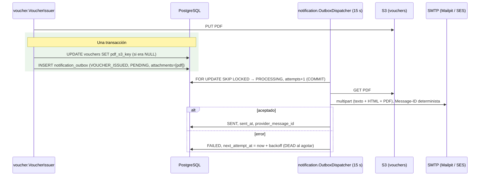

# ADR-0011: Notificar por correo con un transactional outbox y un despachador SMTP con reintentos

- **Estado:** Aceptado (2026-10-09)
- **Proyecto / Módulo:** Intégrate · `backend-api/` — `modules/notification` (nuevo), `modules/voucher`, `modules/auth`, `common/storage` (Etapa 1 · Fase 1.1 · Proceso 2 · T-1.9)
- **Fecha:** 2026-10-09

## Contexto

T-1.9 cierra la Fase 1.1. Hay que enviar al turista el correo transaccional con el voucher en PDF adjunto y el resumen de la reserva (RF-15: "se despacha el correo transaccional vía SMTP/API (Gmail/SES) con el PDF adjunto"; DoD: "el PDF queda almacenado en S3 y enviado al correo del comprador").

El esquema ya define un **transactional outbox**, `notification.notification_outbox` (V8, I4):
- el evento se inserta en la misma transacción del cambio de negocio y un worker lo despacha con reintentos;
- estados `PENDING → PROCESSING → SENT`, `FAILED` con `next_attempt_at` y `DEAD` al agotar `max_attempts` (8 por defecto);
- `recipient_address` guarda la dirección usada, como evidencia;
- `payload` lleva las variables de la plantilla, sin datos sensibles;
- `attachments` es un arreglo de claves S3;
- el índice `ix_outbox_dispatch` está pensado para `FOR UPDATE SKIP LOCKED`.

La infraestructura local ya trae Mailpit (SMTP en `1025`, UI en `8025`, perfiles `mail`/`full`) y la plantilla `.env.example` tiene `SMTP_HOST`/`SMTP_PORT`.

Huecos:
1. **No existe el momento de encolar:** el correo necesita el PDF, que se genera de forma asíncrona después de emitir el voucher (ADR-0010 §5).
2. **No hay despachador, transporte SMTP ni plantillas.**
3. **El adjunto vive en el bucket de vouchers**, pero `VoucherDocumentStorage` no permite leerlo.
4. **El correo del turista está en `auth`.** Los anfitriones enrolados tienen correos sintéticos (`@comunidad.integrate.co`, ADR-0007) a los que no se debe enviar.

## Decisión

### 1. Alcance

Un solo correo en T-1.9: **`VOUCHER_ISSUED`**, que es la confirmación de la reserva. Lleva el voucher en PDF adjunto y el resumen:
- experiencia, fecha y hora local, punto de encuentro y municipio;
- titular y número de cupos;
- total pagado;
- código corto de contingencia.

Nunca lleva EPS, contacto de emergencia ni datos de víctima.

No hay endpoints nuevos.

Fuera de alcance: correos de pago rechazado o reserva vencida, notificaciones a la asociación (RF-19, Etapa 2), WhatsApp/SMS y verificación de correo en el registro.

### 2. Encolado transaccional, en el momento en que el PDF existe

- `notification` publica la interfaz **`NotificationOutbox`**:
  - `enqueueEmail(EmailRequest)`, con `propagation = MANDATORY`;
  - `EmailRequest = {aggregateType, aggregateId, eventType, recipientUserId, recipientAddress, templateCode, payload, attachments}`.
- **`VoucherIssuer.renderPdf`** encola el correo **en la misma transacción** que fija `pdf_s3_key`, y solo si ese `UPDATE … WHERE pdf_s3_key IS NULL` afectó una fila. Así, aunque dos generadores compitan, el correo se encola exactamente una vez y solo cuando el adjunto ya está en S3.
- **Destinatario:** `auth.UserDirectory` (interfaz pública existente) da el correo y el nombre del turista. Si el correo termina en `@comunidad.integrate.co` (sintético), no se encola y se registra en el log, porque nadie lo recibiría.
- **Payload** (variables de la plantilla, sin datos sensibles): `touristName`, `experienceTitle`, `localDate`, `localStartTime`, `localEndTime`, `meetingPoint`, `municipality`, `holderName`, `slots`, `totalAmountCop`, `shortCode`, `bookingId`.
  - `totalAmountCop` sale de una nueva lectura de solo lectura en `booking.BookingVouchers` (`VoucherSubject.totalAmountCop`).
- **`attachments`:** `[{"bucket": "vouchers", "key": pdf_s3_key, "filename": "voucher-<shortCode>.pdf", "contentType": "application/pdf"}]`.

### 3. Despachador con reintentos (`@Scheduled`)

Cada `integrate.notification.dispatch.interval` (15 s; apagado en `test`, donde se invoca a mano):

1. **Reclamar** (transacción corta): `SELECT … WHERE status IN ('PENDING','FAILED') AND next_attempt_at <= now ORDER BY next_attempt_at LIMIT :batch FOR UPDATE SKIP LOCKED` → `status = PROCESSING`, `attempts = attempts + 1` → `COMMIT`. Varias instancias toman lotes disjuntos.
2. **Enviar fuera de la transacción:** se renderiza la plantilla, se descargan los adjuntos de S3 y se entrega por SMTP.
3. **Cerrar** (transacción corta):
   - **éxito:** `SENT`, `sent_at` y `provider_message_id` (el `Message-ID`);
   - **fallo:** `FAILED`, `last_error` (truncado y sin credenciales) y `next_attempt_at = now + backoff`, con backoff exponencial de 1 min, 2, 4, 8… y tope de 6 h;
   - **al agotar `max_attempts`:** `DEAD` y auditoría `NOTIFICATION_DEAD` (`WARNING`).
4. **Rescate:** un `PROCESSING` con `updated_at` de más de 10 min (la instancia murió entre el paso 1 y el 3) vuelve a `FAILED` para reintentarse.

**Entrega "al menos una vez":** si la instancia cae después de que el SMTP aceptó el mensaje y antes del paso 3, el correo se reenvía. Para mitigarlo, el `Message-ID` es determinista (`<{outboxId}@integrate.co>`), lo que permite a los clientes de correo detectar el duplicado. La entrega "exactamente una vez" no es posible con SMTP.

### 4. Transporte (**punto de decisión A**)

- **Puerto `EmailSender`:** `send(EmailMessage) → providerMessageId`.
- **Implementación SMTP** con `spring-boot-starter-mail` (`JavaMailSender`):
  - variables `SMTP_HOST`, `SMTP_PORT`, `SMTP_USERNAME` y `SMTP_PASSWORD` (opcionales), `SMTP_STARTTLS` y `MAIL_FROM`;
  - en local apunta a Mailpit (sin TLS ni credenciales);
  - en despliegue, al relé SMTP elegido (Amazon SES SMTP o Google Workspace SMTP relay), con las credenciales en Secrets Manager;
  - timeouts de conexión y lectura de 10 s, para que un SMTP colgado no retenga el lote.
- **Mensaje:** `multipart/alternative` (texto plano + HTML) más los adjuntos, `From: MAIL_FROM` y `Reply-To` opcional.

### 5. Plantillas (**punto de decisión B**)

- **Thymeleaf** (`spring-boot-starter-thymeleaf`), con plantillas en `resources/templates/mail/voucher-issued.{html,txt}`.
- El motor escapa por defecto todas las variables (`th:text`): un nombre con `<script>` no se inyecta en el HTML.
- Fechas y montos llegan ya formateados en el payload, con locale `es-CO`, zona `America/Bogota` y formato `$ 160.000`.
- El HTML usa estilos en línea y una sola columna, legible en clientes móviles.

### 6. Adjuntos

`VoucherDocumentStorage` suma `get(key) → byte[]`, con `GetObject` sobre el bucket de vouchers. Si el objeto no existe, el envío falla y se reintenta según el backoff.

### 7. Fronteras y configuración

- **ArchUnit:**
  - `notification` no depende de ningún otro módulo; solo de `common`;
  - `voucher` usa `notification` solo por su interfaz pública;
  - nadie más depende de `notification`.
- **Propiedades:**
  - `integrate.notification.mail.from` (`MAIL_FROM`, obligatoria);
  - `integrate.notification.dispatch.{enabled,interval,batch-size,stale-after}`;
  - `integrate.notification.backoff.{initial,max}`;
  - `spring.mail.*` a partir de las variables SMTP.
- **Dependencias nuevas** (gestionadas por el BOM de Spring Boot): `spring-boot-starter-mail` y `spring-boot-starter-thymeleaf`.

### 8. Pruebas

- **Encolado:**
  - al generarse el PDF del voucher queda exactamente un `VOUCHER_ISSUED` `PENDING` con destinatario, adjunto y payload sin EPS;
  - dos generadores concurrentes producen un solo correo;
  - un correo sintético no se encola.
- **Despacho** (servidor SMTP de prueba **GreenMail**, dependencia de test):
  - el mensaje llega con asunto, partes texto y HTML, el PDF adjunto idéntico al de S3 y el `Message-ID` determinista;
  - la fila queda `SENT`.
- **Reintentos:**
  - SMTP caído → `FAILED` con `next_attempt_at` según el backoff;
  - al recuperarse → `SENT`;
  - agotado → `DEAD` con auditoría;
  - un `PROCESSING` viejo se rescata.
- **Concurrencia:** dos despachadores en paralelo no envían la misma fila dos veces.
- **Escape:** un nombre con HTML aparece escapado.
- **ArchUnit:** las fronteras de §7.
- **De punta a punta contra `dev`:** pago → voucher → correo visible en Mailpit (UI y API `/api/v1/messages`) con el PDF adjunto.

## Puntos de decisión para el desarrollador

**Resueltos con el desarrollador (2026-10-09):**

- **A. Transporte: SMTP genérico**, con el requisito de que las pruebas sean **gratuitas**. Los ambientes quedan así:
  - **Local y pruebas automáticas:** Mailpit, gratuito y ya incluido en el Docker Compose. Atrapa todos los correos sin entregarlos y los muestra en la UI (`http://localhost:8025`). Las pruebas de integración usan GreenMail en memoria.
  - **Prueba en un buzón real:** Gmail SMTP con contraseña de aplicación (`smtp.gmail.com:587` + STARTTLS), gratuito y con un límite de unos 500 correos al día. Requiere verificación en dos pasos en la cuenta. La contraseña de aplicación solo vive en `infra/env/.env.development` (ignorado por git, SEC-DIR-004) y la configura el desarrollador.
  - **Demo con destinatarios reales (2026-10-16):** relé SMTP de Brevo (`smtp-relay.brevo.com:587` + STARTTLS), gratuito hasta 300 correos al día, con un remitente verificado en Brevo y sin dominio propio. Es solo configuración (las mismas variables `SMTP_*` y `MAIL_FROM`), sin cambios de código. El login y la SMTP key de Brevo viven en `infra/env/.env.development` (SEC-DIR-004).
  - **Producción:** un relé SMTP con remitente verificado (Amazon SES, Google Workspace u otro), definido en T-2.16.

  Se descartó la Gmail API: exige OAuth 2.0 y Google Workspace, y no se puede probar contra Mailpit.
- **B. Plantillas: Thymeleaf.**

## Alternativas Descartadas

- **Enviar el correo desde el listener del voucher, sin outbox:** si el SMTP falla o la instancia cae, el correo se pierde y no queda evidencia; el outbox ya existe en el esquema.
- **Encolar al confirmar el pago:** el PDF aún no existe; el despachador tendría que esperarlo o enviar sin adjunto.
- **Enviar dentro de la transacción del outbox (sin `PROCESSING`):** retendría bloqueos de filas durante la conversación SMTP (segundos) y un timeout revertiría el estado sin saber si el mensaje salió.
- **Enlace a la URL prefirmada en lugar de adjunto:** la URL vence en 5 min (ADR-0010) y RF-15 exige el PDF adjunto.

## Consecuencias

- **Positivas:**
  - El correo se encola atómicamente con el PDF: nunca se envía sin adjunto ni se pierde.
  - Los reintentos tienen backoff y estado terminal visible (`DEAD` + auditoría).
  - El proveedor de correo se cambia por configuración.
  - El outbox queda como evidencia de notificación (`recipient_address`, `sent_at`).
- **Negativas / Riesgos asumidos:**
  - Entrega "al menos una vez": un reenvío es posible si la instancia cae justo después del SMTP.
  - Dos dependencias nuevas de producción y una de pruebas.
  - Hasta 15 s de espera entre la generación del PDF y el envío.
  - En producción hace falta configurar un remitente verificado (SPF, DKIM y DMARC) en el proveedor; sin eso, el correo puede llegar a spam (tarea de despliegue, T-2.16).

## Contrato o Esquema Conceptual

| Componente | Módulo | Responsabilidad |
|---|---|---|
| `NotificationOutbox` (pública) | `notification` | Encolado transaccional (`MANDATORY`) |
| `OutboxDispatcher` | `notification` | Reclamo con `SKIP LOCKED`, envío fuera de transacción, backoff, `DEAD` y rescate |
| `EmailSender` + `SmtpEmailSender` | `notification` | Transporte SMTP con `Message-ID` determinista |
| `MailTemplates` | `notification` | Renderizado Thymeleaf de texto y HTML con escapado |
| `VoucherDocumentStorage.get` | `common/storage` | Lectura del PDF adjunto |

## Notas de implementación (T-1.9, 2026-10-09)

Desviaciones y precisiones respecto del texto aceptado:

1. **Thymeleaf sin el starter web:** se usa la librería `org.thymeleaf:thymeleaf` (versión del BOM de Spring Boot) con un `ClassLoaderTemplateResolver` propio sobre `resources/mail/`, en lugar de `spring-boot-starter-thymeleaf`. El backend es una API: el starter registraría un `ViewResolver` web que no se usa. Las plantillas son `voucher-issued.html` (HTML, con escapado por `th:text`), `voucher-issued.txt` y `voucher-issued.subject.txt` (modo texto).
2. **Destinatario:** se reutiliza la interfaz pública existente `auth.UserDirectory.findSummaries` (no hizo falta una nueva). El dominio sintético se toma de `AssistedAccountService.SYNTHETIC_EMAIL_DOMAIN`.
3. **El correo lo arma `voucher` (`VoucherEmail`)** y lo encola por `NotificationOutbox`. `notification` no conoce ningún módulo de negocio: la regla ArchUnit `notificationDependsOnlyOnCommon` lo impide, y `notificationIsUsedOnlyThroughItsPublicApi` obliga a los demás a entrar por `service` y `service.model`.
4. **Rescate de `PROCESSING`:** la consulta compara `updated_at` con `now()` de la base (lo fija su trigger), no con el reloj de la aplicación. `rescueStale(Duration)` es público para probarlo con umbral cero.
5. **`payload` y `attachments`** se mapean como `jsonb` (`@JdbcTypeCode(SqlTypes.JSON)`) y los serializa Jackson.
6. **`Message-ID` determinista** (`<outboxId@integrate.co>`), fijado con una subclase de `MimeMessage` que sobrescribe `updateMessageID()`, porque `JavaMailSender` lo regenera al enviar.
7. **Pruebas:** 7 de integración contra GreenMail 2.1.14 (SMTP real en memoria):
   - envío con texto, HTML, adjunto idéntico al PDF de S3 y `Message-ID`;
   - escape de HTML;
   - 3 generadores de PDF concurrentes producen 1 correo;
   - el correo sintético no se encola;
   - backoff de 1 y 2 min, recuperación, `DEAD` con auditoría;
   - rescate de `PROCESSING`;
   - 3 despachadores concurrentes envían 1 correo.

   Además, 2 reglas ArchUnit. Suite 150/150.
8. **De punta a punta contra `dev` + Mailpit:** pago aprobado → voucher con PDF → outbox `PENDING` → `SENT` en el primer intento del despachador. Mailpit recibió el correo con el asunto y el resumen esperados, sin EPS, contacto ni teléfono, con el adjunto `voucher-<código>.pdf` idéntico byte a byte al PDF del bucket. El revisor HTML de Mailpit le da 91% de compatibilidad.
