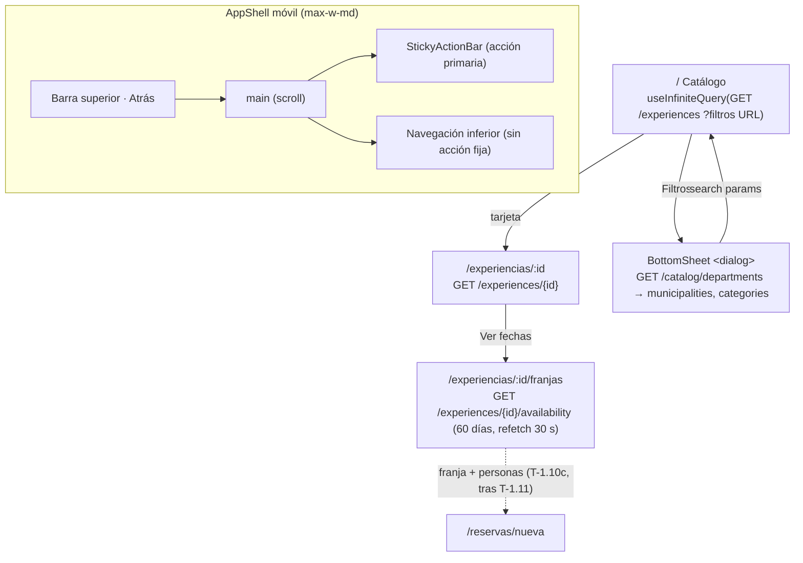

# ADR-0012: Shell móvil de la PWA, estado de servidor con TanStack Query y flujo de catálogo y franjas del turista

- **Estado:** Aceptado (2026-10-09)
- **Proyecto / Módulo:** Intégrate · `frontend-pwa/` — `app/layouts`, `features/catalog` (nuevo), `shared/ui`, `shared/lib` (Etapa 1 · Fase 1.2 · Proceso 2 · T-1.10a y T-1.10b). Enmienda la delimitación pendiente de ADR-0004.
- **Fecha:** 2026-10-09

## Contexto

La Fase 1.2 empieza por el Proceso 2 del turista. Esta entrega cubre **T-1.10a** (catálogo en tarjetas verticales, filtros DIVIPOLA en *bottom-sheet* y detalle) y **T-1.10b** (selector táctil de fechas y franjas con cupos y franjas agotadas inhabilitadas). T-1.10c–e quedan fuera porque dependen de la sesión (T-1.11). ADR-0004 dejó registrado que la delimitación móvil (`PROJECT_STATUS.md` §1.2 y FE-DIR-001: viewport 360–430 px, `max-w-md`, navegación inferior, *sticky bottom bar*, objetivos ≥ 44 × 44 px) "requerirá una enmienda antes de T-1.10". El `AppShell` actual la incumple: contenedor `max-w-5xl` y navegación en el *header*, lejos del pulgar. ADR-0004 también reservó TanStack Query para el catálogo y la reserva, pero aún no está instalado.

El contrato público ya está operativo (ADR-0006): `GET /experiences` (paginado, filtros `departmentCode`, `municipalityCode`, `category`, `intensity`, `q`, rango de fechas y `minSlots`), `GET /experiences/{id}`, `GET /catalog/{categories,departments}`, `GET /catalog/departments/{code}/municipalities` y `GET /experiences/{id}/availability`. Esta última devuelve franjas `OPEN` futuras en un rango de hasta 60 días, con `availableSlots ≥ 0`, y la marca como lectura sin bloqueo: solo `POST /bookings/lock` garantiza el cupo. El contrato **no** trae imágenes ni un itinerario estructurado; el detalle tiene `description`, `safetyGuidelines`, `meetingPoint`, `vereda` y coordenadas. Tampoco hay canal de empuje (SSE/WebSocket) para los cupos.

## Decisión

1. **Shell móvil (enmienda de ADR-0004 §2 y del esquema de rutas).** `AppShell` pasa a ser una columna centrada `max-w-md` (≈ 448 px) a todo lo alto. En escritorio, el lienzo exterior es `bg-surface` y la columna `bg-canvas` con borde, sin layouts anchos. Se compone de:
   - una **barra superior** compacta (marca y título de contexto, botón "Atrás" en las vistas hijas);
   - `<main>` como único contenedor con *scroll*;
   - una **navegación inferior fija** (`<nav>` con 3 destinos como máximo por rol, ≥ 44 px, `env(safe-area-inset-bottom)`, `aria-current`);
   - un **slot de acción fija** (`StickyActionBar` en `shared/ui`) que cada vista usa para su acción primaria. Cuando está presente, la vista oculta la navegación inferior para no apilar dos barras.

   Se conservan `SkipLink`, los *landmarks* (`header`, `nav`, `main`, `footer` reducido a créditos dentro de `main`), el `h1` único por vista y el foco doble anillo. El Gestor usa el mismo shell con sus propios destinos.
2. **Estado de servidor: TanStack Query 5** (`@tanstack/react-query`, versión fijada con `~` en la última *minor* con ≥ 14 días de publicada al instalar, y `package-lock.json`). Un único `QueryClient` en `app/providers`, sobre el `HttpClient` existente (`createHttpClient`, `ApiError`, `NetworkError`). No se usa `fetch` directo.
   - Catálogo y detalle: `staleTime` de 5 min. `GET /catalog/*`: `staleTime: Infinity` (datos DIVIPOLA estáticos).
   - Disponibilidad: `staleTime: 0`, `refetchOnWindowFocus` y `refetchInterval` de 30 s solo mientras la vista está visible ("tiempo real" sin canal de empuje).
   - Reintentos: hasta 2 para `NetworkError` y 5xx; ninguno para 4xx.
   - Paginación del catálogo con `useInfiniteQuery` y un botón **"Ver más experiencias"**, sin *scroll* infinito (control explícito del consumo de datos móviles y del foco del lector de pantalla).
3. **La URL es la fuente de verdad de los filtros.** `departmentCode`, `municipalityCode`, `category`, `intensity` y `q` viven en los *search params*: se pueden compartir y sobreviven a recargas y al botón Atrás del sistema. La clave de la consulta deriva de ellos.
4. **Rutas del turista (sin sesión):**
   | Ruta | Vista | Tarea |
   |---|---|---|
   | `/` | Catálogo (reemplaza el *placeholder* de inicio) | T-1.10a |
   | `/experiencias/:experienceId` | Detalle | T-1.10a |
   | `/experiencias/:experienceId/franjas` | Selector de fecha, franja y personas | T-1.10b |

   La selección (`scheduleId`, `participants`) sale de T-1.10b por *search params* hacia la ruta de reserva de T-1.10c (`/reservas/nueva?franja=…&personas=…`). Esa ruta no se crea ahora: mientras no exista T-1.11, la acción primaria queda **visible pero inhabilitada** y un texto explica que la reserva llega con el inicio de sesión. No se publica un enlace roto.
5. **Feature `catalog`** (`features/catalog/`): `api/` (llamadas y tipos DTO escritos a mano desde `openapi.yaml`), `queries/` (hooks de TanStack Query), `components/` y `pages/`. Expone por `index.ts` solo las páginas y el tipo de la selección de franja. Zod no entra (reservado para T-1.11); los DTO se tipan sin validación en tiempo de ejecución, como hasta ahora.
6. **Componentes compartidos nuevos (`shared/ui`)**, todos con tokens de `@theme`, objetivos ≥ 44 px y separación ≥ 8 px:
   - **`BottomSheet`** sobre `<dialog>` nativo con `showModal()`: atrapa el foco, cierra con Esc y deja el fondo inerte sin librería. Anclado abajo, con *backdrop* sobre `surface-inverse`, animación de entrada desactivada con `prefers-reduced-motion` y foco devuelto al disparador. Sin arrastre para cerrar en el MVP: se cierra con un botón explícito y con Esc.
   - **`StickyActionBar`**.
   - **`ProblemNotice`**: mensaje en español por `code` y `traceId` visible como "Código de seguimiento". `NetworkError` tiene texto propio ("Sin conexión") y un botón "Reintentar".
   - **`Skeleton`** estático (sin *shimmer* animado).
7. **Catálogo (T-1.10a).**
   - **Tarjetas verticales tipográficas, sin imagen:** el contrato no la trae y no se inventan fotos ni marcadores de posición. Jerarquía: municipio y departamento (etiqueta territorial en acento), título, asociación comunitaria, chips de intensidad física y duración, **aforo ecológico** ("Máx. N personas por franja") y tarifa por persona en COP.
   - Toda la tarjeta enlaza al detalle con un único enlace (sin enlaces anidados).
   - **Barra de filtros:** búsqueda por texto con envío explícito (sin consulta por tecla) y un botón "Filtros (n)" que abre el *bottom-sheet*. En el *bottom-sheet*: departamento → municipio (dependiente y cargado bajo demanda; los nombres del DANE en mayúsculas se muestran en formato título), categoría e intensidad, con "Aplicar" y "Limpiar". Los filtros activos aparecen como chips removibles.
   - **Estados:** cargando (*skeleton*), vacío (con "Limpiar filtros"), error (`ProblemNotice`) y fin de resultados.
8. **Detalle (T-1.10a).** Ficha con descripción, punto de encuentro y vereda, recomendaciones de seguridad (`safetyGuidelines`) como bloque informativo destacado, tarifa y aforo. Si hay coordenadas, un enlace "Abrir en mapas" (URL `geo:` con alternativa web), sin incrustar un mapa. El 404 de una experiencia no aprobada o inexistente muestra una vista propia con regreso al catálogo. Acción fija: **"Ver fechas disponibles"**.
9. **Selector de franjas (T-1.10b).**
   - Una consulta por los próximos 60 días (`dateFrom` = hoy en `America/Bogota`, `dateTo` = hoy + 59).
   - **Fechas:** semana de 7 días en rejilla (sin *scroll* horizontal) con botones "Semana anterior/siguiente". Los días sin franjas quedan inhabilitados y los días con todo agotado se marcan.
   - **Franjas del día:** grupo de radio (`role=radiogroup` nativo con `<input type=radio>`) con hora local de inicio y fin, y cupos restantes en texto ("Quedan 4 de 12").
   - **Franja agotada** (`availableSlots = 0`): `disabled` y etiqueta textual "Agotada", no solo color.
   - **Personas:** *stepper* de 1 a `min(availableSlots, 30)` de la franja elegida. Si un refresco deja la selección sin cupo suficiente, se anuncia en una región `aria-live=polite` y se ajusta o se limpia.
   - El total (`unitPriceCop × personas`) se muestra en la barra fija.
   - Las horas se toman de `localStartTime`/`localEndTime` (ya en hora local), formateadas sin conversión de zona.
10. **Formato (`shared/lib`):** `formatCop` (`Intl.NumberFormat('es-CO', { style: 'currency', currency: 'COP', maximumFractionDigits: 0 })`), fechas y horas en `es-CO`, "hoy" calculado en `America/Bogota` y formato título para los nombres DIVIPOLA. Son funciones puras con pruebas.
11. **Mundo visual:** se conservan los tokens, la tipografía del sistema y la paleta existente (brand verde bosque, acento terracota). No se crean tokens nuevos. Si la ejecución revela que hace falta uno, se propone aparte con su prueba de contraste.
12. **Verificación de cierre:**
    - los 5 comandos del Quality Gate de FE-DIR-001 en verde;
    - pruebas de componentes con un `HttpClient` simulado: filtros a la URL, *bottom-sheet* (foco y Esc), franja agotada inhabilitada, ajuste de personas tras un refresco y estados de error con `traceId`;
    - recorrido en el navegador a 360 y 430 px contra el backend `dev`: sin *scroll* horizontal, objetivos ≥ 44 px medidos y navegación solo por teclado.

## Alternativas Descartadas
- **Cargadores (`loader`) de React Router 8 en lugar de TanStack Query:** no añaden dependencias, pero no traen caché con invalidación, refresco por foco o intervalo, ni reintento selectivo. Habría que escribirlos a mano para la disponibilidad, y T-2.x tendría que reconstruirlos para la persistencia offline. ADR-0004 ya había reservado TanStack Query para este uso.
- **SWR:** cubre la mayoría de los casos, pero su paginación infinita y su control de reintentos por tipo de error son más pobres, y no coincide con lo que fijó ADR-0004.
- **Bottom-sheet con librería (Radix, Vaul, Headless UI):** `<dialog>` nativo da foco atrapado, Esc y fondo inerte en todos los navegadores objetivo; una librería añade peso a teléfonos de gama baja para un solo componente.
- **Scroll infinito en el catálogo:** dificulta llegar al pie y ubicarse con lector de pantalla, y descarga páginas que no se piden con datos móviles limitados.
- **Carrusel horizontal de fechas:** contradice el criterio "sin *scroll* horizontal" del DoD y esconde fechas fuera de vista. La rejilla semanal muestra todo con objetivos de 44 px en 360 px (7 × 44 + 6 × 4 = 332 px).
- **Mapa incrustado (Leaflet/Google Maps):** peso, datos móviles y teselas de terceros; "Abrir en mapas" delega en la app del teléfono.
- **Crear ya la ruta de reserva con un aviso de "inicia sesión":** sería un flujo a medias. Se activa en T-1.10c, cuando exista la sesión de T-1.11.

## Consecuencias
- **Positivas:**
  - El shell queda alineado con FE-DIR-001 para todas las vistas siguientes (T-1.10c–e, T-1.11, T-1.12).
  - Los filtros se pueden compartir por URL.
  - Los cupos se refrescan sin intervención y nunca se presentan como garantía.
  - El `BottomSheet`, la `StickyActionBar` y el `ProblemNotice` sirven a todo el resto de la Fase 1.2.
  - TanStack Query deja lista la base para la persistencia offline de la Etapa 2.
- **Negativas / Riesgos asumidos:**
  - Nueva dependencia de ejecución (~13 KB gzip).
  - El sondeo de 30 s añade tráfico mientras la vista de franjas está visible; se detiene en segundo plano.
  - Un cupo visible puede agotarse antes del bloqueo: el 409 de `POST /bookings/lock` se maneja en T-1.10c.
  - Sin imágenes, las tarjetas dependen por completo de la tipografía y la jerarquía. Si el negocio quiere fotos, hace falta un cambio de contrato y de almacenamiento (S3) en un ADR propio.
  - Los DTO escritos a mano pueden divergir de `openapi.yaml` hasta que se adopte generación o validación (Zod en T-1.11).
  - La acción "Continuar con la reserva" queda inhabilitada hasta T-1.10c.

## Notas de implementación (2026-10-09)

- **Dependencia:** `@tanstack/react-query` `~5.103.2`, la última *minor* con al menos 14 días de publicada al instalar (5.104.x tenía menos).
- **Base del enmarque:** `ScrollRestoration` en el shell, para volver al catálogo en la misma posición. La navegación inferior del turista tiene dos destinos ("Explorar" y "Soy Gestor de Enlace").
- **Filtros en la URL:** se nombran en español (`departamento`, `municipio`, `categoria`, `intensidad`, `q`) y se traducen a los parámetros del contrato en la llamada. Los valores que el contrato rechazaría se descartan al leerlos, y un municipio fuera de su departamento se ignora.
- **Bottom-sheet:** el `<dialog>` no se remonta entre aperturas. Una primera versión lo hacía con `key` y el navegador perdía el foco al cerrar: caía al *skip link* en lugar de volver a "Filtros". El borrador se reinicia desde la URL en cada apertura, ajustando el estado durante el render. El cierre por toque fuera usa `closedby="any"` donde el navegador lo soporta. El botón "Filtros" lleva un `aria-label` explícito ("Filtros, N activos") porque el nombre calculado pegaba el contador al texto.
- **Botones:** `Button` gana la variante `quiet` y `buttonClassName` para enlaces con aspecto de botón. El estado deshabilitado cambia de superficie (`surface-subtle` + `ink-muted`) en lugar de bajar la opacidad, para no perder contraste al sol.
- **Rótulos de la barra fija:** "Ver fechas" y "Reservar". En 360 px, el resumen del precio no deja espacio para "Ver fechas disponibles" ni para "Continuar con la reserva".
- **Selector de franjas:**
  - el número de personas va primero, porque condiciona qué franjas sirven;
  - una franja que no alcanza para el grupo se inhabilita con texto ("Solo quedan 2 cupos", "Agotada");
  - al elegir una franja, el día queda fijo, para que cambiar las personas no salte a otra fecha;
  - si la selección deja de valer, un aviso en `role=status` lo explica, y vuelve a valer sola si el grupo se reduce.
- **Iconos:** propios en SVG de trazo uniforme (`shared/ui/Icon`), sin emoji ni librería.
- **Estilos base:** selección de texto, cursor de inserción y `accent-color` desde la paleta. `viewport-fit=cover` permite respetar las áreas seguras. Sin tokens nuevos.
- **Verificación:**
  - Quality Gate de FE-DIR-001 en verde (`typecheck`, `lint`, `format:check`, `test` 67/67, `build`).
  - Recorrido contra el backend `dev` a 360 y 430 px, sin *scroll* horizontal: filtros Antioquia → Medellín en la URL, foco de vuelta a "Filtros", detalle, franja real con 2 cupos, total de $ 160.000 y aviso al subir a 3 personas.
  - Columna `max-w-md` en escritorio y consola sin errores.

## Contrato o Esquema Conceptual

## Enmienda (2026-10-27): proveedor del mapa incrustado

El detalle de la experiencia incrusta un mapa del punto de encuentro (`MeetingPointMap`), a diferencia de lo decidido en §8. La incrustación sin llave de Google Maps (`maps.google.com/maps?output=embed`) dejó de funcionar: Google la redirige a una URL que responde 404 con `X-Frame-Options: SAMEORIGIN`, así que el marco quedaba en blanco. Se cambia a la incrustación de **OpenStreetMap** (`openstreetmap.org/export/embed.html`, sin llave y permitida en marcos), con una ventana de unos 550 m alrededor del punto. El botón «Abrir en Google Maps» se mantiene como alternativa. Las experiencias sin coordenadas no muestran mapa (la de ejemplo de la demo se creó sin ellas y se corrigió).
