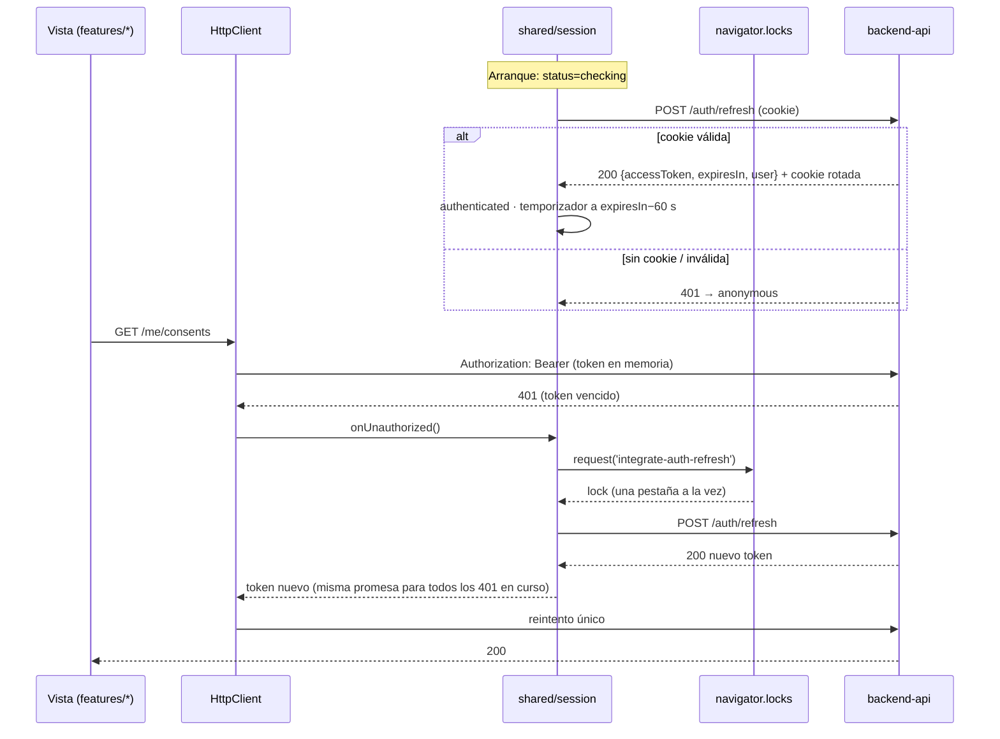

# ADR-0013: Sesión móvil en la PWA con access token en memoria, refresh *single-flight* entre pestañas y consentimiento Habeas Data

- **Estado:** Aceptado (2026-10-09)
- **Proyecto / Módulo:** Intégrate · `frontend-pwa/` — `shared/session` (nuevo), `shared/api`, `features/auth` (nuevo), `app/` (rutas protegidas); `backend-api/` — `modules/auth` (un endpoint público nuevo) (Etapa 1 · Fase 1.2 · Proceso 1 · T-1.11)
- **Fecha:** 2026-10-09

## Contexto

T-1.11 es la base del resto de la Fase 1.2. La reserva, el checkout y la confirmación (T-1.10c–e) exigen `ROLE_TOURIST`, y el enrolamiento asistido (T-1.12) exige `ROLE_LINK_MANAGER`. El backend ya expone el contrato de ADR-0005:
- `POST /auth/login` entrega el access token JWT RS256 de 900 s en el cuerpo, junto con `user{id, email, fullName, roles}`, `requiresConsentUpdate` y `pendingPurposes`. El refresh token rotativo de 7 días va en la cookie `refresh_token; HttpOnly; Secure; SameSite=Strict; Path=/api/v1/auth`.
- `POST /auth/refresh` rota la cookie. Si el token rotado se reutiliza dentro de una ventana de gracia de 10 s, responde 401 sin revocar las demás sesiones; fuera de ella, la reutilización revoca todas las sesiones.
- `POST /auth/register` crea solo `TOURIST` con consentimiento y **no inicia sesión**.
- `POST /auth/logout` es idempotente.
- `GET/POST /me/consents` consulta y otorga finalidades.
- Errores de login: 401 genérico, 423 con `lockedUntil` y `Retry-After`, y 403 para cuentas suspendidas.

FE-DIR-001 §4 prohíbe guardar el access token fuera de memoria: nada de `localStorage`, `sessionStorage` ni IndexedDB. ADR-0005 delegó en la PWA serializar el refresh entre pestañas con `navigator.locks` para no caer en la detección de reutilización. ADR-0004 reservó Zod para esta tarea.

**Hueco del contrato:** el registro exige `consent.policyVersion` igual a la versión vigente (si no, responde 422), pero **no existe un endpoint público** que la exponga, ni el título y la URL del documento que el titular debe poder leer antes de aceptar (Ley 1581, art. 9: autorización previa, expresa e informada). Esos datos ya están en `auth.privacy_policies` (`version`, `title`, `document_url`, `content_sha256`, `effective_from`, `is_current`).

## Decisión

1. **Endpoint público nuevo en el backend (adición al contrato):** `GET /api/v1/privacy-policies/current`.
   - Sin autenticación. Responde 200 con `{ version, title, documentUrl, effectiveFrom, contentSha256 }` y `Cache-Control: public, max-age=300`.
   - Responde 404 `PRIVACY_POLICY_NOT_PUBLISHED` si no hay ninguna política vigente.
   - Va en `modules/auth` sobre el `PrivacyPolicyRepository` existente, con prueba de API, una entrada en `openapi.yaml` y otra en `dtos_contrato_api.md`.
   - Es la única modificación del backend en esta tarea.
2. **Núcleo de sesión en `shared/session`** (transversal y sin UI; lo consumen `app/` y todas las *features*):
   - **Almacén externo mínimo** sobre `useSyncExternalStore`, sin librería de estado. Estados: `checking` (al arrancar), `anonymous` y `authenticated { user, accessToken, expiresAt }`. El token vive solo en una variable del módulo y nunca toca el almacenamiento del navegador.
   - **Restauración al arrancar:** como el token solo vive en memoria, al recargar se intenta un `POST /auth/refresh` silencioso. Si la cookie sigue viva, la sesión se restaura; un 401 deja el estado en `anonymous`. Mientras tanto, las rutas protegidas muestran "Verificando tu sesión…" y las públicas se ven sin esperar.
   - **Refresh *single-flight*:** una sola promesa en curso por pestaña, serializada entre pestañas con `navigator.locks.request('integrate-auth-refresh')`. Donde `navigator.locks` no existe, se degrada a *single-flight* solo por pestaña y la ventana de gracia de 10 s del backend cubre la carrera. Se dispara de dos formas:
     - **proactiva:** con un temporizador a `expiresIn − 60 s`, que se pausa con la pestaña oculta y se reevalúa al volver;
     - **reactiva:** ante un 401 de una petición que llevaba token.
   - **Sincronización entre pestañas** con `BroadcastChannel('integrate-auth')`, solo con eventos y sin datos de la sesión: `logout` (las demás pestañas pasan a `anonymous`) y `refreshed` (las demás descartan su token y lo renuevan en su siguiente uso).
   - **Logout:** `POST /auth/logout`, limpieza de la memoria, `queryClient.clear()` de las consultas privadas y aviso a las demás pestañas.
3. **`createHttpClient` gana `onUnauthorized`:** ante un 401 de una petición que llevaba `Authorization` y no es de `/auth/*`, espera el refresh *single-flight* y **reintenta una sola vez** con el token nuevo. Si el refresh falla, la sesión pasa a `anonymous` y se propaga el `ApiError` 401 original. El resto del cliente no cambia (`ApiError`, `NetworkError`, `credentials: 'include'`).
4. **Zod 4** (`zod`, versión fijada con `~` en la última *minor* con al menos 14 días de publicada):
   - esquemas de los formularios de login y registro, escritos desde las restricciones de `openapi.yaml` (correo de hasta 254 caracteres, contraseña de 12 a 128, documento `^[A-Za-z0-9]{4,20}$` según `DocType`, teléfono E.164, nombre de 3 a 150);
   - validación en tiempo de ejecución de `AuthTokenResponse` y de la política, para no aceptar una sesión malformada.
   - El resto de DTO siguen tipados a mano (ADR-0012). Los mensajes de validación están en español y se muestran por campo (`aria-invalid` + `aria-describedby`). Los `invalidParams` de un 422 se asignan al campo correspondiente.
5. **Feature `auth` (`features/auth/`)**, pantallas móviles con acción primaria en la barra fija:
   - **`/ingresar`:**
     - correo con `type=email` y `autocomplete=username`; contraseña con `autocomplete=current-password` y botón "Mostrar/Ocultar" de 44 px;
     - un 401 muestra el mensaje genérico del contrato, sin revelar qué campo falló; un 423 dice "Cuenta bloqueada temporalmente. Intenta de nuevo a las HH:MM" (con `lockedUntil` o `Retry-After`); un 403 indica una cuenta suspendida; un `NetworkError` se presenta como falta de conexión;
     - enlace a `/registro`.
   - **`/registro`:**
     - campos: nombre completo, tipo y número de documento (`inputmode` según el tipo), celular con prefijo `+57` editable (se normaliza a E.164), correo y contraseña (mínimo 12 caracteres, con "Mostrar");
     - **dos casillas separadas y sin marcar:** `PERSONAL_DATA`, obligatoria, con enlace a la política vigente (título y versión del endpoint nuevo); y `HEALTH_EMERGENCY`, opcional, explicada como necesaria para reservar y que se puede otorgar después;
     - un 201 inicia sesión automáticamente con las mismas credenciales;
     - un 409 dice "Ya existe una cuenta con ese correo o documento" y enlaza a "Ingresar";
     - si la política no carga, el envío queda bloqueado con la explicación.
   - **Retorno seguro:** ambas pantallas aceptan `?volver=`, pero solo con rutas internas que empiecen por `/` y no por `//`, para evitar un *open redirect*.
   - **`ConsentDialog`**, sobre el `BottomSheet` de ADR-0012, con dos usos:
     - **re-consentimiento bloqueante** tras el login cuando `requiresConsentUpdate` es verdadero (finalidades de `pendingPurposes` sobre `pendingPolicyVersion`). No se cierra con Esc ni tocando fuera; "No acepto" cierra la sesión, porque sin `PERSONAL_DATA` no se puede usar la plataforma;
     - **consentimiento puntual de `HEALTH_EMERGENCY`**, expuesto por el `index.ts` para que T-1.10c lo pida antes de reservar (consultando `GET /me/consents`) en lugar de recibir un 428.
   - **`/cuenta`:** nombre, correo, estado de cada finalidad (`GET /me/consents`, con estado en texto), botón "Otorgar" para `HEALTH_EMERGENCY` si falta, y "Cerrar sesión".
6. **Rutas protegidas en `app/`:**
   - `RequireSession roles={[...]}` redirige a `/ingresar?volver=<ruta>` si no hay sesión, y muestra una vista 403 propia si falta el rol.
   - `/cuenta` exige sesión.
   - `/gestor` pasa a exigir `ROLE_LINK_MANAGER`, como anticipa el comentario de `ManagerLayout`.
   - La navegación inferior del turista queda en "Explorar", "Gestor de Enlace" y "Ingresar"; esta última cambia a "Mi cuenta" con sesión.
   - El catálogo y las franjas siguen públicos. El botón "Reservar" de T-1.10b no cambia hasta T-1.10c.
7. **Proveedores:** `main.tsx` crea el almacén de sesión, el `HttpClient` (con `getAccessToken` y `onUnauthorized` del almacén) y el `QueryClient`, y lanza la restauración al arrancar. Las pruebas inyectan un almacén con un `HttpClient` simulado.
8. **Verificación de cierre:**
   - Quality Gate de FE-DIR-001 en verde y suite del backend en verde con la prueba del endpoint nuevo.
   - Pruebas unitarias: un solo refresh para N 401 concurrentes, reintento único, refresh fallido → `anonymous`, rechazo de `volver` externo y esquemas Zod contra el contrato.
   - Pruebas de componentes: errores 401, 423 y 422 por campo, 409 en el registro, re-consentimiento bloqueante y protección por rol.
   - De punta a punta contra el backend `dev` a 360 px: registro de un turista nuevo con inicio de sesión automático, recarga con sesión restaurada, renovación del token, cierre de sesión que se propaga a otra pestaña, bloqueo 423 tras 5 intentos y redirección a `/ingresar?volver=` desde una ruta protegida.

## Alternativas Descartadas
- **Access token en `sessionStorage` para sobrevivir a la recarga:** lo prohíbe FE-DIR-001 §4.1 (expuesto a XSS). La restauración por la cookie `HttpOnly` cuesta una petición al arrancar y no expone nada.
- **Decodificar el JWT en el cliente para leer los roles y la expiración:** el contrato ya entrega `user.roles` y `expiresIn`. Decodificar duplica la fuente de verdad y tienta a confiar en un token sin verificar.
- **Solo refresh reactivo (al recibir un 401):** cada expiración costaría una petición fallida y un reintento visible en conexiones lentas de campo. Lo proactivo lo evita, y lo reactivo queda como red de seguridad (reloj desfasado, pestaña dormida).
- **Sin `navigator.locks`, confiando solo en la ventana de gracia:** dos pestañas que refrescan a la vez provocan un 401 en una de ellas y la expulsan. Con el *lock*, la segunda espera y usa la cookie ya rotada.
- **Zustand, Redux o un Context con estado de React:** una sesión de cuatro campos no justifica una dependencia. Un Context propagaría el token por el árbol y obligaría a leerlo desde React; el almacén externo lo deja disponible para el `HttpClient`, que vive fuera de React.
- **Validación manual sin Zod:** viable, pero T-1.10c (participantes, EPS, contacto de emergencia) y T-1.12 necesitan esquemas más ricos; ADR-0004 ya había reservado Zod para esta tarea.
- **Fijar la versión de la política en una variable `VITE_*`:** se desincroniza en cuanto se publique `v1.0` en producción y no le da al titular el documento que acepta. El endpoint público es la fuente de verdad.
- **Iniciar sesión dentro de `/auth/register`:** ADR-0005 mantiene a `/login` como único emisor de tokens. Se resuelve con un segundo paso automático en el cliente.

## Consecuencias
- **Positivas:**
  - Quedan desbloqueadas T-1.10c–e y T-1.12.
  - El token nunca toca el almacenamiento del navegador.
  - Las pestañas no se expulsan entre sí, y el cierre de sesión se propaga a todas.
  - El consentimiento es informado (documento enlazado), granular (finalidades separadas y sin premarcar) y reutilizable para la precondición de reserva.
  - El RBAC del cliente se apoya en los roles que entrega el servidor.
- **Negativas / Riesgos asumidos:**
  - Una petición `POST /auth/refresh` en cada arranque; para visitantes anónimos es un 401 esperado.
  - Nueva dependencia de ejecución (Zod, unos 15 KB gzip con el uso previsto).
  - El RBAC del cliente es solo de experiencia de usuario: la autorización real sigue en el backend (deny-by-default).
  - En navegadores sin `navigator.locks` (algunos WebView antiguos), las carreras entre pestañas dependen de la ventana de gracia.
  - Un cambio de contrato en el backend (el endpoint de la política) dentro de una tarea de frontend.
  - Sigue abierto, sin tarea asignada: el 409 del registro revela si una cuenta existe (ADR-0005, mejora de la Fase 4), y no hay límite de intentos por IP.

## Notas de implementación (2026-10-09)

- **Backend:** `GET /api/v1/privacy-policies/current` en `modules/auth` (`PrivacyPolicyController` → `PrivacyPolicyService` → `PrivacyPolicyRepository`), pública en `SecurityConfig`, con `Cache-Control: max-age=300, public` y el código `PRIVACY_POLICY_NOT_PUBLISHED` (404). Lleva 2 pruebas de API (200 con la política `dev` y 404 sin política vigente); la suite completa queda en 157/157. Contrato actualizado: `openapi.yaml` (operación, esquema `PrivacyPolicy` y respuesta, verificado: parsea y las 98 `$ref` resuelven) y `dtos_contrato_api.md` (§1, §2 y §3.2.2.1).
- **Zod:** se usa `zod/mini` (`zod` `~4.6.5`) en lugar de la API clásica. La clásica sumaba unos 110 kB minificados y el *build* superaba 500 kB con advertencia, lo que incumple la Directiva 7 de FE-DIR-001. Con `zod/mini` el *bundle* queda en 443 kB (136,7 kB gzip) y sin advertencias. Las reglas son las mismas.
- **`BroadcastChannel`:** solo se emiten `signed-in` y `signed-out`. Se descartó el evento `refreshed` del §2: el access token de otra pestaña sigue vigente hasta su `exp`, porque la rotación solo afecta al refresh token compartido en la cookie. Un `signed-in` hace que las pestañas anónimas restauren su sesión.
- **`BottomSheet`:**
  - nuevo modo `dismissible={false}`: sin botón de cerrar, `closedby="none"` y Esc anulado con `cancel`;
  - `onClose` ahora **solo** se llama cuando cierra el usuario. Antes, el cierre pedido por el padre (al cambiar `open` a `false`) también lo disparaba, y en el re-consentimiento eso habría cerrado la sesión justo después de aceptar. Hay una prueba de regresión.
- **Registro:** si la cuenta se crea pero el inicio de sesión automático falla (por ejemplo, sin red), se redirige a "Ingresar". Repetir el registro devolvería 409.
- **Formularios:** se validan con `noValidate` y Zod. El foco va al primer campo con error, y los errores quedan enlazados por `aria-describedby`. `TextField` y `PasswordField` (con "Mostrar/Ocultar" de 44 px) se suman a `shared/ui`.
- **Navegación inferior del turista:** "Explorar", "Gestor" e "Ingresar" (que pasa a "Mi cuenta" con sesión). El Gestor tiene "Mi cuenta" para cerrar su sesión.
- **Verificación:**
  - Quality Gate de FE-DIR-001 en verde (`test` 99/99).
  - De punta a punta contra el backend `dev` a 360 px:
    - registro de un turista nuevo con inicio de sesión automático y vuelta a `/cuenta`;
    - ni `localStorage` ni `sessionStorage` guardan el token, y la cookie no es visible para JS;
    - al recargar se restaura la sesión por la cookie;
    - `HEALTH_EMERGENCY` se otorga desde la cuenta;
    - una segunda pestaña restaura su sesión sin conflicto de rotación;
    - el cierre de sesión se propaga y la otra pestaña va a `/ingresar?volver=%2Fcuenta`; el inicio de sesión también se propaga;
    - 4 intentos fallidos responden 401 y el quinto 423, con la hora de desbloqueo.
  - El refresh proactivo y el *single-flight* quedan cubiertos por pruebas unitarias con temporizadores simulados; no se esperaron los 14 minutos reales.

## Contrato o Esquema Conceptual


```text
Rutas (además de las de ADR-0012)
/ingresar?volver=/ruta        Login (público)
/registro?volver=/ruta        Registro de turista + consentimiento (público)
/cuenta                       Mi cuenta, consentimientos y cierre de sesión (sesión)
/gestor                       Panel de jornada (ROLE_LINK_MANAGER)

GET /api/v1/privacy-policies/current   (nuevo, público)
200 { version: "v0.1", title, documentUrl: "https://…", effectiveFrom, contentSha256 }
404 PRIVACY_POLICY_NOT_PUBLISHED
```
