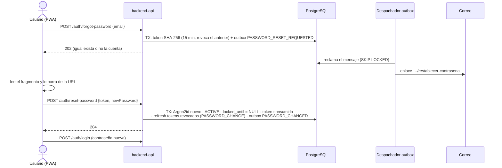

# ADR-0014: Recuperar la contraseña con un enlace de un solo uso enviado por el outbox de correo

- **Estado:** Aceptado (2026-10-09). La parte de backend (§1–§4, §6, §7) está implementada en T-1.13a; la de frontend (§5) espera a T-1.13b.
- **Proyecto / Módulo:** Intégrate · `backend-api/` — `modules/auth` (T-1.13a) y `frontend-pwa/` — `features/auth` (T-1.13b)
- **Fecha:** 2026-10-09

## Contexto

Un turista, gestor o administrador que olvida su contraseña no tiene hoy cómo recuperarla. Solo existe la activación asistida de anfitriones (ADR-0007 §6), que depende de un gestor presente. El backlog agregó T-1.13 con estos requisitos:
- `POST /auth/forgot-password` con respuesta uniforme para no revelar si una cuenta existe;
- `POST /auth/reset-password`;
- tokens con hash SHA-256, de un solo uso y TTL de 15 minutos;
- correo encolado en el outbox de `notification`;
- cambio atómico del hash Argon2id con revocación de las sesiones activas.

La base ya ofrece el `revoke_reason = PASSWORD_CHANGE` de `auth.refresh_tokens` (V2) y el outbox transaccional con despachador SMTP (ADR-0011, `NotificationOutbox.enqueueEmail`).

Faltan cuatro decisiones:
- el código HTTP de la respuesta uniforme (el backlog decía "200/202");
- cómo viaja el token sin quedar en logs ni cabeceras `Referer`;
- qué ocurre con las cuentas `PENDING_RESET`, las bloqueadas y las de correo sintético (`@comunidad.integrate.co`, que no reciben correo);
- cómo frenar el abuso del envío de correos sin una infraestructura de limitación por IP, que no existe.

## Decisión

### 1. Endpoints (públicos, en `PublicAuthEndpoints`)

| Método | Ruta | Cuerpo | Éxito | Errores |
|---|---|---|---|---|
| POST | `/api/v1/auth/forgot-password` | `{email}` | **202** sin cuerpo, siempre | 400, 422 (solo correo mal formado) |
| POST | `/api/v1/auth/reset-password` | `{token, newPassword}` | 204 | 400, 401 `AUTH_RESET_TOKEN_INVALID`, 422 (política de contraseña) |

**202** porque el resultado real (el correo) es asíncrono y se responde igual exista o no la cuenta. Correo inexistente, cuenta cerrada, `SUSPENDED`, correo sintético o límite de solicitudes alcanzado responden igual que el caso válido, sin escribir nada.

### 2. Token y almacenamiento (`V13__password_reset_tokens.sql`)

- **Formato:** 32 bytes de `SecureRandom` en Base64 URL sin relleno, que dan 43 caracteres y 256 bits. No es un código para dictar como el de activación: viaja en un enlace.
- **Tabla `auth.password_reset_tokens`:** `id`, `user_id`, `token_sha256` (`common.sha256_hex`, único), `requested_at`, `expires_at` (= `requested_at` + 15 min), `consumed_at`, `revoked_at`, más la IP y el user agent de quien la solicita.
  - Un índice único parcial permite **un solo token vivo por usuario**: una solicitud nueva revoca el anterior.
  - Se revoca el acceso de `integrate_readonly`, igual que en `refresh_tokens` y `credential_activation_codes`.
- **Límite por cuenta:** 3 solicitudes por hora, contadas sobre `requested_at`. Por encima no se crea token ni se envía correo, y la respuesta sigue siendo 202. Así se acota el envío masivo de correos a una víctima sin revelar nada. El límite por IP sigue pendiente para el endurecimiento (T-2.16).

### 3. Entrega: enlace con el token en el fragmento

- **Enlace:** el correo lleva `{FRONTEND_BASE_URL}/restablecer-contrasena#token=<token>`.
  - El **fragmento** (`#`) nunca viaja al servidor: no aparece en los logs de acceso, en proxies ni en la cabecera `Referer`.
  - La PWA lo lee y lo borra de la barra de direcciones con `history.replaceState` antes de pintar el formulario.
- **Configuración:** `FRONTEND_BASE_URL` es obligatoria (fail-fast) bajo `integrate.frontend.base-url`, con placeholder en `.env.example`.
- **Encolado:** el correo `PASSWORD_RESET_REQUESTED` se encola con `NotificationOutbox.enqueueEmail` **en la misma transacción** que crea el token. Si el `INSERT` falla, no sale correo; si el SMTP falla, el despachador reintenta.
- **Plantillas:** `password-reset.{subject.txt,txt,html}` en Thymeleaf. El texto incluye la vigencia de 15 minutos y el aviso "si no lo solicitaste, ignora este correo".
- **Riesgo asumido:** el enlace queda en `notification_outbox.payload` mientras dura su vigencia. Solo lo leen el rol de la aplicación y el propietario; el token es inútil después de 15 minutos o de su primer uso. La purga del payload tras `SENT` queda para T-2.16.

### 4. Restablecimiento (una sola transacción)

1. **Contraseña:** `PasswordPolicy` (12–128) se valida antes de tocar la base y devuelve 422.
2. **Token:** se busca por `SHA-256(token)` con `FOR UPDATE`. Si no existe, está vencido, consumido o revocado, o la cuenta está cerrada o `SUSPENDED`, se responde 401 `AUTH_RESET_TOKEN_INVALID`.
3. **Efectos en la cuenta:**
   - nuevo hash Argon2id;
   - `credential_status = ACTIVE`: quien controla el correo real de una cuenta `PENDING_RESET` ya demostró su identidad, y su código de activación vivo se revoca;
   - `locked_until = NULL`: el bloqueo por intentos protege la contraseña anterior, que deja de existir.
4. **Token y sesiones:** el token se consume y se revocan **todos** los refresh tokens vivos con `PASSWORD_CHANGE` (`revokeAllActive`). Los access tokens ya emitidos vencen solos en 15 minutos o menos (ADR-0005).
5. **Aviso:** se encola el correo `PASSWORD_CHANGED`, sin enlace, avisando del cambio.
6. **Sesión:** no se inicia sesión automáticamente. El cliente redirige a `/ingresar`.

Las cuentas de anfitrión con correo sintético no pueden usar este flujo. Recuperan el acceso con un código nuevo de su gestor (ADR-0007 §6). Para permitirlo cuando la cuenta ya está `ACTIVE`, `issue` admitirá emitir un código que deje la cuenta en `PENDING_RESET` solo si el correo es sintético. Ese cambio en ADR-0007 queda acotado a T-1.13a.

### 5. Frontend (T-1.13b, FE-DIR-001)

- **Rutas públicas en `features/auth`:**
  - `/recuperar-contrasena`: campo de correo con `inputmode="email"` y `autocomplete="email"`. Tras el 202 muestra siempre el mismo mensaje neutral, "Si el correo está registrado, te enviamos un enlace válido por 15 minutos", y un enlace para volver a ingresar.
  - `/restablecer-contrasena`: lee y borra el fragmento. Pide la nueva contraseña con `autocomplete="new-password"`, botón táctil de mostrar u ocultar (≥ 44×44 px, `aria-pressed`) y validación de 12–128 caracteres con `zod/mini`.
    - Ante un 204, cierra la sesión local si la hubiera y navega a `/ingresar` con un aviso `role=status`.
    - Ante un 401, muestra "El enlace venció o ya se usó" con la acción para pedir otro.
  - En `/ingresar`, el enlace "¿Olvidaste tu contraseña?" junto al campo de contraseña.
- **Restricciones:** se usan `createHttpClient`, `ProblemNotice` y los componentes de `shared/ui` existentes. Sin tokens de color nuevos. Acción primaria en `StickyActionBar`. Los 5 comandos del Quality Gate deben pasar en verde.

### 6. Errores nuevos

| Código | HTTP | Cuándo |
|---|---|---|
| `AUTH_RESET_TOKEN_INVALID` | 401 | Token inexistente, vencido, consumido o revocado, o cuenta no apta |

### 7. Pruebas

- **Integración (Testcontainers y GreenMail):**
  - 202 idéntico para cuenta existente, inexistente, sintética y suspendida (cuerpo y cabeceras), con correo solo en el primer caso;
  - el correo contiene un enlace cuyo token restablece la contraseña;
  - el login con la contraseña nueva funciona y con la anterior no;
  - los refresh tokens previos quedan revocados con `PASSWORD_CHANGE`;
  - una segunda solicitud invalida el primer token;
  - el token vence a los 15 minutos (`MutableClock`) y no se puede reutilizar;
  - la cuarta solicitud en una hora no crea token;
  - una cuenta `PENDING_RESET` con correo real queda `ACTIVE` y su código de activación se revoca;
  - se envía el aviso `PASSWORD_CHANGED`.
- **PWA (Vitest):** ambas vistas, la limpieza del fragmento, el mensaje neutral, el 401 y la redirección.

## Alternativas Descartadas

- **Responder 404 cuando la cuenta no existe:** permite enumerar cuentas, incluidas las de personas víctimas, que son datos sensibles (R-05). El 202 uniforme cumple el requisito del backlog.
- **Token en el *query string* (`?token=`):** termina en los logs del servidor estático, en proxies y en `Referer` si la página carga recursos de terceros. El fragmento no sale del navegador.
- **Código numérico de 6 dígitos:** su espacio pequeño exige limitar intentos por token y por IP para no ser adivinable. El enlace de 256 bits no requiere contador.
- **Reutilizar `credential_activation_codes`:** ese flujo lo inicia un gestor, dura 72 h y se dicta en persona. Mezclar dos ciclos de vida con reglas distintas en una tabla complica sus restricciones.
- **Iniciar sesión automáticamente tras el restablecimiento:** quien intercepte el enlace obtendría una sesión directa. Exigir el login confirma la contraseña nueva.

## Consecuencias

- **Positivas:**
  - Cualquier usuario con correo real recupera el acceso sin intervención humana.
  - El flujo no revela qué cuentas existen y el token nunca viaja al servidor dentro de una URL.
  - Un restablecimiento corta todas las sesiones abiertas, incluida la de un atacante.
  - Reutiliza el outbox, `PasswordPolicy`, `revokeAllActive` y los componentes de la PWA.
- **Negativas / Riesgos asumidos:**
  - El enlace vive en el payload del outbox durante su vigencia (§3).
  - La respuesta uniforme no iguala el tiempo de respuesta: una cuenta existente hace dos `INSERT` más. Es una señal débil que se acepta y se revisa en T-2.16.
  - Sin límite por IP, un atacante puede repartir solicitudes entre muchas cuentas. Cada cuenta recibe como máximo 3 correos por hora.
  - Nueva variable obligatoria `FRONTEND_BASE_URL`, migración `V13` y un cambio acotado en la emisión de códigos de ADR-0007 para cuentas sintéticas ya activas.

## Contrato o Esquema Conceptual

## Notas de implementación (T-1.13a, 2026-10-09)

Desviaciones respecto del texto aceptado, sin cambio de decisión:

- **§4 Cuentas con correo sintético:**
  - el gestor puede emitir un código nuevo a una cuenta sintética ya `ACTIVE`, pero la cuenta **no pasa a `PENDING_RESET`**: la contraseña vigente sigue valiendo hasta que se canjee el código. Así un gestor no puede dejar sin acceso a un anfitrión con solo pedir un código;
  - al canjearlo se revocan las sesiones (`PASSWORD_CHANGE`);
  - una cuenta activa con correo real sigue respondiendo 409: recupera por correo.
- **§4 Entidad `User`:** `activateCredentials` se reemplazó por `resetCredentials`, que usan la activación asistida y el restablecimiento. Ambos dejan la cuenta `ACTIVE` y sin bloqueo.
- **§2 Configuración:** `integrate.auth.password-reset.{ttl, max-requests-per-window, window}`, por defecto 15 min, 3 solicitudes y 1 h. `FRONTEND_BASE_URL` se valida al arrancar: origen absoluto http(s), sin consulta ni fragmento.
- **§4 Orden de escritura:** la revocación masiva de refresh tokens (`revokeAllActive`, que vacía el contexto de persistencia) es el último paso de la transacción, después del cambio de contraseña, el consumo del token y el encolado del aviso.
- **§7 Pruebas:**
  - 6 de API de la recuperación con GreenMail;
  - 1 nueva y 1 ajustada en el enrolamiento por el cambio de §4;
  - la suite pasa 159/159;
  - verificado de punta a punta contra el backend `dev` y Mailpit: 202 idéntico con cuenta y sin ella, correo con el enlace en el fragmento, restablecimiento (204), la contraseña anterior falla, la nueva entra, el enlace reutilizado da 401 y llega el aviso `PASSWORD_CHANGED`.
