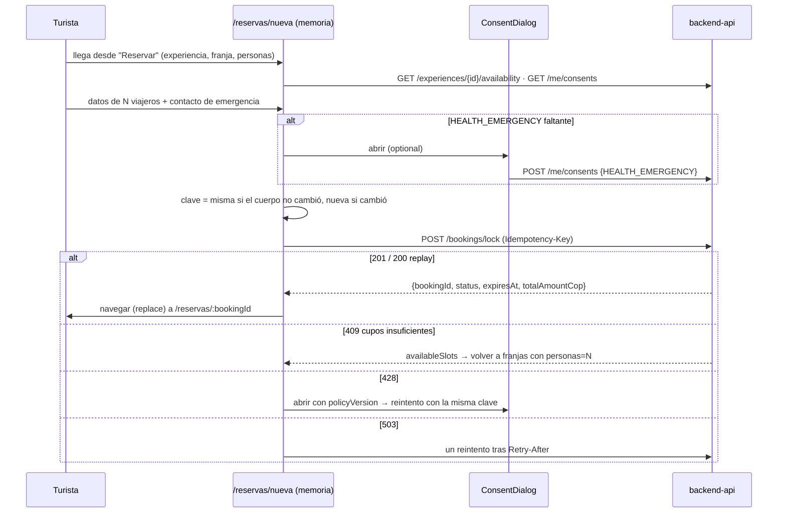

# ADR-0015: Formulario móvil de reserva con datos de viajeros solo en memoria, idempotencia por intención y precondición de consentimiento

- **Estado:** Aceptado (2026-10-09)
- **Proyecto / Módulo:** Intégrate · `frontend-pwa/` — `features/booking` (nuevo), `features/catalog` (selector de franjas), `app/` (rutas) (Etapa 1 · Fase 1.2 · Proceso 2 · T-1.10c)
- **Fecha:** 2026-10-09

## Contexto

T-1.10c formaliza la reserva: tras elegir franja y número de personas (T-1.10b), el turista captura, por cada viajero, la identificación civil y la EPS (exigida por la póliza de turismo), además de un contacto de emergencia, y bloquea los cupos. El backend ya expone `POST /api/v1/bookings/lock` (ADR-0008), con estas condiciones:
- solo `ROLE_TOURIST` y cabecera `Idempotency-Key` (UUIDv4) obligatoria;
- `requestedSlots` de **1 a 10**, `participants.length == requestedSlots`, `(docType, docNumber)` único y exactamente un `isHolder`;
- EPS y contacto de emergencia se cifran con AES-256-GCM;
- un replay con la misma clave y el mismo cuerpo devuelve 200 con el estado actual; con otro cuerpo, 409 `IDEMPOTENCY_KEY_REUSED`;
- otras respuestas: 409 `BOOKING_INSUFFICIENT_SLOTS` (con `availableSlots`) o `BOOKING_SCHEDULE_NOT_BOOKABLE`, 428 `CONSENT_HEALTH_EMERGENCY_REQUIRED` (con `requiredPurposes` y `policyVersion`) y 503 `CONCURRENCY_LOCK_TIMEOUT` con `Retry-After: 1`;
- `GET /api/v1/bookings/{bookingId}` devuelve la reserva propia con `status` y `ttlSecondsRemaining`.

La sesión, el `ConsentDialog` y `GET/POST /me/consents` ya existen (ADR-0013). FE-DIR-001 §4.4 prohíbe persistir datos médicos en texto plano en el cliente; en ADR-0013 se decidió que el borrador del formulario vive **solo en memoria**.

Hay dos brechas con lo construido:
1. El selector de T-1.10b permite hasta 30 personas (el tope de `minSlots`), pero el lock admite como máximo 10.
2. El botón "Reservar" está inhabilitado a la espera de esta tarea.

El pago y la cuenta regresiva del TTL son de T-1.10d; aun así, tras el lock el turista necesita ver que sus cupos quedaron apartados.

## Decisión

1. **Rutas (todas exigen `ROLE_TOURIST` con `RequireSession`):**
   | Ruta | Vista | Tarea |
   |---|---|---|
   | `/reservas/nueva?experiencia=<id>&franja=<id>&personas=<n>` | Formulario de reserva | T-1.10c |
   | `/reservas/:bookingId` | Estado de la reserva: "Cupos apartados hasta HH:MM" | T-1.10c (la base), que T-1.10d amplía con el checkout |

   - En la URL solo viajan identificadores y el número de personas, **nunca** datos de los viajeros.
   - Un visitante sin sesión va a `/ingresar?volver=…` y regresa al formulario.
   - En T-1.10b, "Reservar" pasa a ser un enlace activo a `/reservas/nueva` cuando hay una franja válida.
2. **Ajuste del selector de T-1.10b:** el *stepper* de personas queda en `min(10, maxCapacityPerSlot)`, el tope del contrato. Para más de 10 se muestra "Para grupos de más de 10 personas, haz varias reservas".
3. **Feature `booking` (`features/booking/`):** `api.ts` (lock con la cabecera `Idempotency-Key`, `getBooking`), `forms.ts` (esquema `zod/mini`), `queries.ts`, `components/` y `pages/`. Consume los `index.ts` públicos:
   - **de `catalog`:** `useAvailability`, para el resumen y la verificación de la franja;
   - **de `auth`:** `ConsentDialog`, `useMyConsents`, los tipos de documento y `normalizePhone`, que se exportan desde su `index.ts`. Es una línea, sin cambiar la lógica de `auth`, que tiene trabajo en curso en T-1.13b.
4. **Formulario (todo en estado de React; nada en `localStorage`, `sessionStorage`, IndexedDB ni la URL):**
   - **Resumen fijo arriba:** experiencia, fecha y hora local, personas y total en COP. Si la franja ya no existe o no alcanza para el grupo, el formulario no se muestra: se explica y se ofrece volver a las franjas.
   - **Una tarjeta por viajero**, numerada como "Viajero 1 de N". El primero es el **titular** (`isHolder`), con el nombre de la sesión precargado y editable. Cada tarjeta pide:
     - nombre completo;
     - tipo y número de documento (`inputmode="numeric"` para CC y TI);
     - EPS: texto libre con un `<datalist>` de las EPS más comunes de Colombia, porque el contrato admite cualquier texto de 2 a 120 caracteres; `autocomplete="off"`.
   - **Contacto de emergencia:** nombre y celular normalizado a E.164, con la ayuda "Alguien que no viaje con el grupo".
   - **Validación en el cliente** con el contrato y las reglas del backend: nombres de 3 a 150 caracteres sin espacios externos, documento `^[A-Za-z0-9]{4,20}$` (solo dígitos en CC y TI), EPS de 2 a 120 y documentos sin repetir dentro del grupo (sin distinguir mayúsculas). Los errores van por campo y el foco salta al primero.
   - **Errores 422 del servidor:** los `invalidParams` del tipo `participants[i].campo` se asignan a la tarjeta y al campo correspondientes.
   - **Aviso al salir con datos sin enviar:** `useBlocker` de React Router y `beforeunload` advierten "Si sales, se borrarán los datos de los viajeros".
5. **Precondición `HEALTH_EMERGENCY`:**
   - al abrir el formulario se consulta `GET /me/consents`. Si falta, se muestra un aviso arriba y, al pulsar "Apartar cupos", se abre `ConsentDialog` (modo `optional`); al otorgarla, el envío continúa sin volver a pulsar;
   - si a pesar de eso el servidor responde 428 (por una carrera o un cambio de política), se abre el mismo diálogo con la `policyVersion` del 428 y se reintenta con la misma clave.
6. **Idempotencia por intención:**
   - la clave (`crypto.randomUUID()`) se asocia en memoria a la serialización del cuerpo enviado;
   - **mismo cuerpo, misma clave:** un reintento por red caída o 503 reutiliza la clave, y si el primer intento sí llegó al servidor, el replay 200 devuelve la misma reserva, sin bloquear dos veces;
   - **cuerpo distinto, clave nueva:** si el turista corrige algo, se genera otra.
   - Un 409 `IDEMPOTENCY_KEY_REUSED` (no debería ocurrir) regenera la clave y pide reintentar.
7. **Respuestas del lock:**
   - **201 o 200 (replay):** se navega a `/reservas/:bookingId` con `replace`, para que "Atrás" no vuelva a un formulario ya enviado. El estado del formulario se descarta.
   - **409 `BOOKING_INSUFFICIENT_SLOTS`:** "Solo quedan N cupos en esta franja", con un enlace a las franjas con `personas=N` (o a elegir otra franja si N = 0). Se invalida la disponibilidad en caché.
   - **409 `BOOKING_SCHEDULE_NOT_BOOKABLE` o 404:** "Esta franja ya no está disponible", con un enlace a las franjas.
   - **503:** un reintento automático tras `Retry-After` (1 s), con el texto "Hay mucha demanda en esta franja, reintentando…". Si vuelve a fallar, se ofrece "Reintentar".
   - **`NetworkError`:** "Sin conexión. Tus datos siguen aquí", con "Reintentar" (misma clave).
   - **401:** lo resuelve el `HttpClient` (ADR-0013). Si la sesión terminó, la ruta protegida lleva a ingresar y el borrador se pierde, como se avisa.
8. **Estado de la reserva (`/reservas/:bookingId`):** `GET /bookings/{id}` muestra el resumen (personas, total y la hora límite `expiresAt` en hora de Bogotá) según el `status`:
   - `PENDING`: "Tus cupos están apartados hasta las HH:MM. El pago estará disponible en el siguiente paso." Sin botón de pago hasta T-1.10d.
   - `EXPIRED`: "El tiempo para pagar terminó y los cupos se liberaron", con un enlace a volver a reservar.
   - `CONFIRMED`: "Reserva confirmada" (el voucher llega en T-1.10e).
   - Cualquier otro estado: su nombre en español.
   - Un 404 (reserva ajena o inexistente) tiene vista propia.
   - La consulta guarda en caché solo el estado de la reserva, bajo la clave `['me', 'booking', id]`, que se borra al cerrar sesión. La respuesta del backend no incluye datos de los viajeros.
9. **Verificación de cierre:**
   - Quality Gate de FE-DIR-001 en verde.
   - Pruebas de componentes: validación por viajero (incluido el documento duplicado), cuerpo exacto del lock con `Idempotency-Key`, misma clave al reintentar tras un `NetworkError`, clave nueva al cambiar un campo, 409 con `availableSlots`, 428 → diálogo → reintento, 503 con un reintento automático, el borrador nunca va al almacenamiento y el aviso al salir.
   - De punta a punta contra el backend `dev` a 360 px: turista nuevo sin `HEALTH_EMERGENCY` → franja → formulario → diálogo de consentimiento → lock 201 → estado `PENDING` con su hora límite, cupos descontados en la disponibilidad y un doble envío simulado que no descuenta dos veces.

## Alternativas Descartadas
- **Guardar el borrador en `sessionStorage` para sobrevivir a una recarga:** se descartó en la revisión de T-1.11 (en memoria). Contiene EPS y documentos de terceros (FE-DIR-001 §4.4); el aviso al salir mitiga la pérdida accidental.
- **Pasar los datos de los viajeros por la URL o el estado del *router*:** quedan en el historial del navegador y en los registros del servidor.
- **Una clave de idempotencia nueva por cada pulsación:** un reintento tras una respuesta perdida bloquearía cupos dos veces hasta que venciera el TTL de 15 min.
- **Una sola clave por pantalla sin importar el cuerpo:** al corregir un dato, el servidor respondería 409 `IDEMPOTENCY_KEY_REUSED` en lugar de crear la reserva corregida.
- **Pedir `HEALTH_EMERGENCY` solo después de un 428:** es un viaje de ida y vuelta evitable y una sorpresa al final del formulario. `GET /me/consents` existe para anticiparlo, y el manejo del 428 queda como red de seguridad.
- **Lista cerrada (`<select>`) de EPS:** el contrato acepta texto libre y hay regímenes especiales y planes complementarios que una lista dejaría fuera. Un `<datalist>` ayuda sin restringir.
- **Hacer también el checkout (T-1.10d) en esta tarea:** la pasarela, la cuenta regresiva y el retorno de Wompi tienen decisiones propias. La vista de estado de esta tarea es la base que T-1.10d amplía, no algo que se tire.

## Consecuencias
- **Positivas:**
  - El turista completa la reserva hasta el bloqueo real de cupos.
  - Nada sensible toca el almacenamiento del navegador ni la URL.
  - Los reintentos son seguros: no hay doble bloqueo.
  - La precondición de consentimiento se resuelve antes de enviar.
  - La vista de estado queda lista para el checkout.
- **Negativas / Riesgos asumidos:**
  - Una recarga o una sesión expirada pierden el borrador; es el costo de no persistir datos médicos, mitigado con el aviso.
  - Los cupos quedan apartados 15 min sin poder pagarse hasta que exista T-1.10d; en `dev` se pueden confirmar con el simulador de pagos.
  - El tope de 10 personas obliga a los grupos grandes a hacer varias reservas.
  - Se amplía el `index.ts` de `auth` mientras T-1.13b trabaja en esa *feature*; el cambio es solo de exportaciones.

## Notas de implementación (2026-10-09)

- **Validación:** `zod/mini` (ADR-0013). La unicidad de documentos se valida con `superRefine` y el error queda en el segundo viajero repetido. Los errores se indexan por ruta (`participants.1.docNumber`), y los `invalidParams` del servidor (`participants[1].docNumber`, `emergencyContact.phone`) se traducen a esas mismas rutas.
- **Clave de idempotencia:** `createIntentKeys` guarda en memoria la clave junto a la serialización del cuerpo (`intentKey.ts`). Un 503 por contención se reintenta una sola vez tras 1 s, el valor de `Retry-After` del contrato, porque `ApiError` no expone las cabeceras.
- **Franja agotada mientras se llena el formulario:** el refresco de la disponibilidad (cada 30 s) no oculta el formulario, para no borrar los datos. Se muestra un aviso con el enlace a las franjas y el servidor decide al enviar (409).
- **Navegación:** `catalogKeys.availabilityOf(id)` invalida toda la disponibilidad de la experiencia tras el lock o tras un 409. `catalog` exporta `useAvailability`, `useExperience`, `catalogKeys`, `MAX_PARTICIPANTS` y sus tipos; `auth` exporta `DOC_TYPES`, `NUMERIC_DOC_TYPES`, `normalizePhone`, `fieldErrorsOf` y `DocType`, solo como exportaciones.
- **Aviso al salir:** usa el `BottomSheet` propio ("Seguir llenando" / "Salir"), no `window.confirm`; al cerrar la pestaña, el del navegador (`beforeunload`).
- **Selector de franjas:** "Reservar" es un enlace activo con la selección como identificadores. Con una capacidad mayor que 10 aparece la nota de grupos grandes.
- **Verificación:**
  - Quality Gate de FE-DIR-001 en verde: `test` 113/113 (14 nuevas de reserva y 1 del tope de grupo); *build* de 461 kB (141,7 kB gzip) sin advertencias.
  - De punta a punta contra el backend `dev` a 360 px:
    - registro de un turista nuevo sin `HEALTH_EMERGENCY` → franja real con 2 cupos → 2 personas → formulario con el titular precargado y el aviso de autorización;
    - "Apartar cupos" → `ConsentDialog` → `POST /me/consents` → `POST /bookings/lock` 201;
    - `/reservas/:id` muestra "Tus cupos están apartados hasta las 8:10 p. m." y el total de $ 160.000;
    - la disponibilidad bajó de 2 a 0, "Atrás" vuelve a las franjas y no al formulario enviado, y el almacenamiento del navegador no tiene datos de los viajeros.
  - La reutilización de la clave tras una caída de red y el reintento ante un 503 quedan cubiertos por pruebas de componentes.

## Contrato o Esquema Conceptual

