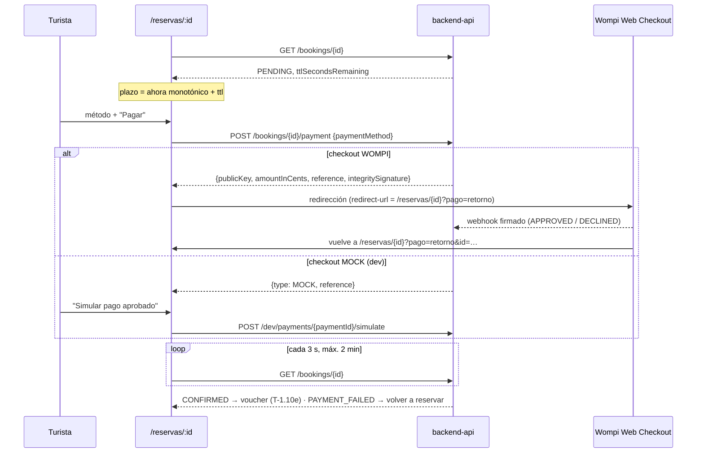

# ADR-0016: Checkout móvil con cuenta regresiva anclada al servidor y pago por redirección a la pasarela

- **Estado:** Aceptado (2026-10-09)
- **Proyecto / Módulo:** Intégrate · `frontend-pwa/` — `features/booking` (vista `/reservas/:bookingId`) (Etapa 1 · Fase 1.2 · Proceso 2 · T-1.10d)
- **Fecha:** 2026-10-09

## Contexto

T-1.10c aparta los cupos (`POST /bookings/lock`) y deja al turista en `/reservas/:bookingId` con la reserva `PENDING` y una hora límite. T-1.10d cobra esa reserva: barra de acción fija, **cuenta regresiva del TTL de 15 min**, desglose de tarifas y pago en COP (PSE, tarjetas y billeteras).

El backend ya expone lo necesario (ADR-0009):
- `POST /bookings/{id}/payment {paymentMethod: PSE|CARD|NEQUI|DAVIPLATA}` crea o retoma **un solo intento abierto** por reserva y devuelve `checkout`, que depende del proveedor activo:
  - `MOCK` (`{type, reference}`), en `dev`/`test`;
  - `WOMPI` (`{type, publicKey, currency, amountInCents, reference, integritySignature}`), en despliegue.
- Si la reserva ya no está `PENDING` o venció su TTL, responde 409 `PAYMENT_BOOKING_NOT_PAYABLE` con `bookingStatus`.
- La confirmación llega **solo por el webhook** (`APPROVED` → `CONFIRMED`; `DECLINED`/`VOIDED` → `PAYMENT_FAILED`, con los cupos devueltos). El cliente nunca decide el resultado.
- En `dev` existe `POST /api/v1/dev/payments/{paymentId}/simulate {status}`, que pasa el evento por el mismo procesador del webhook (en despliegue responde 404).
- `GET /bookings/{id}` devuelve `status` y `ttlSecondsRemaining`, recalculado por el servidor.

Dos restricciones condicionan la integración:
1. El reloj de un teléfono de gama baja puede estar desfasado, así que una cuenta regresiva calculada con `expiresAt` contra el reloj local mentiría.
2. FE-DIR-001 y la política de secretos favorecen no ejecutar JavaScript de terceros en el origen de la PWA, que tiene el access token en memoria.

## Decisión

1. **El checkout amplía la vista existente `/reservas/:bookingId`**: no hay ruta nueva. La ruta pasa a ser de flujo (`handle.flow`), sin navegación inferior y con "Atrás" al inicio. Con `status = PENDING` muestra, de arriba abajo:
   - **cuenta regresiva** "Tienes MM:SS para pagar";
   - **desglose**: valor por persona × personas = total, y la nota "El 85 % del valor va a la asociación comunitaria" (reparto 85/15 de la especificación);
   - **método de pago:** grupo de radio (PSE, tarjeta, Nequi, Daviplata) con objetivos de al menos 44 px;
   - **barra fija** "Pagar $ 160.000".

   Los demás estados siguen como en ADR-0015 §8.
2. **Cuenta regresiva anclada al servidor:**
   - `plazo = instante de la respuesta + ttlSecondsRemaining × 1000`, medido con `performance.now()` (monotónico); nunca `expiresAt` contra la hora del teléfono;
   - el texto visible se actualiza cada segundo;
   - el lector de pantalla solo oye hitos (`aria-live="polite"`): al cargar, a los 5 min, a 1 min y al vencer. No anuncia cada segundo;
   - en el último minuto el bloque pasa a color de advertencia y lo dice en texto;
   - al llegar a 0 se vuelve a consultar la reserva, que debería quedar `EXPIRED` (el worker corre cada 60 s): mientras tanto se muestra "El tiempo terminó, verificando…", con reintentos cada 5 s;
   - cada `GET /bookings/{id}` (al volver a la pestaña o tras pagar) vuelve a anclar el plazo;
   - con `prefers-reduced-motion` no se anima nada.
3. **Pago:**
   - "Pagar" llama a `POST /bookings/{id}/payment` con el método elegido; es idempotente del lado del servidor (un intento abierto por reserva);
   - un 409 `PAYMENT_BOOKING_NOT_PAYABLE` vuelve a consultar la reserva y muestra su estado (normalmente `EXPIRED`);
   - **`checkout.type = WOMPI` → redirección al Web Checkout de Wompi:** se navega a `https://checkout.wompi.co/p/` con `public-key`, `currency`, `amount-in-cents`, `reference`, `signature:integrity` y `redirect-url` = `<origen>/reservas/<id>?pago=retorno`. No se carga `widget.js` de terceros en el origen de la PWA. Al volver, Wompi añade `?id=<transacción>`, que solo se usa como señal para empezar a verificar;
   - **`checkout.type = MOCK` (solo `dev`/`test`) → panel "Pasarela de pruebas"**, claramente marcado, con "Simular pago aprobado" y "Simular pago rechazado" (`POST /dev/payments/{paymentId}/simulate`). No hay código condicional por entorno: el panel aparece solo cuando el servidor devuelve `MOCK`, y el backend lo niega en despliegue.
4. **Verificación del resultado:**
   - tras el retorno de Wompi o la simulación, la vista entra en "Confirmando tu pago…" y consulta `GET /bookings/{id}` cada 3 s durante 2 min como máximo;
   - el sondeo se pausa en segundo plano y se detiene en cuanto el estado deja de ser `PENDING`;
   - resultados: `CONFIRMED` → "¡Reserva confirmada!" con el enlace al voucher, que llega en T-1.10e; `PAYMENT_FAILED` → "El pago no se completó", con un enlace a volver a reservar (los cupos ya se liberaron);
   - si pasan los 2 min sin cambio: "Aún no recibimos la confirmación de la pasarela. Te avisaremos por correo", con el botón "Volver a consultar".
   - El cliente **nunca** marca una reserva como pagada.
5. **Componentes nuevos en `features/booking`:**
   - `CountdownBanner` y `useServerCountdown(ttlSeconds, fetchedAt)`, un *hook* puro con temporizador inyectable para las pruebas;
   - `PaymentMethodPicker`, `PriceBreakdown` y `MockGatewayPanel`;
   - `wompiCheckoutUrl(checkout, redirectUrl)`, función pura con pruebas;
   - `api.ts` gana `startPayment` y `simulatePayment`.
6. **Verificación de cierre:**
   - Quality Gate de FE-DIR-001 en verde.
   - Pruebas: la cuenta regresiva no depende del reloj del sistema (reloj desfasado simulado), los anuncios solo en los hitos, el vencimiento vuelve a consultar, el cuerpo de `startPayment`, el 409 → estado vencido, la URL exacta de Wompi (parámetros codificados y `redirect-url`), el panel Mock solo con `MOCK`, y el sondeo que se detiene al confirmar o al agotar el tiempo.
   - De punta a punta contra el backend `dev` (`PAYMENT_PROVIDER=MOCK`) a 360 px: reserva → checkout con la cuenta regresiva → pagar → simular aprobado → "Reserva confirmada" (y voucher emitido en el backend); otra reserva → simular rechazado → `PAYMENT_FAILED` con los cupos devueltos.
   - Wompi real se valida en su sandbox en T-2.16.

## Alternativas Descartadas
- **Widget de Wompi (`widget.js`) dentro de la PWA:** ejecuta JavaScript de terceros en el mismo origen que guarda el access token en memoria. Además, añade peso y un modal ajeno en teléfonos de gama baja. La redirección aísla la pasarela en su dominio, y es el patrón que Wompi documenta para su Web Checkout.
- **Cuenta regresiva con `expiresAt` contra el reloj del teléfono:** un reloj desfasado mostraría tiempo de más (y el turista llegaría tarde) o de menos. `ttlSecondsRemaining` del servidor y un reloj monotónico lo evitan.
- **Que el cliente confirme el pago con el `id` de transacción que añade Wompi al volver:** el resultado lo decide el webhook firmado (ADR-0009); el parámetro de retorno puede manipularse.
- **WebSocket o SSE para el resultado:** el backend no tiene canal de empuje. Un sondeo acotado (3 s durante 2 min, en pausa en segundo plano) basta para un evento que llega en segundos.
- **Ruta separada `/reservas/:id/pago`:** duplicaría la carga y los estados de la reserva. Una sola vista con el estado como fuente de verdad sigue a la reserva en todas sus transiciones.
- **Ocultar el panel Mock con una variable `VITE_*` de entorno:** sería una segunda fuente de verdad. El servidor ya decide el proveedor y el simulador no existe fuera de `dev`/`test`.

## Consecuencias
- **Positivas:**
  - Se cierra el flujo de reserva hasta la confirmación en `dev`.
  - La cuenta regresiva es fiable aunque el reloj del teléfono esté mal.
  - No entra JavaScript de terceros en la PWA, y el resultado del pago nunca depende del cliente.
  - El mismo código sirve para Mock y Wompi.
- **Negativas / Riesgos asumidos:**
  - La redirección saca al turista de la PWA durante el pago. Si la pasarela no vuelve (cierra la pestaña), la reserva se confirma igual por webhook y el correo con el voucher avisa.
  - El flujo con Wompi solo se prueba con pruebas unitarias hasta el sandbox de T-2.16.
  - Mientras un pago aprobado tarde (después del TTL) se reembolsa por `LATE_APPROVAL` (ADR-0009), la PWA solo muestra el estado que devuelva la reserva.
  - El sondeo genera hasta 40 peticiones por pago en el peor caso.

## Notas de implementación (2026-10-09)

- **Cuenta regresiva:**
  - `useBooking` añade a cada respuesta `receivedAt = performance.now()`, dentro de `queryFn` y no durante el render;
  - `useServerCountdown(receivedAt, ttlSeconds)` cuenta con `setInterval` de 1 s y nunca lee `Date`;
  - el reloj visible tiene `role="timer"`, y los hitos van en una región `aria-live="polite"` aparte.
- **Sondeo:** `useBooking` recibe una política sobre la última respuesta:
  - `EXPIRED_POLL_MS` (5 s) si el TTL ya venció en el cliente y la reserva sigue `PENDING`;
  - `VERIFY_POLL_MS` (3 s) mientras se verifica un pago, con tope de 2 min;
  - nada en los demás casos.
  
  El estado de verificación vive en la página y no en el componente de checkout, para que la política lo vea. Una primera versión sondeaba cada 3 s aunque no hubiera un pago en curso, y se corrigió antes de las pruebas.
- **Pago Mock:** al iniciar un pago Mock se ocultan la barra "Pagar" y el selector (que queda inhabilitado), y aparece el panel de pruebas. Así no se ofrecen dos acciones primarias a la vez.
- **Wompi:** `externalNavigation.assign` aísla la salida a Wompi para observarla en las pruebas. No se carga ningún `<script>` de Wompi.
- **Ruta:** `/reservas/:bookingId` pasa a ser de flujo (`handle`), sin navegación inferior y con "Atrás".
- **Verificación:**
  - Quality Gate de FE-DIR-001 en verde: `test` 123/123 (10 nuevas de checkout, cuenta regresiva y Wompi); *build* de 467 kB (143,6 kB gzip) sin advertencias.
  - De punta a punta contra el backend `dev` (`PAYMENT_PROVIDER=MOCK`) a 360 px:
    - una reserva real con poco más de un minuto restante (01:17 → 01:15) → Nequi → "Pagar" → "Simular pago aprobado" → "¡Reserva confirmada!", y Mailpit recibió "Tu reserva está confirmada" con el voucher (cadena de T-1.7, T-1.8 y T-1.9);
    - otra reserva de 1 persona (cupos de 2 a 1, cuenta regresiva en 14:57) → "Simular pago rechazado" → "El pago no se completó" y cupos de vuelta en 2;
    - sin *scroll* horizontal.

## Contrato o Esquema Conceptual

