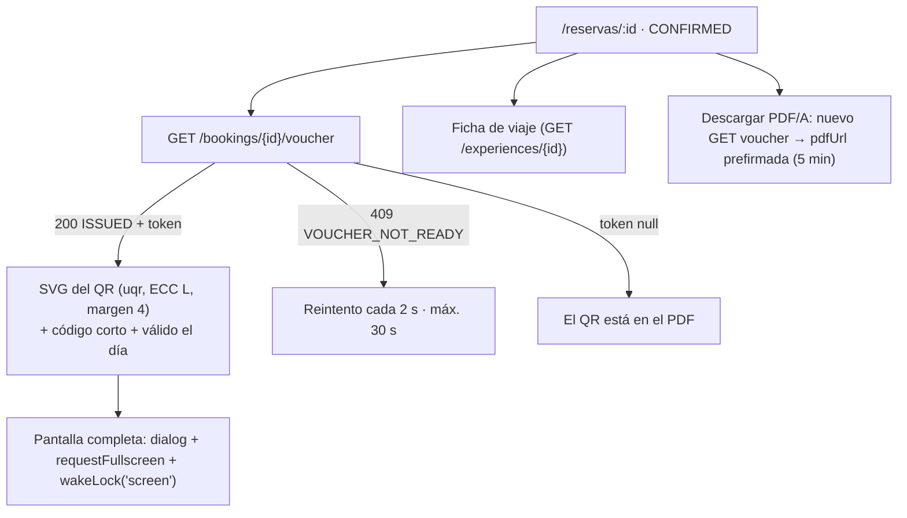

# ADR-0017: Confirmación móvil con el QR del voucher dibujado en el cliente, pantalla completa sin reposo y PDF/A por URL prefirmada

- **Estado:** Aceptado (2026-10-09)
- **Proyecto / Módulo:** Intégrate · `frontend-pwa/` — `features/booking` (vista `/reservas/:bookingId` en estado `CONFIRMED`) (Etapa 1 · Fase 1.2 · Proceso 2 · T-1.10e)
- **Fecha:** 2026-10-09

## Contexto

T-1.10e cierra el flujo del turista. Con la reserva `CONFIRMED` hay que mostrar el **QR criptográfico de alta densidad a pantalla completa**, la **ficha de viaje** y la **exportación a PDF/A** del voucher oficial.

El backend ya lo expone (ADR-0010) en `GET /api/v1/bookings/{id}/voucher` (`Cache-Control: no-store`):
- campos: `shortCode` (8 caracteres, código de contingencia), `status` (`ISSUED | REVOKED | CONSUMED | EXPIRED`), `validDate`, `expiresAt`, `token`, `pdfStatus` (`READY | GENERATING`) y `pdfUrl` (prefirmada **5 min**, o `null`);
- `token` es el JWT RS256 compacto (~650 caracteres) que codifica el QR, o `null` si ya no se puede re-derivar; en ese caso el QR original sigue en el PDF;
- un voucher aún en emisión asíncrona responde 409 `VOUCHER_NOT_READY` con `Retry-After: 2`.

ADR-0010 §6 fija para el QR la corrección de errores **L** (versión ≈ 18), un margen de 4 módulos, alto contraste y la indicación de mostrarlo "a pantalla completa con el brillo al máximo". La PWA no tiene dependencia de QR. El navegador no puede subir el brillo de la pantalla, pero sí impedir que se apague (Screen Wake Lock API) y entrar en pantalla completa.

## Decisión

1. **Vista `CONFIRMED` de `/reservas/:bookingId`** (sin ruta nueva):
   - **mensaje** "¡Reserva confirmada!";
   - **tarjeta del voucher**: QR, código corto agrupado `ABCD EFGH`, válido el día X y botón primario **"Mostrar QR a pantalla completa"**;
   - **ficha de viaje**: experiencia, fecha y hora local, punto de encuentro y vereda, personas, asociación y un recordatorio de las recomendaciones de seguridad, con datos de `GET /experiences/{id}` y la disponibilidad ya en caché;
   - **acción "Descargar voucher (PDF/A)"**.

   La barra fija inferior lleva "Mostrar QR".
2. **QR dibujado en el cliente con `uqr`** (MIT, sin dependencias, ~10 kB; versión fijada con `~` en la última con al menos 14 días de publicada):
   - genera la matriz con corrección **L** y la PWA la dibuja como **SVG propio**: `<rect>` por fila con `shape-rendering="crispEdges"`, negro `#000` sobre blanco `#fff`, 4 módulos de margen y `role="img"` con el `aria-label` "Código QR del voucher, válido el …";
   - **Contraste:** negro y blanco puros son la condición de lectura del código, no colores de interfaz. Para no romper la prohibición de hex en línea (FE-DIR-001 §2.1), se agregan dos tokens nuevos, `--color-qr-ink` (`#000000`) y `--color-qr-paper` (`#ffffff`), en `tokens.ts`, `index.css` y `tokens.test.ts`, con una prueba de contraste de 21:1;
   - el QR se genera solo con `token` presente. Con `token = null` se explica "El QR está en el PDF del voucher" y se destaca el PDF; el código corto sigue visible.
3. **Pantalla completa (`QrFullscreen`)**:
   - `<dialog>` modal a toda la pantalla sobre `--color-qr-paper`, con el QR al mayor tamaño cuadrado que quepa (`min(100vw, 100dvh) − márgenes`), el código corto grande y "Cerrar" (Esc y botón de 44 px);
   - al abrir: `document.documentElement.requestFullscreen()` si existe, y **`navigator.wakeLock.request('screen')`** para que la pantalla no se apague mientras el guía escanea. Se libera al cerrar y se vuelve a pedir si la pestaña regresa a primer plano con el diálogo abierto;
   - texto visible: "Sube el brillo de la pantalla para facilitar la lectura", porque la web no controla el brillo;
   - si una de las API falta, se degrada en silencio;
   - con `prefers-reduced-motion` no hay transición.
4. **Estados del voucher:**
   - `ISSUED`: QR y acciones.
   - `CONSUMED`: "Este voucher ya se usó el …", sin QR a pantalla completa.
   - `REVOKED`: "Voucher anulado".
   - `EXPIRED`: "Voucher vencido".
   - En los tres últimos la ficha de viaje se mantiene.
   - **409 `VOUCHER_NOT_READY`**: "Estamos emitiendo tu voucher…", reintentando cada 2 s hasta 30 s; después, "Volver a consultar".
   - **404**: "Aún no hay voucher para esta reserva".
5. **PDF/A:**
   - "Descargar voucher (PDF/A)" vuelve a pedir el voucher **al hacer clic**, porque la URL prefirmada caduca a los 5 min, y navega a la `pdfUrl` fresca (`externalNavigation`, ADR-0016), donde el navegador la descarga o la abre;
   - con `pdfStatus = GENERATING` el botón queda inhabilitado con "Preparando el PDF…" y se reconsulta cada 3 s hasta 30 s;
   - texto: "Descárgalo para tenerlo sin conexión el día del recorrido", porque la vista con el QR exige red hasta la Fase 2 (T-2.8).
6. **Datos y privacidad:**
   - el `token` es una credencial al portador: vive solo en la caché de TanStack bajo `['me', 'voucher', id]` (se borra al cerrar sesión) y nunca se escribe en `localStorage`, `sessionStorage` ni IndexedDB;
   - guardarlo para uso sin conexión es decisión de T-2.8;
   - la ficha no muestra EPS ni contacto de emergencia.
7. **Dependencias:** `features/booking` usa `useExperience`, que `catalog` ya exporta. `uqr` entra solo en `features/booking/qr/`.
8. **Verificación de cierre:**
   - Quality Gate de FE-DIR-001 en verde, incluido el contraste de los tokens nuevos.
   - Pruebas:
     - el SVG del QR es la matriz de `uqr` (corrección L, margen de 4 módulos) y **un decodificador recupera exactamente el token**; se agrega `jsqr` solo como dependencia de desarrollo (no entra en el *bundle*);
     - `token = null` → aviso y PDF;
     - el reintento ante `VOUCHER_NOT_READY` y el botón de PDF en `GENERATING`;
     - el clic en PDF vuelve a pedir el voucher y navega a la URL nueva;
     - la pantalla completa pide `wakeLock` y lo libera al cerrar (simulado);
     - los estados `CONSUMED`, `REVOKED` y `EXPIRED`.
   - De punta a punta contra el backend `dev` a 360 px: reserva confirmada → QR en la vista y a pantalla completa → **QR leído desde una captura** y comparado con el JWT de la API → PDF descargado por la URL prefirmada (LocalStack) → el QR del PDF coincide.

## Alternativas Descartadas
- **Mostrar solo el PNG del QR extraído del PDF:** exige descargar y procesar el PDF en el teléfono, y el QR del PDF está dimensionado para impresión. Generarlo en el cliente desde el mismo token da un vector nítido a cualquier tamaño.
- **`qrcode` (node-qrcode):** arrastra `pngjs` y `yargs` y pesa varias veces más. `qrcode-generator` es viable, pero `uqr` expone la matriz para dibujar un SVG propio con control del margen y de la corrección de errores.
- **Canvas en lugar de SVG:** un canvas se reescala con borrosidad en pantallas de alta densidad y no tiene nombre accesible propio. El SVG con `crispEdges` es nítido a cualquier tamaño.
- **Corrección M o superior:** subiría la versión del QR (más módulos) para un token de ~650 caracteres y empeoraría la lectura en cámaras de gama baja (ADR-0010 §6). Se usa L, igual que en el PDF.
- **Guardar el token o el PDF para uso sin conexión ya:** es la decisión de T-2.8 (Service Worker e IndexedDB, con cifrado y caducidad). Adelantarla sin esa infraestructura dejaría una credencial al portador en el almacenamiento del navegador.
- **Abrir la `pdfUrl` recibida al cargar la vista:** caduca a los 5 min, y un turista que vuelve más tarde recibiría un 403 de S3. Pedirla al hacer clic garantiza una URL vigente.
- **Usar `ink`/`canvas` para el QR:** `ink` (`#111827`) sobre `canvas` da 17,7:1, pero los lectores de QR esperan negro puro y la especificación de ADR-0010 lo pide. Se agregan dos tokens con propósito único en lugar de un hex en línea.

## Consecuencias
- **Positivas:**
  - Se cierra el flujo del turista de punta a punta (DoD de la Fase 1.2, primer punto).
  - El QR es nítido y legible a pantalla completa, con la pantalla encendida mientras se escanea.
  - El PDF oficial siempre se descarga con una URL vigente.
  - La credencial no persiste en el navegador.
- **Negativas / Riesgos asumidos:**
  - Nueva dependencia de ejecución (`uqr`) y una de desarrollo (`jsqr`).
  - Dos tokens de color nuevos, de uso exclusivo para el QR.
  - El QR en la PWA exige conexión hasta T-2.8; mientras tanto se recomienda descargar el PDF.
  - Wake Lock y Fullscreen no existen en todos los navegadores; sin ellos, la pantalla puede apagarse según la configuración del teléfono.
  - El QR de alta densidad sigue dependiendo de la cámara del lector. El código corto es la contingencia (T-2.12).

## Notas de implementación (2026-10-09)

- **Dependencias:** `uqr` `~0.1.3` (ejecución) y `jsqr` `~1.4.0` (solo desarrollo).
- **Tokens nuevos:** `qr.ink`/`qr.paper` en `tokens.ts` y `--color-qr-ink`/`--color-qr-paper` en `@theme`, con su prueba de contraste (21:1). Una prueba de sincronía con `index.css?raw` se descartó porque Vitest corre con `css: false` y el import llega vacío; los demás tokens tampoco la tienen.
- **SVG:** un solo `<path>` con un subtrazo por módulo (`M x y h1 v1 h-1 z`), sobre `fill-qr-paper` y `fill-qr-ink`. Las funciones puras viven en `qr/matrix.ts`: `qrMatrix`, `qrPath` y `groupShortCode`.
- **Reintentos:** `useVoucher` decide su `refetchInterval` por los contadores de TanStack. Hasta 15 errores `VOUCHER_NOT_READY` (cada 2 s) y hasta 10 lecturas con `GENERATING` (cada 3 s).
- **Pantalla completa:** `requestFullscreen` se pide dentro del clic y se omite donde no existe (iOS). `navigator.wakeLock` se vuelve a pedir con `visibilitychange` y se libera al cerrar. El aviso "Sube el brillo de la pantalla" va en la vista a pantalla completa.
- **Copia de la confirmación:** "Recibimos tu pago. Tu voucher está abajo y también te lo enviamos al correo."
- **Diferencias con §8:** el QR del PDF no se decodificó en el navegador, porque eso exigiría rasterizar el PDF. Esa equivalencia ya la prueban las pruebas del backend (ADR-0010: el QR del PDF renderizado decodifica igual al token de la API). Aquí se verificó que **el QR de la PWA decodifica igual al token de la API**, y como ambos salen del mismo token, son equivalentes.
- **Verificación:**
  - Quality Gate de FE-DIR-001 en verde: `test` 133/133 (10 nuevas, incluida la decodificación con `jsqr` del SVG renderizado); *build* de 486,9 kB (149,9 kB gzip) sin advertencias. **Riesgo:** el *bundle* se acerca al umbral de 500 kB, así que la próxima tarea con dependencias debería separar rutas con `lazy`.
  - De punta a punta contra el backend `dev` a 360 px sobre la reserva confirmada en T-1.10d:
    - QR, código de contingencia `3XRD 96RG` y ficha de viaje, sin *scroll* horizontal;
    - el SVG de la página, decodificado fuera del navegador con `jsqr`, es **igual al token de la API** (804 caracteres, QR versión 20);
    - la URL prefirmada del PDF responde 200 `application/pdf` (`%PDF-1.6`, metadatos `pdfaid`);
    - pantalla completa: diálogo modal con el QR de 328 × 328 px; Esc lo cierra y el foco vuelve a "Mostrar QR a pantalla completa".
  - En el panel emulado del navegador `requestFullscreen` no entra en pantalla completa (el diálogo sí ocupa la vista completa), y la API de Wake Lock está presente.

## Contrato o Esquema Conceptual

