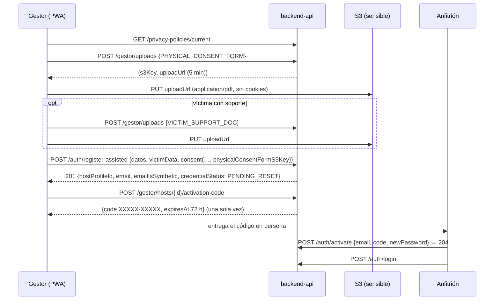

# ADR-0018: Enrolamiento asistido desde el smartphone del Gestor de Enlace, con subida directa a S3 y entrega del código de activación

- **Estado:** Aceptado
- **Proyecto / Módulo:** Intégrate · `frontend-pwa/` — `features/enrollment` (nuevo), `features/auth` (activación del anfitrión), `app/` (rutas del Gestor con carga diferida) (Etapa 1 · Fase 1.2 · Proceso 1 · T-1.12)
- **Fecha:** 2026-10-10

## Contexto

T-1.12 es la última tarea de la Fase 1.2: el portal del Gestor de Enlace (`/gestor/anfitriones/enrolamiento`), con un formulario táctil y la captura del consentimiento, optimizado para un smartphone en campo. El backend está completo (ADR-0007, ADR-0014):
- **`POST /api/v1/auth/register-assisted`** (`ROLE_LINK_MANAGER` con acreditación `ACTIVE`; si no, 403 `ENROLLMENT_MANAGER_NOT_ACTIVE`):
  - pide `fullName`, `docType`, `docNumber`, `phone`, `email` opcional (si falta, se genera uno sintético `@comunidad.integrate.co`), `victimData` y `consent {policyVersion, purposes: [PERSONAL_DATA, SENSITIVE_VICTIM], physicalConsentFormS3Key}`;
  - `victimData` = `{victimCondition, ruvRegistrationNumber?, victimizationType? (texto ≤ 80), supportDocS3Key?}`. Con `victimCondition = false`, mandar el RUV, el hecho o el soporte da error. El soporte es opcional aun siendo víctima;
  - los datos de víctima se cifran con AES-256-GCM y nunca se devuelven;
  - el consentimiento queda con canal `ASSISTED_PROXY`, `captured_by` = el gestor, y su IP y *user agent*;
  - errores: 409 si la persona ya existe y 422 `ENROLLMENT_DOCUMENT_INVALID` si un PDF no existe, no es PDF, pesa más de 5 MB o ya se usó.
- **`POST /api/v1/gestor/uploads {kind: PHYSICAL_CONSENT_FORM | VICTIM_SUPPORT_DOC}`** devuelve `{s3Key, uploadUrl, contentType: application/pdf, maxSizeBytes, expiresAt (5 min)}`. El cliente hace `PUT` directo a S3; LocalStack ya tiene CORS para `localhost:5173`.
- **`GET /api/v1/gestor/hosts`** pagina los anfitriones de la jurisdicción (documento con sus 4 últimos caracteres, sin datos de víctima, `credentialStatus`).
- **`POST /api/v1/gestor/hosts/{id}/activation-code`** devuelve `{code: XXXXX-XXXXX, expiresAt (72 h)}` una sola vez (`no-store`); emitirlo de nuevo revoca el anterior.
- **`POST /api/v1/auth/activate {email, code, newPassword}`** (público) deja la cuenta `ACTIVE`.

Sin la pantalla de activación, un anfitrión enrolado no tiene cómo definir su contraseña: el ciclo del enrolamiento no se cierra.

Las restricciones vienen de FE-DIR-001: la Directiva 6 exige que el módulo del Gestor muestre su estado de conexión, y la Directiva 4.4 prohíbe persistir datos de víctima. Además, el *bundle* está en 486,9 kB, cerca del umbral de advertencia de 500 kB (ADR-0017).

## Decisión

1. **Rutas del Gestor (`ROLE_LINK_MANAGER`, bajo `ManagerLayout`), con carga diferida (`lazy`) de React Router:**
   | Ruta | Vista |
   |---|---|
   | `/gestor` | Panel de jornada (*placeholder* de la Fase 2) con accesos a "Enrolar anfitrión" y "Mis anfitriones" |
   | `/gestor/anfitriones` | Lista paginada de la jurisdicción, con estado y "Emitir código de activación" |
   | `/gestor/anfitriones/enrolamiento` | Formulario de enrolamiento asistido |

   La navegación inferior del Gestor queda en "Jornada", "Anfitriones" y "Mi cuenta".

   **División del código:** las páginas del Gestor (y las de reserva, que el turista anónimo no necesita al entrar) pasan a cargarse con `lazy`, para bajar el *bundle* inicial del umbral. El catálogo sigue cargándose de inmediato.
2. **Formulario de enrolamiento (`features/enrollment`), en tres secciones en una sola página**, con "Registrar anfitrión" en la barra fija:
   1. **Datos del anfitrión:** nombre, tipo y número de documento, celular E.164 y correo opcional, con la ayuda "Si no tiene correo, se le asigna uno interno y recupera el acceso con un código tuyo". Reutiliza las reglas de `auth`.
   2. **Condición de víctima** (Ley 1448), con radios "Sí"/"No":
      - con "Sí" aparecen el número RUV (opcional, ≤ 40), el hecho victimizante y el **documento soporte** en PDF (opcional);
      - el hecho es un `<select>` con los hechos del Registro Único de Víctimas, más "Otro (especificar)" con texto, que se envía como texto de hasta 80 caracteres, como admite el contrato;
      - con "No" esos campos se ocultan **y se vacían**, porque el servidor rechaza datos de víctima con `victimCondition = false`.
   3. **Consentimiento asistido:**
      - enlace a la política vigente (`GET /privacy-policies/current`), con la indicación de leérsela al anfitrión;
      - dos casillas obligatorias y sin marcar, `PERSONAL_DATA` y `SENSITIVE_VICTIM`, redactadas en primera persona del anfitrión ("La persona autoriza…");
      - **el formato físico firmado** en PDF, obligatorio.
   - **Validación** con `zod/mini` según el contrato (más el PDF ≤ 5 MB y del tipo correcto antes de subirlo). Los errores van por campo, con el foco en el primero. Los `invalidParams` de un 422 se asignan a su campo.
   - **Todo en memoria**, con el aviso al salir de ADR-0015 (`useBlocker` + `beforeunload`). Al terminar, el estado se descarta. Los datos de víctima nunca se muestran después del envío.
3. **Subida de PDF (`DocumentUpload`):**
   - `<input type="file" accept="application/pdf">` con un botón de 44 px;
   - al elegir el archivo se valida el tipo y el tamaño, se pide `POST /gestor/uploads` y se hace `PUT` a `uploadUrl` con `Content-Type: application/pdf`;
   - el `PUT` se hace con `fetch` dentro de `features/enrollment/api.ts` (no en un componente) y sin `credentials`, porque es otro origen y no debe llevar cookies;
   - la vista muestra el estado: "Subiendo…" → "Archivo cargado: nombre.pdf (1,2 MB)", con "Cambiar";
   - la `s3Key` se guarda en el formulario. Si al enviar responde 422 `ENROLLMENT_DOCUMENT_INVALID` (por ejemplo, la URL caducó antes del `PUT`), se marca el archivo para volver a subirlo.
   - **Solo se aceptan PDF**: se recomienda la opción "Escanear" del teléfono (Google Drive o Archivos en Android, Notas en iOS), que produce un PDF. Convertir una foto a PDF en el cliente queda fuera de esta tarea.
4. **Estado de conexión (Directiva 6):**
   - una insignia en la cabecera del formulario ("En línea" / "Sin conexión") a partir de `navigator.onLine` y sus eventos;
   - sin conexión, "Registrar anfitrión" queda inhabilitado con la nota "El enrolamiento necesita conexión. Tus datos siguen aquí". La cola diferida es de la Fase 2 (T-2.13).
5. **Envío y resultado:**
   - **201:** pantalla "Anfitrión registrado" con el nombre, el correo y la marca de sintético, más el botón **"Emitir código de activación"**;
   - el código se muestra **una sola vez**: grande, agrupado `XXXXX-XXXXX`, con la fecha de vencimiento (72 h), las instrucciones para el anfitrión (entrar a `/activar` con su correo y el código) y la advertencia "No se volverá a mostrar";
   - **errores:** 403 `ENROLLMENT_MANAGER_NOT_ACTIVE` → "Tu acreditación como gestor no está activa"; 409 → "Ya existe una cuenta con ese documento o correo"; 422 de documento → volver a subir. El envío se protege contra el doble clic (botón inhabilitado mientras corre).
6. **Lista de anfitriones (`/gestor/anfitriones`):**
   - tarjetas con nombre, documento `CC ••••7483`, celular y estado ("Activo" / "Pendiente de activación"), con "Ver más" para paginar;
   - "Emitir código de activación" aparece en las cuentas pendientes y en las de correo sintético. Un 409 (cuenta activa con correo real) responde "Esta persona recupera su acceso por correo".
7. **Activación del anfitrión (`/activar`, pública, en `features/auth`):**
   - correo (precargado con `?correo=`), código (tolera minúsculas, guiones y espacios), nueva contraseña (12–128) y su confirmación;
   - un 204 lleva a `/ingresar` con el aviso "Cuenta activada";
   - un 401 responde con un mensaje único: "El código no es válido, venció o ya se usó. Pide uno nuevo a tu gestor".

   Solo se agregan una página y una ruta a `auth`. No se toca el login, que T-1.13b va a modificar.
8. **Verificación de cierre:**
   - Quality Gate de FE-DIR-001 en verde; *build* sin advertencias y con el *chunk* inicial por debajo del de T-1.10e.
   - Pruebas:
     - cuerpo exacto de `register-assisted`, con y sin condición de víctima (y los campos vaciados al cambiar a "No");
     - subida: validación de tipo y tamaño, `PUT` con el `Content-Type` correcto y sin cookies;
     - bloqueo sin conexión;
     - errores 403, 409 y 422;
     - código mostrado una vez;
     - lista paginada con el documento enmascarado;
     - activación con 204 y 401;
     - nada de lo sensible queda en el almacenamiento.
   - De punta a punta contra el backend `dev` y LocalStack a 360 px: gestor acreditado → enrolar una víctima con soporte y formato físico (PDF reales subidos a S3) → código → anfitrión en `/activar` → inicio de sesión del anfitrión.

## Alternativas Descartadas
- **Asistente de varios pasos (una sección por pantalla):** con tres secciones cortas, una página con anclas pierde menos contexto, es más fácil de revisar antes de enviar y evita el estado de navegación entre pasos. La barra fija mantiene la acción a la mano.
- **Lista cerrada de hechos victimizantes enviada como código:** el contrato admite texto libre (≤ 80) y el backend no tiene catálogo. Un `<select>` con los hechos del RUV más "Otro" da consistencia sin inventar un catálogo que el servidor no valida.
- **Aceptar fotos (JPEG/PNG) del formato firmado y convertirlas a PDF en el cliente:** exige una librería de PDF (decenas de kB) y cuidar la calidad y el tamaño. Las apps de escaneo de los teléfonos ya generan PDF, y el contrato exige `application/pdf`.
- **Subir los PDF a través del backend:** duplica el tráfico en redes rurales y contradice ADR-0007 §5 (subida directa con URL prefirmada).
- **Guardar el borrador o los PDF para enrolar sin conexión:** son datos sensibles de víctimas (FE-DIR-001 §4.4). La cola cifrada sin conexión es de la Fase 2 (T-2.13).
- **Dejar la activación del anfitrión para otra tarea:** el enrolamiento quedaría sin cierre verificable, porque el código no serviría de nada.
- **Mantener todo en un solo *bundle*:** la próxima dependencia superaría los 500 kB, lo que incumple la Directiva 7. La carga diferida de las rutas que no se usan al entrar lo evita sin cambiar la arquitectura.

## Consecuencias
- **Positivas:**
  - Se cierra la Fase 1.2: los tres criterios del DoD quedan verificables.
  - El Gestor enrola en campo desde su teléfono, con el consentimiento físico respaldado en S3 y los datos de víctima cifrados de punta a punta.
  - El anfitrión activa su cuenta sin correo propio.
  - El *bundle* inicial baja.
- **Negativas / Riesgos asumidos:**
  - Solo se aceptan PDF, lo que exige que el gestor sepa escanear a PDF con su teléfono.
  - Enrolar exige conexión hasta la Fase 2.
  - La URL prefirmada vence a los 5 min: con una señal muy lenta, la subida puede fallar y hay que reintentarla.
  - Las rutas diferidas muestran una carga breve la primera vez que se abren.
  - Se agrega una página a `features/auth`, que tiene trabajo en curso (T-1.13b), aunque sin tocar las existentes.

## Notas de implementación (2026-10-10)
- **Estructura:**
  - `features/enrollment`:
    - `api.ts`: contrato, `putToStorage` con `credentials: 'omit'` y `UploadRejectedError`;
    - `forms.ts`: borrador, validación con `zod/mini`, `withVictimAnswer`, `serverErrorsOf` y `pdfProblem`;
    - `connectivity.ts`: `useOnlineStatus` con `useSyncExternalStore`;
    - `queries.ts`: `useManagedHosts`, consulta infinita bajo `['me', …]`;
    - componentes `DocumentUpload`, `ConnectionBadge` y `ActivationCodeIssuer`;
    - páginas `EnrollmentPage` y `HostsPage`.
  - `features/auth` suma `activation.ts` y `pages/ActivatePage.tsx`, y exporta `PolicyLink`, `useCurrentPolicy` y `PrivacyPolicy`. No se tocó `LoginPage` ni `auth.test.tsx`: sus pruebas van en `activation.test.tsx`.
  - El panel `/gestor` (`features/home`) ofrece accesos a "Enrolar anfitrión" y "Mis anfitriones".
- **Hechos victimizantes:** se envían como códigos legibles (`DESPLAZAMIENTO_FORZADO`, como el ejemplo del contrato), y "Otro" como el texto escrito (≤ 80).
- **Errores del servidor por campo:** un 422 asigna `invalidParams` a cada campo. `consent.physicalConsentFormS3Key` y `victimData.supportDocS3Key` vacían ese PDF con "El servidor no aceptó este archivo. Súbelo de nuevo." Para el resto se muestra un mensaje propio en español, porque el `reason` del servidor es técnico y en inglés.
- **Subida:**
  - la subida en curso se cancela con `AbortController` si la sección se oculta (al marcar "No");
  - si S3 rechaza el `PUT` (p. ej. URL vencida), se pide elegir el archivo otra vez y se conserva el archivo anterior si ya estaba cargado.
- **Código de activación:** vive solo en el estado del componente que lo emite (no en `useMutation` ni en la caché). En la lista, las cuentas con correo sintético o pendientes ofrecen el botón, con la nota "Si ya tenía uno, ese código dejará de servir".
- **Cambios fuera del módulo:**
  - `createHttpClient` ya no excluye de la renovación del token todo `/v1/auth/*`: `register-assisted` lleva el token del gestor y sí se renueva ante un 401 (prueba nueva). El resto de `/v1/auth/*` sigue excluido, para que un 401 de activación no gaste otro intento.
  - `AppShell` muestra una barra de carga mientras se descarga una ruta diferida, y la raíz tiene un `hydrateFallbackElement` (`RouteLoading`).
  - Los iconos `wifi`, `file` y `check` se agregaron a `shared/ui/Icon`, y `formatDateTime` a `shared/lib`.
  - `test/setup.ts` hace de `window.scrollTo` un *no-op*, porque jsdom no lo implementa: eran 124 avisos por corrida.
- **Diferencias con la decisión:**
  - §7: tras el 204, `/activar` muestra "Cuenta activada" con el correo y el botón "Ingresar", en vez de llevar a `/ingresar` con el aviso. Así no se toca `LoginPage`, que modificará T-1.13b.
  - Ante un error del servidor, `/activar` y el enrolamiento vuelven al inicio de la vista, porque a 360 px el aviso quedaba fuera de la pantalla.
  - La navegación del gestor deja "Portal turista": el logotipo lleva a `/gestor` y "Mi cuenta" usa el *shell* del turista.
- **División del código:** `booking` (con `uqr`) y `enrollment` son *chunks* diferidos (42,7 kB y 29,1 kB). El JS inicial queda en 453,1 kB: `index` 259,2 kB más el *chunk* común 193,4 kB, frente a los 486,9 kB de T-1.10e. Una prueba de la reserva ahora espera la guarda con `waitFor`.
- **Verificación:**
  - Quality Gate de FE-DIR-001 en verde: `test` 158/158 (25 nuevas), *build* sin advertencias.
  - De punta a punta contra el backend `dev` y LocalStack a 360 px:
    1. Un gestor acreditado por `POST /admin/link-managers` entra y abre la ruta diferida.
    2. Enrola una víctima con RUV, hecho y soporte. Los dos PDF suben por `PUT` directo a `integrate-sensitive-dev` (200), y `register-assisted` responde 201 y los valida en S3.
    3. En la base, la condición, el RUV y el hecho quedan cifrados (32, 43 y 50 bytes opacos). Las dos finalidades quedan con canal `ASSISTED_PROXY`, `captured_by` = el gestor, *user agent* y la llave del formato físico.
    4. El código se emite y se muestra una vez, con vencimiento a 72 h. La lista muestra a la anfitriona con `CC ••••3163` y "Pendiente de activación".
    5. En el navegador no queda nada sensible: `localStorage` e IndexedDB vacíos, y en `sessionStorage` solo el *scroll* del router.
    6. En `/activar`, un código erróneo da el mensaje único. El real, escrito en minúsculas y con espacio, responde 204.
    7. La anfitriona inicia sesión con su contraseña y ve `PERSONAL_DATA` y `SENSITIVE_VICTIM` autorizados.
  - **Datos de prueba que quedan en la base `dev`:**
    - `admin.t112.2449923163@ejemplo.com`, al que se le dio `ROLE_ADMIN` por SQL porque no hay administrador de arranque configurado;
    - `gestor.t112.2449923163@ejemplo.com`;
    - la anfitriona `cc2449923163@comunidad.integrate.co`.

## Contrato o Esquema Conceptual

