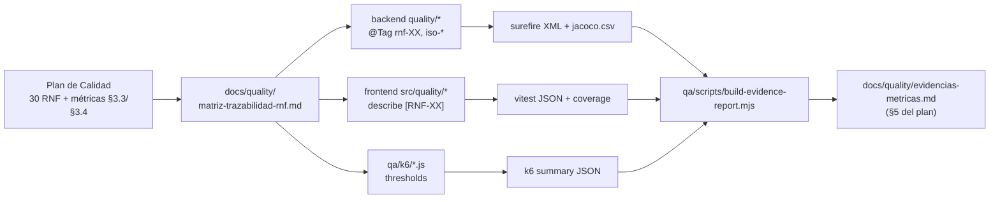

# ADR-0019: Suite de pruebas de calidad trazable a los RNF del Plan de Gestión de la Calidad (ISO/IEC 25010)

- **Estado:** Aceptado
- **Proyecto / Módulo:** Intégrate · `backend-api/` (`src/test/.../quality`, `pom.xml`), `frontend-pwa/` (`src/quality`, `scripts/`), `qa/` (nuevo: k6 e informe de evidencias), `docs/quality/` (nuevo) — transversal a los Procesos 1, 2 y 3
- **Fecha:** 2026-10-10

## Contexto

El *Plan de Gestión de la Calidad del Proyecto* v1.00 (21/09/2026) fija 30 RNF por característica ISO/IEC 25010 y métricas con umbral cuantitativo (sobreventa 0,0 %, bloqueo ≤ 200 ms p95, login ≤ 800 ms p95, barrido TTL < 1,5 s, cobertura > 80 %, 100 % de endpoints protegidos con 401/403, 100 % de consentimientos en bitácora *append-only*, 100 % de detección de vouchers alterados, *bundle* < 2,5 MB, Flesch-Szigriszt > 60, etc.). Su §3.6 (fase *Check* del PDCA) exige suites automatizadas, y su §5 *Evidencias Métricas* está vacía. Hoy hay 30 clases de prueba en el backend (JUnit 5 + Testcontainers + ArchUnit) y 17 en la PWA (Vitest), pero están organizadas por módulo y no por RNF: no hay forma de responder "¿qué prueba demuestra el RNF-16?" ni de producir la evidencia del §5. Tampoco hay medición de cobertura (sin JaCoCo ni `@vitest/coverage-v8`), pruebas de carga ni pipeline CI (`.github/` no existe; T-2.16).

Restricciones: el Proceso 3 (validación offline, split 85/15, regla 72 h, *Background Sync*, contingencia) aún no existe (T-2.1 a T-2.13), así que sus RNF no se pueden probar sin inventar código de producción. Varias métricas del plan no son verificables por una suite (MTTR, cumplimiento de entregables en Jira, entrega en Gmail ≥ 99,5 %, tiempo de enrolamiento en campo, TLS 1.3 A+, CPU < 75 % en AWS). Además hay discrepancias entre el plan y lo construido que la suite debe hacer visibles, no esconder (ver Consecuencias).

## Decisión

1. **Trazabilidad RNF → prueba como regla.** Cada verificación lleva el ID del RNF del plan:
   - JUnit: `@Tag("rnf-16")` + `@Tag("iso-fiabilidad")` (una etiqueta por característica: `iso-seguridad`, `iso-eficiencia`, `iso-interaccion`, `iso-fiabilidad`, `iso-adecuacion`, `iso-mantenibilidad`) y `@DisplayName("[RNF-16] …")`.
   - Vitest: `describe('[RNF-15] …')`.
   - `docs/quality/matriz-trazabilidad-rnf.md`: una fila por RNF (30) con proceso, métrica/umbral del plan, prueba(s) que lo verifican, y estado: **Automatizada**, **Parcial** (se cubre parte del criterio), **Pendiente Fase 2** (código no existe; se cita la tarea T-2.x) o **No automatizable** (medición manual u operativa; se dice cómo y quién la mide).
   - No se escriben pruebas "placeholder" que pasen sin verificar nada.

2. **Backend: paquete `com.integrate.quality`**, reutilizando `PostgresIntegrationTest`, `MutableClock`, `TestKeys` y el patrón `ExecutorService` + `CountDownLatch` ya usado en `BookingApiIntegrationTest`. Una clase por RNF o grupo cohesivo:

   | Característica | Clase | RNF | Qué verifica (umbral del plan) |
   |---|---|---|---|
   | Seguridad | `EndpointSecuritySweepTest` | 07 | Enumera **todas** las rutas de `RequestMappingHandlerMapping`; las que no están en la lista pública de `SecurityConfig` responden 401 sin token y 403 con un rol ajeno. Una ruta nueva sin regla rompe la prueba. |
   | Seguridad | `CredentialStorageQualityTest` | 04 | 100 % de `auth.users.password_hash` con prefijo Argon2id y ninguno igual a la contraseña. |
   | Seguridad | `SensitiveDataAtRestQualityTest` | 01 | Lectura SQL cruda: columnas de víctima, documento y salud son cifrado AES-GCM (no texto plano); los endpoints públicos del catálogo no exponen coordenadas exactas ni datos de víctima. |
   | Seguridad | `ConsentAuditQualityTest` | 06 | 100 % de usuarios con consentimiento registrado (fecha, IP, versión de política); `UPDATE`/`DELETE` sobre la tabla de consentimientos es rechazado por la BD. |
   | Seguridad | `VoucherTamperDetectionQualityTest` | 05 | Alterar cada *claim* y la firma del token del QR → 100 % rechazado con la clave pública. |
   | Fiabilidad | `OverbookingStressQualityTest` | 16, 24 | N hilos (≥ 100) contra franjas con aforo pequeño, varias franjas a la vez → 0,0 % sobreventa; cupos vendidos + disponibles = aforo. |
   | Adecuación | `CapacityParametrizationQualityTest` | 24 | 100 % de intentos de ofertar más cupos que la capacidad de carga rechazados en backend. |
   | Adecuación | `WebhookIdempotencyQualityTest` | 25 | El mismo evento de pasarela repetido y concurrente → 1 confirmación, 1 voucher, 1 notificación. |
   | Adecuación | `VoucherPdfConformanceQualityTest` | 23 | El PDF declara PDF/A-2b (XMP) y contiene localizador, QR, cupos, EPS, contacto de emergencia y términos. |
   | Eficiencia | `BookingLockLatencyQualityTest` | 02 | p95 del `POST /bookings/lock` ≤ 200 ms con 100 peticiones concurrentes; sin *deadlocks*. |
   | Eficiencia | `LoginLatencyQualityTest` | 08 | p95 de `POST /auth/login` ≤ 800 ms. |
   | Eficiencia | `ExpirationSweepQualityTest` | 11 | Un barrido sobre ≥ 1 000 reservas vencidas < 1,5 s y libera todos sus cupos. |
   | Mantenibilidad | `WorkerDecouplingQualityTest` | 26 | ArchUnit: `@Scheduled` solo en paquetes `worker`, ningún controlador depende de un worker; e integración: un worker que lanza excepción no afecta las respuestas de la API. |
   | Mantenibilidad | `OpenApiCoverageQualityTest` | 28 | Cada ruta de `RequestMappingHandlerMapping` está en `docs/api/openapi.yaml` (y viceversa). |

   Las pruebas de latencia en Testcontainers son **indicativas** (misma máquina, sin red); la evidencia formal de RNF-02/08/10 la dan las pruebas k6 (punto 5).

3. **Ejecución por perfiles Maven.** `mvn verify` sigue corriendo todo como hoy. Se añade el perfil `-Pquality`, que corre solo las pruebas con `@Tag("quality")` (marca común de la suite). Las de latencia llevan además `@Tag("performance")` para poder excluirlas en máquinas lentas (`-DexcludedGroups=performance`).

4. **Cobertura (RNF-27, métrica "Cobertura de pruebas" de los tres procesos).**
   - Backend: `jacoco-maven-plugin` (EPL-2.0, sin binarios externos) con `report` y `check`: ≥ 80 % de líneas en `com.integrate.modules.*.service..` y `com.integrate.common.crypto..`. La regla rompe `mvn verify` si no se cumple.
   - PWA: `@vitest/coverage-v8` (devDependency) con umbral 80 % en `src/features/**` y `src/shared/**`, script `npm run test:coverage`.

5. **Carga (RNF-02, 08, 10) con k6** en `qa/k6/`: `booking-lock.js` (100 checkouts concurrentes, `http_req_duration{p(95)}<200`), `login.js` (`p(95)<800`), `catalog-checkout-mix.js` (500 VU navegando + 100 en checkout). Los umbrales viven en `thresholds` de cada script, así k6 sale con código ≠ 0 si se incumplen. Corren contra el stack de `infra/docker/docker-compose.yml`, **no** en la suite unitaria. k6 es un binario externo: no se instala ni se ejecuta sin consentimiento expreso; si no hay consentimiento, los scripts se entregan sin evidencia de ejecución y la matriz los marca "Pendiente de ejecución".

6. **PWA: `src/quality/`** (Vitest, mismas fronteras de FE-DIR-001):
   - `consentReadability.quality.test.ts` (RNF-15): calcula Flesch-Szigriszt (fórmula de Szigriszt-Pazos, conteo de sílabas en español implementado en el propio test, sin dependencia) sobre los textos del consentimiento → > 60.
   - `checkoutGuards.quality.test.tsx` (RNF-13): el formulario no invoca la pasarela si faltan EPS o contacto de emergencia, y avisa cuando el TTL está por vencer.
   - `componentReuse.quality.test.ts` (RNF-30): cada componente base de `shared/ui` se importa en ≥ 3 vistas (análisis de imports con `import.meta.glob`).
   - `a11y.quality.test.tsx` (RNF-03): `axe-core` (MPL-2.0, devDependency) sobre las vistas principales renderizadas → 0 violaciones WCAG 2.1 A/AA. Contraste: se mantiene `tokens.test.ts` (umbral AAA 7:1 del proyecto, más estricto que el 4,5:1 del plan).
   - `scripts/check-bundle-budget.mjs` + `npm run quality:bundle` (RNF-09): suma el tamaño gzip de lo que `index.html` carga de forma inicial en `dist/` → < 2,5 MB (y advierte sobre los 500 kB de ADR-0017).

7. **Informe de evidencias (§5 del plan).** `qa/scripts/build-evidence-report.mjs` (Node, sin dependencias) lee los XML de Surefire, `jacoco.csv`, el JSON de Vitest/coverage y, si existen, los resúmenes JSON de k6, y genera `docs/quality/evidencias-metricas.md`: por RNF, valor medido vs. umbral, resultado (Cumple / No cumple / Pendiente / No automatizable) y fecha. Ese archivo es lo que se pega en la sección 5 del documento Word.

8. **Fuera de este ADR:** RNF-14, 17, 18, 19, 20, 21, 22 (Proceso 3, se prueban con sus tareas T-2.x y entran a la matriz entonces); el pipeline CI (T-2.16; el perfil `-Pquality` y los scripts quedan listos para engancharse); RNF-29 (no hay logs JSON con *correlation id*: hoy existe `TraceIdFilter`, pero no salida estructurada; se registra como **brecha**, no se prueba).

## Alternativas Descartadas

- **Reetiquetar las pruebas existentes en vez de crear `quality`:** mezcla pruebas de contrato por módulo con verificaciones de umbral del plan, y obliga a tocar 30 clases. Se reutilizan sus utilidades, pero las verificaciones de calidad viven aparte y se pueden correr solas.
- **Gatling o JMeter en lugar de k6:** Gatling añade un módulo Maven/Scala pesado; JMeter usa XML difícil de revisar en PR. k6 expresa los umbrales del plan como código (`thresholds`) y lo cita el roadmap (T-2.14).
- **Pruebas `@Disabled` para los RNF del Proceso 3:** no compilan sin el código que verifican, o pasarían sin verificar nada; la matriz con estado "Pendiente Fase 2" deja la brecha visible sin falsear el informe.
- **SonarQube para cobertura y linters (RNF-28):** requiere un servidor; JaCoCo + ESLint (ya con `--max-warnings 0`) dan la misma evidencia en local.

## Consecuencias

- **Positivas:** cada RNF del plan tiene una respuesta verificable ("esta prueba, este umbral, este resultado"); la sección 5 del plan se genera desde ejecuciones reales; la cobertura deja de ser declarativa; el barrido de endpoints protege RNF-07 ante rutas futuras; la suite queda lista para CI.
- **Negativas / Riesgos asumidos:**
  - `mvn verify` se vuelve más lento (estrés de concurrencia, 1 000 reservas del barrido). Mitigación: `@Tag("performance")` excluible.
  - El `check` de JaCoCo puede romper el build si la cobertura actual de `service` está por debajo de 80 %. Si pasa, se reporta la cifra real antes de decidir (subir cobertura o fijar el umbral temporalmente con la cifra medida y documentarlo).
  - Latencias medidas en Testcontainers no equivalen a producción.
  - Nuevas devDependencies: `jacoco-maven-plugin`, `@vitest/coverage-v8`, `axe-core`. Ninguna es binaria ni se ejecuta en runtime.
  - **Discrepancias del plan que la suite hará visibles** (requieren decisión del equipo; la suite prueba lo construido y lo anota en la matriz):
    1. RNF-04 pide **BCrypt**; el sistema usa **Argon2id** (ADR-0005 §3), que es igual o más fuerte. Se propone actualizar el plan.
    2. Numeración del plan: el §4.1.2 se titula "RNF 02" pero su ID es RNF-04, y "RNF-02" aparece también en §4.2.1. La matriz usa el campo **ID** de cada tabla.
    3. RNF-03 pide contraste 4,5:1; el proyecto exige 7:1 (FE-DIR-001). Se prueba el más estricto.
    4. §3.3.2/§3.3.3: algunas filas repiten la descripción en la columna "Fórmula" (sobreventa, split, regla 72 h); la matriz usa las fórmulas del §3.4.

## Contrato o Esquema Conceptual (Opcional)

## Notas de implementación (2026-10-10)

- **No conformidades conocidas sin romper el build.** Las pruebas que verifican el criterio literal del plan sobre un comportamiento distinto llevan `@Tag("nonconformity")`: `mvn verify` las excluye y `-Pquality` las corre con `testFailureIgnore`, de modo que quedan medidas en `target/quality-metrics`. En la PWA el equivalente es `it.fails` (se pone en rojo cuando el defecto se corrige).
- **Pruebas de la PWA junto a su feature**, no en `src/quality/`: las reglas de capas de ESLint (FE-DIR-001, Directiva 3) prohíben importar el interior de una feature desde fuera. Quedan en `features/auth`, `features/booking` y `app/` con el sufijo `.quality.test.*`; la evidencia viaja en `task.meta` y el reporter JSON de Vitest.
- **k6 en Docker** (`grafana/k6:2.2.0`) en lugar de instalarlo en el sistema, contra un PostgreSQL y un backend desechables con secretos generados por corrida (ver `qa/k6/README.md`). La CPU de RNF-10 se midió sobre el proceso del backend en la máquina local.
- **Agregados al alcance inicial:** `SplitPaymentExactnessQualityTest` (RNF-21, custodia 85/15 con redondeo CEIL sobre 12 pagos) y `SecretRedactionQualityTest` (RNF-04: los `toString()` de portadores de secretos no los exponen; además cubre el único paquete que quedaba bajo el 80 %).
- **`axe-core` fijado en 4.13** (4.14.0 tenía 5 días de publicado). `color-contrast` se desactiva en jsdom: el contraste lo certifica `styles/tokens.test.ts`.
- **RNF-06:** la verificación "100 % de usuarios con consentimiento" sobre toda la base dependía del orden de las pruebas; se reemplazó por una prueba determinista por canal de alta, que encontró que el bootstrap del `ADMIN` crea la cuenta sin consentimiento (lo pide en el primer ingreso).
- **Resultado de la primera corrida:** 18 RNF cumplen, 4 con no conformidad (RNF-01, RNF-06, RNF-15, RNF-23), 6 pendientes de la Fase 2, 1 no automatizable (RNF-12) y 1 brecha (RNF-29). Detalle en `docs/quality/evidencias-metricas.md`.