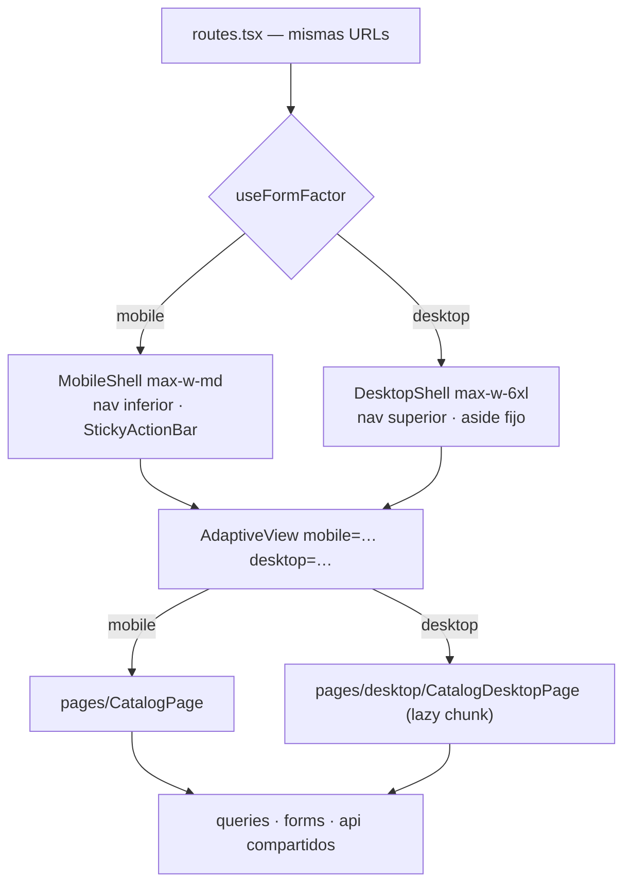

# ADR-0020: Responsive móvil 320–480 px y vistas de escritorio dedicadas por detección de factor de forma

- **Estado:** Aceptado (2026-10-10) — tablets con vista móvil, preferencia manual incluida y portal del Gestor solo con `DesktopShell`, confirmados por el desarrollador.
- **Proyecto / Módulo:** Intégrate · `frontend-pwa/` — `app/layouts`, `app/routes.tsx`, `shared/lib`, `shared/ui`, `features/*/pages`. Enmienda FE-DIR-001 (Directiva 1) y ADR-0012 §1.
- **Fecha:** 2026-10-10

## Contexto

La PWA (ADR-0012 a ADR-0018) se diseñó para 360–430 px y, en escritorio, muestra la misma columna `max-w-md` centrada (FE-DIR-001, Directiva 1.2). Hay dos problemas. Primero, por debajo de 360 px la interfaz se rompe: `WeekPicker` usa `grid-cols-7` con `min-w-11` y `gap-1` (7 × 44 px + 6 × 4 px = 332 px), lo que supera los 328 px útiles de un teléfono de 360 px con `px-4`. La auditoría en el navegador mostró que la página no desborda, pero los botones de los días se solapan entre sí (44 px de ancho cada ~42 px). Además, la separación de 4 px incumple la regla de ≥ 8 px. WCAG 1.4.10 (Reflow) exige que el contenido funcione a 320 px CSS, y en Colombia rural circulan teléfonos de gama baja de 320–360 px y otros con zoom de sistema o "texto grande", que reducen el ancho CSS efectivo.

Segundo, el turista planifica el viaje desde el computador (ADR-0012, contexto: "turistas en planificación urbana"). Ahí la columna de 448 px desperdicia la pantalla y obliga a patrones táctiles (bottom-sheet, barra inferior) que no tienen sentido con ratón y teclado. El desarrollador pide **vistas distintas** para celular y computador, no solo un estiramiento responsive, y que la app **detecte** cuál mostrar. El móvil sigue siendo el canal principal y no debe cargar con el peso del código de escritorio.

## Decisión

1. **Fase A — Responsive móvil 320–480 px (prioridad, antes de escritorio).**
   - El rango soportado pasa de 360–430 a **320–480 px**. Se corrigen los desbordes encontrados en la auditoría, empezando por `WeekPicker`: rejilla de 7 columnas fluida (`minmax(0,1fr)`), `gap-2` y, por debajo de 360 px, día en dos líneas o abreviatura de una letra, sin bajar el área táctil de 44 px de alto.
   - Se revisan con zoom de texto al 200 % (WCAG 1.4.4) y en orientación horizontal (alto ≥ 320 px): `StickyActionBar`, `BottomSheet` (`max-h-[85dvh]`) y `QrFullscreen` no deben tapar el contenido.
   - Se añade una prueba de regresión de desborde: render en 320, 360, 390, 412 y 430 px con la aserción `scrollWidth ≤ clientWidth` en cada ruta.
2. **Detección del factor de forma por capacidades, no por User-Agent.** Un hook puro `useFormFactor(): 'mobile' | 'desktop'` en `shared/lib`, sobre `matchMedia`:
   - `desktop` ⇔ `(min-width: 1024px) and (hover: hover) and (pointer: fine)`; cualquier otro caso es `mobile`.
   - Una tablet o un teléfono en horizontal (puntero grueso) reciben la vista móvil. Un portátil con la ventana angosta (< 1024 px) también, porque la vista móvil ya es su layout correcto.
   - Es reactivo: escucha `change` del `MediaQueryList`, de modo que redimensionar la ventana o conectar un ratón cambia la vista sin recargar.
   - Se evalúa de forma síncrona en el primer render, así que no hay parpadeo de la vista equivocada.
   - **Preferencia manual opcional:** un enlace "Ver versión para celular / computador" en el pie de cada shell, guardado en `localStorage` (`integrate.viewPreference`, sin datos personales ni tokens; permitido por FE-DIR-001 Directiva 4). Prevalece sobre la detección.
3. **Mismas URLs, distinta vista.** No hay subdominio ni prefijo `/escritorio`. El árbol de rutas de ADR-0012 §4 y ADR-0013 §6 no cambia: un enlace compartido abre en ambos dispositivos. La bifurcación ocurre en dos puntos:
   - **Layout:** `TouristLayout` y `ManagerLayout` eligen entre `MobileShell` (el `AppShell` actual renombrado) y `DesktopShell`.
   - **Página:** un componente `AdaptiveView` en `shared/ui` recibe `mobile` y `desktop` como componentes por props, así que `shared` no importa nada de `features`. Las rutas lo usan donde la vista de escritorio difiere. Si una página no tiene variante de escritorio, se muestra la móvil centrada dentro del `DesktopShell` (degradación segura).
4. **`DesktopShell`:**
   - barra superior horizontal con la marca y la navegación del rol (los mismos `NavItem`, `aria-current`), sin navegación inferior;
   - contenedor `max-w-6xl` con rejilla de 12 columnas;
   - `<main>` único, `SkipLink`, *landmarks*, `h1` único y foco doble anillo, igual que en móvil.
   - La marca `flow` de `ShellHandle` se interpreta como "acción primaria en panel lateral fijo (*sticky aside*)" en lugar de barra inferior.
5. **Separación de código por factor de forma.** Las vistas y el shell de escritorio se cargan con `import()` diferido, en chunks propios. Un teléfono nunca descarga código de escritorio (RNF-04, consumo de datos en zona rural). Se fija un presupuesto: el bundle inicial móvil no crece más de 2 KB gz por la infraestructura de detección.
6. **Lógica compartida, presentación separada.** Las variantes de una feature comparten queries (TanStack Query), formularios (Zod), API y componentes atómicos. Solo cambia la composición. Las vistas de escritorio viven en `features/<f>/pages/desktop/` y se exportan por el `index.ts` de la feature. La API y los hooks no se duplican.
7. **Alcance de las vistas de escritorio (por prioridad):**
   | Orden | Vista | Diferencia en escritorio |
   |---|---|---|
   | 1 | Catálogo `/` | Filtros en barra lateral permanente (no bottom-sheet) y rejilla de tarjetas de 2–3 columnas |
   | 2 | Detalle `/experiencias/:id` | Dos columnas: ficha a la izquierda y tarjeta de reserva fija a la derecha |
   | 3 | Franjas `/experiencias/:id/franjas` | Calendario mensual y lista de franjas lado a lado, total en el panel lateral |
   | 4 | Reserva, checkout y voucher | Formulario a la izquierda, resumen del viaje y temporizador TTL a la derecha. El QR conserva su tamaño |
   | 5 | Ingreso, registro y cuenta | Formulario centrado `max-w-md` (sin variante propia, solo el `DesktopShell`) |
   | 6 | Portal del Gestor | Solo `DesktopShell`. El Gestor opera en campo, así que sus vistas siguen siendo móviles hasta que exista un caso de uso de oficina |
8. **Reglas que no cambian en escritorio:**
   - tokens y contraste AAA;
   - foco doble anillo y `prefers-reduced-motion`;
   - áreas clicables ≥ 44 × 44 px (sin costo, y sirven a pantallas táctiles grandes);
   - fronteras de capas, `createHttpClient`/`ApiError` y reglas de sesión.
   - Sin tablas anchas que en móvil obliguen a scroll horizontal: cada variante es independiente.
9. **Enmienda a FE-DIR-001, Directiva 1** (se aplica al aceptar este ADR, junto con la línea "Viewport" de `CLAUDE.md` sobre Impeccable):
   - 1.1 Viewport móvil objetivo **320–480 px**, verificado en 320/360/390/412/430.
   - 1.2 En dispositivos clasificados `desktop` (ver §2), la app muestra **vistas de escritorio dedicadas** dentro de `DesktopShell` (`max-w-6xl`). La degradación por defecto es la vista móvil centrada en `max-w-md`.
   - 1.3 y 1.4 sin cambios. La zona del pulgar aplica a la vista móvil; en escritorio, la acción primaria va en un panel lateral fijo y visible sin scroll.
10. **Verificación de cierre (por fase):**
    - los 5 comandos del Quality Gate en verde;
    - pruebas de `useFormFactor` (con `matchMedia` simulado: las cuatro combinaciones de ancho, `hover` y `pointer`, más el cambio en caliente y la preferencia manual);
    - prueba de desborde a 320 px por ruta;
    - prueba de que el bundle móvil no contiene chunks de escritorio;
    - revisión visual en el navegador a 320, 390, 430, 1280 y 1440 px.

## Alternativas Descartadas

- **Detección por User-Agent (`navigator.userAgent` / `userAgentData.mobile`):** frágil (Chrome congeló el UA, iPadOS se anuncia como macOS), no reacciona al redimensionar y falla con "versión de escritorio" del navegador móvil. Las *media features* `hover`/`pointer` describen la capacidad real de entrada, que es lo que determina la vista.
- **Solo responsive (una vista que se estira con breakpoints `md:`/`lg:`):** no cumple el pedido de vistas distintas. Además, mezclar dos composiciones (bottom-sheet frente a barra lateral, barra inferior frente a panel fijo) en un mismo componente lo llena de condicionales y envía el código de escritorio al teléfono.
- **Dos aplicaciones o subdominio `escritorio.` / prefijo `/d/`:** duplica despliegue, PWA y service worker, y rompe los enlaces compartidos entre dispositivos.
- **Vista de escritorio desde 768 px:** las tablets (puntero grueso) quedarían con una vista pensada para ratón.

## Consecuencias

- **Positivas:**
  - reflow WCAG 1.4.10 cumplido a 320 px;
  - experiencia de planificación en escritorio acorde a la pantalla;
  - enlaces universales;
  - el móvil no paga el peso del escritorio;
  - lógica de negocio sin duplicar.
- **Negativas / Riesgos asumidos:**
  - dos composiciones por vista prioritaria que mantener y probar;
  - el riesgo de que las variantes diverjan en reglas de negocio se mitiga con hooks y formularios compartidos y con pruebas que ejercitan ambas;
  - la preferencia manual añade un estado más;
  - la enmienda de FE-DIR-001 relaja el "Móvil Exclusivo" original, y queda abierto el debate de si la acción primaria en escritorio también debe ir abajo.

## Notas de implementación (2026-10-10)

Desviaciones respecto a la decisión, aplicadas al implementar las Fases A, B y C (orden 1–3):

- **§1 `WeekPicker`:** con 44 px por día y 8 px de separación, la semana necesita 356 px. Se usa una *container query*: 7 columnas desde 356 px y, por debajo, dos filas de 4 + 3. No hay solapamiento ni objetivos táctiles por debajo de 44 px. Los botones "Semana anterior/siguiente" llevan `shrink-0`, porque a 320 px se comprimían a 39 px.
- **§1 prueba de desborde:** jsdom no calcula layout, así que la aserción `scrollWidth ≤ clientWidth` no puede vivir en Vitest. Se ejecutó como auditoría en el navegador real: desborde, objetivos < 44 px y solapamiento de controles, en 320, 360, 390, 412 y 430 px y en escritorio a 1024 y 1280 px. Todas las rutas públicas quedaron limpias. Automatizarla requiere Playwright, una dependencia nueva pendiente de aprobación. Las vistas con sesión (reserva, checkout, voucher, cuenta y Gestor) no se auditaron en el navegador.
- **§3 `AdaptiveView`:** recibe la vista móvil como `children` y la de escritorio por la prop `desktop`. Las rutas con vista dedicada se marcan `wide` en `ShellHandle`; las demás se muestran en `DesktopShell` centradas en `max-w-md` y conservan su `StickyActionBar`.
- **§6 punto de entrada:** las vistas de escritorio **no** se exportan por `index.ts`: eso las metería en el bundle móvil. Cada feature expone un segundo barril público, `@/features/<f>/desktop`, permitido en `eslint.config.js` (`!@/features/*/desktop`). Las rutas lo cargan con `lazy()` desde `app/desktopViews.ts`.
- **§2 preferencia manual retirada (2026-10-14):** a pedido del desarrollador se eliminaron el enlace "Ver versión para celular / computador" y la preferencia `integrate.viewPreference`. La vista depende solo de la detección; la clave ya no se lee, así que una elección guardada antes no deja a nadie atrapado.
- **§5 presupuesto:** la carga inicial móvil pasó de 143,6 a 147,1 KB gz (+3,5 KB); tras retirar la preferencia, 146,7 KB gz (+3,1 KB). Del primer valor, el crecimiento real comprimido en un solo bloque era de +2,2 KB; el resto (~1,1 KB) es fragmentación en más chunks. Se supera el presupuesto de 2 KB y queda pendiente la decisión del desarrollador.
- **Pendiente (orden 4–6 de §7):** vistas de escritorio de reserva, checkout y voucher. Ingreso, registro, cuenta y Gestor ya funcionan centrados en `DesktopShell`.

## Contrato o Esquema Conceptual



```ts
type FormFactor = 'mobile' | 'desktop';
type ViewPreference = FormFactor | 'auto';
function useFormFactor(): FormFactor; // matchMedia + preferencia manual
interface AdaptiveViewProps {
  mobile: ComponentType;
  desktop?: LazyExoticComponent<ComponentType>;
}
```
