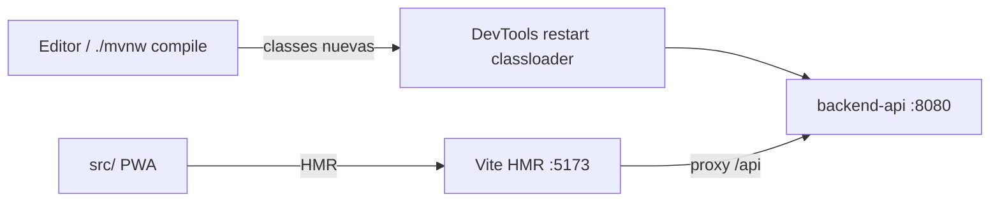

# ADR-0021: Habilitar recarga en caliente en desarrollo (backend y PWA)

- **Estado:** Propuesto
- **Proyecto / Módulo:** backend-api (Spring Boot) y frontend-pwa (Vite) · entorno de desarrollo local
- **Fecha:** 2026-10-14

## Contexto
Hoy el backend se arranca con `./mvnw spring-boot:run -Dspring-boot.run.profiles=dev` y cada cambio en código Java o en recursos obliga a detener y relanzar el proceso (arranque con Flyway + contexto completo). La PWA ya usa Vite con HMR (`npm run dev`, puerto 5173, proxy `/api` → 8080), por lo que su recarga en caliente ya funciona y no requiere cambios.

La restricción es que la recarga no debe existir fuera del perfil de desarrollo: ni en el JAR de producción, ni en la suite de calidad (ADR-0019), ni debilitar la política de secretos (SEC-DIR-004).

## Decisión
Adoptar **Spring Boot DevTools** como dependencia `optional` con alcance `runtime` en `backend-api/pom.xml`, y configurarlo solo en `application-dev.yml`:

- Reinicio automático rápido (classloader dividido) al recompilar clases del proyecto; el IDE o `./mvnw compile` en otra terminal dispara el reinicio.
- Con `spring-boot-maven-plugin` las dependencias `optional` no se empaquetan en el JAR ejecutable (DevTools se desactiva solo en `java -jar` de producción); además se excluye explícitamente en la configuración del plugin para `repackage`.
- LiveReload desactivado (`spring.devtools.livereload.enabled=false`): la PWA se sirve desde Vite, no desde Spring.
- `spring.devtools.restart.additional-paths` limitado a `src/main/resources` para recargar plantillas de correo y configuración sin reiniciar manualmente.
- Las migraciones Flyway siguen siendo inmutables: un reinicio las reaplica solo si son nuevas.
- La PWA mantiene Vite HMR sin cambios; se documenta el flujo de dos terminales en la guía de desarrollo.

## Alternativas Descartadas
- **JRebel / HotswapAgent:** recarga de clases sin reinicio, pero es licenciado (JRebel) o requiere JVM con agente (HotswapAgent), añadiendo fricción de instalación al equipo.
- **Hot-swap nativo del depurador (JDWP):** solo cubre cambios en el cuerpo de métodos; falla ante nuevos beans, campos o anotaciones.
- **Reinicio manual con `spring-boot:run` en bucle (watcher externo):** reinicio completo del JVM, más lento y sin separación de classloaders.

## Consecuencias
- **Positivas:** ciclo de edición→prueba de segundos; sin cambios de código de aplicación; cero impacto en producción.
- **Negativas / Riesgos asumidos:** el reinicio de DevTools puede causar problemas de classloader con librerías que cachean clases (PDFBox/ZXing); el contexto se reinicia (no es hot-swap puro); un reinicio con perfil `dev` vuelve a ejecutar `seed-dev` si cambia su contenido; consume algo más de memoria en desarrollo.

## Contrato o Esquema Conceptual

