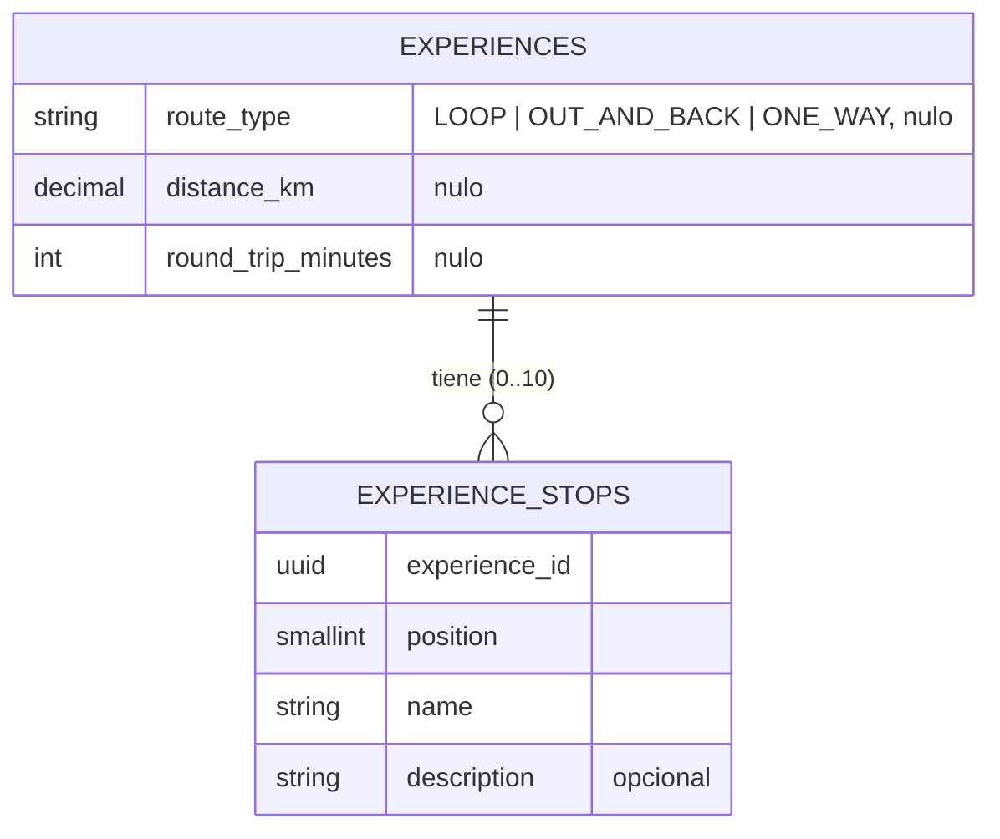

# ADR-0022: Exponer distancia, paradas y tiempo de ida y vuelta del recorrido de una experiencia

- **Estado:** Aceptado
- **Proyecto / Módulo:** backend-api (`catalog`) y frontend-pwa (`features/catalog`)
- **Fecha:** 2026-10-15

## Contexto
La ficha de una experiencia solo muestra duración e intensidad física (`ExperienceFacts`). Para decidir si pueden hacerla, el turista también necesita saber cuánto camina o recorre (distancia), si el recorrido tiene paradas (miradores, descansos, comunidad) y cuánto tarda completo, ida y vuelta. Hoy `catalog.experiences` solo guarda `duration_minutes` (15–4320 min), sin indicar si cubre ida y vuelta, y no existe ningún dato de distancia ni de paradas.

Restricciones: el contrato público y el de anfitrión (ADR-0006 §4) deben evolucionar de forma compatible; las migraciones Flyway son inmutables (nueva `V14`); los datos nuevos los captura el anfitrión o el gestor de enlace (RF-05/RF-06) y los revisa el administrador (RF-07); la UI sigue FE-DIR-001 (mobile-first, tokens existentes, sin hex nuevos).

## Decisión
Añadir a `catalog.experiences` cuatro columnas **opcionales** (nulas en experiencias existentes, para no romper el catálogo vigente):

| Campo (API / BD) | Tipo | Regla |
|---|---|---|
| `routeType` / `route_type` | `LOOP` (circular), `OUT_AND_BACK` (ida y vuelta por el mismo camino), `ONE_WAY` | CHECK en BD |
| `distanceKm` / `distance_km` | `NUMERIC(5,2)` | `> 0` y `<= 500`; es la distancia **total** del recorrido (ida y vuelta incluida si aplica) |
| `roundTripMinutes` / `round_trip_minutes` | `INTEGER` | 15–4320; tiempo total de ida y vuelta; si es nulo se interpreta que `durationMinutes` ya lo cubre. `>= durationMinutes` no se exige: `durationMinutes` sigue siendo el tiempo de la actividad |
| `stops` / tabla `catalog.experience_stops` | lista ordenada (máx. 10) de `{name, description?}` | tabla hija 1:N con `position`; `hasStops` se deriva (`stops.length > 0`) |

Backend: nueva migración `V14__experience_route_details.sql`, campos en `Experience`/`ExperienceContent`, `ExperienceRequest`, `HostExperienceResponse`, `ExperienceSummaryResponse` y detalle público; validación Bean Validation espejo de los CHECK. El resumen del catálogo incluye `routeType`, `distanceKm`, `roundTripMinutes` y `stopsCount`; el detalle añade la lista `stops`.

Frontend: `ExperienceFacts` agrega los hechos «Distancia» (icono existente o nuevo en `Icon.tsx`), «Ida y vuelta» y «Paradas» (`Sin paradas` / `N paradas`), con la variante `compact` en la tarjeta (distancia + paradas) y la `full` en el detalle (con lista de paradas); el filtro por distancia queda fuera de este ADR. Formatos con helpers de `shared/lib`, solo tokens existentes, objetivos táctiles sin cambios.

## Alternativas Descartadas
- **Calcular distancia desde `latitude`/`longitude`:** el modelo solo guarda el punto de encuentro, no la traza; no hay forma fiable de derivarla.
- **Guardar paradas como texto libre en `description`:** no es estructurado, no permite contar ni mostrar paradas ni evolucionar a mapa.
- **Columna JSONB de paradas:** más rápida de implementar, pero rompe el estilo relacional del esquema y dificulta consultas y auditoría.
- **Hacer los campos obligatorios:** invalidaría las experiencias aprobadas existentes y bloquearía el flujo del gestor hasta recapturar todo.

## Consecuencias
- **Positivas:** el turista evalúa esfuerzo y tiempo real antes de reservar; contrato compatible hacia atrás; paradas estructuradas listas para un futuro mapa.
- **Negativas / Riesgos asumidos:** más campos a diligenciar por anfitriones con baja conectividad (por eso son opcionales); la tarjeta compacta gana densidad en 360 px y puede requerir truncar; hay que actualizar semillas, fixtures de pruebas, la suite de calidad (ADR-0019) y los formularios de anfitrión/gestor.

## Contrato o Esquema Conceptual

