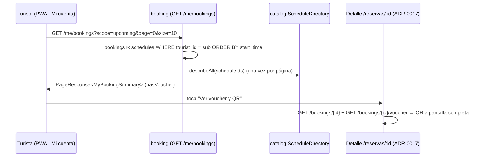

# ADR-0023: Mostrar en "Mi cuenta" las experiencias del turista, con acceso a su voucher y su QR

- **Estado:** Aceptado (2026-10-18)
- **Proyecto / Módulo:** Intégrate · `backend-api/` (`modules/booking`, `modules/catalog`) y `frontend-pwa/` (`features/booking`, `features/auth`) — T-1.14a (backend) y T-1.14b (frontend móvil)
- **Fecha:** 2026-10-18

## Contexto

Hoy el turista solo llega a su reserva y a su voucher con el enlace `/reservas/:bookingId`. Ese enlace aparece al terminar el pago y en el correo (ADR-0011). La pantalla de estado (ADR-0017) ya muestra el voucher con el QR a pantalla completa, el código corto y la descarga del PDF, pero solo si la reserva está `CONFIRMED`.

"Mi cuenta" (`/cuenta`, T-1.11) muestra el perfil, las autorizaciones de datos y el cierre de sesión. **No hay forma de ver las experiencias reservadas o realizadas.** Si el turista pierde el correo, no puede recuperar su QR.

Huecos:
1. **No existe un listado de reservas del turista.** ADR-0008 §11 dejó `GET /me/bookings` fuera de alcance y pendiente de T-1.10e.
2. **La reserva no guarda el título ni la fecha de la experiencia.** Hay que componerlos desde `catalog` sin caer en N+1.
3. **No está definido qué se muestra para una experiencia ya realizada** (`EXECUTED`), cuyo voucher queda `CONSUMED`.

## Decisión

### 1. Backend (T-1.14a): `GET /api/v1/me/bookings`

| Método | Ruta | Rol | Respuesta |
|---|---|---|---|
| GET | `/api/v1/me/bookings?scope=upcoming\|past&page=0&size=20` | `TOURIST` (solo las suyas) | 200 `PageResponse<MyBookingSummary>` (**adición al contrato**) |

- **`scope=upcoming`** (por defecto): reservas `CONFIRMED` o `PENDING` cuya franja aún no termina, ordenadas por fecha de inicio ascendente (la más próxima primero). Una `PENDING` con el TTL vencido no aparece, porque ya no se puede pagar.
- **`scope=past`:** todo lo demás, ordenado por inicio descendente (lo más reciente primero):
  - experiencias realizadas (`EXECUTED`) o con inasistencia (`NO_SHOW`);
  - `CONFIRMED` cuya franja ya terminó;
  - canceladas, fallidas y expiradas (`PAYMENT_FAILED`, `EXPIRED`, `CANCELLED_*`).
- **`MyBookingSummary`:** `bookingId`, `status`, `experienceId`, `experienceTitle`, `municipality`, `startTime`, `endTime`, `timezone`, `slots`, `totalAmountCop`, `hasVoucher`.
  - `hasVoucher = status ∈ {CONFIRMED, EXECUTED}`: el voucher solo existe para reservas pagadas. Es una derivación del estado, sin consultar `voucher` (§3).
  - No lleva datos de los viajeros, EPS ni contacto de emergencia.
- **Paginación:** la común de ADR-0006 (`size` ≤ 50). Un `scope` inválido responde 422.
- **Consulta:** un `JOIN` de `booking.bookings` con `catalog.schedules` para filtrar y ordenar por la fecha de la franja, con `tourist_id = sub del JWT` siempre en el `WHERE`. Luego **un solo** `describeAll(scheduleIds)` a una ampliación de `catalog.ScheduleDirectory` (por lotes, sin N+1) para el título y el municipio.
  - La lectura de `catalog.schedules` desde el repositorio de `booking` es de solo lectura, como el anti-join documentado en ADR-0010 §5. Ordenar por la fecha de la franja exige el `JOIN` en la base: paginar primero y ordenar después daría páginas incorrectas.
  - El índice existente `ix_bookings_tourist` cubre el filtro por turista.

### 2. Frontend (T-1.14b): sección "Mis experiencias" en Mi cuenta

- **Ubicación:** en `/cuenta`, entre el perfil y las autorizaciones, una sección "Mis experiencias" con dos pestañas (`role="tablist"`, operables con teclado):
  - **Próximas** (predeterminada);
  - **Realizadas** (`scope=past`), que también incluye las canceladas y fallidas, con su estado bien visible.
- **Tarjetas verticales:** una por reserva, con título, fecha y hora local, municipio, cupos, total y una insignia de estado. Cada estado tiene texto e icono, nunca solo color.
  - Toda la tarjeta es un enlace de ≥ 44 px de alto a `/reservas/:bookingId`.
  - Si `hasVoucher`, muestra la acción **"Ver voucher y QR"**.
- **Paginación:** 10 por página, con un botón "Ver más". Sin scroll infinito, para que sea accesible y predecible.
- **Estados vacíos:**
  - Próximas: "Aún no tienes experiencias reservadas" con el enlace "Explorar experiencias".
  - Realizadas: "Aquí verás las experiencias que ya viviste".
- **La pantalla de detalle se reutiliza:** `/reservas/:bookingId` (ADR-0017) sigue siendo el único lugar donde se muestran el voucher, el QR a pantalla completa y el PDF. No se duplica la vista del QR.
  - **Ajuste a ADR-0017:** el panel del voucher se muestra también para `EXECUTED`, pero como "Voucher usado": código corto, fecha de uso y PDF descargable como comprobante, **sin QR a pantalla completa** (ya no sirve para ingresar).
  - Para `CONFIRMED` no cambia nada.
- **Navegación de vuelta:** al llegar al detalle desde Mi cuenta, el botón "Atrás" vuelve a `/cuenta` con la pestaña que estaba abierta (`?tab=realizadas`).
- **Datos:** `features/booking` expone `useMyBookings(scope)` (TanStack Query, `useInfiniteQuery` con `createHttpClient`) y el componente `MyBookingsSection` por su `index.ts`. `features/auth` (AccountPage) lo importa por el barril, como exige la Directiva 3.
- **Escritorio** (ADR-0020): sin vista dedicada. La sección usa el mismo layout móvil centrado en `max-w-md`, como el resto de Mi cuenta.

### 3. Fronteras

- `booking` no depende de `voucher` (regla ArchUnit `nothingDependsOnVoucher`). Por eso `hasVoucher` se deriva del estado y el voucher se sigue pidiendo en el detalle (`GET /bookings/{id}/voucher`).
- `catalog.ScheduleDirectory` suma `describeAll(Collection<UUID>) → Map<UUID, ScheduleSummary>`.

### 4. Pruebas

- **Backend:**
  - solo aparecen las reservas del turista autenticado (otra cuenta → lista vacía);
  - clasificación por `scope` (`CONFIRMED` futura en próximas, `CONFIRMED` pasada y `EXECUTED` en realizadas, `PENDING` vencida excluida de próximas);
  - orden y paginación;
  - `scope` inválido → 422; rol distinto → 403;
  - una consulta a `catalog` por página (sin N+1, contando sentencias);
  - sin datos de viajeros en la respuesta.
- **Frontend (Vitest + Testing Library):**
  - pestañas con teclado y `aria-selected`;
  - tarjetas con enlace al detalle y "Ver voucher y QR" solo con `hasVoucher`;
  - estados vacíos;
  - "Ver más";
  - el error RFC 9457 se muestra con `ProblemNotice` y reintento;
  - "Voucher usado" sin QR para `EXECUTED`;
  - sin scroll horizontal a 320 px;
  - los 5 comandos del Quality Gate (Directiva 7).

## Alternativas Descartadas

- **Página nueva `/cuenta/experiencias`:** agrega un nivel de navegación. Una sección dentro de Mi cuenta deja las experiencias a un toque, que es lo pedido.
- **Mostrar el QR directamente en la tarjeta de la lista:** cargaría el voucher de cada reserva (una petición por tarjeta) y pondría varios QR en pantalla. El QR debe verse solo, a pantalla completa y con el brillo alto (ADR-0017).
- **Componer el listado en el navegador** (lista de ids + `GET /bookings/{id}` + catálogo por cada una): N+1 peticiones en redes rurales lentas.
- **Incluir el estado del voucher en el listado:** obligaría a `booking` a depender de `voucher` o a una lectura SQL cruzada adicional. El estado de la reserva basta para decidir si hay voucher.

## Consecuencias

- **Positivas:**
  - El turista recupera su QR sin depender del correo.
  - Ve el historial de experiencias realizadas, con su comprobante.
  - Una sola consulta paginada y un lote al catálogo por página.
  - El voucher sigue viéndose en un único lugar.
- **Negativas / Riesgos asumidos:**
  - Una segunda lectura SQL de `booking` sobre `catalog.schedules` (documentada).
  - Una adición al contrato.
  - `hasVoucher` puede ser `true` unos segundos antes de que el voucher exista (emisión asíncrona). El detalle ya lo maneja con `VOUCHER_NOT_READY` y reintento (ADR-0010).

## Contrato o Esquema Conceptual

## Notas de implementación (T-1.14a y T-1.14b, 2026-10-18)

Desviaciones y precisiones respecto del texto aceptado:

1. **La sección se compone en `app/`, no se importa desde `features/auth` (§2).** `booking` ya depende de `auth` en tiempo de ejecución (`DOC_TYPES`, `ConsentDialog`), así que importar `booking` desde `AccountPage` crearía un ciclo entre features. Además, metería el módulo de reservas (con el QR) en el paquete inicial, contra la carga diferida de ADR-0018 §1. `AccountPage` recibe la sección por la prop `experiences`, y `app/pages/AccountExperiences.tsx` la carga con `React.lazy` desde el barril `@/features/booking`.
2. **"Voucher usado" (§2):** `VoucherPanel` recibe `used` cuando la reserva está `EXECUTED`. Con `used` no hay QR ni pantalla completa; se muestran el aviso "Este voucher ya se usó.", el código corto y el PDF. Si el voucher ya está `CONSUMED`, el panel lo trataba igual desde ADR-0017.
3. **Pestañas en la URL:** `?tab=realizadas` (sin parámetro = Próximas). El botón "Atrás" del detalle vuelve con `navigate(-1)` y conserva la pestaña. Siguen el patrón WAI-ARIA (flechas, Inicio y Fin; `aria-selected`; foco itinerante).
4. **Sin N+1:** el servicio hace una consulta paginada (`findUpcoming` / `findPast`, nativas con `countQuery`) y una sola llamada a `ScheduleDirectory.describeAll` por página (una consulta por tabla: franjas, experiencias, municipios y departamentos). La prueba no cuenta sentencias SQL, como proponía §4: verifica el resultado con varias reservas.
5. **`PENDING` vencida sin pasar por el worker:** la clasificación usa `expires_at > now`, así que pasa a Realizadas en cuanto vence el TTL, aunque el worker aún no la haya marcado `EXPIRED`. Lo cubre una prueba.
6. **Pruebas:**
   - backend, 3 de integración: clasificación y orden, vencimientos con el reloj de prueba, propiedad, paginación, 422, 401 y ausencia de datos de viajeros; suite 185/185;
   - frontend, 5 de Vitest: listado y apertura del detalle con QR, pestañas por teclado y URL, estados vacíos y "Ver más", error con reintento, voucher usado sin QR; suite 217/217 (más 1 `expected fail` ya existente).
7. **Quality Gate:** `typecheck`, `lint`, `test` y `build` en verde. `format:check` solo falla por `src/features/booking/pages/BookingFormPage.tsx`, que tenía cambios previos sin commitear y ajenos a esta tarea; no se tocó.
8. **Verificación en el navegador** contra el backend real (instancia temporal en 8083 y PWA en 5174, porque el backend en 8081 corría con el código anterior):
   - a 375 px, Mi cuenta mostró Próximas (confirmada con "Ver voucher y QR" y pendiente con "Completar el pago");
   - el detalle mostró el QR, el código y "Mostrar QR a pantalla completa";
   - Realizadas mostró la experiencia realizada, cuyo detalle presentó "Este voucher ya se usó." sin QR;
   - a 320 px, sin scroll horizontal y sin objetivos táctiles menores de 44 px.
