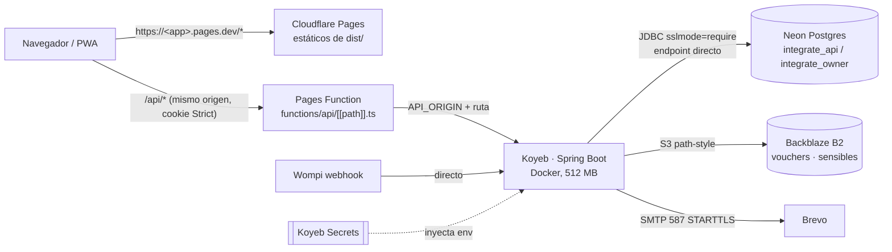

# ADR-0024: Desplegar un entorno de demostración gratuito en Neon, Koyeb, Cloudflare Pages y Backblaze B2

- **Estado:** Aceptado (§2 Koyeb y §5 Koyeb Secrets reemplazados por [ADR-0025](ADR-0025-backend-demo-en-pc-propia-con-cloudflare-tunnel.md), aprobado)
- **Proyecto / Módulo:** Despliegue · backend-api (Spring Boot 4.1, Java 21) y frontend-pwa (Vite/React)
- **Fecha:** 2026-10-18

## Contexto
Intégrate solo corre hoy en local (ADR-0001: Docker Compose con Postgres, LocalStack y Mailpit). Para la sustentación y las pruebas con usuarios hace falta un entorno público con HTTPS que no cueste dinero, no exija tarjeta de crédito y no use Vercel ni Render. El código impone cuatro restricciones: (1) la cookie de refresh es `HttpOnly; Secure; SameSite=Strict; Path=/api/v1/auth` (ADR-0005), así que la PWA y la API deben compartir sitio; (2) el arranque es *fail-fast* y exige S3 (`AWS_S3_BUCKET_NAME`, `AWS_S3_SENSITIVE_BUCKET_NAME`), SMTP, llaves RSA y AES; (3) Flyway migra con el rol `integrate_owner` y el runtime usa `integrate_api` con timeouts por rol (`00_bootstrap.sql`), y las migraciones requieren `pg_trgm` y `btree_gist`; (4) el repositorio no tiene Dockerfile ni Spring Boot Actuator.

SEC-DIR-004 §4 pide Vault, AWS Secrets Manager o SSM en producción. Este entorno es de **demostración**, no de producción, y ninguno de esos gestores es gratuito sin tarjeta. Por eso este ADR pide una excepción acotada a ese punto (ver Decisión §5); el resto de la directiva se cumple sin cambios.

## Decisión
1. **Base de datos: Neon (Postgres 16+).** Los roles y la base `integrate` se crean una sola vez ejecutando `infra/postgres/init/00_bootstrap.sql` con psql ≥ 15 y el rol propietario de Neon. Tanto el backend como Flyway usan el **endpoint directo** (sin `-pooler`): el pooler de Neon trabaja en modo transacción y rompe el bloqueo pesimista (ADR-0008) y los `SET` por rol. `DATABASE_URL` lleva `?sslmode=require`. La región de Neon se elige junto a la de Koyeb (AWS us-east-1 ↔ Washington, o eu-central-1 ↔ Frankfurt).
2. **Backend: Koyeb, instancia Free, desde un Dockerfile.** Se agrega `backend-api/Dockerfile` multi-etapa (compilación con `maven:3-eclipse-temurin-21` y `mvn -DskipTests package`, porque el `mvnw` del repo no valida su SHA-256 en Linux; ejecución con `eclipse-temurin:21-jre`, usuario no root, puerto 8080) y su `.dockerignore`. La JVM se ajusta a 512 MB con `JAVA_TOOL_OPTIONS=-XX:MaxRAMPercentage=70 -XX:+UseSerialGC -Xss512k` y `DB_POOL_MAX_SIZE=5`. El health check de Koyeb es **TCP al puerto 8080**: así no hace falta añadir Actuator ni abrir un endpoint nuevo en `SecurityConfig`. El perfil `dev` **no** se activa (cargaría `db/seed-dev`). Koyeb despliega solo al hacer push a `main`.
3. **PWA: Cloudflare Pages con un proxy en Pages Functions.** El directorio raíz es `frontend-pwa`, el build es `npm ci && npm run build` (Node ≥ 22.12) y la salida es `dist`. Se agrega `frontend-pwa/functions/api/[[path]].ts`: reenvía `/api/*` al origen de Koyeb, conservando método, ruta, query, cuerpo y cabeceras (incluidas `Cookie` y `Set-Cookie`), y añade `X-Forwarded-For`/`X-Forwarded-Proto`. El origen se lee de la variable de Pages `API_ORIGIN`, nunca se escribe en el código. La PWA se construye con `VITE_API_BASE_URL=/api`, igual que el proxy de Vite en desarrollo. Así la cookie `SameSite=Strict` viaja en el mismo origen y `CORS_ALLOWED_ORIGINS` queda vacío. Los webhooks de pago (Wompi) apuntan directo a Koyeb.
4. **Objetos: Backblaze B2 (API compatible con S3).** Dos buckets privados: vouchers y documentos sensibles (ADR-0007 §5, ADR-0010 §7). Se reutiliza la configuración existente (`AWS_ENDPOINT_URL`, `AWS_REGION`, `AWS_ACCESS_KEY_ID`, `AWS_SECRET_ACCESS_KEY`); `StorageConfig` ya activa *path-style* cuando hay endpoint propio, así que **no se toca código Java**. La Application Key de B2 se limita a esos dos buckets. Correo: Brevo SMTP, ya documentado en `.env.example` (ADR-0011).
5. **Secretos (excepción acotada a SEC-DIR-004 §4).** Todo valor sensible vive en **Koyeb Secrets** (cifrados, inyectados como variables de entorno al arrancar). El servicio solo los referencia con `{{ secret.NOMBRE }}`. No se usan archivos `.env` en el despliegue. Las llaves (JWT, voucher, AES) se generan **nuevas para la demo**, distintas de las de desarrollo, y la llave AES se respalda fuera de la base. Lo único que se versiona es una tabla de **nombres** de variables, sin valores, en la guía de despliegue. El *fail-fast* existente aborta el arranque si falta alguna. La excepción caduca si el entorno pasa a manejar datos reales de víctimas: en ese caso aplica §4 completo.
6. **Documentación.** Se agrega `docs/despliegue/demo-gratuita.md` con el paso a paso (Neon → B2 → Koyeb → Pages), la tabla de variables, la rotación de llaves, cómo crear el primer ADMIN (`BOOTSTRAP_ADMIN_*` solo en el primer arranque) y las limitaciones. También se enlaza desde `docs/guia-desarrollo.md`.

## Alternativas Descartadas
- **API en `*.koyeb.app` llamada directamente desde `*.pages.dev` con CORS:** son sitios distintos, así que `SameSite=Strict` bloquea la cookie de refresh y la sesión se pierde al recargar. Relajarla a `SameSite=None` debilita la protección CSRF de ADR-0005.
- **`_redirects` de Cloudflare Pages con estado 200:** no reenvía a orígenes externos, solo reescribe rutas internas.
- **Cloudflare R2:** exige registrar un método de pago para activarse.
- **Oracle Cloud Always Free, Fly.io, Railway, Cloud Run, Northflank:** piden tarjeta o ya no tienen plan gratuito permanente.
- **Hugging Face Spaces (Docker):** tiene RAM suficiente, pero no está pensado para APIs y podría restringir puertos salientes (5432, 587).
- **Servidor propio con Cloudflare Tunnel:** siempre activo y sin límites de RAM, pero depende de que el equipo esté encendido. Queda como plan B documentado.
- **Agregar Actuator para el health check:** suma una dependencia y una ruta pública que el check TCP no necesita.

## Consecuencias
- **Positivas:** costo cero sin tarjeta; HTTPS en ambos extremos; sesión y CSRF iguales a desarrollo (mismo origen, `VITE_API_BASE_URL=/api`); ningún cambio en código Java ni en la PWA fuera del proxy; despliegue continuo desde `main`; secretos fuera del repositorio.
- **Negativas / Riesgos asumidos:**
  - Koyeb Free tiene 512 MB y **se suspende sin tráfico**; Neon suspende la base a los ~5 min. Mientras el servicio duerme no corren la expiración de bloqueos (RF-11, TTL 15 min), el despachador del outbox ni el barrido de vouchers: se ponen al día al despertar. La primera petición tarda varios segundos. **Apto para demo, no para producción.**
  - Las Pages Functions gratuitas tienen un límite diario de invocaciones (~100 000/día) y suman un salto de red.
  - El backend ve la IP de Cloudflare: el *rate limiting* o la auditoría que dependan de la IP deben leer `X-Forwarded-For` (por verificar en la implementación).
  - La excepción del §5 depende de la seguridad de la cuenta de Koyeb: hay que activar 2FA en Koyeb, Neon, B2, Cloudflare y GitHub.
  - Las condiciones de los planes gratuitos cambian sin aviso; la guía registra la fecha en que se verificaron.

## Contrato o Esquema Conceptual (Opcional)

Artefactos a crear tras la aprobación: `backend-api/Dockerfile`, `backend-api/.dockerignore`, `frontend-pwa/functions/api/[[path]].ts`, `infra/postgres/seed/demo_privacy_policy.sql` (la política de privacidad no se siembra sin el perfil `dev`), `docs/despliegue/demo-gratuita.md` y un enlace desde `docs/guia-desarrollo.md`.
