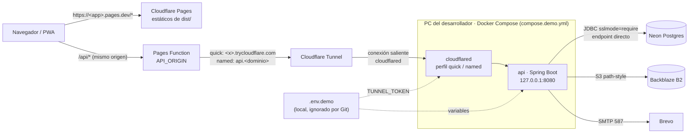

# ADR-0025: Ejecutar el backend de la demo en un PC propio y publicarlo con Cloudflare Tunnel

- **Estado:** Aceptado como alternativa local; el backend de la demo corre solo en Hetzner ([ADR-0027](ADR-0027-backend-24-7-en-vps-hetzner.md))
- **Proyecto / Módulo:** Despliegue · backend-api, infra/docker · reemplaza parcialmente a ADR-0024
- **Fecha:** 2026-10-19

## Contexto
ADR-0024 eligió Koyeb (instancia Free) para el backend. Koyeb fue adquirida por Mistral AI en febrero de 2026 y su plan gratuito está cerrado a cuentas nuevas: el panel de control del equipo solo muestra un aviso, sin menú ni *Secrets*, y no se puede desplegar. La restricción de fondo no cambia: demo pública con HTTPS, costo cero, sin tarjeta de crédito y sin Vercel ni Render. Las demás decisiones de ADR-0024 siguen vigentes: Neon para la base, Backblaze B2 para los archivos, Brevo para el correo y Cloudflare Pages con su proxy `/api` para que la cookie `SameSite=Strict` viaje en el mismo origen.

Los planes gratuitos que quedan en el mercado (Railway, SnapDeploy, Hugging Face Spaces) tienen cuotas que no pude confirmar en sus páginas oficiales, se agotan con uso real o no están pensados para una API con Postgres y SMTP salientes. La única opción verificada de punta a punta es la imagen `backend-api/Dockerfile`, que ya se construyó y arrancó contra Postgres con 512 MB.

## Decisión
1. **El backend corre en el PC del desarrollador con Docker Compose.** Se agrega `infra/docker/compose.demo.yml` con el servicio `api`, construido con `backend-api/Dockerfile` (`restart: unless-stopped`, límite de memoria de 1 GB, puerto `8080` solo en `127.0.0.1`). Se conserva Neon como base (siempre disponible aunque el PC se apague), B2 para archivos y Brevo para correo.
2. **Publicación con Cloudflare Tunnel, en dos modos seleccionables por perfil de Compose**, con la imagen oficial `cloudflare/cloudflared` fijada por versión:
   - **Perfil `quick` (sin dominio ni cuenta):** `cloudflared tunnel --url http://api:8080`. Publica una URL `https://<palabras>.trycloudflare.com` que **cambia cada vez que el contenedor se reinicia**. Pensado para pruebas y la sustentación. Cloudflare no da garantía de disponibilidad a estos túneles.
   - **Perfil `named` (con dominio propio):** `cloudflared tunnel run` con `TUNNEL_TOKEN`; el nombre de host (p. ej. `api.<dominio>`) se configura una vez en el panel de Cloudflare Zero Trust y queda **fijo**. Requiere un dominio cuyo DNS esté en Cloudflare.
3. **La PWA no cambia.** El proxy `frontend-pwa/functions/api/[[path]].ts` ya acepta cualquier origen `https://`. Solo cambia el valor de `API_ORIGIN` en Cloudflare Pages: en modo `quick` hay que actualizarlo y redesplegar Pages cada vez que cambie la URL; en modo `named` se fija una sola vez. `FRONTEND_BASE_URL` se define en el `.env.demo` local.
4. **Secretos.** Se cumple SEC-DIR-004 §2 como en desarrollo: los valores viven en `infra/env/.env.demo`, archivo local que ya ignora el `.gitignore` (`.env.*`). **No** se versiona otra plantilla (la directiva admite un único `.env.example`): las variables nuevas (`TUNNEL_TOKEN`, `API_IMAGE_TAG` y las de la demo) se agregan como una sección comentada a `infra/env/.env.example`, con placeholders. El `TUNNEL_TOKEN` es un secreto: se revoca desde el panel de Cloudflare si se filtra (SOP-SEC-01). Esto reemplaza la excepción de ADR-0024 §5 (Koyeb Secrets), que ya no aplica.
5. **Pagos y webhooks.** En modo `quick` se usa `PAYMENT_PROVIDER=MOCK`: el webhook de Wompi exigiría reconfigurar la URL en cada reinicio. Con Wompi solo en modo `named`.
6. **Guía.** `docs/despliegue/demo-gratuita.md` se reescribe: se elimina el paso de Koyeb y se agrega el arranque con Compose, la elección de modo, cómo leer la URL del túnel (`docker compose logs cloudflared`), cómo actualizar `API_ORIGIN` y el comportamiento al dormir o reiniciar el PC.

## Alternativas Descartadas
- **Koyeb:** plan gratuito cerrado a cuentas nuevas tras la adquisición por Mistral.
- **Railway o SnapDeploy:** cuotas gratuitas no confirmadas en fuentes oficiales; según terceros se agotan en una o dos semanas de uso o dependen de un proveedor pequeño.
- **Hugging Face Spaces (Docker):** no está pensado para APIs persistentes y no verifiqué si permite conexiones salientes a los puertos 5432 y 587.
- **Fly.io, Oracle Cloud, Cloud Run, Northflank:** piden tarjeta o ya no tienen plan gratuito permanente.
- **Abrir puertos del router o usar ngrok:** exponen la IP del hogar o limitan la URL gratuita; Cloudflare Tunnel solo hace conexiones salientes.
- **Un único modo de túnel:** `quick` solo sirve a quien no tiene dominio y `named` solo a quien lo tiene; con ambos perfiles el mismo Compose cubre los dos casos.

## Consecuencias
- **Positivas:** costo cero sin tarjeta; sin límite de 512 MB; las tareas programadas (expiración de bloqueos, outbox de correo, barrido de vouchers) corren sin interrupciones mientras el PC esté encendido; HTTPS en ambos extremos sin abrir puertos; imagen ya verificada; modo `named` listo para un despliegue estable cuando haya dominio.
- **Negativas / Riesgos asumidos:**
  - **Disponibilidad igual a la del PC:** si se apaga, suspende, pierde internet o Docker Desktop no está abierto, la API no responde y la PWA muestra el error 502 del proxy.
  - **URL efímera en modo `quick`:** cada reinicio exige actualizar `API_ORIGIN` y redesplegar Pages; las sesiones activas se pierden con la URL, y los enlaces de correo siguen apuntando a la PWA, que no cambia.
  - **El tráfico de la API pasa por Cloudflare** (termina TLS allí), igual que el de la PWA. Aceptable para una demo sin datos reales de víctimas; si cambia ese supuesto, esta decisión se revisa.
  - **Seguridad del equipo:** el PC aloja el backend y las llaves; debe tener cifrado de disco, sesión bloqueada y el `.env.demo` fuera de carpetas sincronizadas públicamente. La carpeta del proyecto está en OneDrive: `infra/env/.env.demo` debe excluirse de la sincronización o guardarse fuera de ella.
  - **Modo `named` exige un dominio** (costo anual, no gratuito) y delegar su DNS a Cloudflare.
  - Las condiciones de Cloudflare cambian sin aviso; la guía registra la fecha de verificación.

## Contrato o Esquema Conceptual (Opcional)

Artefactos a crear tras la aprobación: `infra/docker/compose.demo.yml`, sección «Despliegue de demo» en `infra/env/.env.example`, reescritura de `docs/despliegue/demo-gratuita.md`, referencias a Koyeb en `docs/README.md`, `README.md` y `docs/guia-desarrollo.md`, y `.gitignore`/`.dockerignore` solo si hiciera falta. ADR-0024 queda como «Aceptado (§2 y §5 reemplazados por ADR-0025)».
