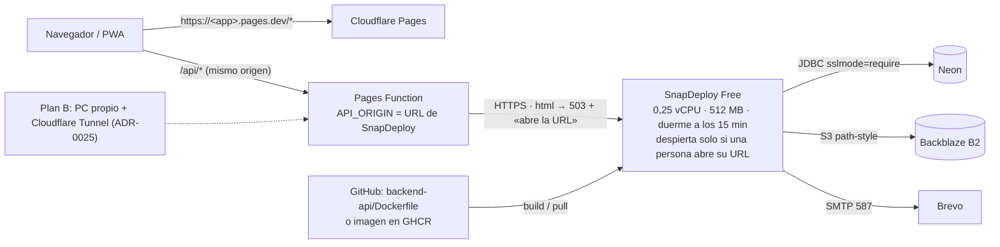

# ADR-0026: Desplegar el backend de la demo en SnapDeploy (plan gratuito)

- **Estado:** Aceptado; desde el 2026-10-27 es el **entorno de pruebas** (no la producción): la producción 24/7 corre en Hetzner ([ADR-0027](ADR-0027-backend-24-7-en-vps-hetzner.md))
- **Proyecto / Módulo:** Despliegue · backend-api, frontend-pwa/functions · alternativa a ADR-0025 §1–§2
- **Fecha:** 2026-10-19

## Contexto
ADR-0025 aloja el backend en el PC del desarrollador con Cloudflare Tunnel porque Koyeb cerró su plan gratuito. El desarrollador prefiere un proveedor en la nube para no depender de que su PC esté encendido, y eligió **SnapDeploy**. La restricción sigue siendo costo cero, sin tarjeta, sin Vercel ni Render.

Lo que la [página oficial de SnapDeploy](https://snapdeploy.dev) declara para el plan Free (verificado el 2026-10-19): contenedor *Small* de **512 MB y 0,25 vCPU**, hasta 4 contenedores, **100 horas al mes** (cuentan solo con el contenedor despierto), 10 despliegues al día, **se duerme tras 15 minutos sin tráfico** y despierta en ~1 minuto mostrando una página de espera propia, «no credit card required», despliegue desde GitHub con Dockerfile, imagen Docker pública o JAR/ZIP, y variables de entorno editables con reinicio sin caída. Dominios propios solo en planes de pago. **No documenta** secretos ni health checks. Es un proveedor pequeño y esas condiciones pueden cambiar.

**Verificado el 2026-10-19 en su [documentación oficial](https://snapdeploy.dev/docs/free-tier)** (corrige supuestos de la primera redacción): (a) las conexiones salientes están permitidas a los puertos TCP 1 a 27017 salvo 3333 y 9000 a 9099, lo que cubre PostgreSQL 5432 y SMTP 587; (b) el despliegue desde GitHub admite un *root directory* y usa el Dockerfile del repositorio tal cual; (c) las 100 horas son **por cuenta y compartidas** entre contenedores; (d) un contenedor dormido responde **503 con una página HTML de espera** a cualquier petición y **solo se despierta cuando una persona abre esa página en un navegador**: las llamadas de scripts, monitores, webhooks o de otro servidor (incluido el proxy de Pages) reciben el 503 pero **no lo despiertan**; (e) cada despertar arranca una copia nueva del contenedor (el sistema de archivos se pierde; la API es *stateless*: Neon y B2); (f) la URL pública es `<nombre>.containers.snapdeploy.app` y los dominios propios solo existen en planes de pago.

Restricciones del código que siguen vigentes: la cookie de refresh es `SameSite=Strict` (la PWA y la API deben compartir origen, vía el proxy de Pages), el arranque es *fail-fast*, y la imagen `backend-api/Dockerfile` ya se construyó y arrancó con 512 MB contra Postgres (8 s en un PC normal; con 0,25 vCPU será bastante más lento).

## Decisión
1. **El backend se despliega en SnapDeploy (plan Free) desde el repositorio de GitHub**, usando `backend-api/Dockerfile` (puerto 8080, `JAVA_TOOL_OPTIONS` ya fijado en la imagen para 512 MB). Neon, Backblaze B2, Brevo y Cloudflare Pages no cambian (ADR-0024).
2. **Puerta de verificación antes de dar por buena la decisión.** La documentación oficial ya cubre los puertos de salida (5432 y 587 permitidos) y el *root directory*. Quedan por comprobar en el primer despliegue: (a) que el arranque de Spring Boot con 0,25 vCPU termina y la plataforma lo da por sano; (b) que la plataforma enruta al puerto 8080 (usa la detección de puerto; la variable `PORT` la define la plataforma y la imagen fija `SERVER_PORT=8080`: se confirma con una petición real); (c) que Brevo acepta el envío desde esa red. Si (a) falla, esta decisión se descarta y se vuelve a ADR-0025 sin más cambios (el `compose.demo.yml` se conserva como plan B).
3. **El despliegue usa el *root directory* `backend-api`** con el Dockerfile del repositorio. Solo si eso fallara en la práctica, se usa la alternativa documentada por la plataforma: imagen Docker pública. Se construye en local con `docker build -t ghcr.io/<usuario>/integrate-api:demo backend-api` y se publica en GitHub Container Registry (paquete público; la imagen no contiene secretos). Sin workflow de GitHub Actions en esta fase.
4. **Secretos.** SnapDeploy no documenta un gestor de secretos: las variables se cargan como variables de entorno del contenedor, visibles para quien entre a la cuenta. Es una excepción acotada a SEC-DIR-004 §4, igual de limitada que la de ADR-0024 §5: solo demo, sin datos reales de víctimas, 2FA en todas las cuentas, llaves nuevas distintas a las de desarrollo. Nada de esto se versiona; `infra/env/.env.example` sigue siendo la única plantilla y su sección de demo se amplía con una nota de SnapDeploy.
5. **Cambios en el proxy de Pages (`frontend-pwa/functions/api/[[path]].ts`).** Con el contenedor dormido SnapDeploy devuelve su página HTML de espera, no JSON, y la PWA no debe intentar interpretarla. El proxy, cuando la respuesta del origen a una ruta `/api/*` tiene `Content-Type: text/html`, devuelve un `503` `application/problem+json` con `Retry-After: 60` y un detalle que **indica abrir la URL del backend en el navegador** (el proxy no puede despertarlo, ver (d) arriba). Además reintenta una vez los GET ante un fallo de red. No cambia nada más.
6. **Pagos.** `PAYMENT_PROVIDER=MOCK` (el webhook de Wompi podría perderse mientras el contenedor duerme).
7. **PWA en Cloudflare Pages, no en SnapDeploy.** Se evaluó alojar también la PWA en SnapDeploy (dos contenedores bajo `snapdeploy.app`, que no figura en la Public Suffix List, de modo que cuentan como el mismo sitio y la cookie `SameSite=Strict` viajaría sin proxy). Se descartó: la PWA también se dormiría, las 100 horas compartidas se gastarían al doble, y como todos los clientes de SnapDeploy comparten sitio, la protección CSRF de `SameSite=Strict` se debilita. Con Pages la PWA está siempre disponible, no consume horas y la cookie sigue protegida.
8. **Automatización con la API de SnapDeploy** (verificada en su [referencia](https://snapdeploy.dev/api)): un token personal con alcance `deploy` (con vencimiento, revocable, que no puede borrar nada) permite reemplazar todas las variables de un contenedor (`PUT /api/mobile/containers/{id}/env`), despertarlo (`POST …/wake`) y leer estado, horas y logs. `infra/scripts/snapdeploy.sh` lo envuelve: carga las variables desde el `.env.demo` local en una sola llamada (sin imprimirlas ni escribirlas en disco; el token solo vive en la variable de entorno de la terminal) y evita crearlas una por una en el panel. El despertar por API **sustituye** la apertura manual en el navegador, aunque consume horas igual. No automatiza el despliegue ni toca el repositorio.
9. **Guía.** `docs/despliegue/demo-gratuita.md` pasa a tener dos caminos para el backend: **A) SnapDeploy** (principal) y **B) PC propio + Cloudflare Tunnel** (ADR-0025). Se añade la sección de consumo de horas y el procedimiento de **despertar la API a mano** antes de cada uso.

## Alternativas Descartadas
- **PC propio + Cloudflare Tunnel (ADR-0025):** funciona y ya está probado, pero depende de que el PC esté encendido. Se conserva como plan B, no se elimina.
- **Railway:** la prueba gratuita depende de un crédito de uso que, según terceros, se agota en una o dos semanas; sus límites oficiales no se confirmaron.
- **Hugging Face Spaces, Fly.io, Oracle Cloud, Cloud Run, Northflank:** descartadas en ADR-0025 (no pensadas para APIs, piden tarjeta o sin plan gratuito permanente).

## Consecuencias
- **Positivas:** la API no depende del PC del desarrollador; costo cero sin tarjeta; despliegue desde GitHub; se mantienen Neon, B2, Brevo y Pages.
- **Negativas / Riesgos asumidos:**
  - **0,25 vCPU:** el arranque de Spring Boot + Flyway (14 migraciones) puede tardar uno o dos minutos y las peticiones simultáneas serán lentas. Es lo más probable que falle la puerta del punto 2(b).
  - **Despertar manual y doble arranque en frío:** tras 15 minutos sin tráfico el contenedor se duerme y **solo despierta cuando una persona abre su URL en un navegador** (~1 minuto, más el arranque de la JVM). Antes de cada demo hay que abrir la URL de la API en el navegador (o llamar a `snapdeploy.sh wake`) y esperar; hasta entonces la PWA mostrará el 503 con esa indicación.
  - **100 horas al mes por cuenta** con el contenedor despierto (≈ 4 días seguidos): un monitor o *keep-alive* no puede despertarlo, pero una vez despierto mantenerlo activo consume horas. No hacer *keep-alive*.
  - **Tareas programadas detenidas mientras duerme:** expiración de bloqueos (TTL 15 min), outbox de correo y barrido de vouchers solo corren con el contenedor despierto.
  - **Sin dominio propio ni secretos cifrados** en el plan gratuito; proveedor pequeño sin documentación completa: la puerta del punto 2 existe por eso.
  - La IP registrada por el backend es la de la infraestructura, no la del usuario (igual que en ADR-0025).

## Contrato o Esquema Conceptual (Opcional)

Artefactos a crear tras la aprobación: ajuste de `frontend-pwa/functions/api/[[path]].ts` (puntos 5), actualización de `docs/despliegue/demo-gratuita.md` (punto 7), nota de SnapDeploy en `infra/env/.env.example`, y estados/índices de ADR. No se modifica código Java ni `compose.demo.yml`.
