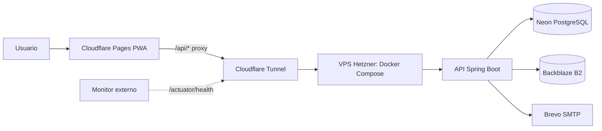

# ADR-0027: Alojar el backend 24/7 en un VPS de Hetzner Cloud

- **Estado:** Propuesto
- **Proyecto / Módulo:** Infraestructura / Despliegue
- **Fecha:** 2026-10-26

## Contexto
El docente exige que la aplicación esté disponible 24/7. El plan gratuito de SnapDeploy (ADR-0026) duerme el contenedor tras 15 minutos sin uso y el modo Always-On cuesta 1 USD por cada 24 h, por lo que no cumple el requisito de forma sostenida. Neon (plan gratuito) también suspende el cómputo tras unos minutos inactivo.

Restricciones: costo bajo y predecible, sin Vercel ni Render, reutilizar lo ya construido (`Dockerfile`, `compose.demo.yml`, proxy de Cloudflare Pages, Brevo, Backblaze B2) y no volcar secretos en Git ni en el chat.

## Decisión
Alojar la API en **un VPS de Hetzner Cloud** (tipo CX22 o equivalente, 2 vCPU y 4 GB de RAM, Ubuntu LTS, unos 5 USD/mes), ejecutada con Docker Compose y reiniciada automáticamente (`restart: unless-stopped`).

- **Base de datos:** se mantiene Neon como punto de partida (sin migrar datos). Si la suspensión de Neon afecta la experiencia, se pasa a un PostgreSQL 16 en la misma VM mediante un ADR posterior.
- **Exposición:** Cloudflare Tunnel (`cloudflared`) hacia el contenedor, sin abrir puertos de entrada. La Pages Function `/api/*` sigue haciendo de proxy con `API_ORIGIN` apuntando al túnel con nombre.
- **Seguridad del servidor:** acceso solo por llave SSH, sin contraseña ni root; cortafuegos que cierra todo el tráfico de entrada; actualizaciones de seguridad automáticas; contenedor sin privilegios (usuario 10001); variables en un archivo `.env` con permisos 600 fuera de Git.
- **Memoria de la JVM:** se amplía el margen respecto al ajuste de 512 MB de ADR-0026 (por ejemplo Xmx de 1 GB) y se verifica con las pruebas de ciclo de vida existentes.
- **Operación:** se agrega un monitor de disponibilidad externo gratuito sobre `/actuator/health` para alertar si cae.
- **SnapDeploy** queda como plan B de contingencia, sin retirar su script.

## Alternativas Descartadas
- **Seguir en SnapDeploy Free:** duerme a los 15 min; incumple el 24/7.
- **SnapDeploy Always-On por Sprint Pack:** 1 USD por 24 h es más caro que el mes completo de un VPS y exige renovar a diario.
- **Azure for Students / DigitalOcean con créditos:** gratuito, pero depende de que aprueben el correo universitario o el Student Pack y los créditos vencen.
- **DigitalOcean de pago:** más del doble de costo con prestaciones similares.
- **PC propia con Cloudflare Tunnel (ADR-0025):** solo está disponible mientras el equipo esté encendido.

## Consecuencias
- **Positivas:** disponibilidad continua sin dormirse, más memoria y estabilidad, costo fijo y bajo, reutiliza casi toda la infraestructura existente.
- **Negativas / Riesgos asumidos:** costo mensual recurrente y necesidad de tarjeta o PayPal; el servidor se administra a mano (parches, respaldos, vigilancia); latencia mayor al estar en Europa o EE. UU.; un único nodo sin alta disponibilidad; la suspensión de Neon puede añadir segundos al primer acceso.

## Contrato o Esquema Conceptual

