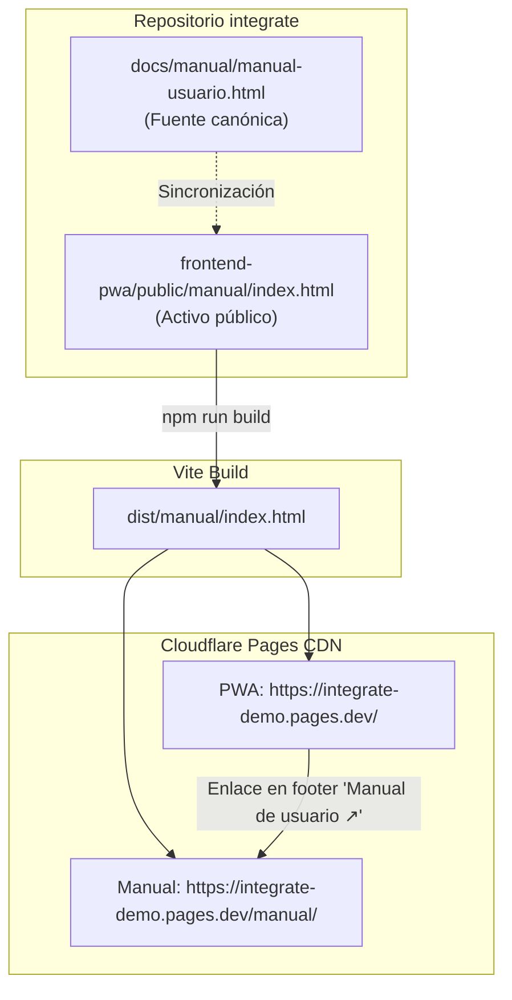

# ADR-0028: Publicar el Manual de Usuario como Activo Estático en la PWA (Cloudflare Pages y Local)

- **Estado:** Aceptado
- **Proyecto / Módulo:** Documentación / Frontend PWA / Despliegue
- **Fecha:** 2026-10-26

## Contexto
El proyecto dispone de un manual de usuario integral en [`docs/manual/manual-usuario.html`](../../manual/manual-usuario.html) para los cuatro roles de la plataforma (Turista, Gestor de Enlace, Anfitrión comunitario y Administrador). Dicho manual es un documento HTML autocontenido (con estilos certificados para WCAG AAA y 22 capturas de pantalla reales embebidas en formato Base64).
Se requiere que este manual esté publicado en la web y accesible para docentes, evaluadores y usuarios en general, sin incurrir en costos de infraestructura, sin riesgo de que el servicio se suspenda por inactividad y garantizando su disponibilidad tanto en la demostración en la nube como en el entorno local de desarrollo.

## Decisión
Publicar el manual de usuario **directamente como un activo estático dentro de la PWA** (`frontend-pwa/public/manual/index.html`):

1. **Empaquetado transparente con Vite:**
   Vite copia todo el contenido del directorio `frontend-pwa/public/` directamente a `dist/` durante el empaquetado (`npm run build`) sin procesarlo a través del pipeline de JavaScript, generando `dist/manual/index.html`.
2. **Disponibilidad universal y persistente:**
   - En la demo desplegada en **Cloudflare Pages** (ADR-0024), el manual queda accesible de forma pública y permanente en:
     `https://integrate-demo.pages.dev/manual/`
   - En el entorno local de desarrollo (`npm run dev`), queda accesible de inmediato en:
     `http://localhost:5173/manual/`
3. **Mantenimiento y trazabilidad:**
   La fuente canónica del documento continúa siendo [`docs/manual/manual-usuario.html`](../../manual/manual-usuario.html). Se conserva además una copia idéntica en [`docs/manual/index.html`](../../manual/index.html) para permitir que cualquier servidor estático alternativo (como Render Static Site o GitHub Pages) pueda servirlo directamente en la raíz de dicha carpeta si se requiere en el futuro.
4. **Acceso ergonómico desde la interfaz:**
   Integrar un enlace accesible en los pies de página de la aplicación (`DesktopShell` y `MobileShell`) que abra el manual en una pestaña nueva mediante `<a href="/manual/" target="_blank" rel="noopener noreferrer">Manual de usuario ↗</a>`, cumpliendo con las directivas de contraste WCAG AAA y áreas táctiles de `docs/rules/frontend-rules.md` (FE-DIR-001).

## Alternativas Descartadas
- **Render Web Service (Free Tier):** El plan gratuito de servicios web en Render suspende el contenedor tras 15 minutos sin peticiones y requiere más de un minuto para reanudar el servicio.
- **Render Static Site:** Aunque los sitios estáticos en Render son gratuitos y no se suspenden, requiere gestionar un proyecto independiente en Render, crear registros DNS o subdominios adicionales (`.onrender.com`) y mantener desacoplado el ciclo de despliegue de la documentación respecto a la PWA.
- **GitHub Pages dedicado:** Requiere habilitar y configurar un workflow de GitHub Actions separado y dispersa la experiencia del usuario hacia un origen cruzado (`choclitoxd.github.io`).
- **Servicios efímeros (Netlify Drop / Surge):** Despliegues manuales fuera del control de versiones y con URLs temporales que no garantizan persistencia.

## Consecuencias
- **Positivas:**
  - **Cero costo y cero servicios adicionales:** Aprovecha la infraestructura ya existente en Cloudflare Pages.
  - **Disponibilidad continua:** El CDN global de Cloudflare Pages no sufre arranques en frío ni suspensión por inactividad.
  - **Cohesión de origen:** Tanto la aplicación como su manual residen bajo el mismo dominio (`pages.dev`), eliminando problemas de CORS o enlaces rotos.
  - **Cero impacto en rendimiento:** Al ser un archivo estático independiente fuera del bundle JS principal (`index.js`), el peso de la PWA no se incrementa y la descarga de 1.3 MB solo ocurre cuando el usuario decide abrir el manual.
- **Negativas / Riesgos asumidos:**
  - El archivo autocontenido pesa ~1.3 MB debido a las imágenes embebidas. Su carga inicial depende de la conexión del usuario, aunque una vez descargado queda cacheado por el navegador.
  - Toda modificación en `docs/manual/manual-usuario.html` debe replicarse en `frontend-pwa/public/manual/index.html`.

## Contrato o Esquema Conceptual

