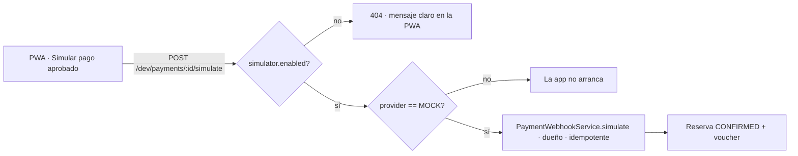

# ADR-0029: Habilitar el simulador de la pasarela Mock en la demo desplegada mediante una propiedad explícita

- **Estado:** Aceptado (2026-10-27)
- **Proyecto / Módulo:** Intégrate · `backend-api/` — `modules/payment`; `frontend-pwa/` — `features/booking`; despliegue (ADR-0027)
- **Fecha:** 2026-10-27

## Contexto

La auditoría del 2026-10-27 (`docs/quality/auditoria-procesos-1-y-2-2026-10-27.md`, hallazgo C2) encontró que **ningún turista puede terminar un pago en la demo desplegada**. La demo corre con `PAYMENT_PROVIDER=MOCK` (no hay dinero real), así que el checkout muestra el panel «Pasarela de pruebas» (ADR-0016). Pero `POST /api/v1/dev/payments/{paymentId}/simulate` lo sirve `DevPaymentSimulatorController`, que solo existe con los perfiles `dev` y `test` (ADR-0009 §1, punto C). En el servidor la llamada responde 404 y la PWA muestra «No encontramos lo que buscas»; el cupo se libera a los 15 minutos.

Hoy la única forma de confirmar una reserva en la demo es firmar a mano el webhook con `PAYMENT_WEBHOOK_SECRET_MOCK`, que no es algo que un tester o un evaluador pueda hacer. El perfil de Spring no es el criterio correcto: lo que hace seguro al simulador es que el proveedor sea `MOCK`, no el nombre del perfil.

## Decisión

### 1. Backend: el simulador depende de una propiedad, no del perfil

- `DevPaymentSimulatorController` deja `@Profile({"dev","test"})` y pasa a `@ConditionalOnProperty(prefix = "integrate.payments.simulator", name = "enabled", havingValue = "true")`.
- **Valor por defecto `false`** en `application.yml`, con la variable `PAYMENT_SIMULATOR_ENABLED`. Los perfiles `dev` y `test` lo ponen en `true`, así que el comportamiento local y de pruebas no cambia.
- **Guarda de arranque (fail-fast):** si `integrate.payments.simulator.enabled=true` y `integrate.payments.provider` no es `MOCK`, la aplicación **no arranca** y explica por qué. Así es imposible exponer el simulador junto a una pasarela real (Wompi).
- El contrato no cambia: misma ruta, solo rol `TOURIST`, solo el **dueño** del pago (lo valida `PaymentWebhookService.simulate`), mismo procesador idempotente del webhook, misma auditoría y dispersión del 85 %.

### 2. Despliegue

- En el servidor de la demo (`~/integrate/.env`, ADR-0027) se agrega `PAYMENT_SIMULATOR_ENABLED=true`. `infra/env/.env.example` documenta la variable con valor `false` y la advertencia de que solo vale con `MOCK`.

### 3. PWA: mensaje claro si el simulador no está

- Si `simulatePayment` responde 404, el panel muestra «La pasarela de pruebas no está activa en este servidor» con la indicación de avisar al equipo, en lugar del genérico «No encontramos lo que buscas». No hay cambios visuales ni tokens nuevos; se usa `ProblemNotice`.

### 4. Pruebas

- Integración: con la propiedad en `false` la ruta responde 404; en `true` con `MOCK` confirma la reserva del dueño y rechaza la de otro turista (403/404 según el servicio actual); en `true` con un proveedor distinto de `MOCK` el contexto no arranca.
- PWA: prueba del mensaje ante 404.
- De punta a punta en la demo: reserva → pagar → «Simular pago aprobado» → «¡Reserva confirmada!» con voucher.

## Alternativas Descartadas

- **Activar el perfil `dev` en el servidor:** arrastra toda la configuración de desarrollo (registros, valores por defecto) a un entorno público.
- **Ocultar el panel y no permitir pagar:** la demo quedaría sin el final del Proceso 2, que es lo que el docente debe ver.
- **Firmar el webhook desde la PWA:** exigiría poner el secreto HMAC en el bundle público.
- **Integrar Wompi en modo sandbox ya:** es lo correcto a mediano plazo, pero exige llaves y configuración del comercio; no resuelve la demo de esta semana.

## Consecuencias

- **Positivas:** testers y evaluadores completan la reserva hasta el voucher; el cambio es pequeño y no toca el contrato de la API ni la PWA salvo el mensaje de error; la guarda de arranque impide usarlo con dinero real.
- **Negativas / Riesgos asumidos:** en la demo cualquier turista puede confirmar **sus propias** reservas sin pagar. Es aceptable porque con `MOCK` no existe dinero real. Si algún día se cambia a Wompi, la guarda obliga a apagar el simulador.

## Contrato o Esquema Conceptual

