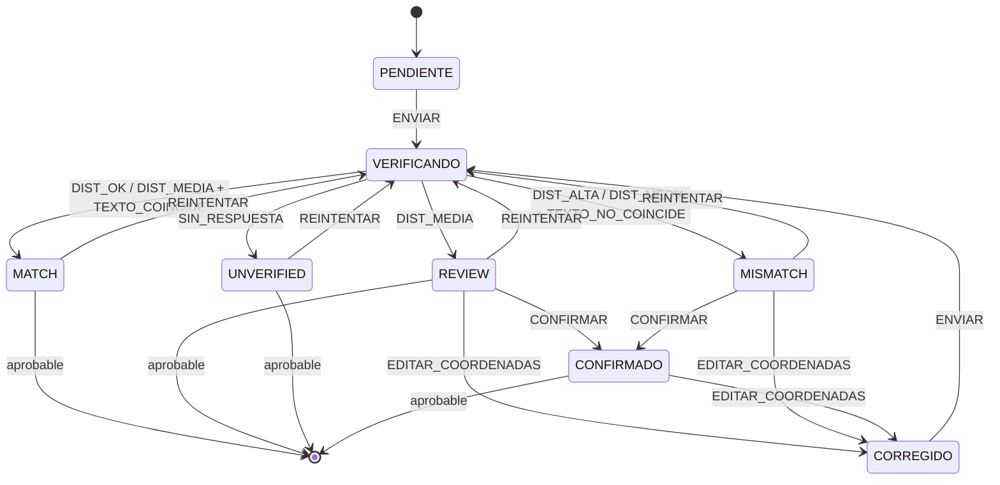
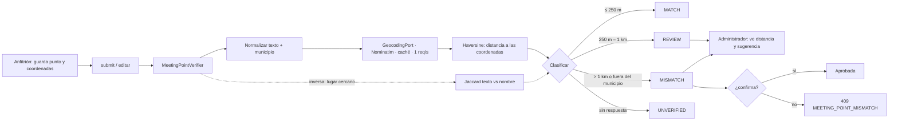

# ADR-0030: Verificar que la dirección del punto de encuentro coincida con sus coordenadas

- **Estado:** Aceptado (2026-10-27)
- **Proyecto / Módulo:** Intégrate · `backend-api/` — `modules/catalog`; `frontend-pwa/` — `features/catalog` (detalle)
- **Fecha:** 2026-10-27

## Contexto

Una experiencia guarda dos datos independientes del mismo lugar: el texto `meetingPoint` («Plaza de Bolívar, Armenia») y las coordenadas `latitude`/`longitude`. Nada comprueba que digan lo mismo. El 2026-10-27 la experiencia de ejemplo de la demo salió con el marcador del mapa a **906 m** de la Plaza de Bolívar: las coordenadas se escribieron a mano y estaban mal, y ni el anfitrión, ni el administrador que aprueba, ni el turista tenían cómo notarlo. Un turista que sigue el marcador llega al sitio equivocado, y es el dato que más importa el día del recorrido.

Restricciones: costo cero, sin llaves nuevas, sin datos personales hacia terceros (el punto de encuentro es un lugar público), el catálogo no debe quedar bloqueado si el servicio externo falla, y la decisión final sobre una experiencia sigue siendo del administrador.

## Decisión

Un servicio de **verificación advisoria** en el backend que compara el texto con las coordenadas y deja un resultado visible en la aprobación y en el detalle.

### 1. Algoritmo (`MeetingPointVerifier`)

1. **Normalizar** `meetingPoint`: minúsculas, sin tildes ni signos, sin palabras vacías («de», «la», «el», «en»); consulta de geocodificación = `meetingPoint` + municipio + departamento + «Colombia» (el municipio sale de `municipality_code`, DIVIPOLA).
2. **Geocodificar** (adelante) con un puerto `GeocodingPort`; implementación por defecto: **Nominatim de OpenStreetMap**, con `User-Agent` propio, máximo 1 solicitud por segundo, tiempo límite de 3 s y caché por texto normalizado.
3. **Distancia:** fórmula de Haversine entre las coordenadas declaradas y la mejor coincidencia. Se prefieren resultados de tipo lugar (plaza, parque, iglesia, vereda) dentro del municipio; los que caen fuera del cuadro del municipio se descartan.
4. **Clasificar:**

| Resultado | Condición | Efecto |
| :--- | :--- | :--- |
| `MATCH` | distancia ≤ 250 m | sin aviso |
| `REVIEW` | 250 m a 1 000 m | aviso al anfitrión y al administrador, con las coordenadas sugeridas |
| `MISMATCH` | > 1 000 m, o coordenadas fuera del municipio | aviso fuerte; el administrador debe confirmarlo para aprobar |
| `UNVERIFIED` | sin coordenadas, sin coincidencia o servicio caído | sin aviso bloqueante; se reintenta al enviar |

5. **Segunda señal (inversa):** con las coordenadas se consulta el lugar más cercano y se compara su nombre con el texto por **similitud de conjuntos de palabras** (Jaccard sobre los términos normalizados). Si la similitud es 0 y la distancia está en `REVIEW`, se sube a `MISMATCH`; si es ≥ 0,5, se baja un nivel. Sirve para el caso inverso (texto bien, coordenadas del lugar vecino).

### 1b. Autómata del ciclo de verificación (`MeetingPointAutomaton`)

El ciclo completo, desde la verificación hasta la aprobación, lo gobierna una **máquina de estados finita y determinista**, en el mismo estilo que el autómata del mod *portero* (tabla de transiciones explícita, sin modelos de lenguaje). El algoritmo de la sección 1 es el que **produce los eventos**; el autómata es el único que decide qué estado sigue. Ni el servicio ni el controlador cambian el estado a mano.

**Estados:** `PENDIENTE`, `VERIFICANDO`, `MATCH`, `REVIEW`, `MISMATCH`, `UNVERIFIED`, `CONFIRMADO` (el administrador aceptó el punto dudoso) y `CORREGIDO` (se cambiaron las coordenadas y vuelve a verificarse).

**Eventos:** `ENVIAR` (submit o edición del punto), `REINTENTAR` (endpoint del anfitrión), `DIST_OK` (≤ 250 m), `DIST_MEDIA` (250–1 000 m), `DIST_ALTA` (> 1 000 m o fuera del municipio), `SIN_RESPUESTA`, `TEXTO_COINCIDE` (Jaccard ≥ 0,5), `TEXTO_NO_COINCIDE` (Jaccard 0 con distancia media), `CONFIRMAR` (administrador), `EDITAR_COORDENADAS`.

**Tabla de transiciones** (estado actual × evento → estado siguiente; lo que no está en la tabla se rechaza):

| Estado actual | Evento | Estado siguiente |
| :--- | :--- | :--- |
| `PENDIENTE` | `ENVIAR` | `VERIFICANDO` |
| `VERIFICANDO` | `DIST_OK` | `MATCH` |
| `VERIFICANDO` | `DIST_MEDIA` + `TEXTO_COINCIDE` | `MATCH` |
| `VERIFICANDO` | `DIST_MEDIA` | `REVIEW` |
| `VERIFICANDO` | `DIST_MEDIA` + `TEXTO_NO_COINCIDE` | `MISMATCH` |
| `VERIFICANDO` | `DIST_ALTA` | `MISMATCH` |
| `VERIFICANDO` | `SIN_RESPUESTA` | `UNVERIFIED` |
| `UNVERIFIED`, `REVIEW`, `MISMATCH`, `MATCH` | `REINTENTAR` o `ENVIAR` | `VERIFICANDO` |
| `REVIEW`, `MISMATCH` | `EDITAR_COORDENADAS` | `CORREGIDO` |
| `CORREGIDO` | `ENVIAR` | `VERIFICANDO` |
| `MISMATCH` | `CONFIRMAR` | `CONFIRMADO` |
| `REVIEW` | `CONFIRMAR` | `CONFIRMADO` |
| `CONFIRMADO` | `EDITAR_COORDENADAS` | `CORREGIDO` |

**Estados terminales para aprobar:** una experiencia se puede aprobar solo desde `MATCH`, `REVIEW`, `UNVERIFIED` o `CONFIRMADO`. Desde `MISMATCH`, `VERIFICANDO`, `PENDIENTE` o `CORREGIDO` la aprobación se rechaza (409 `MEETING_POINT_MISMATCH` o `MEETING_POINT_NOT_VERIFIED`). Es la única puerta: no hay otro camino hacia `APPROVED`.

**Por qué un autómata y no `if` sueltos:** la regla que importa («un punto dudoso no se aprueba sin que alguien lo confirme») queda en **una sola tabla**, se prueba celda por celda y no se puede saltar añadiendo un camino nuevo en un controlador. Una transición no listada lanza una excepción en lugar de pasar en silencio.

**Persistencia:** el estado actual se guarda en `meeting_point_check_status` (sección 3) y cada transición se registra en `catalog.experience_status_history`-equivalente (`meeting_point_check_history`: estado anterior, evento, estado nuevo, distancia, usuario, momento), de modo que la auditoría pueda reconstruir por qué se aprobó un punto.

**Fuera de alcance:** el reintento periódico automático de los `UNVERIFIED` (una tarea programada) no entra en este ADR; el reintento es manual desde el anfitrión o al editar. Queda como evolución si hace falta.

**Precisiones de la implementación (2026-10-27):**
- Los eventos con «+» de la tabla (`DIST_MEDIA + TEXTO_COINCIDE`, `DIST_MEDIA + TEXTO_NO_COINCIDE`) llegan al autómata ya combinados, como `DIST_MEDIA_TEXTO_COINCIDE` y `DIST_MEDIA_TEXTO_NO_COINCIDE`: el verificador decide la similitud del texto y el autómata solo ve un evento.
- Se agregó la fila `VERIFICANDO` × `REINTENTAR` → `VERIFICANDO`, para no quedar atascado si una verificación se pierde (por ejemplo, un reinicio del servidor). La prueba de seguridad sigue en pie: los únicos eventos que llevan a un estado aprobable son los resultados de `VERIFICANDO` y `CONFIRMAR`.
- Desde `MISMATCH`, `REINTENTAR` puede terminar en `MATCH` si el geocodificador devuelve un resultado distinto: es una verificación nueva, no un atajo.
- Con `integrate.catalog.meeting-point.enabled=false` (pruebas y entornos sin salida a internet) toda verificación termina en `UNVERIFIED`, aprobable.
- Si el estado es `CONFIRMADO`, enviar de nuevo a revisión no reinicia la verificación; editar el punto sí (`EDITAR_COORDENADAS`).
- El detalle público no expone la sugerencia ni la distancia: solo `meetingPointCoordinatesTrusted` (`false` con `REVIEW` o `MISMATCH`). Sin llave de Google, la PWA no dibuja mapa mientras las coordenadas son dudosas (OpenStreetMap no busca por texto) y deja el botón «Abrir en Google Maps» con la dirección.

### 2. Cuándo corre

- Al **enviar a revisión** (`submit`) y al **editar** el punto o las coordenadas de una experiencia, en segundo plano y sin bloquear la respuesta.
- Un endpoint para repetirla: `POST /api/v1/host/experiences/{id}/meeting-point/check` (anfitrión dueño) → 200 con el resultado.

### 3. Datos (migración nueva, `V15__meeting_point_check.sql`)

Columnas en `catalog.experiences`: `meeting_point_check_status`, `meeting_point_check_distance_m`, `meeting_point_suggested_lat`, `meeting_point_suggested_lng`, `meeting_point_checked_at`. Sin datos personales. La respuesta de `GET /experiences/{id}` no expone la sugerencia al turista; la ve el anfitrión y el administrador.

### 4. Aprobación

La aprobación consulta al autómata (sección 1b), no a la distancia directamente:

- `MATCH`, `REVIEW`, `UNVERIFIED` y `CONFIRMADO`: se puede aprobar. En `REVIEW` y `UNVERIFIED` el administrador ve el motivo y la distancia.
- `MISMATCH`: `POST /api/v1/admin/experiences/{id}/approve` responde 409 `MEETING_POINT_MISMATCH`. Para continuar, el administrador envía `POST /api/v1/admin/experiences/{id}/meeting-point/confirm` (evento `CONFIRMAR`, queda en el historial con su nombre) o el anfitrión corrige las coordenadas (`EDITAR_COORDENADAS`).
- `VERIFICANDO`, `PENDIENTE` y `CORREGIDO`: 409 `MEETING_POINT_NOT_VERIFIED`; aún no hay resultado.
- La verificación **nunca borra ni cambia coordenadas sola**: solo propone.

### 5. PWA

- Detalle: si el resultado es `REVIEW` o `MISMATCH`, el mapa se centra por la **dirección** (la Embed API de Google acepta `q=` con texto) en vez de por las coordenadas dudosas, para que el marcador caiga donde dice el texto.
- Aviso de administración: en la vista de aprobación (cuando exista), con la distancia y un botón para usar las coordenadas sugeridas.

### 6. Pruebas

- **Del autómata:** una prueba parametrizada que recorre **toda la tabla** (cada par estado × evento listado produce el estado indicado) y otra que comprueba que **cada par no listado se rechaza**; la prueba clave: ningún camino llega a «aprobable» desde `MISMATCH` sin pasar por `CONFIRMAR` o `EDITAR_COORDENADAS` y una nueva verificación.
- Unitarias del algoritmo sin red (puerto simulado): Haversine con distancias conocidas, normalización de texto, umbrales en los bordes (250 m y 1 000 m), Jaccard, descarte fuera del municipio y degradación a `UNVERIFIED`.
- Integración: `submit` deja el estado calculado; aprobar un `MISMATCH` sin confirmación → 409.
- Caso real de la demo: «Plaza de Bolívar, Armenia» con las coordenadas viejas (906 m) debe dar `REVIEW`, y con las corregidas, `MATCH`.

## Alternativas Descartadas

- **Google Geocoding API:** más precisa, pero exige una llave distinta de la del mapa, facturación y restricciones propias.
- **Validar solo en el navegador:** se puede saltar, no deja rastro y no protege los datos que entran por la API.
- **Bloquear siempre la creación si no coincide:** el geocodificador gratuito no conoce muchas veredas ni fincas; bloquearía experiencias reales. Por eso es advisoria y la decisión es del administrador.
- **Elegir el punto en un mapa interactivo (Leaflet):** es la mejor solución para el anfitrión, pero es otra pantalla grande (hoy no existe la pantalla de crear experiencias); queda como evolución.
- **Dejarlo manual:** es lo que causó el error de 906 m.
- **Reglas `if` en el servicio de aprobación (sin autómata):** suficiente para cuatro casos, pero la regla quedaría repartida entre servicio y controlador y sería fácil añadir un camino que se salte la confirmación. Con la tabla, esa garantía se prueba una vez.
- **Autómata solo para clasificar la distancia (sin gobernar la aprobación):** deja el flujo que más importa fuera de la tabla.

## Consecuencias

- **Positivas:** se detecta un marcador mal puesto antes de que llegue a un turista; sin costo ni llaves; queda auditable (qué se verificó, cuándo y con qué distancia); los errores de transcripción de coordenadas se vuelven visibles.
- **Negativas / Riesgos asumidos:** dependencia de un servicio externo con límites (1 req/s) y sin garantía de disponibilidad, mitigada con caché, tiempo límite y el estado `UNVERIFIED`; los lugares rurales sin nombre en OpenStreetMap darán `UNVERIFIED` con frecuencia; los umbrales (250 m y 1 000 m) son una estimación y conviene ajustarlos con datos reales; se envía a un tercero el texto del punto de encuentro y el municipio (información pública, sin datos personales).

## Contrato o Esquema Conceptual

Ciclo de estados del autómata (sección 1b):

Flujo general:

