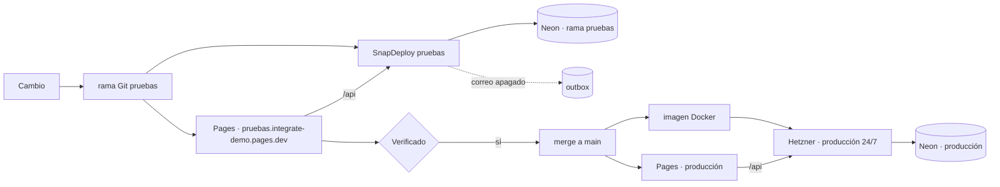

# ADR-0031: Entorno de pruebas aislado en SnapDeploy y promoción controlada a producción en Hetzner

- **Estado:** Aceptado (2026-10-27)
- **Proyecto / Módulo:** Infraestructura / Despliegue (`infra/`, Cloudflare Pages, Neon, SnapDeploy, Hetzner)
- **Fecha:** 2026-10-27

## Contexto

La producción 24/7 corre en Hetzner (ADR-0027) y el desarrollador quiere usar SnapDeploy como **entorno de pruebas** para comprobar los cambios antes de darlos por buenos (ADR-0026, enmienda del ADR-0027). Hoy eso no es seguro por cuatro razones:

1. El único contenedor de SnapDeploy está ligado a la rama `main` y reconstruye con cada push: un cambio llega a pruebas **al mismo tiempo** que se sube a la rama de producción, sin ninguna comprobación previa.
2. Hasta ahora compartía la base de Neon con producción: los procesos de fondo (correos y expiración de reservas) se duplicaban y cualquier prueba ensuciaba datos reales. El desarrollador ya creó una **rama de Neon** (`pruebas`) y la dejó probada, pero la rama es una copia de producción: contiene usuarios reales y sus correos.
3. La PWA solo tiene un despliegue (producción) y su proxy `/api` apunta a Hetzner, así que los cambios de pantalla no pueden verse contra el backend de pruebas.
4. La publicación en Hetzner se hizo a mano (construir la imagen, enviarla por SSH, reiniciar, desplegar la PWA): no es repetible ni está documentada como procedimiento.

Restricciones: costo cero para pruebas (plan gratuito de SnapDeploy y de Neon, Cloudflare Pages), nada de secretos en Git, y no enviar correos a personas reales desde pruebas.

## Decisión

### 1. Datos: la rama `pruebas` de Neon es la única base del entorno de pruebas

- El backend de pruebas usa **solo** la rama `pruebas` (host `ep-orange-frog-…`); nunca el host de producción.
- Variables en `infra/env/.env.demo.pruebas` (local, ignorado por Git). `infra/env/.env.example` documenta la sección con valores ficticios.
- **Rol mínimo:** la aplicación usa `integrate_api` y solo Flyway usa `integrate_owner`, igual que en producción. Hoy el archivo usa `integrate_owner` de forma provisional; se reemplaza en cuanto exista `integrate_api` en la rama.
- **Datos reales:** como la rama copia usuarios reales, el envío de correos queda **apagado** (`INTEGRATE_NOTIFICATION_DISPATCH_ENABLED=false`) y no se usa la cuenta de Brevo en pruebas. El correo se redirige, en su lugar, al registro del *outbox* (se ven los mensajes en la tabla, no llegan a nadie).
- **Refresco:** la rama se envejece. Cuando haga falta, se **restablece desde producción** («Reset from parent» en Neon), lo que borra los cambios de las pruebas; no se hace en caliente con usuarios probando.

### 2. Backend de pruebas: se reutiliza el contenedor de SnapDeploy, atado a una rama propia

- No se crea un segundo contenedor (el plan gratuito tiene cupo limitado): el contenedor existente se **reconfigura** para pruebas.
- Se cambia la rama de seguimiento de `main` a una rama de Git **`pruebas`**. Un cambio solo llega a pruebas cuando se empuja a `pruebas`; empujar a `main` ya no lo toca. Se amplía `infra/scripts/snapdeploy.sh` con `link --branch <rama>` (hoy la rama va fija).
- Variables cargadas con `ENV_FILE=infra/env/.env.demo.pruebas bash infra/scripts/snapdeploy.sh env`. El simulador de pago queda encendido (`PAYMENT_SIMULATOR_ENABLED=true`, con proveedor MOCK; ADR-0029).
- El contenedor permanece **detenido** mientras no se prueba; se despierta con `wake`.

### 3. PWA de pruebas: vista previa de Cloudflare Pages con su propio proxy

- Los despliegues con `--branch pruebas` generan la dirección `pruebas.integrate-demo.pages.dev`, separada de producción.
- El secreto `API_ORIGIN` se define **por entorno** en el proyecto de Pages: en producción apunta a Hetzner y en vista previa, a SnapDeploy. Se fija con la API de Cloudflare (`deployment_configs.preview.env_vars`), porque `wrangler pages secret put` solo escribe el de producción.
- La vista previa se compila con las mismas variables (`VITE_API_BASE_URL=/api` y la llave de Google Maps, que debe admitir también ese dominio).

### 4. Promoción a producción (procedimiento repetible)

```
cambio → rama `pruebas` → SnapDeploy + PWA de vista previa → verificación
       → merge a `main` → imagen → Hetzner (compose) → PWA de producción → verificación
```

- Se agrega `infra/scripts/hetzner.sh` con `deploy` (construye la imagen, la envía con `docker save | ssh docker load`, reinicia solo la API, espera la salud y corre la comprobación), `status`, `logs` y `rollback` (re-etiqueta la imagen anterior). Lee `infra/env/.env.hetzner` (token y dirección), sin imprimir secretos.
- Se agrega `infra/scripts/pages.sh deploy [produccion|pruebas]` que encapsula el comando de compilación (`MSYS_NO_PATHCONV=1 VITE_API_BASE_URL=/api …`) y la comprobación de que el *bundle* no contiene la ruta de Git (hoy documentado a mano en `docs/despliegue/demo-gratuita.md` (§4)).
- Antes de promover: Quality Gate de la PWA y suite del backend en verde, y la verificación contra el entorno de pruebas.

### 5. Operación y cierre

- **Monitor externo gratuito** sobre `/api/v1/privacy-policies/current` del backend de producción (lo crea el desarrollador con su cuenta; se documenta la dirección y la frecuencia).
- **Servidor duplicado de Hetzner** (`integrate-server`, apagado y cobrado): el desarrollador decide si se borra.
- **Credenciales:** al terminar, revocar los tokens que pasaron por el chat (Hetzner, SnapDeploy, Cloudflare), regenerar la llave de Google Maps y rotar la contraseña de la rama. Se deja una lista de verificación en `docs/despliegue/`.
- **Fuera de alcance:** el administrador pendiente (Carlos Ledher) y las pantallas de anfitrión y administrador.

## Hallazgos de la implementación (2026-10-27)

- **SnapDeploy aplica las variables solo al construir un despliegue nuevo.** `snapdeploy.sh env` las guarda, pero al despertar un contenedor detenido arranca con las de su última construcción. La primera prueba arrancó contra la base de **producción** por unos minutos; se detuvo y se limpió (un usuario de prueba, anonimizado, y un correo a una dirección ficticia; sin reservas ni pagos). De ahí la comprobación de aislamiento obligatoria en `docs/despliegue/demo-gratuita.md` (§2).
- **Cambiar la rama enlazada exige desenlazar el repositorio, y SnapDeploy no lo permite con llaves de API** (solo con sesión en su panel). `link --branch` queda implementado y avisa de esto; el desenlace lo hace el desarrollador.
- **La base de pruebas se aísla de verdad solo después de ese despliegue nuevo.** Hasta entonces el contenedor permanece detenido.
- El almacenamiento de objetos (Backblaze B2) y la llave de firma de vouchers son compartidos entre ambos entornos; los objetos se nombran por reserva, así que no chocan, pero un voucher de pruebas queda en el mismo bucket.

## Alternativas Descartadas

- **Seguir compartiendo la base de producción:** duplica los procesos de fondo y mezcla datos de prueba con reales.
- **Una base separada dentro del mismo *branch* de Neon:** aísla los datos, pero comparte el cómputo y las credenciales, y no se pudo crear con los permisos disponibles (la creación de ramas es una operación del panel o de su API, no de SQL).
- **Un segundo contenedor de SnapDeploy:** consume cupo del plan gratuito sin necesidad; basta con reconfigurar el existente.
- **Dejar SnapDeploy ligado a `main`:** cada push de producción se prueba y se publica a la vez; no hay un paso intermedio.
- **Prueba solo en local con Docker:** no ejercita el despliegue real (Cloudflare Pages, proxy, red).
- **Promoción totalmente automática con GitHub Actions:** requiere guardar el token de Hetzner y la llave SSH como secretos del repositorio; se difiere hasta que se decida.

## Consecuencias

- **Positivas:** los cambios se comprueban contra un backend real antes de llegar a producción; el entorno de pruebas no puede escribir en la base de producción ni enviar correos a personas reales; el despliegue deja de depender de comandos recordados; empujar a `main` ya no dispara reconstrucciones inesperadas.
- **Negativas / Riesgos asumidos:** la rama de Neon contiene copia de datos reales (mitigado con correo apagado, pero hay que tratarla como sensible); el plan gratuito de SnapDeploy duerme y limita horas y peticiones, y la rama de Neon también se suspende; hay dos despliegues de PWA que mantener coherentes; la rama `pruebas` de Git es una más que mantener al día con `main`; sin automatización, sigue habiendo pasos manuales de verificación.

## Contrato o Esquema Conceptual


