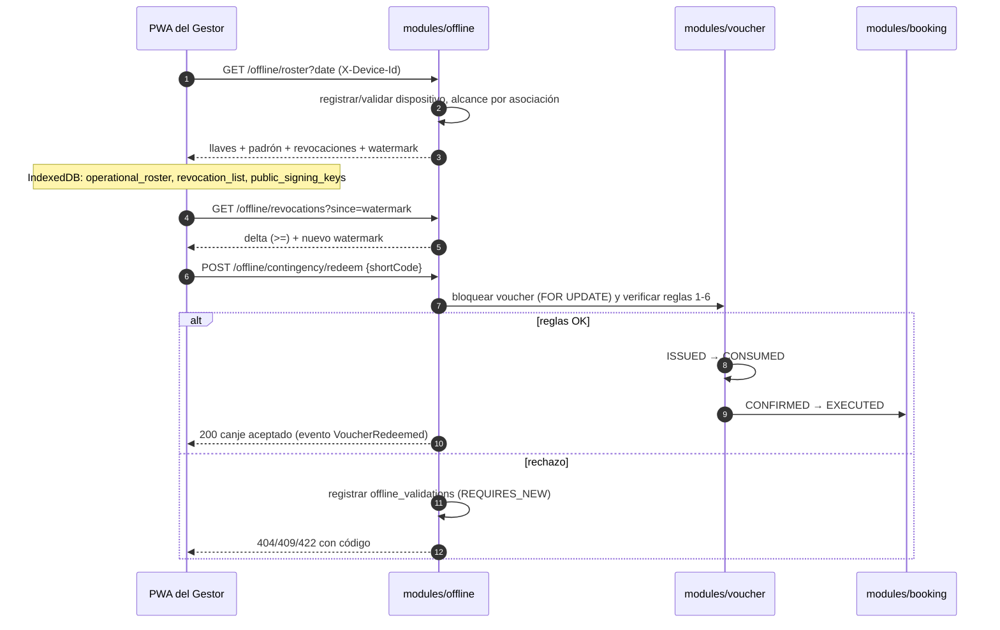

# ADR-0032: Servir el padrón offline, la lista delta de revocación y el canje manual de contingencia

- **Estado:** Aceptado (2026-10-29)
- **Proyecto / Módulo:** Intégrate · `backend-api/` — nuevo `modules/offline/` (T-2.1, T-2.2); toca `modules/voucher` y `modules/booking` por un puerto de canje
- **Fecha:** 2026-10-29

## Contexto

El Gestor de Enlace valida vouchers en territorio sin cobertura (RF-16, RF-17). Para eso la PWA debe descargar por la mañana tres cosas: el **padrón** de vouchers de la jornada, la **lista de revocación** y las **llaves públicas** de firma (`public_signing_keys`, `operational_roster` y `revocation_list` de `offline_data_indexeddb.md`). Si la cámara falla, el gestor ingresa el `shortCode` de 8 caracteres y necesita un **canje manual en línea** (R-02) que no permita canjear dos veces el mismo voucher.

El esquema ya existe (`V6__voucher.sql`, `V7__offline.sql`): `offline.devices`, `roster_downloads` (append-only, con `revocations_watermark`), `offline_validations` (append-only, canal `MANUAL_CODE`) y `sync_incidents`; `voucher.vouchers` tiene el índice parcial `ix_vouchers_revoked_at` pensado para la descarga delta. **El módulo `offline` y sus endpoints no existen, y el OpenAPI solo documenta `POST /offline/sync`.** Restricciones: el padrón contiene datos personales (nombre, documento, participantes) y debe dejar rastro de acceso (Ley 1581); la respuesta debe caber holgadamente en el tope de 10 MB de IndexedDB (T-2.8); el alcance del gestor es **su asociación**; no se introduce migración salvo que una decisión de abajo la exija.

## Decisión

Un módulo `modules/offline/` (capas `controller → service → repository`, `ApiError` y `ErrorCode` existentes) con tres endpoints para el rol `LINK_MANAGER`, todos con `Cache-Control: no-store`, y un puerto de canje compartido con T-2.3.

### 1. Identificación del dispositivo

Cada llamada lleva el encabezado `X-Device-Id` (el `device_identifier` de la PWA). Si no existe en `offline.devices`, se **registra en el acto** para el gestor autenticado (plataforma deducida del encabezado `User-Agent`, `OTHER` si no se reconoce). Reglas: un dispositivo pertenece a un único gestor para siempre; si lo usa otro gestor → 409 `DEVICE_OWNED_BY_OTHER`; si su estado es `REVOKED` o `LOST` → 403 `DEVICE_REVOKED`. Cada llamada actualiza `last_seen_at`.

### 2. `GET /api/v1/offline/roster?date=YYYY-MM-DD[&scheduleId=…]` (T-2.1)

Devuelve el **estado completo** de la jornada de la asociación del gestor:

| Bloque | Contenido |
| :--- | :--- |
| `rosterDate`, `generatedAt`, `associationId` | Metadatos. `date` por defecto = hoy en `America/Bogota`; máximo hoy + 1 día. |
| `signingKeys[]` | `kid`, `algorithm`, `publicKeyPem`, `status`, `validFrom`: la llave `ACTIVE` y las `RETIRED` cuyo `kid` aparezca en el padrón. Las `COMPROMISED` nunca se envían (sus vouchers ya están revocados, `V6`). |
| `vouchers[]` | Los de estado `ISSUED` cuya franja cae en `date` y cuya experiencia pertenece a la asociación. Campos del store `operational_roster`: `voucherId`, `bookingId`, `scheduleId`, `experienceTitle`, `shortCode`, `tokenSha256`, `signingKeyKid`, `holderName`, `holderDocument`, `slotsCount`, `participants[]` (`fullName`, `docType`, `docNumber`), `emergencyContact`. **Nunca** `eps_enc` ni ningún dato de salud. |
| `revocations` | Lista inicial de revocación (ver §3, con `since` vacío) y su `watermark`. |

Efectos: inserta una fila en `offline.roster_downloads` (dispositivo, asociación, fecha, llave activa, cantidad, `revocations_watermark`) y una entrada de auditoría `OFFLINE_ROSTER_DOWNLOADED` (quién, desde qué dispositivo, cuántos titulares); el contenido personal **no** se copia a la auditoría. Tope configurable `integrate.offline.roster.max-vouchers` (2 000 por defecto, ≈ 2–3 MB); si se supera, 422 `ROSTER_TOO_LARGE` y el cliente repite la descarga por `scheduleId`. Se comprime con gzip.

### 3. `GET /api/v1/offline/revocations?since=<ISO-8601>` (T-2.1)

Delta de revocación para refrescar el dispositivo **sin** descargar de nuevo el padrón. Devuelve los vouchers de la asociación con `revoked_at >= since` (todos si falta `since`), cada uno con `voucherId`, `shortCode`, `revokedAt` y `revocationReason`, más un `watermark` = mayor `revoked_at` devuelto (o `since` si no hay nada). Decisión deliberada: se usa **`>=`** y no `>`, porque una revocación confirmada en una transacción lenta puede llevar un `revoked_at` anterior al de otra ya visible; el solapamiento es inocuo porque el store `revocation_list` se llena por clave `voucherId` (idempotente). Sin escritura en `roster_downloads` (la tabla es solo para descargas de padrón); sí se audita el acceso con el contador, no con el contenido.

### 4. `POST /api/v1/offline/contingency/redeem` (T-2.2)

Cuerpo: `shortCode` (`^[A-HJ-NP-Z2-9]{8}$`; en mayúsculas, se normaliza). `X-Device-Id` opcional. Todo ocurre en **una transacción** que bloquea la fila del voucher con `SELECT … FOR UPDATE` (mismo patrón pesimista de T-1.5), de modo que dos canjes simultáneos se serializan y el segundo ve el voucher ya consumido.

Orden de verificación (el primer fallo gana):

| # | Condición | Respuesta | `local_result` / `server_outcome` |
| :-: | :--- | :--- | :--- |
| 1 | El código no existe **o** el voucher no es de la asociación del gestor | 404 `VOUCHER_NOT_FOUND` (idéntica en ambos casos: no revela existencia ajena) | sin fila (la FK exige voucher); solo `audit_trail` |
| 2 | `status = REVOKED` | 409 `VOUCHER_REVOKED` | `REJECTED_REVOKED` / `REJECTED_REVOKED` |
| 3 | `status = CONSUMED` | 409 `VOUCHER_ALREADY_REDEEMED` (con `redeemedAt`) | `REJECTED_DUPLICATE` / `REJECTED_DUPLICATE` |
| 4 | `status = EXPIRED` o `expires_at < ahora` | 422 `VOUCHER_EXPIRED` | `REJECTED_WRONG_DATE` / `REJECTED_OUT_OF_DATE` |
| 5 | La fecha local de la franja ≠ hoy en `America/Bogota` | 422 `VOUCHER_WRONG_DATE` | `REJECTED_WRONG_DATE` / `REJECTED_OUT_OF_DATE` |
| 6 | Reserva no `CONFIRMED` | 409 `BOOKING_NOT_REDEEMABLE` | `REJECTED_REVOKED` / `REJECTED_REVOKED` |
| 7 | Todo en orden | 200 con titular, experiencia, franja y `slotsCount` | `ACCEPTED` / `ACCEPTED` |

En el caso 7 el **puerto de canje** (`VoucherRedemptionPort`, implementado en `modules/voucher`) cambia el voucher `ISSUED → CONSUMED` (`consumed_at`) y la reserva `CONFIRMED → EXECUTED` en la misma transacción, y publica el evento `VoucherRedeemed`. Ese evento es el enganche de la dispersión de T-2.5; **este ADR no dispersa dinero**. T-2.3 reutiliza el mismo puerto para la sincronización por lotes, de modo que hay una sola regla de canje.

Los rechazos 2–6 **sí se persisten** en `offline.offline_validations` (es evidencia antifraude y la tabla es append-only), por lo que se escriben en una transacción independiente (`REQUIRES_NEW`) que sobrevive al error 4xx. No crean `sync_incidents`: esos nacen de la conciliación de T-2.3/T-2.4, donde sí hay un hecho consumado en campo; aquí el canje en línea simplemente se niega. `signature_sha256` es nulo en `MANUAL_CODE` (permitido por `ck_offline_validations_offline_fields`).

### 5. Seguridad y errores

`@PreAuthorize("hasRole('LINK_MANAGER')")`; el alcance por asociación se resuelve desde `link_manager_profiles` del usuario autenticado, nunca desde un parámetro. Códigos nuevos en `ErrorCode`: `DEVICE_OWNED_BY_OTHER`, `DEVICE_REVOKED`, `ROSTER_TOO_LARGE`, `VOUCHER_NOT_FOUND`, `VOUCHER_REVOKED`, `VOUCHER_ALREADY_REDEEMED`, `VOUCHER_EXPIRED`, `VOUCHER_WRONG_DATE`, `BOOKING_NOT_REDEEMABLE`. Se actualizan `docs/api/openapi.yaml` y `dtos_contrato_api.md` en la misma entrega (RNF-28).

### 6. Pruebas

- **Contrato (integración, PostgreSQL real):** padrón de la asociación propia y no de otra; excluye `REVOKED`/`CONSUMED`/otras fechas; nunca incluye `eps_enc`; deja fila en `roster_downloads`; delta con `since` devuelve solo lo nuevo e incluye el solapamiento del `>=`.
- **Doble canje (RNF-18 en servidor):** N hilos canjean el mismo `shortCode` → exactamente 1 respuesta 200, el resto 409, un solo `CONSUMED` y una sola reserva `EXECUTED`.
- **Tabla de rechazos:** una prueba por fila 1–6 verificando código HTTP, fila en `offline_validations` y que el rechazo persiste pese al 4xx.
- **Dispositivo:** autoregistro, dispositivo ajeno y revocado.
- Se registra la evidencia en la matriz de RNF (`docs/quality/evidencias-metricas.md`) y `graphify update .`.

**Precisiones de la implementación (2026-10-29):**
- Los valores de server_outcome son los de V10 (ACCEPTED, REJECTED_REVOKED, REJECTED_DUPLICATE, REJECTED_OUT_OF_DATE, REJECTED_CLOCK_SKEW), que sustituyen a los de V7; la tabla de arriba ya los usa.
- El rechazo no es una excepción dentro de la transacción: el servicio devuelve un resultado y el controlador lo traduce a 4xx después de confirmar, en lugar de una segunda transacción REQUIRES_NEW. El bloqueo es FOR NO KEY UPDATE, de modo que las filas de evidencia (FK al voucher) no se bloquean entre sí.
- La inserción de evidencia usa ON CONFLICT DO NOTHING sobre (voucher_id, device_id, scanned_at).
- Los accesos de lectura de la jornada usan JdbcClient en OfflineQueries; el único acoplamiento entre módulos es el puerto VoucherRedemption (oucher) y BookingExecution (ooking).

## Alternativas Descartadas

- **Padrón con cursor/paginación desde el inicio:** una jornada de una asociación cabe en pocos MB; paginar complica la atomicidad de la descarga (qué watermark gana). Se sustituye por un tope y el filtro `scheduleId`, y se reabre si el tope se alcanza en datos reales.
- **Un único endpoint que mezcle padrón y delta:** obliga a repetir el padrón con datos personales cada vez que solo cambió la lista negra.
- **`revoked_at > since` estricto:** puede perder revocaciones con commits fuera de orden; el costo de repetir alguna es nulo gracias a la clave `voucherId`.
- **Revelar la causa cuando el voucher es de otra asociación (403):** permitiría enumerar códigos ajenos; se responde 404 igual que si no existiera.
- **Canje manual que solo consulte, sin consumir:** dejaría la ventana de doble canje entre la consulta y un segundo paso; la contingencia debe ser atómica.
- **Crear `sync_incidents` también en el canje en línea:** esa tabla modela conflictos de conciliación diferida; aquí el sistema puede simplemente negar, sin consecuencia financiera que escalar.

## Consecuencias

- **Positivas:** la PWA (T-2.9, T-2.12) tiene contratos estables y probados; una sola regla de canje compartida con la sincronización; el doble canje en línea se impide en la base de datos, no en la UI; cada descarga de datos personales queda auditada; sin migración nueva.
- **Negativas / Riesgos asumidos:** el padrón expone documento y participantes en el dispositivo del gestor (mitigado: solo la asociación propia, sin EPS, `no-store`, y sujeto a la política de cifrado/retención de T-2.7 y T-2.8); el autoregistro de dispositivos significa que un gestor con credenciales válidas puede registrar un equipo propio (aceptado: la revocación es manual por `LOST`); el tope de 2 000 vouchers es una estimación; la persistencia de rechazos en `REQUIRES_NEW` añade una segunda transacción por intento fallido; el puerto de canje acopla `offline` con `voucher` y `booking` a través de una interfaz (debe vivir en un paquete `api` del módulo propietario).

## Contrato o Esquema Conceptual

