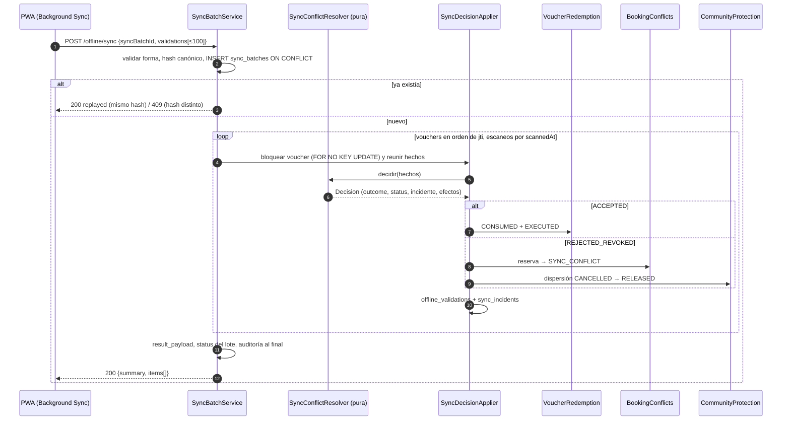

# ADR-0033: Sincronizar por lotes de forma idempotente y resolver los conflictos con una tabla determinista

- **Estado:** Aceptado (2026-10-29)
- **Proyecto / Módulo:** Intégrate · `backend-api/` — `modules/offline` (T-2.3, T-2.4); toca `modules/booking`, `modules/voucher` y `modules/payment` por puertos
- **Fecha:** 2026-10-29

## Contexto

Cuando la PWA recupera cobertura envía por Background Sync la cola de canjes hechos en campo (RF-18). El contrato `POST /api/v1/offline/sync` ya está aprobado (`dtos_contrato_api.md` §7 y §8, `openapi.yaml`): lote de 1 a 100 validaciones, idempotencia por `syncBatchId` con hash del contenido, reglas de reconciliación en orden y una respuesta 200 con el resultado de cada ítem. Lo que falta es **cómo** se implementa de forma que dos lotes simultáneos, un reenvío o un voucher revocado en el servidor jamás debiten el 85 % de la comunidad. El esquema también está listo: `V10` agregó `payload_sha256`, `result_payload` y `device_sent_at` a `sync_batches`, `local_validation_id` a `offline_validations` y los tres tipos de incidente; `V5` impide por trigger que una dispersión `CANCELLED` pase a `RELEASED` salvo que la reserva esté en `SYNC_CONFLICT`.

El ADR-0032 dejó el puerto `VoucherRedemption` (voucher `CONSUMED` + reserva `EXECUTED`) y la evidencia en `offline_validations`. Quedan tres huecos que este ADR cierra: (1) qué identifica al voucher en el lote, (2) cómo se serializa el trabajo concurrente sobre un mismo voucher, y (3) quién cambia la dispersión comunitaria, que hoy solo crea `payments` y ningún otro módulo toca.

## Decisión

Un servicio de sincronización dividido en **tres piezas con responsabilidad única**, todas dentro de `modules/offline`:

| Pieza | Responsabilidad | Efectos |
| :--- | :--- | :--- |
| `SyncBatchService` | Idempotencia del lote, orden de procesamiento, transacción y respuesta | Escribe `sync_batches` |
| `SyncConflictResolver` (T-2.4) | **Función pura**: de los hechos de un ítem a una `Decision`; sin I/O | Ninguno |
| `SyncDecisionApplier` | Ejecuta la decisión: evidencia, incidente, canje o protección | Escribe `offline_validations`, `sync_incidents`, y llama a los puertos |

Separar la decisión de su ejecución es lo que permite probar **celda por celda** la tabla de §3 sin base de datos, en el mismo estilo que el autómata del ADR-0030.

### 1. Identificación y alcance

- `voucherId` del lote es el **`jti`** del voucher, tal como fija el contrato (§7.1): es lo único que la PWA lee del QR sin conexión. El servidor lo resuelve contra `voucher.vouchers.jti`; la clave interna (`vouchers.id`) no viaja en el lote.
- **Corrección a T-2.1:** el padrón y la lista de revocación hoy exponen `voucherId` (`vouchers.id`) pero no `jti`. Se agrega `jti` (cambio aditivo) a cada voucher del padrón y a cada ítem de revocación, para que la PWA pueda armar el lote. Sin él, el contrato no es ejecutable.
- Roles `LINK_MANAGER` y `HOST`. El `deviceId` debe existir, estar `ACTIVE` y pertenecer al usuario autenticado (`manager_id` del gestor acreditado, o `host_id`); si no, 403 `OFFLINE_DEVICE_NOT_AUTHORIZED`. **La sincronización no registra dispositivos nuevos** (a diferencia del padrón): un lote de un equipo nunca visto es sospechoso. Como hoy solo el gestor puede descargar padrón, un `HOST` no tiene aún cómo registrar su dispositivo; queda como punto abierto (§ Consecuencias).
- Alcance por asociación: un voucher cuya experiencia no pertenece a la asociación del gestor (o al anfitrión) se trata como **inexistente** (regla 2), igual que en el canje manual: no se revela su existencia.

### 2. Idempotencia y transacción

1. **Validación de forma** (422 sin tocar la base): 1–100 ítems, `localValidationId` único en el lote, `signatureHash` obligatorio si el canal es `OFFLINE_PWA`, `shortCode` con el patrón de 8 caracteres.
2. **Hash canónico**: SHA-256 de una serialización de los ítems ordenados por `localValidationId`, con campos en orden fijo y fechas normalizadas a UTC; `deviceSentAt` y los metadatos del lote no entran, para que un reintento con otro reloj siga siendo el mismo lote.
3. **Una sola transacción por lote.** Se inserta `sync_batches` con `ON CONFLICT (id) DO NOTHING`. Si la fila ya existe, el reenvío espera a que la transacción ganadora confirme y entonces: mismo hash → 200 con `result_payload` y `replayed = true` (con el `serverReceivedAt` original); hash distinto → 409 `SYNC_BATCH_PAYLOAD_MISMATCH`.
4. Un fallo inesperado revierte **todo** el lote (incluida la fila de `sync_batches`) y responde 500: el cliente reintenta el mismo `syncBatchId` y el resultado es idéntico. Nunca queda un lote a medio aplicar. `sync_batches.status` termina `PROCESSED` si todos los ítems fueron `CONFIRMED` y `PARTIAL` si hubo algún `CONFLICT` o `REJECTED`; `FAILED` no se persiste (el rollback lo hace innecesario).
5. **Idempotencia por ítem:** si un `localValidationId` ya existe en `offline_validations` (porque llegó en otro lote), no se crea otra fila: el ítem devuelve el resultado almacenado. Dos ítems con el mismo voucher, dispositivo y `scannedAt` son el mismo escaneo físico y comparten resultado.
6. La auditoría (resumen del lote y una alerta por cada incidente `HIGH`) se escribe **al final**, porque el encadenamiento bloquea `audit.chain_head` hasta el commit (`AuditTrail`).

### 3. Tabla de decisión (T-2.4)

Los ítems se evalúan en el orden del contrato; el primero que se cumple decide. `facts` son: hora del servidor, voucher (estado, fecha válida), reserva (estado), si ya existe una validación `ACCEPTED` y el `scannedAt` más temprano entre los ítems del lote para ese voucher.

| # | Condición | `serverOutcome` | `status` | Incidente (severidad) | Efectos |
| :-: | :--- | :--- | :--- | :--- | :--- |
| 1 | `scannedAt > recepción + 5 min` | `REJECTED_CLOCK_SKEW` | `CONFLICT` | `CLOCK_SKEW_FUTURE_SCAN` (MEDIUM) | Ninguno sobre reserva ni dispersión |
| 2 | Voucher inexistente, de otra asociación, o `shortCode` que no coincide | `REJECTED_UNKNOWN_VOUCHER` | `REJECTED` | — | Solo auditoría (no hay FK donde guardarlo) |
| 3 | Fecha local de `scannedAt` (Bogotá) ≠ fecha válida de la franja, o voucher `EXPIRED` | `REJECTED_OUT_OF_DATE` | `REJECTED` | — | Ninguno |
| 4 | Voucher `REVOKED` o reserva `CANCELLED_*` o `SYNC_CONFLICT` | `REJECTED_REVOKED` | `CONFLICT` | `OVER_REDEMPTION_COMMUNITY_PROTECTED` (HIGH) | Reserva → `SYNC_CONFLICT`; dispersión `CANCELLED → RELEASED`; alerta de auditoría ALTA |
| 5 | Ya hay una validación `ACCEPTED` del voucher, o otra del lote con `scannedAt` anterior | `REJECTED_DUPLICATE` | `CONFLICT` | `DUPLICATE_OFFLINE_REDEMPTION` (MEDIUM) | Ninguno |
| 6 | Cualquier otro caso | `ACCEPTED` | `CONFIRMED` | — | `VoucherRedemption`: voucher `CONSUMED`, reserva `EXECUTED` |

Precisiones que el contrato dejaba abiertas:

- **El 85 % es irrenunciable (regla 4).** El resolvedor jamás produce un efecto de reembolso o reversión de dispersión. Una dispersión ya `SCHEDULED`, `ON_HOLD`, `RELEASED` o `PAID` no se toca; solo una `CANCELLED` se reactiva. El trigger de `V5` es la segunda barrera: aunque el código fallara, la base rechaza liberar sin `SYNC_CONFLICT`.
- **`financial_impact_cop`** del incidente de la regla 4 es la suma de los reembolsos de ese pago que no están `FAILED` (el dinero que la plataforma ya devolvió al turista y ahora absorbe); queda nulo si no hubo reembolso. Un segundo escaneo del mismo voucher ya en conflicto crea su incidente sin impacto, para no contar dos veces.
- **Orden dentro del lote:** los ítems se agrupan por voucher; los grupos se procesan en orden ascendente de `jti` para que dos lotes concurrentes bloqueen las filas siempre en el mismo orden (sin interbloqueos), y dentro de cada grupo por `(scannedAt, localValidationId)`: gana el escaneo más temprano. La respuesta conserva el orden original del lote.
- **Concurrencia entre lotes:** cada voucher se bloquea con `FOR NO KEY UPDATE` (igual que en ADR-0032), de modo que un ítem de otro dispositivo ve el estado ya consumido o en conflicto.
- **Un `ACCEPTED` ya emitido no se revierte**, aunque llegue después un escaneo con `scannedAt` anterior: ese segundo escaneo es `REJECTED_DUPLICATE`.
- `NO_SHOW → EXECUTED` es válido (el trigger de la reserva lo permite): `BookingExecution` pasa a aceptar `CONFIRMED` y `NO_SHOW`.

### 4. Puertos entre módulos

- `booking`: nuevo `BookingConflicts.markSyncConflict(bookingId)` (`CANCELLED_* → SYNC_CONFLICT`, idempotente si ya lo está) y un `BookingConflicts.stateOf(bookingId)` de solo lectura.
- `payment`: nuevo `CommunityProtection.release(bookingId)`: pasa la dispersión del pago de esa reserva de `CANCELLED` a `RELEASED` y devuelve el importe de reembolsos a efectos del incidente. No hace nada si la dispersión no está `CANCELLED`. Lo que construyan T-2.5/T-2.6 (cálculo y política de 72 h) **debe** respetar el estado `SYNC_CONFLICT`: no reembolsar ni cancelar una reserva en conflicto.
- `voucher`: se reutiliza `VoucherRedemption` del ADR-0032.

### 5. Datos y contrato

Sin migración: `V7`/`V10` ya contienen todo lo necesario. Se agrega `jti` a las respuestas del padrón y las revocaciones (ADR-0032) y se documenta el endpoint en `openapi.yaml`. Códigos de error nuevos: ninguno (se reutilizan `OFFLINE_DEVICE_NOT_AUTHORIZED`, `SYNC_BATCH_PAYLOAD_MISMATCH`, `VALIDATION_FAILED`).

### 6. Pruebas

- **Del resolvedor (unitarias, sin base de datos):** una prueba parametrizada que recorre las 6 filas de la tabla y los bordes (5 min exactos, medianoche de Bogotá, `NO_SHOW`), y otra que comprueba que ningún camino emite un efecto de reembolso o reversión del 85 %.
- **De integración (PostgreSQL real):** lote feliz con `jti`; reenvío idéntico (`replayed`), mismo id con otro contenido (409); `localValidationId` reenviado en otro lote; voucher revocado → reserva `SYNC_CONFLICT`, dispersión `CANCELLED → RELEASED`, incidente HIGH y alerta de auditoría; doble canje en el mismo lote y entre dos lotes simultáneos (un solo `ACCEPTED`); reloj adelantado; voucher de otra asociación = desconocido; dispositivo ajeno o revocado = 403; fallo a mitad del lote = rollback total.
- **Concurrencia:** dos lotes con los mismos vouchers en distinto orden terminan sin interbloqueo y con exactamente un `ACCEPTED` por voucher.
- Se registran las pruebas en la matriz de RNF (RNF-06 idempotencia de sincronización) y se actualiza `evidencias-metricas.md`.

**Precisiones de la implementación (2026-10-29):**
- «Duplicado» (regla 5) se evalúa como «ya existe una validación aceptada del voucher», incluida la de un ítem anterior del mismo lote. Como cada grupo se procesa por `scannedAt` ascendente, un escaneo más temprano que fue rechazado por fecha o reloj no compite con uno posterior válido.
- `SyncConflictResolver` vive en `service.impl` como clase pública y final (función pura); su catálogo de efectos es cerrado y una prueba lo fija.
- La dispersión se reactiva con `CommunityProtection.release(bookingId, at)` y el impacto financiero se calcula con `refundedAmount(bookingId)`; ambos en `payment` (T-2.5/T-2.6 deben respetar `SYNC_CONFLICT`).
- Un lote de un anfitrión exige que su dispositivo exista con `host_id`; como no hay ruta de registro para anfitriones, hoy solo sincronizan los gestores (punto abierto sin cambios).

## Alternativas Descartadas

- **Una transacción por ítem:** deja lotes a medio aplicar si falla la red o la base a mitad, y obliga a decidir qué se reintenta. Con 100 ítems como máximo, una transacción por lote es corta y mucho más fácil de razonar.
- **Resolver los conflictos dentro del servicio con `if` en cascada:** repartiría la regla que más importa (el 85 %) entre varios métodos y volvería difícil probar que ningún camino la viola. La tabla pura la deja en un solo lugar.
- **Rechazar todo el lote ante un ítem inválido:** un solo QR dañado bloquearía la asistencia correcta de todo el día; el contrato pide un resultado por ítem.
- **Registrar automáticamente los dispositivos nuevos en el sync:** abriría la puerta a que cualquier credencial robada inyecte canjes desde un equipo que nunca descargó el padrón.
- **Usar `vouchers.id` como identificador del lote:** contradice el contrato aprobado y deja a la PWA sin ese dato salvo que lo lea del padrón; se prefiere el `jti`, que viaja en el QR.
- **Reembolsar al turista o revertir la dispersión ante el conflicto:** viola la regla de negocio del 85 % irrenunciable (RF-18); la pérdida la absorbe la plataforma y se escala al Administrador.

## Consecuencias

- **Positivas:** reenvíos y reintentos son seguros; ningún camino puede debitar el 85 % de la comunidad y esa garantía se prueba en una sola tabla; el Administrador recibe una incidencia contable con impacto cuantificado; los lotes concurrentes no se interbloquean; el motor de decisión se prueba sin base de datos.
- **Negativas / Riesgos asumidos:** una transacción de hasta 100 ítems con bloqueos de fila puede alargarse si hay mucha contención en un mismo voucher (mitigado por el orden de bloqueo y el tope de 100); `CommunityProtection` introduce una dependencia nueva de `offline` hacia `payment` y T-2.5/T-2.6 deben respetarla; el calculo del impacto financiero depende de que los reembolsos de T-2.6 estén bien registrados; cambia el contrato del padrón (campo `jti`) respecto de lo ya entregado en T-2.1; **abierto:** los dispositivos de un `HOST` no tienen ruta de registro, por lo que hoy solo los gestores pueden sincronizar; y **fuera de alcance:** la consulta y resolución de incidentes por el Administrador (CU-19) se difiere a un ADR propio, aquí solo se crean y se alertan.

## Contrato o Esquema Conceptual

