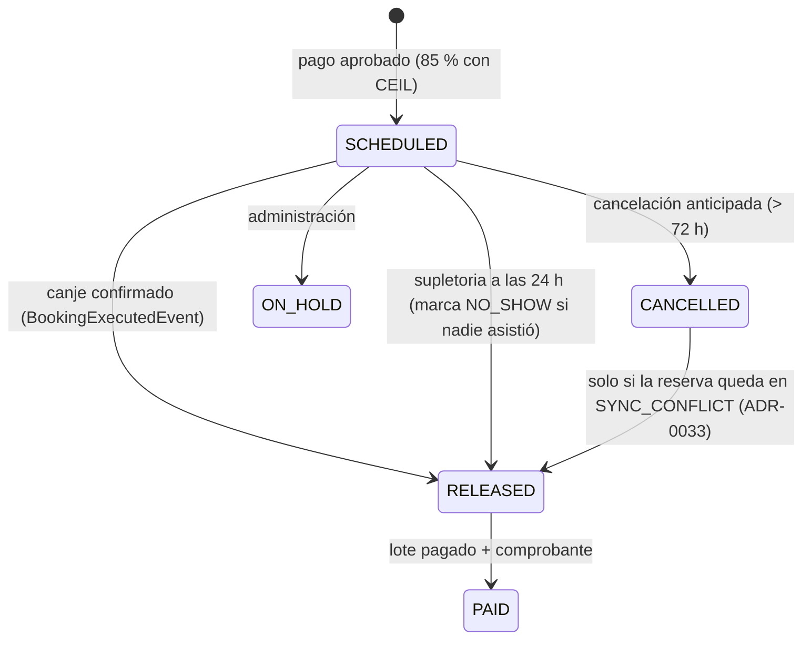
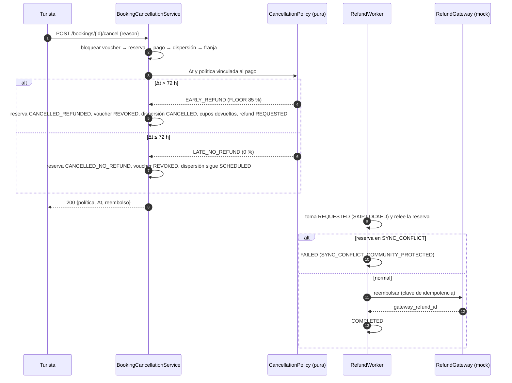

# ADR-0034: Liberar y dispersar el 85 % a la comunidad, cancelar con la regla de 72 h y ejecutar los reembolsos

- **Estado:** Aceptado (2026-10-29)
- **Proyecto / Módulo:** Intégrate · `backend-api/` — `modules/payment` (T-2.5, T-2.6); toca `modules/booking`, `modules/voucher` y `modules/catalog` por puertos
- **Fecha:** 2026-10-29

## Contexto

El dinero ya entra bien: al aprobarse un pago, `PaymentEventProcessor` calcula el reparto con la política vigente (`community_pct` 85 con `CEIL` a favor de la comunidad, el resto a la plataforma) y crea la dispersión `SCHEDULED` con `release_at` = fin de la franja + 24 h (T-1.7, ADR-0009). Falta todo lo que ocurre después: **nadie libera esa dispersión ni la paga**, **no existe forma de cancelar una reserva** (no hay endpoint; `booking_cancellations` y la regla de 72 h solo están en el esquema y en RF-13/RF-14), **ningún reembolso se ejecuta** (las órdenes `REQUESTED` de la aprobación tardía esperan a T-2.6) y **no hay comprobante** de lo pagado (RF-19). Tampoco existe quien marque un `NO_SHOW`, aunque el ADR-0033 ya acepta un canje sobre una reserva en ese estado.

El esquema está completo: `commission_policies` versionada (umbral 72 h, gracia 24 h, reembolso 85 %), `disbursements` con su máquina de estados y trigger (`SCHEDULED → RELEASED → PAID`, `CANCELLED`, `CANCELLED → RELEASED` solo con `SYNC_CONFLICT`), `payout_accounts`, `payout_batches` (un lote `OPEN` por asociación), `settlement_receipts` append-only y `refunds` con idempotencia y tope por trigger. Restricciones: sin llamadas de red reales en el MVP (el adaptador de pasarela es un mock, ADR-0029), el 85 % comunitario es irrenunciable (RF-18, ADR-0033), todo el dinero es entero en COP y los trabajos programados deben ser seguros con varias instancias.

## Decisión

Cuatro piezas en `modules/payment`, más dos puertos pequeños en `booking`, con las reglas de dinero como **funciones puras** (probables sin base de datos, como el resolvedor del ADR-0033):

| Pieza | Responsabilidad |
| :--- | :--- |
| `MoneyRules` (pura) | Reparto 85/15, reembolso por cancelación y desglose del comprobante, con redondeo explícito |
| `CancellationPolicy` (pura) | De Δt y la política del pago a `EARLY_REFUND` o `LATE_NO_REFUND` |
| `BookingCancellationService` | Cancelación del turista (T-2.6) |
| `RefundWorker`, `DisbursementReleaseWorker`, `PayoutWorker` | Reembolsos, liberación y pago, cada uno como máquina de estados reanudable |

### 1. Reglas de dinero (puras)

- **Reparto:** `comunidad = CEIL(bruto × community_pct / 100)`, `plataforma = bruto − comunidad`. La suma siempre es el bruto; el redondeo sobra a favor de la comunidad. La comisión de la pasarela sale de la parte de la plataforma (comentario de `V5`).
- **Reembolso anticipado:** `FLOOR(bruto × early_cancel_refund_pct / 100)`; el resto queda en la plataforma. Así el turista nunca recibe más del 85 % ni el reparto pierde un peso.
- **Política:** se toma de la **política vinculada al pago** (`commission_policy_id`), no de la vigente hoy: una política aplicada es evidencia contable inmutable.
- **Δt estricto en UTC:** `inicio de la franja − momento de la cancelación`. `Δt > umbral` (72,0 h, estricto) → `EARLY_REFUND`; `Δt ≤ umbral` → `LATE_NO_REFUND`. 72 h exactas son tardías.

### 2. Cancelación del turista (T-2.6): `POST /api/v1/bookings/{bookingId}/cancel`

Rol `TOURIST`, dueño de la reserva, cuerpo `{reason}`. Solo una reserva `CONFIRMED` cuya franja no ha empezado. Todo en una transacción, con este **orden de bloqueo canónico: voucher → reserva → pago → dispersión → franja** (el mismo orden que ya siguen el canje y la sincronización: voucher primero, reserva después; así no hay interbloqueos con ellos).

| Política | Reserva | Reembolso | Dispersión | Cupos | Voucher |
| :--- | :--- | :--- | :--- | :--- | :--- |
| `EARLY_REFUND` (Δt > 72 h) | `CANCELLED_REFUNDED` | Orden `REQUESTED` por `FLOOR(85 %)` (`EARLY_CANCELLATION`) | `SCHEDULED → CANCELLED` con motivo | Se devuelven al catálogo | `REVOKED` |
| `LATE_NO_REFUND` (Δt ≤ 72 h) | `CANCELLED_NO_REFUND` | Ninguno | Sigue `SCHEDULED`: se libera a las 24 h (§4) | **No** se devuelven | `REVOKED` |

Cada cancelación inserta su fila append-only en `booking_cancellations` (actor, `hours_before_start`, política, % de reembolso). Un segundo intento responde 409 `BOOKING_NOT_CANCELLABLE`; una franja ya iniciada, 409 `BOOKING_ALREADY_STARTED`; una reserva ajena, 404. La respuesta devuelve política, Δt, % y monto del reembolso, y su estado. La revocación del voucher se propaga por la lista delta del ADR-0032. La cancelación por la plataforma (100 %) queda fuera.

### 3. Reembolsos (`RefundWorker`)

Un puerto `RefundGateway` (implementación `Mock` en el MVP; la de Wompi llega con la integración real) recibe el monto y una **clave de idempotencia** (`refunds.idempotency_key`). El trabajador toma órdenes `REQUESTED` con `FOR UPDATE SKIP LOCKED`, las pasa a `PROCESSING` y luego a `COMPLETED` (con `gateway_refund_id`) o `FAILED` (con motivo). Un error transitorio las deja en `REQUESTED` para el siguiente barrido. También ejecuta las órdenes `LATE_APPROVAL` que ADR-0009 dejó pendientes. **Antes de llamar a la pasarela relee la reserva**: si está en `SYNC_CONFLICT`, la orden pasa a `FAILED` con motivo `SYNC_CONFLICT_COMMUNITY_PROTECTED` (el 85 % comunitario no se compensa pagando también al turista); el incidente ya lo abrió el ADR-0033.

### 4. Liberación de la dispersión (`DisbursementReleaseWorker`, T-2.5)

Dos disparadores, ambos `SCHEDULED → RELEASED` con `released_at`:

1. **Asistencia confirmada:** `BookingExecutionImpl` (por donde pasan el canje manual y la sincronización) publica `BookingExecutedEvent`; `payment` lo escucha en `BEFORE_COMMIT` y libera la dispersión **en la misma transacción** del canje.
2. **Supletoria a las 24 h:** un barrido selecciona las dispersiones `SCHEDULED` con `release_at ≤ ahora` y, **para cada una, abre su propia transacción** que bloquea en el orden canónico y vuelve a comprobar que la reserva no está en `SYNC_CONFLICT` ni tiene un incidente `OPEN`. Si la reserva sigue `CONFIRMED`, la marca `NO_SHOW` (RF-14) y libera. Un `NO_SHOW` aún puede canjearse después (ADR-0033) y entonces pasa a `EXECUTED`; la dispersión ya liberada no cambia.

No se libera una dispersión `ON_HOLD`. Marcar una dispersión en espera por queja es una función de administración que queda fuera.

### 5. Pago a la asociación (`PayoutWorker`)

Máquina de estados reanudable, con la llamada de red **fuera** de cualquier transacción:

1. **Armar el lote** (transacción corta): por asociación con dispersiones `RELEASED` sin lote, si tiene cuenta por defecto verificada, se crea (o reutiliza) el lote `OPEN`, se le asocian las dispersiones y pasa a `SUBMITTED` con `submitted_at`. Sin cuenta, no se arma el lote y se registra una alerta de auditoría `PAYOUT_ACCOUNT_MISSING` (`WARNING`) una vez por asociación y día.
2. **Enviar** a un puerto `PayoutGateway` (mock) con clave de idempotencia `payout:<batchId>`; un reintento tras una caída no duplica el pago.
3. **Cerrar** (transacción corta): éxito → lote `PAID` y dispersiones `PAID`, y se emite el **comprobante**; fallo definitivo → lote `FAILED` con motivo y las dispersiones se desvinculan (`payout_batch_id` nulo) para entrar en el siguiente lote. El trabajador también retoma lotes `SUBMITTED` huérfanos.

### 6. Comprobante contable (RF-19)

Al cerrar un lote `PAID` se inserta la fila append-only de `settlement_receipts` con el desglose **derivado de los pagos del lote**: bruto = Σ pagos, comisión de pasarela = Σ `gateway_fee_cop`, neto comunitario = Σ dispersiones, comisión de plataforma = bruto − neto (el `CHECK` de la tabla exige bruto = neto + plataforma). Se genera un PDF de una página con ese desglose, se guarda en el bucket y se avisa por correo al contacto de la asociación mediante el outbox de notificaciones (ADR-0011).

### 7. Datos, contrato y configuración

Sin migración: `V4`, `V5` y `V10` cubren los estados, claves y topes. Códigos de error nuevos: `BOOKING_NOT_CANCELLABLE` y `BOOKING_ALREADY_STARTED`. El endpoint de cancelación se documenta en `openapi.yaml`. Los tres trabajadores se activan con `integrate.payments.{refund,release,payout}.enabled` y su intervalo, apagados en el perfil `test` (como `BookingExpirationWorker`); las pruebas los invocan directamente.

### 8. Pruebas

- **Puras (sin base de datos):** `CancellationPolicy` en los bordes (72 h exactas = tardía, 72 h + 1 s = anticipada, una franja que empieza ya); `MoneyRules` sobre una barrida de brutos (para todo `bruto`, `comunidad + plataforma = bruto`, `reembolso ≤ 85 %`, `reembolso + retención = bruto`) y los casos conocidos (100 000 → 85 000/15 000; 99 999 → comunidad 85 000, plataforma 14 999, reembolso 84 999).
- **Integración (PostgreSQL real):** cancelar anticipada y tardía con todos sus efectos; reserva ajena, ya cancelada o iniciada; el reembolso se ejecuta y es idempotente; un reembolso en `SYNC_CONFLICT` falla sin pagar; liberación por canje y supletoria, con `NO_SHOW` y su canje posterior; pago de un lote con dos asociaciones y desglose del comprobante exacto; cuenta ausente; fallo del pago y reintento sin duplicar; **cancelar y canjear a la vez** termina con una sola acción ganadora y sin interbloqueo.
- Se registran en la matriz de RNF (RNF-21, exactitud de la dispersión) y en `evidencias-metricas.md`.

**Precisiones de la implementación de T-2.6 (2026-10-29):**
- La arquitectura del proyecto impide que `payment` dependa de `voucher` (`nothingDependsOnVoucher`) y que `booking` dependa de `payment`. Por eso la cancelación vive en `payment`, usa el puerto público `BookingCancellations` de `booking`, y el voucher se revoca con un `BookingCancelledEvent` (en `payment.service.model`) que `voucher` atiende con un `@EventListener` **síncrono**, en la misma transacción. El candado del voucher (primero en el orden canónico) lo toma `BookingVoucherLock`, una lectura `FOR NO KEY UPDATE` solo del candado.
- Por la regla RNF-26 (`@Scheduled` solo en `..worker..`, los servicios no dependen de workers y los workers son apagables) la lógica de reembolsos está en `RefundProcessor` (servicio) y un único `PaymentWorker` condicional por `integrate.payments.workers.enabled` la planifica; se sustituyen las tres banderas por una sola con intervalo y lote compartidos.
- `MockRefundGateway` completa siempre con un identificador derivado de la clave de idempotencia; las pruebas fuerzan `RETRY` y rechazos con `next(...)`.
- Sin migración: `booking_cancellations` se escribe con una entidad solo de inserción.

## Alternativas Descartadas

- **Liberar y pagar en una sola transacción con la llamada a la pasarela dentro:** mantiene filas bloqueadas durante una llamada de red y, si el proceso cae después del pago, no hay forma de saber si se pagó. La máquina de estados con clave de idempotencia lo resuelve.
- **Bloquear primero la dispersión en el barrido supletorio (`SKIP LOCKED`):** es el patrón habitual, pero invierte el orden de bloqueo frente a la cancelación (reserva antes que dispersión) y puede interbloquearse. Se prefiere elegir los candidatos sin bloquear y bloquear después, por fila, en el orden canónico.
- **Devolver siempre los cupos al cancelar:** contradice RF-14: con menos de 72 h la comunidad ya compró insumos y contrató jornales; revender el cupo a última hora no la compensa. Queda abierto como regla de negocio por confirmar.
- **Redondear el reembolso con `CEIL`:** el turista podría recibir más del 85 % pactado; con `FLOOR` el peso sobrante se queda en la plataforma.
- **Tomar la política vigente al cancelar:** un cambio de política reescribiría el trato de pagos ya hechos; la política vinculada al pago es la evidencia.
- **Comprobante PDF/A y conciliación contra el extracto de la pasarela:** fuera del MVP; se entrega un comprobante legible y auditable sin la certificación de archivo.

## Consecuencias

- **Positivas:** el dinero de la comunidad llega con regla y evidencia: se libera por asistencia o a las 24 h, se paga con reintentos seguros y queda un comprobante con el desglose; el turista puede cancelar con una regla exacta y auditable; los reembolsos que esperaban a T-2.6 se ejecutan; `NO_SHOW` deja de ser un estado sin dueño; todas las cuentas se prueban sin base de datos.
- **Negativas / Riesgos asumidos:** tres trabajadores programados nuevos que operar y vigilar; el orden de bloqueo canónico es una regla que todo código futuro debe respetar (se documenta en el ADR y se cubre con la prueba de concurrencia); dependemos de mocks de reembolso y de pago hasta la integración real con Wompi; sin cuenta de pago verificada la dispersión queda `RELEASED` y no se paga (y no hay aún endpoint para registrar cuentas); la política de cupos tardíos y la marca de «queja» (`ON_HOLD`) necesitan confirmación de negocio; la cancelación por la plataforma, la consulta de comprobantes y la supervisión del Administrador (CU-20) quedan para un ADR posterior.

## Contrato o Esquema Conceptual

Ciclo de la dispersión comunitaria:

Cancelación y reembolso:

