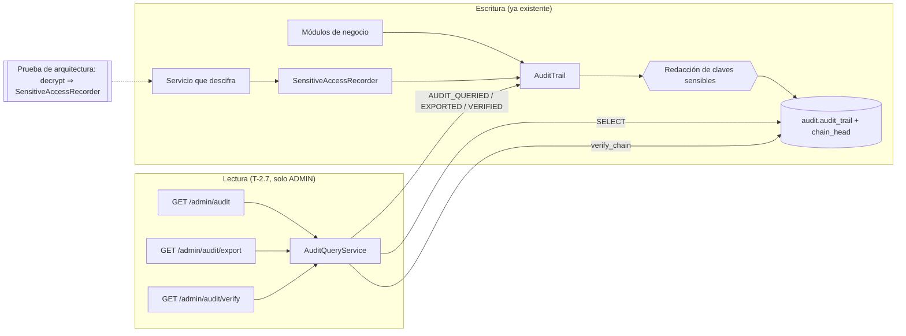

# ADR-0035: Consultar la bitácora de auditoría, registrar los accesos a datos sensibles y fijar el alcance del cifrado

- **Estado:** Aceptado (2026-10-29)
- **Proyecto / Módulo:** Intégrate · `backend-api/` — nuevo `modules/audit/` (T-2.7); toca `common/audit` y `modules/offline`
- **Fecha:** 2026-10-29

## Contexto

La **escritura** de la bitácora ya está resuelta y es sólida: `audit.audit_trail` es solo de inserción (el rol de la aplicación no tiene `UPDATE` ni `DELETE`), está encadenada con SHA-256 por un trigger `SECURITY DEFINER` sobre la fila única `audit.chain_head`, tiene la función `audit.verify_chain` y todos los módulos escriben por `AuditTrail` (`common/audit`, ADR-0008 §6). Los consentimientos viven en `auth.habeas_data_consents`, también append-only y con prueba propia (`ConsentAuditQualityTest`, RNF-06), y los campos sensibles (EPS, condición de víctima, cuentas de pago) se cifran en la aplicación con AES-256-GCM (`SensitiveDataCipher`, RNF-01).

Lo que **falta** es lo que pide T-2.7 y RF-20: no existe `modules/audit/`; nadie puede **consultar ni exportar** la bitácora (RF-20: solo `ROLE_ADMIN`); no hay forma de saber **quién accedió a los datos de un titular** (Ley 1581 de 2012, art. 8, derecho a conocer el uso de sus datos; Ley 1448 para víctimas); y nada impide que mañana un desarrollador descifre un dato sensible sin dejar rastro. Hoy el único código que descifra para mostrar es la descarga del padrón del ADR-0032 (contacto de emergencia) y su traza cuenta registros pero no identifica a los titulares. Además, «cifrado AES-256 en reposo» de la bitácora admite dos lecturas y conviene fijar cuál se adopta. Restricciones: sin migración que toque la cadena, la consulta no puede degradar la escritura (todo `record` se serializa en `chain_head`), y lo que se consulta no debe exponer datos personales que nunca debieron estar ahí.

## Decisión

### 1. Consulta de la bitácora (`modules/audit/`, solo lectura)

Un módulo con capas `controller → service → repository`, que lee `audit.audit_trail` con un `JdbcClient` y nunca la modifica. Todos los endpoints exigen `ROLE_ADMIN` y responden `Cache-Control: no-store`.

| Endpoint | Función |
| :--- | :--- |
| `GET /api/v1/admin/audit` | Búsqueda paginada, más reciente primero. Filtros opcionales: `module`, `action`, `entityName`, `entityId`, `actorId`, `severity`, `from`, `to` y `subject` (ver §2). Tamaño máximo de página 100. |
| `GET /api/v1/admin/audit/export` | Mismos filtros, salida **CSV** (UTF-8) por flujo. Tope de 50 000 filas: si el filtro devuelve más, 422 `AUDIT_EXPORT_TOO_LARGE` y se pide acotar el rango. |
| `GET /api/v1/admin/audit/verify` | Llama a `audit.verify_chain(fromId, toId)`; por defecto verifica las últimas 10 000 filas. Responde `{intact, fromId, toId, checked, brokenId, problem}`. |

Cada llamada **se audita a sí misma** (`module = admin`; acciones `AUDIT_QUERIED`, `AUDIT_EXPORTED`, `AUDIT_VERIFIED`) con los filtros y el conteo devuelto, nunca el contenido: quien mira la bitácora también queda en la bitácora. El CSV neutraliza la inyección de fórmulas (una celda que empieza con `=`, `+`, `-` o `@` se prefija con `'`) y escapa comillas y saltos de línea. La verificación de la cadena se limita a un rango acotado para no retener una conexión indefinidamente; un rango mayor se pide por tramos.

### 2. Registro de accesos a datos sensibles

Un puerto nuevo `SensitiveAccessRecorder` en `common/audit` (junto a `AuditTrail`, que `common` ya no puede importar de los módulos) escribe una entrada `SENSITIVE_DATA_ACCESSED` con: módulo, tipo de entidad, **finalidad** (`OFFLINE_ROSTER`, …), **nombres de los campos** accedidos (nunca sus valores), actor, IP y agente, y la lista de **identificadores de los titulares afectados** en `details.subjects`. La lista usa el índice GIN que `audit_trail` ya tiene sobre `details`, por lo que `subject = <id>` responde «¿quién vio los datos de esta reserva?» sin escanear la tabla. Una descarga muy grande se registra en **una sola fila** con todos sus titulares (una fila por titular saturaría el `chain_head`).

**Barrera estructural, no una regla escrita:** una prueba de arquitectura falla si una clase fuera de `common.crypto` llama a `SensitiveDataCipher.decrypt` sin depender también de `SensitiveAccessRecorder`. Así el rastro deja de ser una convención que alguien debe recordar. Se adapta la descarga del padrón (ADR-0032), que descifra el contacto de emergencia, para registrar sus titulares (las reservas del padrón) y los campos entregados (contacto de emergencia, documento del titular y de los participantes).

### 3. La bitácora no guarda datos personales

`JpaAuditTrail` **redacta** (reemplaza el valor por `[REDACTED]`, registra un aviso y sigue) cualquier clave de `details`, `before_data` o `after_data` que sea de una lista cerrada de datos sensibles o de credenciales (contraseña, token, EPS, teléfono, contacto de emergencia, número de documento, número de cuenta, condición de víctima y variantes). Redactar en vez de rechazar evita que un descuido tumbe una operación de negocio; una prueba de integración confirma que ninguna entrada que las suites existentes escriben activa la redacción. Los identificadores (UUID) siguen siendo válidos: una referencia no es el dato.

### 4. Alcance del «cifrado AES-256 en reposo»

Se adopta esta lectura y se documenta, para que no se interprete distinto en la auditoría:

1. **Datos sensibles de la aplicación:** AES-256-GCM por columna, con AAD ligado a la fila (RNF-01), tal como ya está. Es el cifrado que protege EPS, condición de víctima y cuentas.
2. **Bitácora:** no lleva datos sensibles en claro (§3), de modo que no hay nada que cifrar *dentro* de la fila; cifrar `details` en la aplicación rompería el índice GIN de §2 y obligaría a custodiar llaves para verificar la cadena.
3. **Volumen de la base de datos:** cifrado de almacenamiento AES-256 (RDS con KMS) como requisito de despliegue de **T-2.16**; queda anotado allí y no se implementa aquí.

### 5. Consentimientos y retención

El consentimiento ya es inmutable (trigger y privilegios) y está cubierto por `ConsentAuditQualityTest`; T-2.7 no lo modifica y esa prueba se cita como evidencia del criterio «tabla de consentimientos inmutable». La retención de 10 años (RNF-09) y la creación anual de la partición (`audit.ensure_year_partition`, que exige el rol propietario) son operación y se asignan a T-2.16; mientras tanto la partición `DEFAULT` recibe las filas.

### 6. Datos, errores y pruebas

Sin migración. Códigos nuevos: `AUDIT_EXPORT_TOO_LARGE` (422). Se documentan los tres endpoints en `openapi.yaml`.

- **Unitarias:** escape de CSV (comillas, comas, saltos de línea, prefijo antiinyección), construcción de filtros y redacción de claves anidadas.
- **Integración (PostgreSQL real):** solo `ROLE_ADMIN` (los demás 403, sin sesión 401); filtros y paginación; `subject` tras una descarga de padrón devuelve esa descarga con los campos pero sin valores; la exportación respeta filtros y tope; las tres consultas dejan su propia entrada; `verify` responde íntegro sobre la cadena real y rechaza rangos absurdos.
- **Arquitectura:** la regla de §2 y la que impide a `modules/audit` escribir en `audit.audit_trail`.
- Se registran en la matriz de RNF (RNF-01 y RNF-06) y se actualiza `evidencias-metricas.md`.

**Precisiones de la implementación (2026-10-29):**
- `verify` rechaza (422) un rango **solicitado** de más de 100 000 filas antes de ajustarlo al máximo `id` existente; un `toId` mayor que el máximo se recorta, un `fromId` mayor que `toId` se rechaza y sin parámetros se verifican las últimas 10 000 filas. Una cadena rota se audita con severidad `CRITICAL`.
- El tope de exportación es la propiedad `integrate.audit.export.max-rows` (50 000 por defecto) para poder probarlo sin generar miles de filas.
- La barrera de §2 es `SensitiveAccessArchitectureTest` (ArchUnit): ya detectó el caso real al escribirse (el padrón del ADR-0032 descifraba sin rastro) y se corrigió en la misma entrega con una entrada `SENSITIVE_DATA_ACCESSED` (finalidad `OFFLINE_ROSTER`, seis campos, una reserva por titular).
- La prueba de arranque del administrador (`bootstrapCreatesTheFirstAdminOnlyOnce`) dependía de que ninguna clase anterior creara administradores en la base compartida; ahora compara contra el conteo previo.
- Fuera de alcance, sin cambios: la detección de una cadena alterada solo se prueba en la base de datos (`audit.verify_chain`), porque el rol de la aplicación no puede modificar la tabla.

## Alternativas Descartadas

- **Cifrar `details` de la bitácora en la aplicación:** respondería literalmente a «cifrado en reposo», pero la bitácora no debe contener datos sensibles; cifrar lo que no es sensible solo agrega llaves que custodiar, anula el índice por titular y complica verificar la cadena. El cifrado de volumen cubre el riesgo físico.
- **Una fila de acceso sensible por titular:** respondería mejor al titular pero con 2 000 reservas por descarga serializaría 2 000 inserciones sobre `chain_head`. Una fila con la lista de titulares y el índice GIN da la misma respuesta sin ese costo.
- **Registrar el acceso dentro de `SensitiveDataCipher.decrypt` con un interceptor:** el cifrador no conoce al actor ni la finalidad (y vive en `common`); mantenerlo sin contexto y exigir el puerto de auditoría con una prueba de arquitectura es más explícito.
- **Rechazar la operación cuando `details` trae un dato sensible:** protege más, pero una clave mal elegida en un registro rutinario tumbaría un pago o un canje; se prefiere redactar, avisar y probar.
- **Exportar a PDF o Excel:** más cómodo para auditores, pero exige librerías y plantillas; el CSV cubre «consulta y exportación» de RF-20 y se puede abrir en una hoja de cálculo.
- **Un rol `AUDITOR` separado del administrador:** más seguro, pero RF-20 reserva la consulta exclusivamente a `ROLE_ADMIN`; queda como evolución.

## Consecuencias

- **Positivas:** el Administrador puede consultar, exportar y verificar la bitácora, y esas acciones también quedan auditadas; el titular puede saber quién vio sus datos; ningún código nuevo puede descifrar un dato sensible sin dejar rastro, y la barrera falla en CI; las claves peligrosas no llegan a la bitácora aunque alguien las incluya; la lectura del cifrado queda escrita.
- **Negativas / Riesgos asumidos:** la regla de arquitectura se basa en dependencias de clase, no en el flujo de datos (alguien podría registrar sin descifrar de verdad, o descifrar vía otra ruta); la lista de claves redactadas es cerrada y exige mantenimiento; la lista de titulares en una fila puede pesar decenas de KB en descargas grandes; `verify_chain` recorre filas secuencialmente y por eso se acota el rango; sin rol `AUDITOR`, el mismo administrador que opera consulta la bitácora (mitigado porque esa consulta queda registrada).

## Contrato o Esquema Conceptual

