# ADR-0036: Configurar la infraestructura offline de la PWA con Workbox e IndexedDB (`IntegrateOfflineDB`)

- **Estado:** Aceptado (2026-10-30)
- **Proyecto / Módulo:** Intégrate · `frontend-pwa/` — `shared/offline/`, Service Worker y `features/auth/` (Fase 2.2 · T-2.8)
- **Fecha:** 2026-10-30

## Contexto

El Gestor de Enlace Comunitario opera en veredas y senderos sin cobertura móvil (RF-16, RF-17, RNF-04, RNF-17). Con el backend del Proceso 3 ya certificado en la Fase 2.1 (ADR-0032 a ADR-0035), la PWA necesita la base de infraestructura local en el navegador antes de implementar la descarga del padrón (T-2.9), el escáner QR criptográfico (T-2.10), la marca anti-doble canje (T-2.11), la contingencia manual (T-2.12) y la cola de Background Sync (T-2.13).

Esta infraestructura está sujeta a cuatro restricciones estrictas: (1) el esquema local debe implementar exactamente los **6 Object Stores** y sus índices definidos en `docs/architecture/offline_data_indexeddb.md` §2, añadiendo el índice por `jti` requerido por el contrato de sincronización de ADR-0033 §1; (2) el almacenamiento en dispositivos rurales de gama media/baja debe mantenerse **por debajo de 10 MB** y solicitar almacenamiento persistente (`StorageManager.persist()`); (3) **ningún token** (`accessToken` ni `refresh_token`) ni dato de salud/víctima (`eps_enc`, RUV) puede persistirse en IndexedDB o `localStorage` (FE-DIR-001 Directiva 4), pero el Gestor debe poder abrir `/gestor` en modo avión tras recargar o iniciar la PWA instalada; y (4) el cierre de sesión debe bloquearse si existen validaciones pendientes en `sync_outbox` (*Logout Guard*, `offline_data_indexeddb.md` §4.2.2).

## Decisión

### 1. Motor IndexedDB (`IntegrateOfflineDB` v1) con `idb`

Se adopta la librería **`idb`** (~1,2 kB gzip) sobre la API nativa W3C IndexedDB en lugar de `Dexie.js` (~28 kB gzip), manteniendo el presupuesto del bundle inicial (RNF-09, ADR-0019) y conservando control directo sobre las transacciones nativas multi-almacén (`readwrite`) necesarias para la atomicidad entre `local_validations` y `sync_outbox` (T-2.11, T-2.13).

En `src/shared/offline/` se define la base `IntegrateOfflineDB` (versión `1`) tipada con `DBSchema` y compuesta estrictamente por los **6 Object Stores** normativos:

| Object Store | `keyPath` | Índices (`unique`) | Propósito y alineación con ADR-0032 / ADR-0033 |
| :--- | :--- | :--- | :--- |
| `read_only_catalog` | `id` | `idx_catalog_host` (`hostId`), `idx_catalog_municipality` (`municipalityCode`), `idx_catalog_status` (`status`) | Catálogo desnormalizado de solo lectura (TTL 72 h). |
| `operational_roster` | `voucherId` | `idx_roster_short_code` (`shortCode`, único), `idx_roster_schedule` (`scheduleId`), `idx_roster_token_hash` (`tokenSha256`, único), `idx_roster_holder_doc` (`holderDocument`), `idx_roster_jti` (`jti`, único) | Padrón de la jornada (TTL 24 h). Incluye `jti` (ADR-0033 §1) sin `eps_enc`. |
| `revocation_list` | `voucherId` | `idx_revocation_short_code` (`shortCode`, único), `idx_revocation_timestamp` (`revokedAt`), `idx_revocation_jti` (`jti`, único) | Lista negra de vouchers anulados (`GET /offline/revocations`). |
| `public_signing_keys` | `kid` | `idx_key_status` (`status`) | Llaves públicas RSA (`RS256`) en formato PEM para Web Crypto API (T-2.10). |
| `local_validations` | `localValidationId` | `idx_val_voucher_id` (`voucherId`), `idx_val_scanned_at` (`scannedAt`), `idx_val_sync_status` (`syncStatus`), `idx_val_short_code` (`shortCode`) | Registro de lecturas en campo y barrera anti-doble canje local (`CONSUMIDO_LOCAL` / `VALIDATED_OFFLINE`, RNF-18). |
| `sync_outbox` | `mutationId` | `idx_outbox_order` (`sequenceNumber`, único), `idx_outbox_status` (`status`), `idx_outbox_aggregate` (`[aggregateType, aggregateId]`) | Cola transaccional FIFO de salida hacia `POST /api/v1/offline/sync`. |

- **Migraciones seguras (`onupgradeneeded`):** se comprueba `db.objectStoreNames.contains(...)` y `store.indexNames.contains(...)` sin invocar nunca `deleteDatabase()` ni `clear()` sobre `local_validations` o `sync_outbox` (`offline_data_indexeddb.md` §4.3). En caso de fallo al abrir la base, el cliente expone un estado degradado de solo lectura con aviso diagnóstico.

### 2. Identidad del dispositivo (`X-Device-Id`) y metadatos operativos

Para respetar la restricción de exactamente 6 Object Stores en `IntegrateOfflineDB`, los metadatos ligeros no sensibles (< 1 KB, sin tokens ni PII) se persisten en `localStorage` bajo la clave estructurada `integrate.offline.meta.v1`:

- `deviceId` (UUIDv4 generado una sola vez por instalación con `crypto.randomUUID()`), enviado en la cabecera `X-Device-Id` de las peticiones a `/api/v1/offline/*` (ADR-0032 §1).
- `rosterMeta`: `{ rosterDate, generatedAt, associationId, revocationsWatermark, voucherCount } | null`.
- `catalogUpdatedAt`: marca ISO-8601 para el TTL de 72 h.
- `clockSkewSeconds`: desfase reportado por el servidor en la última sincronización.
- `lastActivityAt`: marca ISO-8601 actualizada al operar en la app para evaluar la purga por inactividad de 7 días.

### 3. Presupuesto de cuota (< 10 MB), `StorageManager` y políticas de purga

1. **Tope duro de 10 MB (`MAX_OFFLINE_BYTES = 10_485_760`) y umbral de alerta de 8 MB (80 %):** antes de persistir una descarga de padrón o catálogo, `assertQuotaAvailable(estimatedAdditionalBytes)` consulta `navigator.storage.estimate()` (complementado con el cálculo en bytes UTF-8 de los registros almacenados para entornos como iOS/WebKit o pruebas donde `estimate().usage` sea 0). Si el uso proyectado supera los 10 MB, aborta la escritura con `OfflineQuotaExceededError`.
2. **Persistencia explícita (`StorageManager.persist()`):** al autenticarse un usuario con `ROLE_LINK_MANAGER` o `ROLE_HOST`, la PWA solicita `navigator.storage.persist()`. Si el navegador la rechaza, el panel del Gestor muestra una alerta accesible indicando que el almacenamiento local opera en modo volátil y recomendando liberar espacio (`offline_data_indexeddb.md` §4.1.1).
3. **Caducidad automática y purga por inactividad (7 días):**
   - Al inicializar el módulo offline se purgan de `operational_roster` los registros cuya `rosterDate` (en `America/Bogota`) haya vencido (> 24 h).
   - Si `now - lastActivityAt > 7 días`, se ejecuta la limpieza de datos personales de `operational_roster`, `revocation_list` y `read_only_catalog`, y de los ítems de `local_validations` ya sincronizados (`syncStatus === 'SYNCED'`), preservando únicamente las mutaciones aún pendientes en `sync_outbox` y su evidencia en `local_validations` para no perder hechos consumados en campo (§4.2.2 y §4.3.1).
4. **Cierre de Sesión Seguro (*Logout Guard*) y limpieza selectiva (§4.2.2):**
   - `AccountPage` y `sessionStore.signOut()` verifican `countPendingOutbox()` (`status` en `QUEUED`, `PROCESSING` o `FAILED_RETRYABLE`). Si `> 0`, el cierre de sesión se bloquea y muestra una alerta accesible indicando cuántas validaciones de asistencia faltan por sincronizar.
   - Con la cola en 0 pendientes, el cierre de sesión purga obligatoriamente `operational_roster`, `revocation_list` y `local_validations` (además de `rosterMeta` y el perfil offline de sesión), conservando `read_only_catalog`, `public_signing_keys` y el `deviceId`.

### 4. Supervivencia de la sesión del Gestor en modo avión (sin persistir tokens)

Conforme a `offline_data_indexeddb.md` §1 (`auth.users` y `auth.roles` parcialmente replicadas) y FE-DIR-001 Directiva 4:

- El `accessToken` continúa **exclusivamente en memoria** y el `refresh_token` en su cookie `HttpOnly`.
- Cuando un usuario con `ROLE_LINK_MANAGER` o `ROLE_HOST` inicia o renueva sesión en línea, se guarda en `integrate.offline.session.v1` únicamente la tupla pública de perfil (`id`, `fullName`, `email`, `roles`).
- Si al arrancar la PWA (`sessionStore.restore()`) la llamada a `POST /v1/auth/refresh` falla por **`NetworkError`** (sin cobertura) y existe un perfil local vigente (< 7 días de inactividad), `sessionStore` restaura el estado `authenticated` con `accessToken = null` para que `RequireSession` permita abrir `/gestor` y operar contra `IntegrateOfflineDB`. Al recuperar red (evento `online` o antes de una petición autenticada), `sessionStore.refresh()` obtiene un `accessToken` fresco en memoria. Un 401/403 del servidor o `signOut()` borra inmediatamente este perfil local.

### 5. Service Worker con Workbox y Web App Manifest

1. **Compilación e inyección del precache (`workbox-build` + script de Service Worker en TypeScript):**
   - Se escribe un Service Worker dedicado en `src/sw.ts`, compilado como IIFE en `dist/sw.js` por un plugin propio de Vite (`buildServiceWorkerPlugin` en `vite.config.ts`, en `closeBundle`) que recorre `dist/` y sustituye el literal `__PRECACHE_MANIFEST__` por la lista de entradas de precache (`{ url, revision }`; los activos de `assets/` llevan hash en el nombre y no necesitan revisión). Evita acoplar el pipeline a plugins con restricción de *peer dependencies* sobre Vite 8. El identificador es propio y se lee tal cual: `define` solo sustituye la expresión exacta.
   - **Control en el `build`:** `scripts/check-service-worker.mjs` (encadenado a `npm run build`) falla si `dist/sw.js` no existe, si quedó algún marcador sin sustituir, si el precache no contiene `/index.html`, `/manifest.webmanifest` ni algún chunk JS de `/assets/`, o si incluye `/manual/`.
   - **Precache del App Shell:** todos los activos estáticos generados en `dist/` (`index.html`, *chunks* JS/CSS incluidos los diferidos del portal del Gestor, iconos y `manifest.webmanifest`, excluyendo `/manual/**` para no inflar la cuota offline con activos de documentación) se precachean y sirven con estrategia *Cache-First* y *Navigation Fallback* a `/index.html` para todas las rutas de la SPA (`/`, `/gestor`, `/gestor/**`).
2. **Reglas de caché en tiempo de ejecución (*Runtime Caching*):**
   - `/api/v1/auth/**`, `/api/v1/offline/**`, `/api/v1/bookings*`, `/api/v1/me/**`, `/api/v1/payments/**`, `/api/v1/gestor/**`, `/api/v1/host/**`, `/api/v1/admin/**` y `/api/v1/dev/**`: **nunca** se cachean en el Service Worker (`NetworkOnly`); los datos offline viajan por `IntegrateOfflineDB` bajo control explícito de la aplicación.
   - `/api/v1/catalog/**`, `/api/v1/experiences*` (listado, detalle y disponibilidad públicos) y `/api/v1/privacy-policies/current`: `NetworkFirst` (timeout de 3 s, máximo 30 entradas, expiración de 72 h). Los datos cacheados pueden estar desactualizados (p. ej. los cupos de una franja si la red tarda más de 3 s): la reserva real siempre pasa por `/api/v1/bookings*`, que es `NetworkOnly`, y el servidor valida el aforo.
3. **Preparación para Background Sync (T-2.13):** el Service Worker escucha el evento `sync` con el tag `'integrate-offline-sync'` y mensajes `{ type: 'SKIP_WAITING' }` / `{ type: 'TRIGGER_SYNC' }` para coordinarse con las pestañas abiertas.
4. **Web App Manifest (`public/manifest.webmanifest` + enlaces en `index.html`):**
   - `name: "Intégrate · Turismo Comunitario"`, `short_name: "Intégrate"`, `lang: "es-CO"`, `start_url: "/"`, `scope: "/"`, `display: "standalone"`, `orientation: "portrait"`, `theme_color: "#14532d"`, `background_color: "#fafaf7"`, e iconos PNG `192x192` y `512x512` (propósito `any`), `512x512` `maskable` (marca dentro del 80 % central) y el `favicon.svg`. Chrome exige PNG de 192 y 512 px para ofrecer la instalación y iOS ignora un `apple-touch-icon` en SVG, por lo que `index.html` enlaza `apple-touch-icon.png` (180 px). Los PNG se generan con `scripts/generate-icons.mjs` (sin dependencias, desde la misma marca del favicon) y se versionan en `public/`.
5. **Indicador de estado offline e infraestructura en `/gestor`:** se añade en el portal del Gestor una tarjeta/barra de diagnóstico de almacenamiento offline (estado de red *En línea / Sin conexión*, persistencia concedida o volátil, uso en MB sobre el tope de 10 MB y cantidad de validaciones pendientes de sincronizar).

**Precisiones tras la revisión (2026-10-30):**
- *Logout Guard tolerante:* si IndexedDB no se puede abrir (modo privado de Safari, almacenamiento bloqueado), `guardAndPurgeOnLogout()` permite cerrar sesión: no hay cola que proteger ni datos locales que purgar, y bloquearla dejaría atrapado al usuario, incluido un turista que nunca usó el modo offline. Un `PendingSyncLogoutError` sí se propaga. El mantenimiento de arranque (`runInactivityMaintenance`) no rompe la app si la base falla.
- *Sesión forzada por el servidor:* un 401/403 borra el perfil local pero no purga `IntegrateOfflineDB`; el padrón vence por su TTL de 24 h y la limpieza por inactividad de 7 días lo elimina. Se acepta porque ese caso (cuenta suspendida o sesión revocada) no pasa por el cierre de sesión del usuario.
- *Datos personales en `localStorage`:* la tupla `integrate.offline.session.v1` contiene `fullName` y `email` (datos personales, no sensibles) además de `id` y `roles`; se borra al cerrar sesión, ante un 401/403 y a los 7 días de inactividad.

## Alternativas Descartadas

- **Dexie.js en lugar de `idb`:** añade ~28 kB gzip al bundle y una capa de abstracción propia sobre las transacciones de IndexedDB; `idb` (~1,2 kB gzip) ofrece tipado completo con `DBSchema` y expone las transacciones nativas sin sobrecarga en teléfonos de gama baja.
- **Persistir el `accessToken` en IndexedDB o `localStorage` para abrir `/gestor` sin red:** prohibido expresamente por `FE-DIR-001` Directiva 4.1 y `offline_data_indexeddb.md` §1 por riesgo de extracción ante XSS. Guardar únicamente la tupla pública `SessionUser` (sin token) permite habilitar la UI local sin exponer credenciales.
- **Cachear respuestas de `/api/v1/offline/roster` en el Cache Storage del Service Worker:** duplicaría el padrón en disco (Cache Storage + IndexedDB), acercándose al límite de 10 MB e impidiendo indexar por `shortCode`/`jti` o purgar selectivamente datos personales al cerrar sesión.
- **Añadir un séptimo Object Store en `IntegrateOfflineDB` para metadatos del dispositivo:** incumpliría la delimitación estricta de 6 Object Stores de `offline_data_indexeddb.md` §2.2.

## Consecuencias

- **Positivas:**
  - La PWA queda instalable (`manifest.webmanifest` + Service Worker) y capaz de abrir todas las vistas del Gestor en modo avión.
  - `IntegrateOfflineDB` implementa fielmente los 6 Object Stores, índices y reglas de cuota (< 10 MB), persistencia (`StorageManager.persist()`), purga por inactividad (7 días) y *Logout Guard* de `offline_data_indexeddb.md`.
  - Las tareas T-2.9 a T-2.13 (ADR-0037) cuentan con repositorios tipados, transacciones atómicas y el encabezado `X-Device-Id` listos en `src/shared/offline/`.
  - Se certifica de forma automatizada el **RNF-17** (operación offline en IndexedDB, cuota y no pérdida de cola ante cierre de sesión) en la suite de calidad (`*.quality.test.ts`).
- **Negativas / Riesgos asumidos:**
  - En iOS/Safari, `StorageManager.persist()` y la API nativa de `Background Sync` tienen soporte limitado por el sistema operativo; la PWA mitiga esto mostrando el aviso de almacenamiento volátil, verificando la inactividad de 7 días y disparando la sincronización también mediante los eventos `online` y `visibilitychange` en primer plano (T-2.13).
  - La sesión en modo avión con `accessToken = null` solo permite operar contra datos locales en `IntegrateOfflineDB`; cualquier operación en línea (como el enrolamiento asistido en S3) requiere recuperar cobertura para renovar el token con la cookie `HttpOnly`.

## Contrato o Esquema Conceptual

```mermaid
flowchart TB
    subgraph Browser["Smartphone del Gestor (PWA)"]
        UI["Vistas Gestor (/gestor, /cuenta)"]
        SS["shared/session (accessToken solo en memoria + perfil offline sin token)"]
        OF["shared/offline (idb + StorageManager + LogoutGuard + X-Device-Id)"]
        SW["Service Worker (Workbox: App Shell Precache + NavigationFallback)"]
        subgraph IDB["IntegrateOfflineDB v1 (< 10 MB)"]
            S1["1. read_only_catalog"]
            S2["2. operational_roster (+ idx_roster_jti)"]
            S3["3. revocation_list (+ idx_revocation_jti)"]
            S4["4. public_signing_keys"]
            S5["5. local_validations"]
            S6["6. sync_outbox"]
        end
    end
    UI --> SS
    UI --> OF
    OF --> IDB
    SS -- "signOut() consulta countPendingOutbox()" --> OF
    SW -- "Sirve App Shell en modo avión" --> UI
```

