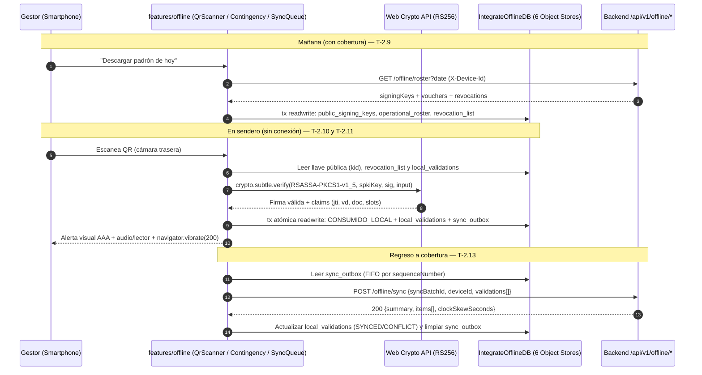

# ADR-0037: Implementar la descarga preventiva del padrón, validación criptográfica QR con Web Crypto, anti-doble canje local, contingencia manual y sincronización diferida en la PWA

- **Estado:** Aceptado (2026-10-30)
- **Proyecto / Módulo:** Intégrate · `frontend-pwa/` — nuevo `features/offline/` y rutas en `/gestor` (Fase 2.2 · T-2.9, T-2.10, T-2.11, T-2.12, T-2.13)
- **Fecha:** 2026-10-30

## Contexto

Con el backend del Proceso 3 certificado (ADR-0032 a ADR-0035) y la infraestructura offline de la PWA lista en `shared/offline/` (Workbox, `IntegrateOfflineDB` v1 con sus 6 Object Stores, cuota < 10 MB, *Logout Guard* y sesión en modo avión, ADR-0036 / T-2.8), restan los cinco bloques funcionales de campo en el smartphone del Gestor de Enlace:

1. **Descarga preventiva (T-2.9):** almacenar antes de salir a terreno el padrón de vouchers de la jornada, la lista inicial/delta de revocación y las llaves públicas RSA (`GET /api/v1/offline/roster` y `GET /api/v1/offline/revocations`).
2. **Lector QR y validación criptográfica desconectada (T-2.10, RNF-05, RNF-14):** leer el QR con la cámara trasera del smartphone (`facingMode: 'environment'`), verificar matemáticamente la firma RS256 del JWS compacto mediante Web Crypto API sin red y emitir respuesta multimodal accesible (visual AAA, lector de pantalla y vibración háptica `navigator.vibrate`).
3. **Anti-doble canje atómico local (T-2.11, RNF-18):** marcar de forma inmediata y atómica en IndexedDB todo voucher validado como `CONSUMIDO_LOCAL`, impidiendo su reutilización en el mismo dispositivo.
4. **Contingencia manual por código corto (T-2.12, RNF-20):** permitir al Gestor consultar y canjear un voucher por su `shortCode` de 8 caracteres (`^[A-HJ-NP-Z2-9]{8}$`) cuando la cámara falle físicamente o la pantalla del turista esté averiada, tanto con red (`POST /api/v1/offline/contingency/redeem`) como sin red (contra el padrón local).
5. **Cola de asistencias y Background Sync (T-2.13, RNF-19):** encolar las asistencias validadas en `sync_outbox` y despacharlas automáticamente por lotes idempotentes (`POST /api/v1/offline/sync`) con retroceso exponencial y *jitter* al recuperar cobertura.

## Decisión

Se crea el módulo `src/features/offline/` cargado de forma diferida (`lazy` en `app/routes.tsx` para no incrementar el bundle inicial del turista) con tres vistas dedicadas bajo `/gestor` y el panel principal de jornada actualizado:

| Ruta | Vista | Tarea | Responsabilidad |
| :--- | :--- | :--- | :--- |
| `/gestor` | `ManagerHomePage` | T-2.8, T-2.9 | Tarjeta de descarga preventiva del padrón de hoy y actualización delta de revocaciones, diagnóstico de cuota (< 10 MB) y accesos táctiles (`≥ 44×44 px`) a escáner QR, contingencia, cola de sincronización y anfitriones. |
| `/gestor/validar` | `QrScannerPage` | T-2.10, T-2.11 | Escáner QR con cámara trasera (`facingMode: 'environment'`), verificador Web Crypto RS256, marcación atómica `CONSUMIDO_LOCAL` y tarjeta multimodal de veredicto con vibración háptica. |
| `/gestor/contingencia` | `ContingencyRedeemPage` | T-2.12 | Ingreso táctil del `shortCode` de 8 caracteres y búsqueda nominal en el padrón local; canje en línea (`POST /offline/contingency/redeem`) con caída automática (*fallback*) a canje local encolado si no hay cobertura. |
| `/gestor/cola` | `SyncQueuePage` | T-2.13 | Estado de las asistencias capturadas (`PENDING`, `SYNCED`, `CONFLICT`, `REJECTED` y `DEAD_LETTER`), resumen del último lote y botón de sincronización manual inmediata. |

### 1. Descarga preventiva del padrón y delta de revocación (T-2.9)

1. **Cabecera `X-Device-Id`:** toda petición a `/api/v1/offline/*` adjunta `X-Device-Id: getOrCreateDeviceId()`.
2. **Validación y presupuesto de cuota:** la respuesta de `GET /api/v1/offline/roster?date=YYYY-MM-DD` (por defecto hoy en `America/Bogota`) se valida con `zod/mini` y su peso serializado se comprueba con `assertQuotaAvailable(estimatedBytes)` antes de abrir la transacción.
3. **Persistencia transaccional con preservación de canjes locales:** en una sola transacción `readwrite` sobre `['public_signing_keys', 'operational_roster', 'revocation_list']`:
   - Se guardan las llaves de `signingKeys[]` en `public_signing_keys`.
   - Al actualizar `operational_roster` para la fecha descargada, si un `voucherId` ya existía localmente con `localStatus === 'CONSUMIDO_LOCAL'`, **se preserva su marca `CONSUMIDO_LOCAL` y `consumedLocallyAt`** para que refrescar el padrón nunca borre una asistencia tomada minutos antes en campo.
   - Se insertan las revocaciones iniciales en `revocation_list` y se persiste `rosterMeta` (`rosterDate`, `generatedAt`, `associationId`, `revocationsWatermark`, `voucherCount`) en `integrate.offline.meta.v1`.
4. **Refresco ligero de revocaciones (`GET /api/v1/offline/revocations?since=<watermark>`):** inserta de forma idempotente los ítems recibidos en `revocation_list` y actualiza `revocationsWatermark`.

### 2. Escáner QR (`facingMode: 'environment'`), Web Crypto API y respuesta multimodal (T-2.10)

1. **Captura de cámara trasera y decodificación:**
   - Solicita `navigator.mediaDevices.getUserMedia({ video: { facingMode: { ideal: 'environment' }, width: { ideal: 1280 }, height: { ideal: 720 } } })` y detiene las pistas (`track.stop()`) al desmontar o pausar la vista.
   - Procesa los fotogramas con `BarcodeDetector` nativo (cuando el navegador lo soporte) o, en Safari/iOS, Firefox y muchos WebView de Android que no lo traen, con `jsqr` sobre un `<canvas>` de trabajo (fotograma de hasta 640 px de ancho, cuatro lecturas por segundo) importado de forma diferida (`qrDecoder.ts`) y por tanto solo descargado cuando hace falta. Si el navegador no tiene ni el detector ni contexto 2D, la vista lo avisa y ofrece pegar el token o la contingencia. Si el permiso de cámara es denegado o el hardware falla, ofrece enlace directo a `/gestor/contingencia`.
2. **Verificación criptográfica pura con Web Crypto API (`verifyVoucherTokenOffline`):**
   - Descompone el JWS compacto (`header.payload.signature`), valida `alg === 'RS256'`, `typ === 'voucher+jwt'` y extrae `kid` y los claims (`iss === 'integrate'`, `jti`, `bid`, `sid`, `xid`, `vd`, `doc`, `slots`, `iat`, `exp`).
   - Busca `kid` en `public_signing_keys` (debe existir con `status` en `ACTIVE` o `RETIRED`). Convierte el PEM SPKI a binario DER e importa la llave con `crypto.subtle.importKey('spki', der, { name: 'RSASSA-PKCS1-v1-5', hash: 'SHA-256' }, false, ['verify'])`.
   - Verifica la firma con `crypto.subtle.verify('RSASSA-PKCS1-v1-5', key, signatureBytes, signingInputBytes)`. Si no verifica, rechaza de inmediato con `INVALID_SIGNATURE` (**RNF-05**) sin tocar el padrón.
   - Calcula `tokenSha256` (SHA-256 hex del JWS compacto completo) y `signatureSha256` (SHA-256 hex de los bytes de la firma, requerido por `POST /api/v1/offline/sync`).
3. **Orden determinista de evaluación local:**
   1. Firma o estructura JWS inválida → `INVALID_SIGNATURE`.
   2. Presente en `revocation_list` (por `idx_revocation_jti`) → `REJECTED_REVOKED`.
   3. Ya consumido en este dispositivo (`local_validations` por `idx_val_voucher_id` con `consumptionMarker === 'CONSUMIDO_LOCAL'` o `operational_roster.localStatus === 'CONSUMIDO_LOCAL'`) → `REJECTED_ALREADY_CONSUMED` (**RNF-18**).
   4. Fecha válida `vd` ≠ **hoy** en `America/Bogota` (ajustado con `clockSkewSeconds`; nunca la fecha del padrón descargado, para que un padrón de ayer no acepte los vouchers de ayer) o `exp` vencido respecto de ese mismo reloj → `REJECTED_WRONG_DATE`.
   5. Contraste contra `operational_roster` (`idx_roster_jti`): si existe en el padrón, comprueba `tokenSha256` y recupera los datos nominales del titular y participantes (`holderName`, `holderDocument`, `slotsCount`, `participants[]`, `emergencyContact`) para que el Gestor verifique el documento físico de identidad en campo (mitigación del riesgo **R-03**).
4. **Respuesta multimodal accesible (`FE-DIR-001` Directiva 6.3, RNF-14):**
   - En éxito: panel con tokens `border-success-border bg-success-bg text-success-text`, icono `check`, anuncio `role="alert"`, datos del titular/cupos y disparo de `navigator.vibrate?.(200)`.
   - En rechazo: panel con tokens `border-danger-border bg-danger-bg text-danger-text`, icono `alert`, causa legible en español (revocado, ya utilizado con su hora local, fecha incorrecta o firma inválida) y disparo de `navigator.vibrate?.([120, 80, 120])`.

### 3. Marcación atómica anti-doble canje (`CONSUMIDO_LOCAL`, T-2.11 · RNF-18)

Toda validación aceptada (por QR en T-2.10 o por contingencia desconectada en T-2.12) se ejecuta dentro de `redeemVoucherAtomically()`, protegida por `navigator.locks` (`'integrate-offline-redeem'`) y una **única transacción IndexedDB `readwrite`** sobre `['operational_roster', 'local_validations', 'sync_outbox']`:

1. Re-verifica dentro de la misma transacción que no exista ya un registro con `consumptionMarker === 'CONSUMIDO_LOCAL'` para ese `jti` o `shortCode`. Si una lectura concurrente se adelantó, aborta la escritura de canje y devuelve `REJECTED_ALREADY_CONSUMED`.
2. Actualiza la entrada de `operational_roster` a `localStatus: 'CONSUMIDO_LOCAL'` y `consumedLocallyAt: scannedAt`.
3. Inserta el registro en `local_validations` (`localResult: 'VALIDATED_OFFLINE'`, `consumptionMarker: 'CONSUMIDO_LOCAL'`, `syncStatus: 'PENDING'`).
4. Inserta en el mismo commit el comando en `sync_outbox` (`status: 'QUEUED'`, `sequenceNumber` monotónico, `actionType: 'CREATE_VALIDATION'`).

### 4. Contingencia manual por código alfanumérico (`shortCode`, T-2.12 · RNF-20)

En `/gestor/contingencia`:
- Entrada táctil del código de 8 caracteres (`^[A-HJ-NP-Z2-9]{8}$`, normalizado a mayúsculas sin espacios ni guiones) y buscador auxiliar por documento o nombre sobre el padrón descargado (`operational_roster`) para consultar la lista de viajeros del día.
- **Con conectividad:** llama a `POST /api/v1/offline/contingency/redeem` (`{ shortCode }`, cabecera `X-Device-Id`). Si responde `200`, marca también el voucher como `CONSUMIDO_LOCAL` en `operational_roster` para mantener coherencia local; si responde `404`/`409`/`422`, traduce el `code` de `ApiError` (`VOUCHER_REVOKED`, `VOUCHER_ALREADY_REDEEMED` con `redeemedAt`, `VOUCHER_EXPIRED`, `VOUCHER_WRONG_DATE`, `VOUCHER_NOT_FOUND`).
- **Sin conectividad (o si la petición falla con `NetworkError`):** resuelve contra `revocation_list` (`idx_revocation_short_code`) y `operational_roster` (`idx_roster_short_code`), ejecuta la misma transacción atómica `redeemVoucherAtomically()` con `channel: 'MANUAL_CODE'` y `signatureSha256: null`, y encola la asistencia en `sync_outbox` para sincronización diferida.

### 5. Cola de asistencias y sincronización diferida con Backoff Exponencial (T-2.13 · RNF-19)

1. **Despachador por lotes (`flushSyncOutbox`):**
   - Serializado entre pestañas con `navigator.locks` (`'integrate-offline-sync'`).
   - Selecciona hasta 100 mutaciones de `sync_outbox` en estado `QUEUED` o `FAILED_RETRYABLE` en orden estricto de `sequenceNumber` ascendente (`idx_outbox_order`).
   - Asigna un `syncBatchId` (UUIDv4) y lo persiste en las filas `PROCESSING` antes de enviar; si un lote `PROCESSING` o `FAILED_RETRYABLE` se reintenta tras una caída de red o error `5xx`, **reutiliza el mismo `syncBatchId`** para garantizar la idempotencia extremo a extremo con `POST /api/v1/offline/sync` (ADR-0033 §2).
2. **Reconciliación de la respuesta 200:**
   - Guarda `clockSkewSeconds` en `integrate.offline.meta.v1`.
   - Por cada ítem devuelto en `items[]`: actualiza `local_validations.syncStatus` (`CONFIRMED → 'SYNCED'`, `CONFLICT → 'CONFLICT'`, `REJECTED → 'REJECTED'`) y `serverOutcome`, y elimina la mutación completada de `sync_outbox`.
3. **Manejo de fallos, reintentos y `DEAD_LETTER` (ninguna asistencia se pierde en silencio):** cada fallo se clasifica así (`classifySyncFailure`):
   - **Sin cobertura (`NetworkError`):** la mutación queda `FAILED_RETRYABLE` con el retardo base y **no gasta intentos** (`retryCount` no cambia): la cola espera hasta que haya señal y la corta el evento `online`. Reenviar es seguro porque el servidor es idempotente por `syncBatchId` y por `localValidationId` (ADR-0033 §2).
   - **Transitorio** (5xx, `401` mientras se renueva la sesión, `408`, `429`, una respuesta ilegible o un error inesperado): incrementa `retryCount` y reprograma con retroceso exponencial y *jitter*: $\min(300\,000\text{ ms},\; 2\,000\text{ ms} \times 2^{\text{retryCount}}) \times [0{,}8;\,1{,}2]$ (±20 %). Si `retryCount >= maxRetries` (5) pasa a `DEAD_LETTER`, pero la validación local **sigue `PENDING`**: el servidor puede incluso haberla aceptado.
   - **Rechazo explícito** (`400`, `403`, `409 SYNC_BATCH_PAYLOAD_MISMATCH`, `422`): pasa a `DEAD_LETTER` de inmediato con `lastError` y la validación local queda `REJECTED`.
   - Un `DEAD_LETTER` **no se descarta**: `/gestor/cola` muestra cuántos hay y el botón «Reintentar» (`requeueDeadLetters`) los devuelve a `QUEUED` con los intentos en cero, sin `syncBatchId` (un lote rechazado por contenido distinto no se arregla reenviándolo igual) y con la validación otra vez `PENDING`.
4. **Disparadores automáticos:**
   - Al registrar un canje local: invoca `requestBackgroundSync('integrate-offline-sync')` y, si `navigator.onLine` es `true`, ejecuta `flushSyncOutbox()`.
   - Listeners globales en el arranque de la PWA para el evento `online` de `window`, `visibilitychange` (al volver a `'visible'`) y el mensaje `SW_SYNC_REQUESTED` emitido por el Service Worker.

## Alternativas Descartadas

- **Incluir una librería pesada de cámara (`html5-qrcode` ~120 kB gzip):** innecesaria; `getUserMedia({ video: { facingMode: 'environment' } })` + `<canvas>` + `BarcodeDetector`/`jsqr` (ya presente en el repositorio y confinado al *chunk* diferido del Gestor) no añade dependencias externas nuevas y mantiene el control total de accesibilidad y limpieza de cámara.
- **Generar un `syncBatchId` nuevo en cada reintento de red:** anularía la protección de replay idempotente de `offline.sync_batches` si el primer envío sí llegó al servidor pero la respuesta se perdió en el camino.
- **Bloquear el canje por contingencia manual cuando no hay cobertura:** en veredas desconectadas una cámara rota dejaría al Gestor sin poder registrar la asistencia; resolver contra el padrón local y encolar con `channel = 'MANUAL_CODE'` (soportado por el contrato `POST /offline/sync`) cubre ambos escenarios.

## Consecuencias

- **Positivas:**
  - Cierra el 100 % de las tareas de la Fase 2.2 (`T-2.8` a `T-2.13`) y del DoD 2.2.
  - La validación criptográfica RS256 corre íntegramente en el navegador con Web Crypto API sin depender de red (**RNF-05**).
  - La transacción atómica sobre `operational_roster`, `local_validations` y `sync_outbox` impide el doble canje local incluso bajo pulsaciones o lecturas concurrentes (**RNF-18**).
  - Se automatizan y pasan a estado **Cumple** en la suite de calidad los requerimientos **RNF-05** (verificación offline), **RNF-14** (indicadores multimodales), **RNF-17** (IndexedDB), **RNF-18** (anti-doble canje offline), **RNF-19** (Background Sync determinista) y **RNF-20** (contingencia manual).
- **Negativas / Riesgos asumidos:**
  - Si un turista compró su reserva *después* de que el Gestor descargó el padrón matutino y ya no hay señal en la vereda, el QR validará su firma RS256 pero no tendrá fila en `operational_roster`: el validador lo **rechaza** con `REJECTED_NOT_IN_ROSTER` y un mensaje que explica la causa y las salidas (con señal, descargar el padrón otra vez o canjearlo en línea por su código de 8 caracteres; sin señal, verificar el documento del titular y registrar el ingreso al recuperar cobertura). Se decidió rechazar y no aceptar por los claims del JWT porque `POST /api/v1/offline/sync` exige el `shortCode` de cada validación (`voucher.vouchers.short_code`, ADR-0033 §1) y el token **no lo contiene**: un ítem sin él invalidaría con 422 todo el lote y mandaría las demás asistencias a error. Aceptarlo exige un cambio del contrato (por ejemplo, `shortCode` opcional en `OFFLINE_PWA` cuando viene `signatureHash`) y queda como evolución del backend.

## Contrato o Esquema Conceptual

