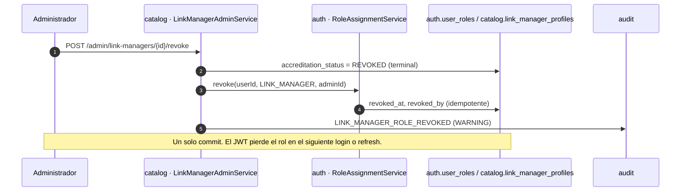
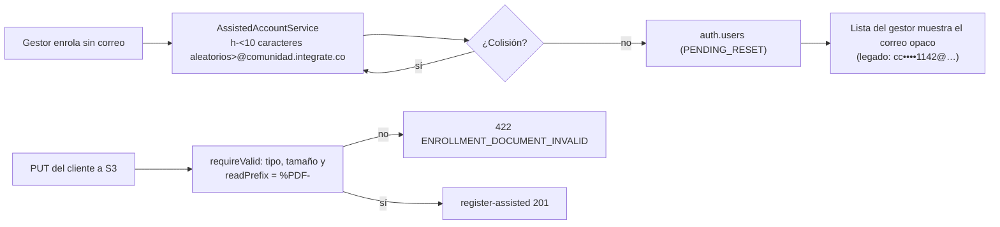

# ADR-0038: Cerrar los hallazgos de seguridad del ciclo de vida: correo sintético opaco, rol del gestor revocado y firma del PDF

- **Estado:** Aceptado (2026-10-30), con P1 = (a), P2 = (a) y P3 = un solo ADR
- **Proyecto / Módulo:** Intégrate · `backend-api/` — `auth` (`AssistedAccountServiceImpl`, `RoleAssignmentService`), `catalog` (`LinkManagerAdminServiceImpl`, `GestorHostServiceImpl`, `EnrollmentDocuments`), `common/storage` (`DocumentStorage`, `S3DocumentStorage`), migración Flyway `V16`; `frontend-pwa/` — `features/enrollment` (lista «Mis anfitriones») (Procesos 1 y 3 · hallazgos E-02, E-03 y E-04 de la prueba de ciclo de vida)
- **Fecha:** 2026-10-30

## Contexto

La prueba manual del ciclo de vida por rol (`docs/quality/guion-pruebas-ciclo-de-vida.md`, §12.2, ejecutada el 2026-10-30 en el entorno de pruebas) encontró tres defectos de la aplicación, confirmados contra el código:

- **E-03 · el correo sintético revela el documento.** Cuando el gestor enrola a un anfitrión sin correo propio, ADR-0007 §3.4 le asigna `{docType}{docNumber}@comunidad.integrate.co` (p. ej. `cc2510301142@…`). La lista «Mis anfitriones» enmascara el documento a los últimos 4 dígitos, pero imprime ese correo completo: el número de documento completo vuelve a quedar a la vista, en la API, en la pantalla y en `auth.users.email`.
- **E-02 · la revocación del gestor no quita el rol.** `acreditar` otorga `ROLE_LINK_MANAGER`; `revocar` solo cambia `accreditation_status` a `REVOKED` (estado terminal). El servidor sí niega las operaciones con 403 `ENROLLMENT_MANAGER_NOT_ACTIVE`, pero el token sigue trayendo el rol: la persona sigue viendo «Gestor» y abre un portal en el que nada funciona. No existe en `RoleAssignmentService` ninguna operación para quitar un rol (la tabla `auth.user_roles` sí lo prevé con `revoked_at` y `revoked_by`).
- **E-04 · el «PDF» solo se valida por sus metadatos.** `EnrollmentDocuments.requireValid` consulta `HeadObject` y exige `Content-Type: application/pdf` y un tamaño de hasta 5 MB. Ese tipo lo declara quien sube el archivo a la URL prefirmada; un PNG subido como `application/pdf` se acepta (el backend respondió 201 al registrar un anfitrión con él).

Restricciones: el backend no recibe binarios (ADR-0007 §5, subida directa a S3); las cuentas de anfitriones ya activadas inician sesión con el correo sintético que tienen, así que no se puede cambiar sin coordinarlo; el sufijo `@comunidad.integrate.co` es lo que identifica una cuenta sin correo real en cuatro lugares (`CredentialActivationServiceImpl`, `PasswordResetServiceImpl`, `GestorHostServiceImpl`, `VoucherEmail`); los datos sensibles y la bitácora siguen las reglas de ADR-0035.

## Decisión

### 1. Correo sintético opaco (E-03)

1. **Formato nuevo:** `h-<10 caracteres>@comunidad.integrate.co`, con los 10 caracteres de un alfabeto sin ambigüedades (el mismo de los códigos cortos: sin `0`, `1`, `I` ni `O`), en minúsculas y generados con `SecureRandom` (32 símbolos, 50 bits de entropía). No contiene ni deriva del documento ni del nombre.
2. **Unicidad:** la garantiza el índice único de `auth.users.email`; ante una colisión se regenera (máximo 3 intentos) y, agotados, responde 500 con `traceId` (probabilidad despreciable).
3. **El sufijo no cambia**, por lo que la detección por sufijo de los cuatro lugares sigue funcionando sin tocarlos.
4. **El gestor lo comunica como hoy:** la confirmación del enrolamiento y la tarjeta del código de activación muestran el «correo de acceso». Al ser corto y legible puede dictarse en persona.
5. **Cuentas ya existentes** (decisión P1, recomendada):
   - *Pendientes de activación* (`PENDING_RESET`): la migración `V16` les asigna un correo opaco, porque nadie ha iniciado sesión con el anterior; el gestor ve el nuevo en «Mis anfitriones» y lo entrega con el código de activación.
   - *Activas*: conservan su correo (es su usuario de ingreso) y la API **enmascara** su parte local en la lista del gestor cuando coincide con el patrón antiguo (`{tipo}{dígitos}@…` → `cc••••1142@…`). El valor completo sigue en `auth.users.email` (límite asumido, ver Consecuencias).
6. Se agrega una **enmienda a ADR-0007 §3.4** que reemplaza la fórmula del correo sintético.

### 2. Revocar el rol cuando se revoca la acreditación (E-02)

1. `RoleAssignmentService` gana `revoke(userId, role, revokedBy)`: fija `revoked_at` y `revoked_by` del rol vigente; **idempotente** (sin rol vigente no hace nada), con la misma transacción del invocador, igual que `grant`.
2. `LinkManagerAdminServiceImpl.changeStatus` lo invoca **solo al pasar a `REVOKED`**, en la misma transacción que cambia el estado, y deja una entrada de auditoría `LINK_MANAGER_ROLE_REVOKED` (severidad `WARNING`, actor = el administrador, sin datos personales).
3. **`SUSPENDED` no quita el rol:** es reversible (`reinstate`) y el servidor ya niega las operaciones mientras esté suspendido; quitar y volver a otorgar el rol solo añadiría ruido y haría perder la sesión.
4. **Efecto sobre el token:** el rol sale del JWT en el siguiente login o renovación (≤ 15 min). El servidor sigue negando las operaciones desde el primer instante, así que no hay ventana de uso indebido. Decisión P2 sobre cerrar las sesiones al instante.
5. **Datos existentes:** `V16` fija `revoked_at` en el rol `LINK_MANAGER` de los usuarios cuyas acreditaciones están **todas** en `REVOKED` (hoy conservan el rol sin servirles).
6. **Re-acreditación:** hoy `accredit` rechaza (409 `ENROLLMENT_MANAGER_EXISTS`) a quien tenga cualquier perfil de gestor sin borrar, también uno revocado; ese comportamiento no cambia. Si algún día se permite volver a acreditar a una persona revocada, `accredit` ya vuelve a otorgar el rol, que para entonces estará sin vigencia.

### 3. Validar la firma del PDF (E-04)

1. `DocumentStorage` gana `readPrefix(key, length)`, que devuelve los primeros bytes del objeto (en S3, `GetObject` con rango `bytes=0-4`; no descarga el archivo).
2. `EnrollmentDocuments.requireValid` rechaza con `ENROLLMENT_DOCUMENT_INVALID` («must be a PDF») cualquier objeto cuyo contenido no empiece por `%PDF-`, además de las comprobaciones actuales de tipo y tamaño. Aplica a los dos tipos de documento (`PHYSICAL_CONSENT_FORM` y `VICTIM_SUPPORT_DOC`).
3. **Alcance deliberado:** se valida la firma de formato, no la estructura completa ni el contenido (sin antivirus ni parseo); eso queda fuera de este ADR.
4. **Pruebas:** `InMemoryDocumentStorage.put` recibe los bytes del objeto; por omisión guarda una cabecera `%PDF-1.7`, así las pruebas existentes no cambian salvo la de la imagen y la nueva del PNG con tipo falso.

### 4. Pruebas y verificación

| Decisión | Prueba que debe existir |
|---|---|
| 1 | Enrolar sin correo → el correo sintético cumple `^h-[a-hj-np-z2-9]{10}@comunidad\.integrate\.co$` y **no contiene** el documento; la lista del gestor enmascara un correo antiguo; la migración renombra solo cuentas `PENDING_RESET`; el sufijo sigue disparando la ruta de «sin recuperación por correo». |
| 2 | Revocar → el usuario ya no trae `ROLE_LINK_MANAGER` tras el siguiente login y `/gestor` queda sin acceso; suspender **no** quita el rol; revocar dos veces da 409 y no duplica la auditoría; el historial conserva la asignación con quien la revocó; queda la entrada de auditoría. |
| 3 | PNG declarado como `application/pdf` → 422 `ENROLLMENT_DOCUMENT_INVALID`; PDF válido → 201; ambos tipos de documento. |
| Guía | Actualizar G-24, G-33 y G-61 de `guion-pruebas-ciclo-de-vida.md` con el comportamiento nuevo y repetirlos. |

## Alternativas Descartadas

- **Solo enmascarar el correo en la PWA** (E-03): el documento seguiría completo en la respuesta de la API, en la base y en cualquier log; es esconder el síntoma.
- **Derivar la parte local de un HMAC del documento:** determinista, ligaría el correo al documento (se puede comprobar si un documento conocido es anfitrión) y su única ventaja, poder reconstruirlo, ya no hace falta si el gestor lo ve en pantalla.
- **UUID completo como parte local:** opaco, pero imposible de dictar en persona a una comunidad con baja alfabetización digital.
- **Iniciar sesión con el documento en lugar del correo:** cambia el modelo de autenticación; excede este ADR.
- **Quitar el rol también al suspender** (E-02): obliga a re-otorgarlo al reactivar y cierra la sesión del gestor sin necesidad, cuando el servidor ya lo bloquea.
- **Ocultar «Gestor» en la PWA consultando el estado de la acreditación** (E-02): mejora la pantalla, pero no corrige el token, que sigue anunciando un rol que la persona ya no tiene. Puede hacerse además, no en lugar.
- **Escanear el PDF con antivirus o analizarlo entero** (E-04): costo y operación desproporcionados para el riesgo; la firma `%PDF-` cierra el caso observado.
- **Recibir el binario en el backend para inspeccionarlo:** contradice ADR-0007 §5 (subida directa a S3).

## Consecuencias

- **Positivas:** el número de documento deja de aparecer en el correo de las cuentas nuevas y en la lista del gestor (se recupera el enmascarado de ADR-0007); el rol de un gestor revocado desaparece del token y del menú; un archivo que no es PDF ya no puede respaldar un consentimiento firmado; todo queda cubierto por pruebas y auditado.
- **Negativas / Riesgos asumidos:**
  - Las cuentas **activas** creadas antes de este cambio conservan su correo derivado del documento en `auth.users.email`: solo se enmascara en la API y la PWA. Cambiarlo exigiría que cada anfitrión cambie su usuario de ingreso (decisión P1, opción c).
  - Un correo opaco es menos fácil de recordar que `cc<documento>`; el gestor debe dárselo por escrito o dictarlo junto al código.
  - Renombrar las cuentas pendientes invalida el correo que el gestor ya hubiera comunicado: debe informar el nuevo y, si ya había entregado un código, reemitirlo.
  - Hasta la renovación del token (≤ 15 min) el menú de un gestor recién revocado todavía puede mostrar «Gestor»; no puede operar.
  - La firma `%PDF-` es fácil de falsificar: detecta el error y el abuso casual, no a un atacante determinado.
  - `V16` modifica datos (correos pendientes, roles): se ejecuta primero en el entorno de pruebas y se verifica el conteo de filas afectadas antes de promoverla a producción (ADR-0031).

## Puntos de decisión para el desarrollador

- **P1 · Cuentas existentes con correo derivado del documento.** (a) *Recomendada:* renombrar las pendientes y enmascarar las activas en la API. (b) Cambiar solo el enrolamiento nuevo y dejar el resto. (c) Renombrar también las activas y avisar a cada anfitrión de su nuevo usuario.
- **P2 · Sesiones del gestor revocado.** (a) *Recomendada:* esperar la renovación (≤ 15 min); el servidor ya lo bloquea. (b) Revocar además sus refresh tokens para forzar el cierre de inmediato (la persona también perdería su sesión de turista).
- **P3 · ADR único o tres.** Se agruparon por nacer de la misma prueba y compartir `V16`; si prefiere separarlos, cada decisión es independiente y puede aceptarse por su cuenta.

## Contrato o Esquema Conceptual

Interfaces nuevas (solo firmas): `RoleAssignmentService.revoke(UUID userId, RoleCode role, UUID revokedBy)` y `DocumentStorage.readPrefix(String key, int length) → Optional<byte[]>`. Sin cambios en el contrato OpenAPI: no se agregan ni cambian rutas; solo cambia el valor de `email` de las cuentas sintéticas nuevas y la forma en que la lista del gestor muestra las antiguas.
