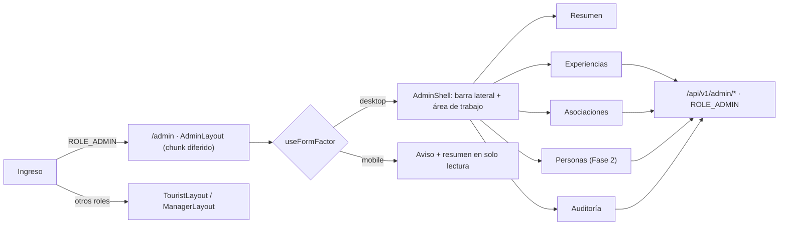

# ADR-0042: Dar al Administrador una consola propia con shell dedicado

- **Estado:** Aceptado (2026-11-09) — Fase 1 aprobada por el desarrollador; la Fase 2 (Personas) queda pendiente.
- **Proyecto / Módulo:** Intégrate · `frontend-pwa/` — `app/layouts`, `app/routes.tsx`, nueva feature `features/admin`. Fase 2 en `backend-api/` (módulos `auth` y `catalog`). Enmienda FE-DIR-001 (Directiva 1) y ADR-0020 §7.
- **Fecha:** 2026-11-09
- **Trazabilidad:** Tejiendo Hogar, H-09 · auditoría propia 2026-10-27, A7 · guion de pruebas §6 (A-01 a A-44)

## Contexto

El Administrador no tiene pantallas. Al ingresar ve el menú de un turista y todo lo propio de su rol (asociaciones, anfitriones, gestores de enlace, moderación de experiencias y bitácora de auditoría) solo se puede hacer por API con PowerShell (guion §6.2 a §6.5). La auditoría cruzada lo reporta en H-09 y la auditoría propia en A7. Los endpoints `/admin/*` ya existen y están protegidos por `ROLE_ADMIN` (`AdminCatalogController`, `AdminLinkManagerController`, `AuditController`).

El desarrollador pide que la administración **no reutilice la interfaz de los demás roles**: debe ser una ventana de administrador reconocible como tal. Los shells actuales (`MobileShell`, `DesktopShell`) están pensados para el recorrido del turista y el trabajo de campo del gestor: una columna angosta, navegación de 3 o 4 destinos y una acción por pantalla. El trabajo del administrador es de oficina: revisar colas, comparar filas, filtrar la bitácora y exportarla. Además, el administrador maneja datos personales de terceros, así que conviene que el cambio de contexto sea visible.

## Decisión

1. **Shell propio `AdminShell`** en `app/layouts/`, distinto de `MobileShell` y `DesktopShell`:
   - barra lateral izquierda fija con la marca «Intégrate · Administración», la navegación por secciones y, al pie, la persona en sesión, «Volver al sitio» y «Cerrar sesión»;
   - área de trabajo a ancho completo (sin `max-w-6xl`), con encabezado de sección (`h1` único), migas y zona de filtros;
   - mismo `SkipLink`, *landmarks*, `lang="es-CO"`, foco de doble anillo y `prefers-reduced-motion` que los otros shells;
   - la identidad visual distinta se logra **solo con tokens existentes** de `tokens.ts` (barra lateral en superficie invertida, densidad mayor). Si hiciera falta un token nuevo, se pide aprobación aparte y pasa por `tokens.test.ts`.
2. **Rutas bajo `/admin`**, protegidas con `RequireSession roles={['ROLE_ADMIN']}` y montadas en `AdminLayout`. La feature `features/admin` y el shell se cargan con `import()` diferido: ni el turista ni el gestor descargan ese código.
   | Ruta | Sección | Endpoints que consume |
   |---|---|---|
   | `/admin` | Resumen: pendientes de moderación, puntos de encuentro por confirmar, estado de la cadena de auditoría | `GET /admin/experiences`, `GET /admin/audit/verify` |
   | `/admin/experiencias` y `/admin/experiencias/:id` | Moderación: cola por estado, ficha, aprobar, rechazar (motivo obligatorio), suspender, reactivar, retirar, confirmar punto de encuentro | `GET /admin/experiences`, `POST …/approve\|reject\|suspend\|reinstate\|retire`, `POST …/meeting-point/confirm` |
   | `/admin/asociaciones` | Lista y alta de asociaciones | `GET, POST /admin/associations` |
   | `/admin/personas` | Convertir en anfitrión; acreditar, suspender, reactivar y revocar gestores | `POST /admin/host-profiles`, `POST /admin/link-managers…` (más los de la Fase 2) |
   | `/admin/auditoria` | Bitácora con filtros (módulo, severidad, fechas), exportación y verificación de la cadena | `GET /admin/audit`, `/admin/audit/export`, `/admin/audit/verify` |
3. **Entrada y salida.** Tras ingresar, una cuenta con `ROLE_ADMIN` aterriza en `/admin`. En el sitio público, el menú muestra «Administración» solo a quien tiene el rol (igual que hoy «Gestor»). La consola no muestra la navegación del turista; se vuelve con «Volver al sitio».
4. **Factor de forma: la consola se diseña para escritorio.** Es la excepción a «móvil primero» y se registra como enmienda a FE-DIR-001 (Directiva 1) y a ADR-0020 §7. En un dispositivo clasificado `mobile` por `useFormFactor()`, `/admin` no intenta encoger tablas: muestra un aviso con `h1` propio («La administración se usa desde un computador»), el resumen de pendientes en solo lectura y el enlace para volver. Las reglas que no cambian: áreas clicables ≥ 44 × 44 px, contraste AAA, sin barras fijas de acción al fondo y acción primaria junto a los datos que confirma.
5. **Tablas y acciones.**
   - Tablas HTML semánticas (`caption`, `th scope`), ordenación y paginación del servidor, estados vacío, cargando y error con `ProblemNotice` y `traceId`.
   - Las acciones que cambian estado (rechazar, suspender, retirar, revocar) piden confirmación en un diálogo que repite a quién o a qué afectan; las que exigen motivo lo validan con Zod antes de enviar.
   - Los errores de negocio conocidos se traducen: `CATALOG_MEETING_POINT_MISMATCH` (409) ofrece ir a confirmar el punto; 409 de transición no válida refresca la fila.
   - Tras cada mutación se invalida la consulta de la lista afectada (TanStack Query).
6. **Datos personales y consentimiento.**
   - La consola nunca muestra en claro lo que la API entrega enmascarado y no guarda nada de ella en `localStorage` ni IndexedDB (FE-DIR-001, Directiva 4).
   - Si la API responde que falta el consentimiento vigente del administrador (ADR-0040), la consola abre el diálogo de reconsentimiento existente; el rechazo cierra la sesión.
   - Se avisa en pantalla que consultar la bitácora queda registrado (`AUDIT_QUERIED`).
7. **Entrega en dos fases.**
   - **Fase 1 (solo frontend, endpoints actuales):** shell, resumen, moderación de experiencias, asociaciones y auditoría.
   - **Fase 2 (requiere backend):** la sección Personas. Hoy `POST /admin/host-profiles` y `POST /admin/link-managers` piden un `userId` que el administrador no tiene cómo buscar, y no hay listado de gestores para suspender o revocar. Se añaden `GET /admin/users?email=` (búsqueda exacta, respuesta mínima: id, nombre, correo, roles), `GET /admin/link-managers` y `GET /admin/host-profiles`. Los tres con `ROLE_ADMIN`, paginados, registrados en la bitácora (ADR-0035) y añadidos a `openapi.yaml`, a `docs/api/endpoints-index.md` y al barrido `EndpointSecuritySweepQualityTest`.
8. **Verificación de cierre.** Quality Gate de FE-DIR-001 (5 comandos) en verde; pruebas de ruta (turista y gestor reciben «no disponible» en `/admin`; el administrador entra), de cada mutación con su error de negocio, de accesibilidad con axe sobre cada sección, y de que el bundle inicial no contiene el chunk de administración. Revisión visual a 1280 y 1440 px, y del aviso a 360 px. Actualizar el guion §6, el manual de usuario y `docs/despliegue/demo-gratuita.md` §5.

## Alternativas Descartadas

- **Reutilizar `DesktopShell` con un menú de administrador:** es lo más barato, pero es justo lo que el desarrollador no quiere. La barra superior admite pocos destinos y el contenedor `max-w-6xl` estrecha tablas como la bitácora.
- **Aplicación o subdominio aparte (`admin.`):** duplica despliegue, sesión, cabeceras y service worker para una sola persona usuaria. Un chunk diferido dentro de la misma PWA aísla el código sin ese costo.
- **Consola completa también en celular (tablas convertidas en tarjetas):** duplica la composición de cada sección para un rol que no trabaja en campo. Se puede añadir después sin rehacer el shell.
- **Herramienta genérica de administración (React Admin o similar):** dependencia grande, estilos propios que chocan con los tokens AAA y con las reglas de capas.

## Consecuencias

- **Positivas:**
  - cierra la parte de H-09 y A7 que corresponde al Administrador, y el guion §6 deja de depender de PowerShell;
  - el contexto administrativo es visualmente inconfundible;
  - el turista y el gestor no descargan el código de administración.
- **Negativas / Riesgos asumidos:**
  - un tercer shell que mantener y probar;
  - primera excepción a «móvil primero»: desde el celular el administrador solo consulta el resumen;
  - la Fase 2 abre una búsqueda de personas por correo, que es superficie nueva de datos personales; se limita a coincidencia exacta, respuesta mínima y registro en la bitácora;
  - las pantallas del Anfitrión (la otra mitad de H-09) quedan fuera de este ADR.

## Notas de implementación (2026-11-09, Fase 1)

Desviaciones respecto a la decisión:

- **§2 ficha sin ruta propia:** no existe `GET /admin/experiences/{id}`, así que la ficha no vive en `/admin/experiencias/:id`. Es un panel lateral de la cola, con la selección en la URL (`?estado=…&ver=<id>`), y lee la fila ya cargada.
- **§2 resumen:** la verificación de la cadena no se ejecuta sola al abrir el resumen, porque cada verificación queda en la bitácora. Se pide con el botón «Verificar la cadena» (en Resumen y en Auditoría).
- **§1 migas:** la consola es plana (cuatro secciones), así que la barra superior muestra solo «Administración / sección».
- **§6 consentimiento:** la consola depende del `ConsentGate` global, que ya bloquea tras el ingreso o la renovación. La precondición en servidor de ADR-0040 aún no tiene código de error propio; cuando exista, hay que traducirlo aquí.
- **Exportación CSV:** `createHttpClient` ganó la opción `responseType: 'blob'` para descargar el archivo con el token en memoria.
- **Entrada:** en la navegación del sitio el destino se rotula «Administración» en escritorio y «Admin» en la barra inferior del celular.
- **§8 verificación hecha:** Quality Gate (tipos, lint, 317 pruebas, build) en verde salvo `format:check`, que falla por `src/features/offline/offlineFlow.test.tsx`, un archivo con cambios previos ajenos a este ADR. El build deja la consola en los chunks `admin-*.js` y `AdminLayout-*.js`, fuera del bundle inicial. Revisión en el navegador contra el backend local a 1440 px y aviso a 375 px.
- **Documentación:** enmienda en FE-DIR-001 (Directiva 1.6 y matriz), manual de usuario §2 y §6, guion §6 (A-01 y A-05 a A-09), `demo-gratuita.md` §5 y estado de A7 en la auditoría propia.
- **Pendiente:** Fase 2 (Personas). Las capturas del manual para la consola no se tomaron.

## Contrato o Esquema Conceptual

