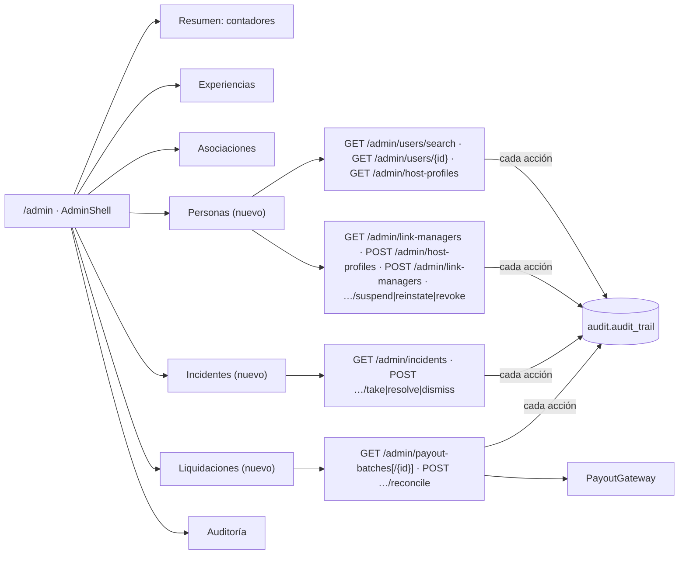

# ADR-0043: Completar la consola de administración con Personas, Incidentes y Liquidaciones

- **Estado:** Aceptado (2026-11-09) — implementación en el orden Personas → Incidentes → Liquidaciones; se empieza por Personas.
- **Proyecto / Módulo:** Intégrate · `backend-api/` (módulos `auth`, `catalog`, `offline`, `payment`, `audit`) y `frontend-pwa/` (`features/admin`, `app/layouts/AdminShell`). Completa ADR-0042 (Fase 2) y agrega dos secciones que ADR-0042 no cubría.
- **Fecha:** 2026-11-09
- **Trazabilidad:** ADR-0042 §7 (Fase 2), ADR-0007 y ADR-0038 (gestores), ADR-0033 (incidentes de sincronización), ADR-0034 y T-2.5 (dispersión 85/15), ADR-0035 (auditoría), ADR-0040 (consentimiento), ADR-0006 §3 y RF-03 (altas), Tejiendo Hogar H-09; lista de evaluación del administrador (secciones 1 a 7) pegada por el desarrollador el 2026-11-09.

## Contexto

La evaluación del administrador, contrastada con el repositorio, deja cuatro vacíos. (1) **Personas:** hay endpoints para acreditar, suspender, reactivar y revocar gestores y para convertir a alguien en anfitrión, pero no hay pantalla ni forma de encontrar el `userId` que piden; tampoco hay listado de gestores ni de anfitriones, y la respuesta de las acciones solo trae identificadores, sin nombre ni asociación (ADR-0042 §7, Fase 2). (2) **Incidentes:** la tabla `offline.sync_incidents` se llena desde la sincronización (ADR-0033), pero no existe ningún endpoint ni pantalla para consultarlos ni resolverlos. (3) **Liquidaciones:** `payments.payout_batches`, `disbursements` y `settlement_receipts` existen y los procesa un job, pero el administrador no puede ver los lotes ni conciliarlos. (4) **Celular:** la lista pide probar en celular, y ADR-0042 §4 lo descarta de forma deliberada; hay que decidirlo explícitamente en vez de dejarlo como discrepancia.

Restricciones: el ADR-0042 ya fijó el shell, las rutas bajo `/admin`, los tokens existentes, las tablas semánticas y la confirmación de acciones destructivas; FE-DIR-001 manda sobre cualquier skill de diseño; el 85 % comunitario nunca se debita al resolver un incidente (RF-18); toda consulta de datos personales debe quedar en la bitácora (ADR-0035); el correo de las cuentas asistidas es opaco (ADR-0038); el cambio de rol llega al token solo en el siguiente ingreso o renovación (guion A-22), y la pantalla debe decirlo.

## Decisión

### 1. Personas (`/admin/personas`)

1. **Búsqueda exacta, no listado abierto.** `GET /admin/users/search?email=` o `?document=` (el número completo, normalizado; exactamente uno de los dos, de lo contrario 400), solo `ROLE_ADMIN`. Devuelve una `PageResponse` de **0 o 1** cuenta con respuesta mínima: `userId`, nombre, correo, estado, roles vigentes y si tiene perfil de gestor o de anfitrión. Nunca celular, documento completo ni datos de víctima.
   - Coincidencia **exacta**; el correo no distingue mayúsculas (índice `uq_users_email_lower`). Sin coincidencia parcial, sin autocompletado y sin paginación sobre toda la tabla de usuarios: no se puede recorrer la base letra a letra.
   - El correo se devuelve **en claro** cuando se buscó por correo (el administrador ya lo conocía) y **enmascarado** cuando se buscó por documento (no debe enterarse de un dato nuevo). El documento nunca sale completo.
   - Las cuentas con correo sintético (`@comunidad.integrate.co`) **no se encuentran por correo**: la respuesta es vacía, igual que para un correo inexistente (ADR-0038). Sí se encuentran por documento, que es como el administrador llega a ellas.
   - **Límite de uso:** 20 consultas por minuto por administrador; al excederlo, 429 con `Retry-After`. Se reutiliza el mecanismo de límites que ya exista en el backend y, si no hay uno reutilizable, un contador en memoria (el despliegue es de nodo único, H-03).
2. **Auditoría de cada consulta.** Se escribe con el puerto `SensitiveAccessRecorder` de ADR-0035 §2: entrada `SENSITIVE_DATA_ACCESSED` de finalidad `ADMIN_USER_LOOKUP` (severidad INFO), con los **nombres** de los campos vistos, actor, IP, agente y los `userId` afectados en `details.subjects`. **El criterio buscado no se guarda**: solo su tipo (`email` o `document`) y si hubo coincidencia. Una huella SHA-256 no sirve de protección aquí, porque un número de documento tiene un espacio tan pequeño que se invierte por enumeración. Los listados y el detalle se registran con la misma mecánica (`ADMIN_USER_LIST`, `ADMIN_USER_DETAIL`), en una sola fila por página con todos sus titulares.
3. **Listado de gestores.** `GET /admin/link-managers?status=&page=` (paginado, tamaño máximo 50, ordenado por fecha de acreditación) con nombre, correo, asociación (id y nombre), estado de acreditación, fecha y quién acreditó. `status` es opcional (`ACTIVE`, `SUSPENDED`, `REVOKED`). Es la fuente de las acciones de suspender, reactivar y revocar, que ya existen.
4. **Listado de anfitriones.** `GET /admin/host-profiles?associationId=&page=` (mismo paginado) con nombre, correo, `emailIsSynthetic`, asociación, `verified` y fecha de alta. Sin documento, celular ni datos de víctima. Los correos sintéticos se rotulan «(interno)», como en la lista del gestor.
5. **Detalle de cuenta con roles.** `GET /admin/users/{id}` (mismo contenido mínimo que la búsqueda más el historial de roles con `revoked_at/revoked_by`). La conversión a anfitrión (`POST /admin/host-profiles`) y la acreditación de gestor (`POST /admin/link-managers`) se lanzan desde ese detalle, con el `userId` ya resuelto. El recorrido es: buscar → confirmar a quién se encontró (nombre, correo y roles que ya tiene) → elegir la asociación (y, para el gestor, la fecha de acreditación, hoy por defecto; la API rechaza las futuras) → confirmar. La asociación se elige en una lista con búsqueda alimentada por `GET /admin/associations`; solo las activas son elegibles.
6. **Acciones.** Acreditar, suspender, reactivar y revocar piden confirmación en un diálogo que repite a quién afectan (ADR-0042 §5). Revocar avisa que la persona pierde el rol de gestor y que no se puede deshacer (ADR-0038 §2). Las transiciones no permitidas (p. ej. reactivar una acreditación revocada) devuelven el 409 existente y la pantalla lo traduce: explica el motivo y refresca la fila. Se traducen también usuario o asociación inexistente (404), anfitrión ya registrado o acreditación vigente (409), asociación inactiva y fecha futura.
7. **Aviso de rol diferido.** Tras convertir o acreditar, la pantalla informa que el rol se aplica cuando la persona vuelva a ingresar o se renueve su sesión. Tras revocar, que el rol se quitó y que el token vigente puede seguir válido hasta vencer (15 minutos).
8. **No se agrega** edición de datos personales, cierre de cuentas, suspensión de anfitriones (no existe el endpoint) ni asignación manual de roles distintos de los dos anteriores.

### 2. Incidentes (`/admin/incidentes`)

1. `GET /admin/incidents?status=&severity=&type=&page=` sobre `offline.sync_incidents` (índice parcial `ix_sync_incidents_open` ya cubre los abiertos). Cada fila muestra tipo, severidad, estado, impacto financiero estimado, fecha, reserva y voucher asociados (identificador de reserva, nunca datos del turista).
2. **Resolver:** `POST /admin/incidents/{id}/take` (`OPEN → IN_REVIEW`), `POST /admin/incidents/{id}/resolve` y `POST /admin/incidents/{id}/dismiss`. Resolver y descartar exigen `resolutionNotes` (el `CHECK ck_sync_incidents_resolution` ya lo impone) y guardan `resolved_by` y `resolved_at` con la hora de la base. Una resolución **nunca** modifica `disbursements` ni `refunds` (RF-18): solo registra la decisión; el impacto financiero ya estaba absorbido por la plataforma.
3. Cada transición se audita (`SYNC_INCIDENT_TAKEN|RESOLVED|DISMISSED`, WARNING cuando la severidad es HIGH).
4. Transiciones solo hacia adelante; repetir una acción sobre un incidente ya cerrado devuelve 409 con `ErrorCode` propio y la pantalla muestra el estado actual.

### 3. Liquidaciones (`/admin/liquidaciones`)

1. `GET /admin/payout-batches?status=&associationId=&page=` con asociación, estado (`OPEN`, `SUBMITTED`, `PAID`, `FAILED`), total derivado de `v_payout_batch_totals`, cantidad de dispersiones, fechas de envío y pago, motivo de fallo y, si existe, número de comprobante. `GET /admin/payout-batches/{id}` agrega el desglose (bruto, comisión de la pasarela, comisión de la plataforma, neto comunitario) y la lista de dispersiones del lote.
2. **Conciliar** = contrastar un lote contra la pasarela. `POST /admin/payout-batches/{id}/reconcile` consulta el estado del pago en `PayoutGateway` (el adaptador existente; en el entorno de pruebas es el simulador) y, según la respuesta: confirma `PAID` si la pasarela lo informa y el lote estaba `SUBMITTED`; marca `FAILED` con motivo si lo rechazó; o responde sin cambios si sigue pendiente. Es idempotente: conciliar dos veces un lote ya `PAID` no repite efectos ni emite otro comprobante (`uq_settlement_receipts_batch`).
3. **Reintentar un lote `FAILED`** queda fuera: requiere una política de cuentas de destino que este ADR no define. La pantalla lo declara («Reintento pendiente de definir») en vez de ofrecer un botón que no hace nada.
4. El comprobante contable (`settlement_receipts`) se descarga con un enlace temporal existente; el administrador no lo regenera ni lo edita (tabla append-only).
5. Conciliar se audita (`PAYOUT_BATCH_RECONCILED`, WARNING si el resultado es `FAILED`) con lote, resultado anterior y nuevo.

### 4. Consola en celular

Se **mantiene** la decisión de ADR-0042 §4 (escritorio primero; en celular, aviso más resumen de solo lectura) y se amplía de forma mínima: en celular el Resumen también muestra los **contadores** de incidentes abiertos y de lotes `SUBMITTED` o `FAILED`, sin acciones. La lista de evaluación se aplica en celular solo a los puntos 1, 2 y 7.1 a 7.3; el resto se marca «No aplica por diseño». Si el desarrollador quiere acciones completas en celular, se tramita como ADR aparte.

### 5. Resumen, navegación y transversales

- El shell gana tres entradas: **Personas**, **Incidentes** y **Liquidaciones** (iconos existentes). El Resumen agrega tarjetas de «Incidentes abiertos» (con los de severidad HIGH en el pie) y «Lotes por conciliar».
- Todas las pantallas nuevas siguen ADR-0042 §5: tablas con `caption` y `th scope`, estados cargando / vacío / error con `ProblemNotice` y `traceId`, mutaciones que invalidan su consulta, foco visible y recorrido por teclado, sin hex en línea.
- **Autorización en servidor:** todos los endpoints nuevos son `ROLE_ADMIN` y se registran en `docs/api/openapi.yaml` y `docs/api/endpoints-index.md`. Un gestor, turista o anfitrión recibe 403 en la API y «no disponible» en la ruta.
- **Datos personales:** la API entrega enmascarado lo sensible y la consola no lo reconstruye ni lo guarda en `localStorage` ni IndexedDB. Las consultas de personas se muestran con aviso «esta consulta queda registrada».
- **Modelo de datos:** no hay migración de esquema. Solo se agregan acciones de auditoría (cadenas nuevas) y, si hiciera falta para paginar bien, el índice `ix_link_manager_profiles_status_created` en una migración `V17`.

### 6. Evaluación completa de cierre

Una vez implementado y aceptado, se ejecuta la lista del administrador (secciones 1 a 7) de punta a punta en Chrome, en computador y en celular (donde aplique), contra el entorno local con Docker, y se entrega en `docs/quality/evaluacion-administrador.md` con la plantilla de registro del desarrollador (función, dispositivo, pasos, esperado, obtenido, estado, evidencia, causa). Incluye: pruebas automáticas de cada endpoint y de cada pantalla (incluida accesibilidad con axe), el Quality Gate de FE-DIR-001 (5 comandos), `mvnw verify` con la compuerta de cobertura y el cruce de cada ítem de la lista con la prueba que lo cubre. Los ítems que dependan de la pasarela real se marcan «Verificado solo contra simulador».

## Alternativas Descartadas

- **Listado completo de usuarios con buscador libre:** amplía la superficie de datos personales sin necesidad. La búsqueda exacta cubre acreditar y convertir en anfitrión, que es lo único que el administrador hace con personas.
- **Búsqueda parcial o con autocompletado por nombre o correo:** más cómoda, pero permite listar a todas las personas registradas, incluidas las víctimas, tecla a tecla.
- **Seguir pidiendo el `userId` al administrador:** es el comportamiento actual; un UUID no se conoce ni se teclea y obliga a seguir usando la API.
- **Que la persona solicite ser anfitrión o gestor y el administrador apruebe:** es otro proceso (solicitudes, estados, notificaciones) que merece su propio ADR; hoy el alta la inicia el gestor o el administrador.
- **Guardar la huella SHA-256 del criterio buscado:** parece anonimizar, pero un documento o un correo conocido se recuperan por enumeración; basta registrar el tipo de criterio y a quién se encontró.
- **Resolver incidentes con efecto automático sobre pagos (reembolsos, reversión del 85 %):** contradice RF-18 y mezcla decisión humana con movimiento de dinero. Se registra la decisión; cualquier ajuste financiero será un ADR propio.
- **Conciliar manualmente por captura de un número de transferencia:** permite al administrador declarar «pagado» sin comprobar nada. La conciliación consulta la pasarela.
- **Reintentar lotes fallidos ahora:** exige reglas sobre cuentas de destino y duplicados de pago que no están decididas.
- **Consola completa en celular:** ya descartada en ADR-0042 por costo y por no ser el contexto de trabajo del rol; se deja abierta como decisión futura.
- **Un ADR por sección:** las tres secciones comparten shell, auditoría y evaluación de cierre, y se aceptan o rechazan juntas con la misma lista; separarlos solo multiplica documentos.

## Consecuencias

- **Positivas:**
  - cada ítem de la lista de evaluación pasa a tener una pantalla y una prueba, o una justificación escrita de por qué no aplica;
  - el administrador deja de depender de PowerShell para gestores, incidentes y liquidaciones;
  - los incidentes de sincronización tienen un cierre trazable y la conciliación de lotes queda auditada.
- **Negativas / Riesgos asumidos:**
  - superficie nueva de datos personales (búsqueda, detalle y listados): un administrador con la cuenta comprometida podría confirmar si un correo o un documento existe y a qué asociación pertenece; se mitiga con coincidencia exacta, respuesta mínima, límite de uso y auditoría de cada consulta;
  - la lista de asociaciones del diálogo se limita a las primeras 50; con más habría que buscar en el servidor;
  - el rol diferido hasta el siguiente ingreso puede confundir; se mitiga con el aviso en pantalla;
  - la conciliación depende del adaptador de pasarela: contra el simulador no demuestra el comportamiento real de Wompi;
  - el reintento de lotes fallidos y las acciones en celular quedan pendientes;
  - alcance grande (siete endpoints de lectura y cuatro de escritura nuevos, tres pantallas): se entrega en el orden Personas → Incidentes → Liquidaciones, cada una con su commit y pruebas.

## Notas de implementación (2026-11-09, Personas)

Desviaciones respecto a la decisión, aplicadas al implementar §1:

- **Documento con tipo:** `GET /admin/users/search` recibe `docType` y `document` juntos, porque el documento es único por tipo y número (`uq_users_document`), no por número. Sin el tipo, 400.
- **Finalidad de la bitácora por criterio:** en lugar de una sola `ADMIN_USER_LOOKUP`, se usan `ADMIN_USER_LOOKUP_EMAIL` y `ADMIN_USER_LOOKUP_DOCUMENT`, así el tipo de criterio queda en la entrada sin guardar el criterio. Se registra también la búsqueda sin coincidencia (sin titulares), para que un barrido deje huella. Listado y detalle usan `ADMIN_USER_LIST` y `ADMIN_USER_DETAIL`.
- **Detalle con correo siempre enmascarado:** el detalle no tiene un criterio de búsqueda que justifique mostrar el correo, y mostrarlo en claro deshacería el enmascarado de la búsqueda por documento. Lleva el documento por sus 4 últimos caracteres y el historial de roles (`role`, `revokedAt`, `revokedBy`).
- **Respuesta de la búsqueda:** `PageResponse` de 0 o 1 elemento con `emailMasked` para que la pantalla sepa si el correo está oculto, y `hostProfileId`, `linkManagerId` y `linkManagerStatus` para ocultar las altas que ya no proceden.
- **Orden de los listados:** `createdAt` descendente (el común de `PageRequests`), no la fecha de acreditación; el nombre de quien acreditó se entrega como `accreditedByName`, no como identificador.
- **Módulos:** la composición vive en `catalog` (`AdminPeopleService`) y lee las cuentas solo por la API pública de `auth` (`UserDirectory`, ampliada con búsquedas y el historial de roles), según `ModuleBoundariesTest`.
- **Límite de uso:** contador en memoria (`LookupRateLimiter`, 20 por minuto por administrador, 429 `ADMIN_LOOKUP_RATE_LIMITED` con `Retry-After`); no había un mecanismo de límites reutilizable.
- **Documento y ADR-0039:** la búsqueda por documento usa hoy la columna `doc_number` (aún en claro, ADR-0039 pendiente de implementar). Al cortar a documento cifrado con índice ciego, solo cambia `UserDirectory.findAccountByDocument`.
- **Acciones y detalle en la pantalla:** el alta parte del resultado de la búsqueda (no de una página de detalle aparte); el historial de roles se pide al abrirlo. La tarjeta se actualiza localmente tras el alta, sin repetir la búsqueda (que contaría para el límite).
- **Verificación:** `AdminPeopleApiIntegrationTest` (10 pruebas: acceso, búsquedas, sintéticos, enmascarado, límite, bitácora sin criterio, detalle, listados), `OpenApiCoverageQualityTest`, ArchUnit y el barrido de seguridad; 15 pruebas de pantalla en `people.test.tsx`, con axe.
- **Pendiente:** Incidentes y Liquidaciones (§2 y §3), el aviso de celular con contadores (§4) y la evaluación de cierre (§6).

## Contrato o Esquema Conceptual

| Pantalla | Estados | Acción → resultado visible |
|---|---|---|
| Incidentes | `OPEN → IN_REVIEW → RESOLVED \| DISMISSED` | Resolver pide notas; la fila pasa a Resuelto con quién y cuándo |
| Liquidaciones | `OPEN → SUBMITTED → PAID \| FAILED` | Conciliar muestra el estado final y el número de comprobante |
| Personas / gestores | `ACTIVE ⇄ SUSPENDED → REVOKED` | Revocar muestra el nuevo estado y la pérdida del rol; acreditar avisa que el rol llega al siguiente ingreso |
