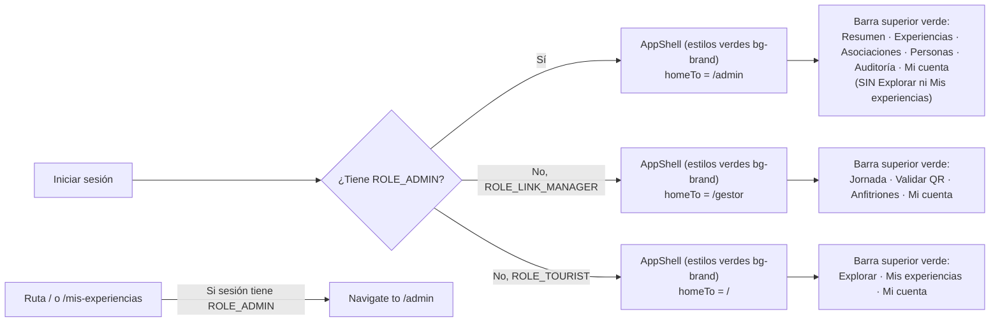

# ADR-0044: Integrar el panel de administración en AppShell con la identidad visual verde y navegación exclusiva de rol

- **Estado:** Propuesto
- **Proyecto / Módulo:** Intégrate · `frontend-pwa/` — `app/layouts`, `app/routes.tsx`, `features/admin`, `features/auth`. Enmienda ADR-0042 (§1, §3, §4) y ADR-0043 (§4, §5).
- **Fecha:** 2026-11-09
- **Trazabilidad:** Enmienda directa a ADR-0042 y ADR-0043 por revisión visual del desarrollador en el entorno de pruebas (`pruebas.integrate-demo.pages.dev/admin`).

## Contexto

La implementación de ADR-0042 creó un shell separado (`AdminShell`) con una barra lateral izquierda oscura (`bg-surface-inverse`), tipografías de encabezado en negro (`text-ink`), un enlace «Volver al sitio» hacia el catálogo público y un botón «Administración» dentro de `TouristLayout`. En la revisión visual sobre el despliegue de pruebas, el desarrollador señaló que este diseño rompe la identidad visual verde de Intégrate (parece otra aplicación externa) y que el administrador no debe operar en una página aislada de la que «va y vuelve» al sitio del turista.

El comportamiento requerido por el desarrollador es que el Administrador ingrese a la misma interfaz y estilos institucionales verdes que usa la aplicación (`AppShell` con `DesktopShell` y `MobileShell`: barra superior `bg-brand`, fondo `bg-canvas`, títulos `text-brand` y acentos `bg-brand-soft`), pero con una navegación exclusiva para su rol donde **no existan** los apartados de un usuario turista («Explorar» ni «Mis experiencias»), sino únicamente sus módulos administrativos y «Mi cuenta».

## Decisión

1. **Reemplazar `AdminShell` por `AppShell` y restituir los estilos verdes de la marca (enmienda ADR-0042 §1):**
   - Se elimina `AdminShell.tsx` (barra lateral oscura) y el enlace «Volver al sitio».
   - `AdminLayout` pasa a delegar en `<AppShell navLabel="Navegación de administración" navItems={ADMIN_NAV_ITEMS} homeTo="/admin" />`, siguiendo exactamente el mismo patrón arquitectónico que `ManagerLayout` (`homeTo="/gestor"`).
   - El administrador ve la barra superior verde institucional (`bg-brand text-on-brand`) con el logotipo **Intégrate** apuntando a `/admin`, pestañas activas con pastilla clara y texto verde (`bg-canvas text-brand`), contenedor `max-w-6xl` en escritorio (`handle: { wide: true }`) y el pie de página estándar con enlace al Manual de usuario.
   - Todas las pantallas de `features/admin` (`AdminHomePage`, `ExperiencesPage`, `AssociationsPage`, `AuditPage` y las de ADR-0043) adoptan los estilos verdes del sistema: `<h1 className="text-3xl font-bold text-brand">`, iconos sobre `bg-brand-soft text-brand`, bordes interactivos `hover:border-brand hover:bg-brand-soft` y tarjetas sobre `bg-surface` / `bg-canvas`.

2. **Navegación exclusiva del Administrador sin «Explorar» ni «Mis experiencias» (enmienda ADR-0042 §3):**
   - Al iniciar sesión con `ROLE_ADMIN`, la navegación principal muestra **únicamente** las secciones administrativas y el perfil:
     | Destino | Rótulo | Ruta |
     | :--- | :--- | :--- |
     | Inicio administrativo | **Resumen** | `/admin` |
     | Moderación de catálogo | **Experiencias** | `/admin/experiencias` |
     | Organizaciones comunitarias | **Asociaciones** | `/admin/asociaciones` |
     | Gestión de cuentas y gestores (ADR-0043) | **Personas** | `/admin/personas` |
     | Bitácora criptográfica | **Auditoría** | `/admin/auditoria` |
     | Perfil y cierre de sesión | **Mi cuenta** | `/cuenta` |
   - *(Cuando se incorporen Incidentes y Liquidaciones de ADR-0043, se integran en esta misma estructura y como accesos directos en las tarjetas del Resumen).*
   - **Exclusión estricta del recorrido de turista:** aunque en la base de datos una cuenta de administrador tenga asignado adicionalmente `ROLE_TOURIST` por semilla o arranque, la interfaz **nunca** le muestra «Explorar» (`/`) ni «Mis experiencias» (`/mis-experiencias`).
   - Si una sesión autenticada con `ROLE_ADMIN` intenta abrir `/` o `/mis-experiencias`, es redirigida automáticamente a `/admin`.
   - Se retira de `TouristLayout` el ítem condicional «Administración / Admin», ya que el administrador no comparte barra con el turista.

3. **Preservar el menú del rol activo en «Mi cuenta» (`/cuenta`):**
   - Al visitar `/cuenta`, el layout respeta el rol operativo de la sesión: si el usuario tiene `ROLE_ADMIN`, `/cuenta` se renderiza bajo la barra de navegación del administrador (`homeTo="/admin"`, sin «Explorar» ni «Mis experiencias»); si es `ROLE_LINK_MANAGER`, bajo la barra del gestor.
   - En `AccountPage`, para una cuenta con `ROLE_ADMIN` no se muestra la solicitud de «Autorizar datos de salud para reservar», dado que el administrador no realiza reservas turísticas.

4. **Comportamiento unificado en escritorio y celular (enmienda ADR-0042 §4 y ADR-0043 §4):**
   - Al usar `AppShell`, la consola hereda automáticamente `DesktopShell` en computador y `MobileShell` en celular (con barra superior verde y navegación inferior), eliminando la pantalla de bloqueo `AdminMobileNotice` o manteniendo las tablas con desplazamiento horizontal limpio (`overflow-x-auto`) dentro de las tarjetas del sistema.

## Alternativas Descartadas

- **Mantener `AdminShell` con barra lateral y solo cambiar su color de negro a verde:** aunque usaría el color `bg-brand`, seguiría siendo una disposición de página distinta al resto de la aplicación (barra lateral vertical frente a la barra superior horizontal de `DesktopShell`), que es lo que el desarrollador rechazó («lo están haciendo en otra página… quiero que utilice los estilos que tenía»).
- **Conservar «Explorar» y «Mis experiencias» junto a las pestañas de administración:** contradice la indicación expresa del desarrollador («obvio no puede ser lo mismo que usuario normal, no va a tener el apartado de explorar ni mis experiencias») y satura la barra de navegación.

## Consecuencias

- **Positivas:**
  - Coherencia visual total: el administrador percibe la misma aplicación Intégrate con sus tonos verdes certificados WCAG AAA (`bg-brand`, `text-brand`, `bg-brand-soft`).
  - Separación clara de rol: el administrador entra directamente a su entorno de trabajo sin ver opciones de compra turística («Explorar», «Mis experiencias») ni enlaces de «Volver al sitio».
  - Menos código que mantener: se eliminan `AdminShell.tsx` y `AdminMobileNotice.tsx`, reutilizando `AppShell` (`DesktopShell` + `MobileShell`) como único caparazón de toda la PWA.
- **Negativas / Riesgos asumidos:**
  - Una cuenta con `ROLE_ADMIN` no podrá usar su misma sesión para explorar el catálogo público ni reservar como turista; para probar el flujo de turista deberá usar una cuenta de turista (o cerrar sesión), lo cual es consistente con la separación de funciones (guion §6).

## Contrato o Esquema Conceptual

