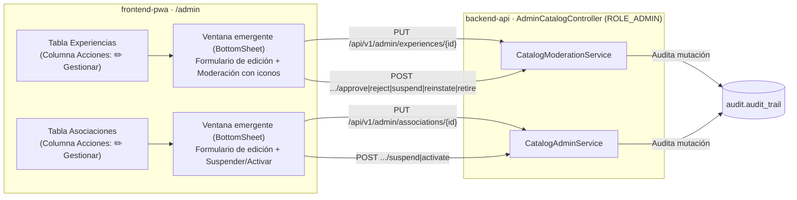

# ADR-0047: Habilitar la edición administrativa de experiencias y asociaciones en ventana emergente con acciones iconográficas

- **Estado:** Aceptado (2026-11-10) — aprobado por el desarrollador.
- **Proyecto / Módulo:** Intégrate · `backend-api/` (módulos `catalog` y `audit`), `docs/api/` (`openapi.yaml`, `endpoints-index.md`) y `frontend-pwa/` (`features/admin`, `shared/ui/Icon.tsx`)
- **Fecha:** 2026-11-10
- **Trazabilidad:** Enmienda y amplía ADR-0006 (§3–§4), ADR-0030 (§2 y §4), ADR-0035, ADR-0042 (§2 y §5) y ADR-0044 (§1).

## Contexto

Actualmente en el módulo de administración (`AdminCatalogController`), el administrador solo puede ejecutar transiciones de estado sobre las experiencias (`approve`, `reject`, `suspend`, `reinstate`, `retire`, `meeting-point/confirm`) y crear asociaciones (`POST /api/v1/admin/associations`), pero carece de endpoints para corregir o actualizar los datos de una experiencia ya registrada (por ejemplo, una experiencia publicada con un dato por ajustar) o para editar y cambiar el estado de una asociación existente. La edición de experiencias (`PUT /api/v1/host/experiences/{id}`) está restringida exclusivamente a `ROLE_HOST` y solo admite los estados `DRAFT` o `REJECTED`.

En el frontend (`ExperiencesPage`), el acceso al detalle de una experiencia está oculto como un enlace subrayado sobre el propio nombre de la experiencia y abre un panel lateral (`<aside>`) que reduce el ancho de la tabla, mientras que los botones de acción carecen de iconos que faciliten su identificación visual rápida.

## Decisión

1. **Edición administrativa de experiencias (`PUT /api/v1/admin/experiences/{id}`):**
   - Se expone en `AdminCatalogController` (`@PreAuthorize("hasRole('ADMIN')")`) el endpoint `PUT /api/v1/admin/experiences/{id}` que recibe `ExperienceRequest` validado (`@Valid`) y devuelve `HostExperienceResponse`.
   - Permite actualizar el contenido de cualquier experiencia que no esté en estado `RETIRED` (si está `RETIRED`, responde `409 CATALOG_INVALID_STATUS_TRANSITION`), **conservando su estado actual** (una experiencia `APPROVED` sigue publicada tras guardar los cambios).
   - Si en la edición cambian la dirección (`meetingPoint`), el municipio o las coordenadas (`latitude`, `longitude`), se ejecuta nuevamente la verificación de punto de encuentro de ADR-0030 (`MeetingPointVerifier`).
   - La operación se registra en la bitácora de auditoría (`EXPERIENCE_UPDATED_BY_ADMIN`, módulo `catalog`, severidad `INFO`) indicando el `experienceId` y el administrador actor.

2. **Edición y gestión de estado de asociaciones (`PUT /api/v1/admin/associations/{id}`, `POST /api/v1/admin/associations/{id}/suspend` y `POST /api/v1/admin/associations/{id}/activate`):**
   - Se expone `PUT /api/v1/admin/associations/{id}` con `AssociationRequest` para actualizar razón social, NIT, RNT, tipo de asociación, municipio (código DANE), dirección, correo y celular de contacto, validando unicidad de NIT y RNT contra otras asociaciones (`409 CATALOG_ASSOCIATION_EXISTS`).
   - Se exponen `POST /api/v1/admin/associations/{id}/suspend` y `POST /api/v1/admin/associations/{id}/activate` para alternar el estado `ACTIVE ⇄ SUSPENDED` de una organización.
   - Todas las mutaciones se registran en la bitácora de auditoría (`ASSOCIATION_UPDATED`, `ASSOCIATION_SUSPENDED`, `ASSOCIATION_ACTIVATED`).

3. **Columna `Acciones` con botones con icono y ventana emergente (`BottomSheet`) en la consola (`Opción A`):**
   - En `ExperiencesPage` (`/admin/experiencias`) y `AssociationsPage` (`/admin/asociaciones`), el nombre del registro en la primera columna deja de ser un enlace y se presenta como texto en negrita (`font-semibold text-ink`).
   - Se agrega la columna **`Acciones`** al final de la tabla con un botón explícito acompañado de icono (`<Icon name="edit" /> Gestionar`), que abre una **ventana emergente centrada (`BottomSheet`)** y elimina el panel lateral `<aside>` que comprimía la tabla.
   - Dentro de la ventana emergente de **Experiencias**, el administrador dispone tanto del formulario editable con todos los datos de la experiencia (`Guardar cambios`) como de los botones de transición de estado (`Aprobar y publicar`, `Rechazar`, `Suspender`, `Reactivar`, `Retirar` y `Confirmar el punto de encuentro`).
   - Dentro de la ventana emergente de **Asociaciones**, el administrador puede editar y guardar los datos de la asociación o suspenderla/reactivarla.
   - Se incorporan en `shared/ui/Icon.tsx` los trazos `edit` (lápiz) y `pause` y se añaden iconos semánticos a todos los botones de acción de las tablas y diálogos de administración (`Experiencias`, `Asociaciones`, `Personas`, `Incidentes` y `Liquidaciones`).

## Alternativas Descartadas

- **Mantener el enlace en el nombre de la experiencia y el panel lateral `<aside>`:** dificulta descubrir que la fila es editable/gestionable y encoge la tabla horizontalmente en escritorio.
- **Reutilizar `PUT /api/v1/host/experiences/{id}` para el administrador:** ese endpoint valida titularidad del anfitrión (`hostUserId == sub`) y fuerza el regreso a `DRAFT`, lo que despublicaría experiencias ya aprobadas al corregir un dato administrativo.
- **Edición en línea dentro de las celdas de la tabla:** una experiencia tiene más de 10 campos (descripción larga, recomendaciones, coordenadas, paradas y categorías) que no caben en una fila de tabla sin romper la legibilidad.

## Consecuencias

- **Positivas:**
  - El administrador cuenta con capacidad completa para corregir datos de experiencias (incluidas las publicadas) y de asociaciones comunitarias sin depender de base de datos ni despublicar el catálogo.
  - Todas las tablas de la consola quedan unificadas bajo el mismo patrón visual: nombre limpio a la izquierda, columna `Acciones` con botón e icono a la derecha y ventana emergente centrada (`BottomSheet`).
  - Los botones con iconos semánticos mejoran el reconocimiento visual sin sacrificar el rótulo textual accesible (`WCAG 2.1 AA/AAA`).
- **Negativas / Riesgos asumidos:**
  - La edición administrativa de una experiencia publicada modifica inmediatamente lo que ve el turista en el catálogo público; se mitiga exigiendo las mismas validaciones de dominio (`ExperienceRequest`) y dejando traza completa en `audit.audit_trail`.

## Contrato o Esquema Conceptual

| Método y ruta | Rol | Solicitud | Respuesta | Códigos de error |
| :--- | :--- | :--- | :--- | :--- |
| `PUT /api/v1/admin/experiences/{id}` | `ROLE_ADMIN` | `ExperienceRequest` | `200 HostExperienceResponse` | `404 RESOURCE_NOT_FOUND`, `409 CATALOG_INVALID_STATUS_TRANSITION` (si `RETIRED`), `422 VALIDATION_FAILED` |
| `PUT /api/v1/admin/associations/{id}` | `ROLE_ADMIN` | `AssociationRequest` | `200 AssociationResponse` | `404 RESOURCE_NOT_FOUND`, `409 CATALOG_ASSOCIATION_EXISTS`, `422 VALIDATION_FAILED` |
| `POST /api/v1/admin/associations/{id}/suspend` | `ROLE_ADMIN` | — | `200 AssociationResponse` | `404 RESOURCE_NOT_FOUND`, `409 CATALOG_INVALID_STATUS_TRANSITION` |
| `POST /api/v1/admin/associations/{id}/activate` | `ROLE_ADMIN` | — | `200 AssociationResponse` | `404 RESOURCE_NOT_FOUND`, `409 CATALOG_INVALID_STATUS_TRANSITION` |

