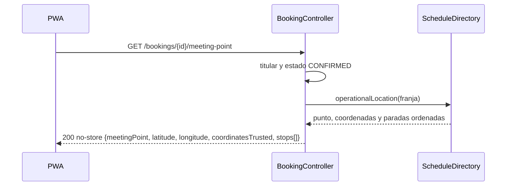

# ADR-0049: Entregar las paradas del recorrido junto con el punto de encuentro de la reserva confirmada

- **Estado:** Aceptado (2026-11-10, por el desarrollador)
- **Proyecto / Módulo:** Intégrate · `backend-api/` (`booking`, `catalog`) y `frontend-pwa/` (`features/booking`)
- **Fecha:** 2026-11-10

## Contexto

ADR-0046 §1 y §4 retiró de la proyección pública las paradas, la dirección exacta y los enlaces que revelen el punto de encuentro. Quedó como único canal para el dato exacto `GET /api/v1/bookings/{bookingId}/meeting-point`, restringido a la persona titular de una reserva `CONFIRMED` y servido con `Cache-Control: no-store`. Esa respuesta hoy trae el punto de referencia y las coordenadas, pero no las paradas, que siguen guardadas en `catalog.experience_stops` (posición, nombre y descripción).

El efecto de la retirada es que quien reserva tampoco ve el recorrido que contrató, y la ficha pública quedó con menos atractivo. Las paradas son información de valor para quien ya pagó (qué va a vivir) y de riesgo para quien aún no lo hizo (revelan la ruta y, con ella, el punto). La decisión debe devolver ese valor sin reabrir la exposición pública.

## Decisión

Ampliar la respuesta de `GET /api/v1/bookings/{bookingId}/meeting-point` con un campo `stops`: lista ordenada por posición de `{ position, name, description }`.

- **Backend.** `ScheduleDirectory.operationalLocation` ya resuelve la experiencia de la franja: se amplía `OperationalLocation` con las paradas leídas de `experience_stops`, y `MeetingPointResponse` las expone. No se crea endpoint, tabla ni migración. La autorización, el estado `CONFIRMED` y la cabecera `no-store` no cambian.
- **Proyección pública.** No cambia: `GET /experiences/{id}` sigue sin paradas y la prueba que lo comprueba se mantiene como barrera.
- **Frontend.** La vista de reserva confirmada muestra la sección «Paradas del recorrido» con la misma presentación numerada que tenía la ficha, solo cuando la lista no está vacía. La ficha pública no la muestra.
- **Contrato.** Se actualizan `docs/api/openapi.yaml`, `docs/api/endpoints-index.md` y `dtos_contrato_api.md`.

## Alternativas Descartadas

- **Endpoint separado `GET /bookings/{id}/route`:** duplicaría la autorización y la regla `CONFIRMED`, exigiría una segunda llamada desde la PWA y ampliaría la superficie que ADR-0046 pide revisar. Las paradas y el punto se entregan juntos por la misma razón: ambos revelan el recorrido.
- **Volver a mostrar las paradas en la ficha pública:** contradice ADR-0046 §1 y la auditoría H-01. Descartado.
- **Incluir las paradas solo en el PDF del comprobante:** no se ven dentro de la app y el PDF se comparte con terceros. Queda como mejora posterior si el desarrollador la pide.

## Consecuencias

- **Positivas:** la persona con reserva confirmada recupera el recorrido completo y la ficha pública mantiene la privacidad exigida. Cambio pequeño: sin migración, sin endpoint nuevo.
- **Negativas / Riesgos asumidos:** la respuesta crece con datos del recorrido que antes no viajaban; quien tenga la reserva podría compartir las paradas (el punto exacto ya tiene ese mismo riesgo). Se cubre con `no-store`, que ya aplica.

## Contrato o Esquema Conceptual (Opcional)

## Pruebas previstas (no son código)

- Reserva `CONFIRMED` de la persona titular: la respuesta trae las paradas en orden.
- Reserva no confirmada o de otra persona: se mantienen los rechazos actuales.
- La proyección pública sigue sin `stops`.
- Experiencia sin paradas: `stops` vacío y la PWA no muestra la sección.
