# ADR-0050: Rediseño visual accesible y componentes de confianza en la ficha de experiencia

- **Estado:** Aceptado
- **Proyecto / Módulo:** Frontend PWA (`src/features/catalog/`)
- **Fecha:** 2026-11-10

## Contexto

La ficha de experiencia pública (`/experiencias/:id`) en la PWA cliente es el punto crítico de decisión para turistas y senderistas interesados en el ecoturismo comunitario. Actualmente, la interfaz presenta una apariencia predominantemente técnica y plana: carece de jerarquía contextual superior (migas de pan), no detalla explícitamente los beneficios o inclusiones del servicio frente al precio cobrado, y el valor distintivo de la plataforma (el aporte ético directo del 85 % a la comunidad) se expone como una simple caja gris sin identidad ni fuerza visual. Adicionalmente, en la vista de escritorio dedicada (`ExperienceDetailDesktopPage`, ADR-0020), la tarjeta lateral de reserva exhibe un desbalance espacial pronunciado sin sellos de garantía o confianza.

Este rediseño debe respetar rigurosamente la directiva técnica `FE-DIR-001` (diseño Mobile-First verificable entre 320 px y 480 px, y desktop $\ge 1024$ px sin estiramientos arbitrarios), el sistema de tokens certificados para contraste solar WCAG AAA (`src/styles/tokens.ts`), y las salvaguardas de seguridad establecidas en ADR-0039 y ADR-0049 (las paradas del recorrido y coordenadas milimétricas permanecen reservadas para el viajero con reserva confirmada y no se revelan en el catálogo público).

## Decisión

Adoptar un rediseño modular y accesible de la ficha de experiencia estructurado en cuatro componentes visuales de alto valor y confianza, garantizando paridad funcional y consistencia visual entre smartphone y computador:

1. **Navegación contextual accesible (Breadcrumbs):**
   Incorporar un elemento semántico `<nav aria-label="Migas de pan">` superior con enlace accesible de retorno (`← Explorar`) y desglose territorial (`Explorar > Departamento > Municipio > Título`), permitiendo al usuario ubicarse geográficamente sin depender de los controles del navegador.

2. **Sección estructurada "¿Qué incluye esta experiencia?":**
   Crear un bloque visual accesible con iconos semánticos del sistema (`Icon.tsx`: `check`, `shield`, `user`, `leaf`) que detalle con claridad los pilares de la experiencia:
   - Guianza y acompañamiento por líder o anfitrión local comunitario.
   - Póliza de asistencia médica y primeros auxilios en campo.
   - Refrigerio o hidratación tradicional campesina (según lineamientos de la experiencia).
   - Aporte para la conservación del ecosistema y tarifa de ingreso.

3. **Elevación del bloque ético "Tu aporte a la comunidad":**
   Transformar el texto pasivo del 85 % en un componente de impacto social y transparencia con borde temático accesible (`border-border-subtle`), distintivo de economía justa y una barra visual de distribución ética:
   - **85 %:** Transferencia directa a la asociación local, familias anfitrionas y conservación del sendero.
   - **15 %:** Mantenimiento de la infraestructura técnica, seguros de viaje y soporte operativo.

4. **Tarjeta de reserva y acción con sellos de garantía (Mobile & Desktop):**
   - **Desktop (`aside` fijo):** Enriquecer el panel lateral con micro-garantías de confianza: *Confirmación inmediata*, *Cancelación gratuita hasta 24 horas antes* y *Aporte comunitario garantizado*, manteniendo la acción primaria en botón `min-h-11` con foco visible doble anillo.
   - **Mobile (en flujo de contenido):** Posicionar la acción transaccional inmediatamente después del precio y resumen operativo (`noFixedActionBars.test.ts`), con los mismos distintivos de confianza compactos para pantalla pequeña.

## Alternativas Descartadas

- **Exhibir las paradas del recorrido (`stops`) antes de reservar:** Descartada por conflicto directo con ADR-0039 y ADR-0049. Revelar los hitos y coordenadas sensibles en el catálogo público expone la seguridad del territorio y fomenta el tránsito no regulado sin guía comunitario. Las paradas se entregan exclusivamente en el voucher de reserva confirmada.
- **Introducir fotografías de cabecera con fuentes externas o campos provisionales:** Descartada a solicitud expresa del desarrollador; el catálogo opera actualmente con metadata verificada y no dispone de almacenamiento de medios en backend en esta iteración.
- **Barra de reserva fija inferior flotante en celulares (`fixed bottom-0`):** Descartada por prohibición taxativa en `FE-DIR-001` (Directiva 1.4) y suite de pruebas `noFixedActionBars.test.ts`, ya que oculta contenido, entorpece teclados virtuales y descontextualiza la decisión del precio.
- **Paletas cromáticas ad-hoc o clases Tailwind no estandarizadas:** Descartada en cumplimiento de `FE-DIR-001` (Directiva 2); todo contraste y fondo se restringe a los tokens certificados en `tokens.ts`.

## Consecuencias

- **Positivas:**
  - Aumento significativo en la tasa de confianza y decisión del viajero al comprender qué recibe por el valor pagado.
  - Visibilización contundente del modelo de turismo comunitario y comercio justo (85/15).
  - Cumplimiento estricto de accesibilidad WCAG 2.1 AAA bajo luz solar directa en campo.
  - Excelente equilibrio estético tanto en pantallas móviles (320–480 px) como en computadores de escritorio (≥ 1024 px).
- **Negativas / Riesgos asumidos:**
  - Incremento ligero en la longitud vertical del documento en móvil, mitigado asegurando que la acción primaria de reserva se mantenga en el primer tercio del contenido.

## Contrato o Esquema Conceptual

```mermaid
graph TD
  subgraph VistaDetalle ["Ficha de Experiencia (Mobile & Desktop)"]
    Breadcrumbs["1. Migas de Pan (nav: Explorar > Territorio)"]
    Header["2. Encabezado (Título, Ubicación, Asociación, Tags)"]
    Facts["3. Datos Operativos (Duración, Intensidad, Aforo)"]
    BookingBlock["4. Tarjeta de Reserva & Garantías"]
    About["5. Sobre la Experiencia (Descripción y Audiencia)"]
    WhatIsIncluded["6. ¿Qué Incluye? (Guianza, Seguro, Refrigerio, Ingreso)"]
    CommunityImpact["7. Tu Aporte Ético (Desglose 85% / 15%)"]
    LocationZone["8. Zona Aproximada y Mapa"]
    Safety["9. ¿Qué Llevar y Recomendaciones?"]
  end

  Breadcrumbs --> Header
  Header --> Facts
  Facts --> BookingBlock
  BookingBlock --> About
  About --> WhatIsIncluded
  WhatIsIncluded --> CommunityImpact
  CommunityImpact --> LocationZone
  LocationZone --> Safety
```

