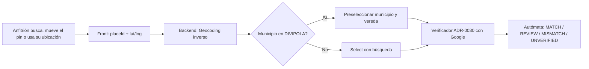

# ADR-0056: Crear y editar la ubicación de una experiencia con búsqueda y mapa de Google Maps

- **Estado:** Aceptado (2026-11-10, por el desarrollador)
- **Proyecto / Módulo:** Intégrate · `frontend-pwa/` (`features/admin`, `features/host`, `shared/`) y `backend-api/` (`modules/catalog`, `meetingpoint`)
- **Fecha:** 2026-11-10
- **Relacionado:** ADR-0030 (verificación dirección vs. coordenadas), ADR-0039 (protección del punto de encuentro), ADR-0047 (edición administrativa en ventana emergente), ADR-0048 (alta administrativa de experiencias)

## Contexto

El formulario de creación y edición de experiencias (`ExperienceForm.tsx`) exige datos que un anfitrión rural no tiene a mano: el municipio como código DANE, la vereda en texto libre, el punto de encuentro como texto y la latitud y la longitud como decimales. El resultado es un formulario difícil de llenar, con errores de coordenadas (ADR-0030 documenta un marcador a 906 m del punto real, causado por coordenadas escritas a mano). El anfitrión necesita ubicarse visualmente, no transcribir números.

El proyecto ya tiene piezas útiles: el backend verifica la dirección contra las coordenadas (`MeetingPointVerifier`, `MeetingPointAutomaton`) y usa Nominatim para geocodificar (ADR-0030). El front muestra un mapa con clave de Google Maps Embed (`VITE_GOOGLE_MAPS_EMBED_KEY`), que solo visualiza y no permite elegir un punto. El desarrollador decidió usar **Google Maps** como proveedor de mapa y búsqueda, asumiendo la facturación de Google Maps Platform.

Restricciones: las claves nunca se incrustan en código fuente ni en el repositorio (`docs/security/security_secrets_policy.md`); la clave de navegador va restringida por referrer y la de servidor por API y por IP; el sistema debe seguir funcionando si Google no responde (la captura manual de coordenadas queda como respaldo); las coordenadas exactas no se publican (ADR-0039); el catálogo no se bloquea por verificación advisoria (ADR-0030).

## Decisión

Reemplazar la captura manual de ubicación por un **selector de ubicación** que combina cuatro formas de ubicarse, todas con Google Maps Platform, y derivar los campos administrativos a partir del punto elegido.

### 1. Componente `LocationPicker` (frontend)

- **Búsqueda con autocompletado:** Places Autocomplete (API JavaScript de Google Maps), restringido a Colombia (`componentRestrictions: { country: 'co' }`). Al elegir una sugerencia se guarda el `placeId` y las coordenadas.
- **Mapa con pin arrastrable:** Maps JavaScript API con un marcador arrastrable. Al soltar el pin se actualizan latitud y longitud. Se muestra un mensaje "Mueve el pin al punto exacto" para no confiar en la sugerencia sin revisar.
- **"Usar mi ubicación":** Geolocalización del navegador. Solo se pide cuando el usuario toca el botón. Siempre se pide confirmar el pin resultante.
- **Pegar un enlace de Google Maps:** si el anfitrión pega un enlace largo o corto, el front extrae coordenadas del patrón `@lat,lng` o del parámetro `q`/`query`. Los enlaces cortos (`maps.app.goo.gl`) no se resuelven en el navegador; se rechazan con mensaje claro.
- Los campos de latitud y longitud dejan de ser visibles por defecto y se muestran solo en "Avanzado" (solo lectura cuando el mapa ya las fijó).

### 2. Geocodificación inversa para municipio y vereda

Al fijar el punto, el backend (no el navegador) llama a **Geocoding API** con las coordenadas y devuelve municipio, departamento y vereda sugeridos. El municipio se resuelve contra la tabla DIVIPOLA: si coincide, se preselecciona; si no, se muestra un `Select` con búsqueda. El código DANE deja de ser un campo que el usuario escriba. La vereda se completa si Google la devuelve; si no, queda como texto opcional.

### 3. Formulario por pasos

El alta y la edición pasan a cuatro pasos: **Datos básicos** (título, descripción, categoría), **Lugar** (`LocationPicker` y municipio), **Condiciones** (precio, cupo, duración, intensidad, indicaciones de seguridad) y **Revisión**. Cada paso guarda un borrador (`DRAFT`) al avanzar, sin exigir completar la experiencia. Los pasos reutilizan la validación Zod existente (`forms.ts`).

### 4. Verificación advisoria con Google (ADR-0030)

El `GeocodingPort` del verificador tiene por proveedor por defecto **Google Geocoding API** en lugar de Nominatim, con el mismo algoritmo de distancia, umbrales (250 m / 1 000 m) y autómata. Nominatim se conserva como implementación alternativa del puerto, activable por configuración, para pruebas sin consumo de cuota. La clave de servidor se lee de variable de entorno.

### 5. Claves y configuración

- `VITE_GOOGLE_MAPS_BROWSER_KEY` (front): solo Maps JavaScript API y Places API, restringida por referrer a los dominios de la PWA y de pruebas.
- `GOOGLE_MAPS_SERVER_KEY` (backend): solo Geocoding API, restringida por IP de salida del servidor. Va en variables de entorno del servicio, nunca en el repositorio.
- Presupuesto de cuota: alerta de facturación y límite diario por API en la consola de Google Cloud, configurados sobre la cuenta de facturación del desarrollador. Se registra en `docs/operacion/` al implementarse.
- Si falta una clave, el selector muestra la captura manual (respaldo), sin romper el formulario.

### 6. Privacidad

- Las búsquedas y los pines los hace el **anfitrión o el administrador**, no el turista, y solo se envían a Google las consultas de lugar, nunca datos personales.
- La ficha pública sigue mostrando solo coordenadas redondeadas (ADR-0039); el punto exacto no cambia de canal.
- Los `placeId` y las coordenadas se guardan en la experiencia; el texto de respuesta de Geocoding se usa solo para el municipio y la vereda sugeridos, sin almacenamiento masivo, respetando los términos vigentes de Google Maps Platform (se verificarán antes de implementar).

## Flujo propuesto

## Alternativas Descartadas

- **Alternativa A: solo OpenStreetMap / Nominatim con Leaflet.** Sin costo ni llave, pero el autocompletado es pobre para veredas y los mosaicos tienen límites de uso que no son apropiados para un formulario de creación. Se conserva solo como respaldo del puerto de geocodificación.
- **Alternativa B: solo pegar enlace de Google Maps.** Barato, pero exige que el anfitrión sepa usar Google Maps y no resuelve el municipio ni la vereda por sí solo. Queda como una de las cuatro formas de ubicarse, no como la única.
- **Alternativa C: mantener Google Maps Embed.** Gratis, pero es de solo lectura y no permite elegir un punto. Se descarta para la captura; el embed puede seguir en la ficha pública.
- **Alternativa D: dejar el formulario como está y añadir ayuda textual.** No resuelve el problema de fondo: el anfitrión no conoce el código DANE ni sus coordenadas.

## Consecuencias

- **Positivas:** el anfitrión ubica el punto visualmente en pocos toques; desaparecen los errores de coordenadas y el código DANE; el formulario se vuelve por pasos y tolera interrupciones gracias al borrador; la verificación del punto usa el mismo proveedor que el mapa.
- **Negativas / Riesgos asumidos:**
  - **Costo:** Google Maps Platform cobra por uso por encima de una cuota gratuita mensual. Requiere una cuenta de facturación. Mitigación: límites diarios y alertas (§5).
  - **Dependencia:** si Google cambia términos o cuotas, la captura cae al modo manual. Es un riesgo aceptado.
  - **Cumplimiento:** los términos de Google limitan el almacenamiento y la visualización fuera de su mapa; la revisión de cumplimiento se hace antes de implementar (§6).
  - **Ampliación de ADR-0030:** cambia el proveedor por defecto y deja sin efecto la restricción "costo cero, sin llaves nuevas" de ese ADR. Se registra como enmienda en ADR-0030 al aceptar este.
  - **Esfuerzo:** toca el formulario de admin, el alta de anfitrión (si aplica), el verificador y la configuración de claves. Se implementa en fases (ver siguiente sección).

## Fases propuestas

1. **Fase 1:** `LocationPicker` con pin arrastrable y "Usar mi ubicación" en `ExperienceForm`; coordenadas en "Avanzado".
2. **Fase 2:** Places Autocomplete y pegado de enlace de Google Maps.
3. **Fase 3:** geocodificación inversa para municipio y vereda; `Select` con búsqueda sobre DIVIPOLA.
4. **Fase 4:** formulario por pasos con borrador por paso.
5. **Fase 5:** proveedor Google en `GeocodingPort` con enmienda a ADR-0030.

Cada fase cumple el Quality Gate y se verifica en el entorno de pruebas solo si depende de las claves reales (ver `CLAUDE.md`, regla de SnapDeploy).

## Decisiones tomadas por el desarrollador (2026-11-10)

1. **Quién usa el selector:** el administrador **y** el anfitrión, en sus propios formularios. El componente `LocationPicker` es compartido.
2. **Facturación:** existe una cuenta de Google Cloud con crédito disponible (alrededor de 200 USD o más). Las claves se crean en esa cuenta con las restricciones de §5; nunca se pegan en el chat ni en el repositorio.
3. **Enmienda a ADR-0030:** aprobada (ver ADR-0030, sección "Enmienda 2026-11-10").

## Contrato o Esquema Conceptual

Campos nuevos o derivados en la experiencia (conceptual, sin código de controlador):

| Campo | Origen | Notas |
| :--- | :--- | :--- |
| `placeId` | Places Autocomplete o enlace pegado | Opcional; se guarda para reabrir el punto |
| `latitude`, `longitude` | Pin arrastrado, GPS o enlace | Ya existen; la fuente cambia |
| `municipalityCode` | Geocodificación inversa + DIVIPOLA | Se preselecciona; el usuario puede corregir |
| `vereda` | Geocodificación inversa (si hay) | Opcional |
| `locationSource` | `SEARCH`, `PIN`, `GEOLOCATION`, `LINK`, `MANUAL` | Trazabilidad para auditoría |
