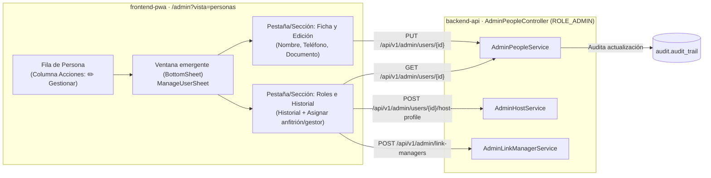

# ADR-0057: Edición administrativa de personas y unificación de acciones en ventana emergente

- **Estado:** Aceptado (2026-11-10) — aprobado por el desarrollador.
- **Proyecto / Módulo:** Intégrate · `backend-api/` (módulos `catalog` y `audit`), `docs/api/` (`openapi.yaml`, `endpoints-index.md`) y `frontend-pwa/` (`features/admin`, `shared/ui`)
- **Fecha:** 2026-11-10
- **Trazabilidad:** Amplía y complementa ADR-0043 (§1), ADR-0046 (identidad y cifrado), ADR-0047 (patrón iconográfico y `BottomSheet`) y ADR-0048 (gestión y roles de usuarios). Subordinado a las directivas de frontend en `docs/rules/frontend-rules.md` (FE-DIR-001).

## Contexto

Actualmente, en la consola de administración (`AdminPeopleController` y `PeoplePage`), el administrador solo puede buscar personas (`GET /api/v1/admin/users/search`), consultar listados (`GET /api/v1/admin/users`, `/link-managers`, `/host-profiles`), consultar el detalle (`GET /api/v1/admin/users/{id}`) y registrar nuevas cuentas (`POST /api/v1/admin/users`). No existe un mecanismo ni endpoint para corregir o actualizar datos básicos de una persona (nombre completo, teléfono de contacto o documento de identidad) en caso de errores tipográficos o actualizaciones legítimas.

En el frontend (`frontend-pwa/src/features/admin/pages/PeoplePage.tsx` y `PersonSearch.tsx`), la interfaz sufre de sobrecarga visual y duplicación de controles:
1. Hay dos niveles idénticos de filtrado de roles (la barra de navegación superior de `PeoplePage` y un conjunto redundante de botones de rol dentro de `PersonSearch`).
2. Cada fila de la tabla de usuarios contiene múltiples botones en celdas separadas: un botón para expandir el historial de roles en línea y botones dispares de acción directa (`Convertir en anfitrión`, `Acreditar como gestor`).
3. En pantallas móviles (360–430 px), esta dispersión rompe el layout horizontal, genera fricción táctil y compromete el cumplimiento de las áreas táctiles mínimas ($\ge 44 \times 44$ px con $\ge 8$ px de separación). Incorporar un botón más de edición por fila saturaría aún más la interfaz.

## Decisión

1. **Endpoint de actualización de datos de usuario (`PUT /api/v1/admin/users/{id}`):**
   - Se expone en `AdminPeopleController` (`@PreAuthorize("hasRole('ADMIN')")`) el endpoint `PUT /api/v1/admin/users/{id}` que recibe `AdminUserUpdateRequest` validado (`@Valid`) y retorna `AdminUserResponse`.
   - Permite actualizar los campos editables: `fullName` (3 a 150 caracteres), `phone` (patrón E.164: `^\+[1-9][0-9]{7,14}$`), `docType` y `docNumber` (4 a 20 caracteres alfanuméricos).
   - El correo electrónico (`email`) se mantiene inmutable por este endpoint para prevenir secuestro o suplantación de cuentas.
   - Si se actualiza el documento de identidad, se aplican los algoritmos de cifrado en reposo y cálculo de hash ciego (`blind index`) definidos en ADR-0046 para garantizar el secreto criptográfico.
   - Si el documento colisiona con el de otra cuenta activa, el servidor rechaza con `409 AUTH_USER_EXISTS`.
   - La operación se audita en `audit.audit_trail` (`USER_UPDATED_BY_ADMIN`, módulo `catalog`, severidad `INFO`), registrando el identificador del usuario afectado y el administrador actor.

2. **Unificación de acciones y eliminación de controles duplicados en la UI (`Opción Gestionar`):**
   - **Consolidación de filtros:** Se elimina la barra de pastillas redundante dentro de `PersonSearch.tsx`. La navegación de roles se gestiona exclusivamente desde la barra de pestañas de `PeoplePage` (`Todos`, `Turistas`, `Gestores de enlace`, `Anfitriones`).
   - **Botón único de acción por fila:** En `PersonSearch` y en `ManagersTable`, se sustituyen los múltiples botones dispares (`Ver historial`, `Convertir en anfitrión`, `Acreditar como gestor`) por un único botón estandarizado:
     `<Button variant="secondary" aria-label="Gestionar a {fullName}"><Icon name="edit" /> Gestionar</Button>`.
   - **Ventana emergente (`BottomSheet`) de gestión integral:** Al presionar `Gestionar`, se abre un diálogo modal centrado (`ManageUserSheet`) que organiza la información y las acciones en dos secciones limpias:
     1. **Ficha y Edición:** Formulario con los datos de la persona (`fullName`, `phone`, `docType`, `docNumber`) y botón `Guardar cambios` que invoca `PUT /api/v1/admin/users/{id}` con validaciones accesibles.
     2. **Roles y Asignaciones:** Muestra los roles actuales, el historial de roles (obtenido bajo demanda de `GET /api/v1/admin/users/{id}` sin deformar la tabla) y las acciones contextuales jerarquizadas (`Convertir en anfitrión`, `Acreditar como gestor`, o gestión de acreditación).

3. **Accesibilidad y cumplimiento Mobile-First:**
   - La ventana emergente y sus controles respetan estrictamente `docs/rules/frontend-rules.md` (FE-DIR-001):
     - Viewport inicial optimizado para 360–430 px.
     - Áreas táctiles $\ge 44 \times 44$ px y separación $\ge 8$ px.
     - Tokens de color certificados con contraste solar WCAG AAA ($\ge 7:1$).
     - Anillo de foco accesible `--color-focus` (3 px) + `--color-focus-halo` (6 px).
     - Foco inicial atrapado en el modal y retorno del foco al botón activador al cerrar.

## Alternativas Descartadas

- **Añadir un botón «Editar» directo en cada fila de la tabla:** Descartado porque agrava la saturación visual, suma una cuarta acción en la fila y desborda la tabla en dispositivos móviles.
- **Edición en línea (editable cells) en la propia tabla:** Descartada porque incrementa el riesgo de pulsaciones accidentales, complica la accesibilidad por teclado/lector de pantalla y no permite albergar validaciones complejas ni gestión de roles.
- **Permitir edición libre del correo electrónico en este endpoint:** Descartada para evitar riesgos de suplantación de identidad sin verificación previa de correo.

## Consecuencias

- **Positivas:**
  - Se resuelve la necesidad de corregir y editar datos personales de usuarios desde la consola de administración.
  - La interfaz de *Personas* queda limpia, organizada y con una sola acción predecible por fila, alineándose al estándar de *Experiencias* y *Asociaciones* de ADR-0047.
  - El historial de roles y las asignaciones ya no rompen el diseño de la tabla principal.
  - La experiencia móvil (360–430 px) se vuelve cómoda, fluida y 100% conforme a FE-DIR-001.
- **Negativas / Riesgos asumidos:**
  - Editar el número de documento de una cuenta exige recalcular el blind index y el cifrado seguro (ADR-0046), requiriendo tests rigurosos de persistencia en el backend.

## Contrato o Esquema Conceptual

| Método y ruta | Rol | Solicitud | Respuesta | Códigos de error |
| :--- | :--- | :--- | :--- | :--- |
| `PUT /api/v1/admin/users/{id}` | `ROLE_ADMIN` | `AdminUserUpdateRequest` (`fullName`, `phone`, `docType`, `docNumber`) | `200 AdminUserResponse` | `400 MALFORMED_REQUEST`, `404 RESOURCE_NOT_FOUND`, `409 AUTH_USER_EXISTS`, `422 VALIDATION_FAILED` |

