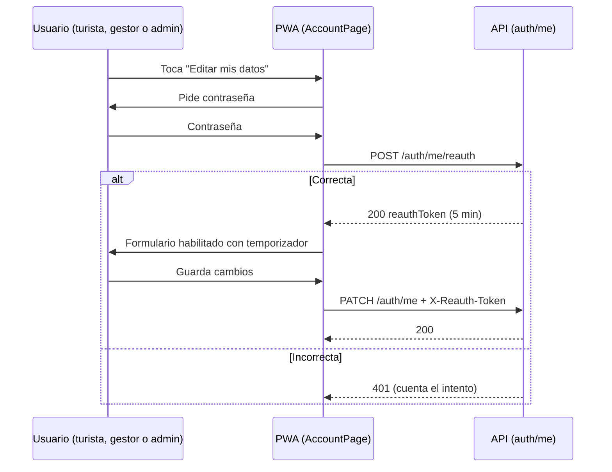

# ADR-0058: Confirmar la identidad con la contraseña antes de editar la cuenta propia

- **Estado:** Aceptado (2026-11-10, por el desarrollador). Enmendado en la implementación (ver "Enmienda 2026-11-10")
- **Proyecto / Módulo:** Intégrate · `backend-api/` (`modules/auth`: `OwnAccountController`, `OwnAccountService`) y `frontend-pwa/` (`features/auth`: `AccountPage`, `AccountSettings`, `PasswordForm`)
- **Fecha:** 2026-11-10
- **Relacionado:** ADR-0046 (cifrado de identidad y cuenta propia), ADR-0038 (correo sintético y opaco), ADR-0044 (administración en el AppShell), ADR-0057 (edición administrativa de personas: su bloque de confirmación debe reutilizar este mecanismo si aplica)

## Contexto

La cuenta propia (`/cuenta` para turistas y gestores, `/admin/cuenta` para administradores) se ve hoy así: el nombre y el celular aparecen en un formulario editable desde el primer momento, y debajo está "Cambiar contraseña". Ninguno de los dos pide confirmar la identidad.

El riesgo es concreto. Una sesión abierta en un equipo compartido, o un celular sin bloqueo, permite cambiar el celular de contacto (que recibe avisos y códigos) o el nombre que aparece en el voucher, sin conocer la contraseña. En el backend, `PATCH /api/v1/auth/me` no exige la contraseña: ocultar el formulario en la interfaz no protege nada. Solo `POST /api/v1/auth/me/password` valida `currentPassword`, y solo para cambiar la contraseña.

El problema afecta a **todos los usuarios con cuenta propia**: turistas, gestores y administradores. La decisión no es solo de la consola de administración.

Restricciones: la verificación debe ser del servidor, no de la interfaz; no debe bloquear la navegación normal (ver reservas, experiencias) ni exigir la contraseña en cada tecla; los intentos fallidos deben tener límite (el proyecto ya tiene `AUTH_PASSWORD_CHANGE_RATE_LIMITED`); todo cambio queda auditado (`AuditEntry`); la sesión sigue siendo JWT, sin una tabla nueva de sesiones.

## Decisión

Proteger los cambios de la cuenta propia con una **confirmación de identidad de vida corta**, aplicada a todos los roles, en dos capas.

### 1. Servidor: marca de reautenticación

- Nuevo endpoint `POST /api/v1/auth/me/reauth` con cuerpo `{ "password": "..." }` (solo la sesión autenticada, nunca público).
- Si la contraseña es correcta, responde `200` con un **token de reautenticación**: un JWT firmado con la clave existente, `aud` = `own-account`, expira en **5 minutos**, y el claim `sub` del usuario. No se guarda en base de datos, así que no requiere tabla nueva.
- Si es incorrecta, responde `401` con el código de error de credenciales (sin revelar más) y cuenta el intento. Tras **5 fallos en 15 minutos por usuario**, responde `429` con `AUTH_REAUTH_RATE_LIMITED` durante 15 minutos. El contador vive en el mismo mecanismo que `AUTH_PASSWORD_CHANGE_RATE_LIMITED`.
- Endpoints que exigen el token en la cabecera `X-Reauth-Token`:
  - `PATCH /api/v1/auth/me` (nombre, celular)
  - `POST /api/v1/auth/me/password` (cambio de contraseña, además de `currentPassword`, que sigue requerida)
  - Cualquier cambio futuro de correo o documento.
- Sin el token válido o vencido: `403` con `AUTH_REAUTH_REQUIRED`. El token no sirve para otro usuario ni para otro endpoint (`aud` y `sub` se verifican).
- Lectura libre: `GET /api/v1/auth/me` no cambia; ver los datos no requiere confirmación.

### 2. Interfaz: vista de solo lectura y confirmación

- Al entrar, la sección "Datos de mi cuenta" muestra nombre, correo enmascarado y celular **sin campos editables**, con el botón "Editar mis datos".
- "Editar mis datos" abre un diálogo (`BottomSheet`) que pide la contraseña actual y muestra el enlace "¿Olvidaste tu contraseña?" hacia el flujo de restablecimiento existente (`/olvide-contrasena`).
- Con el token recibido, el formulario se habilita. Un temporizador visible ("Puedes editar durante 4:58") lo desbloquea y lo bloquea de nuevo al vencer. Al guardar, el token se descarta.
- "Cambiar contraseña" pasa a una sección "Seguridad" bajo el mismo paso de confirmación. El campo de contraseña actual se mantiene, así que el usuario escribe la contraseña dos veces seguidas en el mismo flujo: se acepta como costo de seguridad y se mitiga pidiendo el token y no repitiendo el campo si el token sigue vigente.
- El token vive en memoria (no en `localStorage`), y se pierde al recargar la página. Eso es intencional: al recargar, la confirmación se repite.

### 3. Auditoría

Eventos nuevos en `AuditEntry` del módulo `auth`:

| Evento | Severidad | Cuándo |
| :--- | :--- | :--- |
| `OWN_REAUTH_OK` | INFO | Contraseña correcta; se emite el token |
| `OWN_REAUTH_FAILED` | WARN | Contraseña incorrecta |
| `OWN_REAUTH_LOCKED` | WARN | Límite alcanzado |
| `OWN_PROFILE_UPDATED` | INFO | Ya existe; ahora incluye `reauthAt` |
| `PASSWORD_CHANGED` | INFO | Ya existe |

La auditoría no guarda la contraseña ni el token.

### 4. Alcance por rol

- **Turista, gestor y administrador:** misma regla, mismo componente. La pantalla es la misma en `/cuenta` y `/admin/cuenta`; solo cambia el layout.
- **Datos de salud y autorizaciones** (`/cuenta`, sección "Autorizaciones"): **fuera de alcance**. Se rigen por ADR-0040 y su consentimiento propio, no por la contraseña.
- **Sesión y cierre de sesión:** fuera de alcance; no cambian.

## Alternativas Descartadas

- **A. Solo ocultar el formulario en la interfaz.** Descartada: no protege ningún endpoint; `PATCH /auth/me` sigue aceptando cambios sin contraseña.
- **B. Exigir `currentPassword` en cada `PATCH /auth/me`.** Válida y sencilla, pero obliga a escribir la contraseña en cada guardado, incluso cambiar un solo dígito del celular. Queda como respaldo si la marca de tiempo complica la implementación.
- **C. Sesión "fresca" con reautenticación con Keycloak u otro proveedor.** Descartada: el proyecto no usa un proveedor de identidad externo; añadir uno es un cambio mayor fuera de este alcance.
- **D. Token de reautenticación guardado en base de datos (revocable).** Más control (permite invalidarlo), pero agrega una tabla y una consulta por petición. Como dura 5 minutos y está ligado a `sub` y `aud`, el riesgo de no revocarlo es bajo. Se puede revisar si se necesita revocación inmediata.
- **E. Confirmar con código al celular o correo (OTP).** Más segura frente a una contraseña filtrada, pero depende de que el canal esté disponible y añade costo de envío de mensajes. Se propone como mejora futura, no ahora.

## Consecuencias

- **Positivas:**
  - Ningún cambio de datos sensibles se hace sin la contraseña, ni desde la interfaz ni directamente contra la API.
  - El mismo mecanismo sirve para turistas, gestores y administradores, sin lógica duplicada.
  - Auditoría completa de intentos y cambios.
  - No requiere tabla ni infraestructura nueva.
- **Negativas / Riesgos asumidos:**
  - Fricción adicional: quien edita su celular escribe la contraseña una vez cada 5 minutos.
  - Un token robado durante 5 minutos permite cambios en esa ventana. Se asume; la alternativa D cubre el caso si se requiere.
  - Cambia el contrato de `PATCH /auth/me` (ahora exige `X-Reauth-Token`). Las pruebas de integración de `OwnAccountController` y los tests de `account.test.tsx` deben actualizarse.
  - Hay que actualizar `docs/api/endpoints-index.md` con los dos endpoints nuevos y la cabecera, según la regla de `CLAUDE.md`.

## Contrato o Esquema Conceptual

| Endpoint | Rol | Requiere `X-Reauth-Token` | Respuesta relevante |
| :--- | :--- | :--- | :--- |
| `GET /api/v1/auth/me` | Autenticado | No | Perfil (sin cambios) |
| `POST /api/v1/auth/me/reauth` | Autenticado | No (usa la contraseña) | `200` `{ reauthToken, expiresAt }` · `401` · `429` |
| `PATCH /api/v1/auth/me` | Autenticado | Sí | `200` perfil · `403 AUTH_REAUTH_REQUIRED` |
| `POST /api/v1/auth/me/password` | Autenticado | Sí, además de `currentPassword` | `204` · `403` |

## Respuestas del desarrollador y valores aplicados

El desarrollador aceptó el ADR sin responder las tres preguntas. Se aplican los valores por defecto propuestos:

1. **Ventana:** 5 minutos.
2. **Cambio de contraseña:** se mantiene `currentPassword` además del token. Es la opción que conserva la garantía de la contraseña actual.
3. **Entrega:** backend completo primero; la interfaz va en una fase posterior.

## Enmienda 2026-11-10 (durante la implementación)

- **Token opaco en memoria en lugar de JWT.** El decodificador de acceso (`JwtConfig`) valida emisor, expiración y `sub`, pero no `aud`. Un JWT de reautenticación firmado con la misma clave funcionaría como token de sesión completo durante 5 minutos. Por eso el token es aleatorio de 256 bits, se guarda solo su huella SHA-256 y vive en memoria del proceso (mismo criterio que el límite de cambio de contraseña).
- **Códigos de error reutilizados** mientras los códigos nuevos no se agregan: falta de token y token inválido responden `403 RBAC_FORBIDDEN`; el bloqueo responde `429 AUTH_PASSWORD_CHANGE_RATE_LIMITED`; contraseña incorrecta responde `422` (`invalidField("password")`), como el cambio de contraseña actual. **Pendiente:** agregar `AUTH_REAUTH_REQUIRED` y `AUTH_REAUTH_RATE_LIMITED` a `ErrorCode` (ver estado).
- **Con varias instancias**, cada una lleva su propio conteo y sus tokens. Hoy hay una sola instancia; si se escala, el estado debe pasar a Redis o a la base.

## Estado de la implementación

- **Backend (hecho):** `OwnReauthService`, `POST /api/v1/auth/me/reauth`, exigencia de `X-Reauth-Token` en `PATCH /auth/me` y `POST /auth/me/password`, códigos `AUTH_REAUTH_REQUIRED` (403) y `AUTH_REAUTH_RATE_LIMITED` (429), cabecera permitida en CORS, 4 pruebas unitarias en verde.
- **Interfaz (hecho):** datos en solo lectura con "Editar mis datos"; hoja "Confirma que eres tú" (`ReauthSheet`) con enlace a `/recuperar-contrasena`; formulario habilitado con cuenta regresiva y botón "Terminar edición"; sección "Seguridad" con la misma confirmación; si el servidor responde 403 la interfaz vuelve a solo lectura con aviso. Quality Gate de la PWA en verde (typecheck, lint, format, 395 pruebas, build).
- **Documentación de la API (hecho):** `openapi.yaml` y `endpoints-index.md`.
- **No ejecutado:** las pruebas de integración de `AuthApiIntegrationTest` (actualizadas) necesitan Docker, que no está disponible en esta máquina. Tampoco se probó en navegador contra un backend real.
