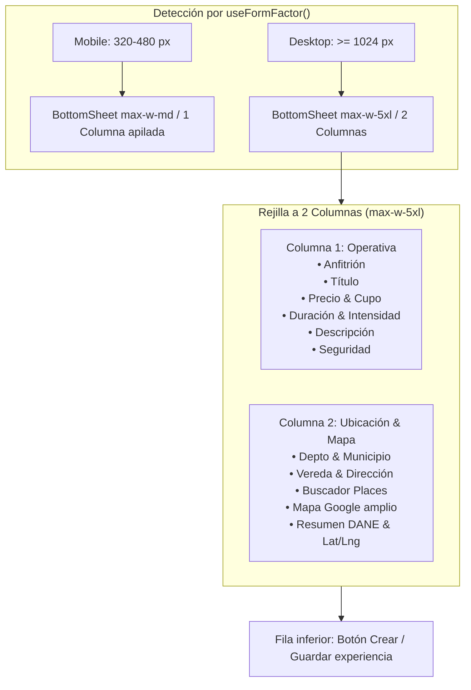

# ADR-0059: Modal amplio adaptativo y formulario de experiencias a dos columnas en escritorio

- **Estado:** Aceptado (2026-11-10) — aprobado por el desarrollador.
- **Proyecto / Módulo:** Intégrate · `frontend-pwa/` (`shared/ui/BottomSheet`, `features/admin/components/NewExperienceSheet`, `features/admin/components/ExperienceForm`, `features/admin/pages/ExperiencesPage`)
- **Fecha:** 2026-11-10

## Contexto

En pantallas de escritorio (PC / laptop), el modal `BottomSheet` centra actualmente cualquier diálogo en un contenedor restringido a `max-w-lg` (512 px) conforme a ADR-0020 §2. Para modales sencillos de confirmación o selección, este ancho es adecuado; sin embargo, en formularios complejos con alta densidad de datos e integración de mapas interactivos —como el alta de nueva experiencia (`NewExperienceSheet`) y la edición administrativa (`FichaModal`)— 512 px resulta excesivamente estrecho. Esto provoca un "túnel vertical" con más de 12 campos apilados, comprime el selector de mapas de Google Maps (`LocationPicker`) a menos de 460 px útiles y obliga a un desplazamiento vertical (scroll) prolongado en monitores donde sobra espacio horizontal.

Al mismo tiempo, la directiva `FE-DIR-001` exige preservar estrictamente la experiencia móvil prioritaria (320–480 px), donde la interfaz debe continuar presentándose como una hoja modal inferior de una columna apilada, con áreas táctiles $\ge 44 \times 44$ px y sin alterar el bundle base ni el flujo del turista en campo.

## Decisión

1. **Variante de tamaño en `BottomSheet` (`size?: 'md' | 'xl'`):**
   - Extender el contrato de `BottomSheetProps` con la propiedad opcional `size?: 'md' | 'xl'` (por defecto `'md'`).
   - En dispositivos móviles (`useFormFactor() === 'mobile'`), la hoja modal conserva siempre su comportamiento de hoja inferior `max-w-md` (`fixed bottom-0`).
   - En escritorio (`useFormFactor() === 'desktop'`), `'md'` mantiene el diálogo centrado en `max-w-lg` (512 px), mientras que `'xl'` expande el diálogo a `max-w-5xl` (~1024 px) con `max-h-[90dvh]`, permitiendo aprovechar la pantalla ancha sin romper los márgenes del viewport.

2. **Reorganización responsive a 2 columnas en `ExperienceForm`:**
   - En móvil, se mantiene la disposición vertical lineal en una sola columna con espaciado táctil accesible.
   - En pantallas grandes (`lg:grid lg:grid-cols-2 lg:gap-6 lg:items-start`), el formulario se divide en dos columnas funcionales coherentes:
     - **Columna 1 (Ficha de la Experiencia):** Selector de anfitrión (en altas), título, fila combinada de precio y cupo, fila combinada de duración e intensidad física, descripción y recomendaciones de seguridad.
     - **Columna 2 (Localización y Mapa):** Fila de selectores DANE (Departamento y Municipio), vereda y dirección textual, buscador de lugares / enlace de Google Maps, mapa interactivo amplio de Google Maps (`LocationPicker` ~480 px útiles), botón de geolocalización, resumen de validación DANE y acordeón "Avanzado" para coordenadas manuales.
     - **Fila inferior de ancho completo:** Avisos de error del servidor (`ProblemNotice`) y botón principal de guardado/creación (`Button`).

3. **Inyección del selector de anfitrión:**
   - Permitir que `ExperienceForm` acepte una prop opcional `hostSelector?: ReactNode` para que `NewExperienceSheet` posicione la selección de anfitrión en la cabecera de la columna operativa de datos, evitando desalineaciones visuales en escritorio.

## Alternativas Descartadas

- **Página completa dedicada (`DesktopPage`) en lugar de modal:** Descartada porque alteraría el flujo de navegación de la lista de experiencias (`ExperiencesPage`), obligaría a crear rutas y sincronizaciones de URL adicionales y rompería la consistencia con el flujo del administrador.
- **Formulario por pasos (Wizard con Stepper) en el modal:** Descartada porque añade clics y fricción innecesaria a un usuario administrativo en oficina, y oculta información que es útil visualizar de forma simultánea (p. ej. validar el municipio y vereda a la vez que se observa el pin en el mapa).
- **Estirar el modal al 100% del ancho de pantalla:** Descartada porque en monitores ultra-anchos generaría líneas de texto demasiado largas que perjudican la legibilidad (violando buenas prácticas de ergonomía visual).

## Consecuencias

- **Positivas:**
  - El selector de mapas interactivo (`LocationPicker`) gana más del doble de superficie visible útil en PC, facilitando la interacción con el mouse.
  - La altura total del formulario se reduce casi a la mitad en escritorio, minimizando el scroll vertical.
  - La experiencia móvil se mantiene intacta en 320–480 px sin regresiones de diseño ni violaciones de WCAG.
  - La mejora beneficia automáticamente tanto a la creación (`NewExperienceSheet`) como a la edición (`FichaModal`).
- **Negativas / Riesgos asumidos:**
  - Requiere asegurar que las pruebas de integración y accesibilidad de `BottomSheet` y `ExperienceForm` cubran ambas configuraciones (`md` y `xl`).

## Contrato o Esquema Conceptual

