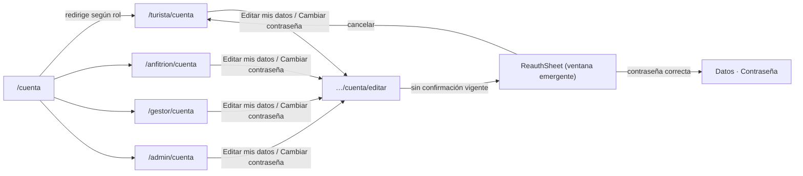

# ADR-0062: Cuenta con ruta por rol y edición en ventanas emergentes

- **Estado:** Aceptado (2026-11-11)
- **Proyecto / Módulo:** Intégrate · `frontend-pwa/` — `app/routes.tsx`, `app/layouts/*` (Tourist, Host, Manager, Admin), `features/auth` (`AccountPage`, `AccountSettings`, `ReauthSheet`). Enmienda ADR-0058 §interfaz y ADR-0044 (ruta `/admin/cuenta`). Sin cambios en el backend.
- **Fecha:** 2026-11-11
- **Trazabilidad:** ADR-0058 (confirmar identidad antes de editar), ADR-0044, FE-DIR-001 (Directiva 1), observación del desarrollador del 2026-11-11.

## Contexto

Hoy hay una sola ruta `/cuenta` para turista, anfitrión y gestor, y `/admin/cuenta` para el administrador. El anfitrión y el gestor tienen «Mi cuenta» en su barra, pero esa opción los saca de su zona (`/anfitrion`, `/gestor`) hacia el layout de turista, y no existe una ruta propia por rol. Además `AccountSettings` pone en la misma página el resumen de la cuenta, el formulario de datos, el de contraseña y las autorizaciones; el desarrollador ve «Mi cuenta» como una pantalla de consulta y quiere que **editar** viva en otra página.

Restricciones: ADR-0058 exige confirmar la contraseña antes de editar datos y antes de cambiar la contraseña (la confirmación vive solo en memoria, unos minutos); FE-DIR-001 manda sobre el diseño (móvil primero, áreas táctiles ≥ 44 px, ventana emergente = `BottomSheet`/diálogo existente, sin tokens nuevos).

## Decisión

1. **Una ruta de cuenta por rol, mismo componente.** Cada zona monta la misma pantalla bajo su propio prefijo y dentro de su propio layout; solo cambia el enrutador:

   | Rol | Mi cuenta | Editar |
   |---|---|---|
   | Turista | `/turista/cuenta` | `/turista/cuenta/editar` |
   | Anfitrión | `/anfitrion/cuenta` | `/anfitrion/cuenta/editar` |
   | Gestor | `/gestor/cuenta` | `/gestor/cuenta/editar` |
   | Administrador | `/admin/cuenta` (sin cambio) | `/admin/cuenta/editar` |

   `/cuenta` se conserva como redirección a la cuenta del rol vigente (el administrador va a `/admin/cuenta`, el anfitrión a `/anfitrion/cuenta`, etc.; quien tiene varios roles va a la de su zona principal, y el turista a `/turista/cuenta`), para no romper enlaces ni el manual. Los menús («Mi cuenta» en `HostLayout`, `ManagerLayout`, `TouristLayout`, `shell.ts`) apuntan a la ruta de su rol.
2. **«Mi cuenta» pasa a ser de consulta.** Muestra perfil, roles, un resumen de datos en solo lectura, las autorizaciones de datos y el cierre de sesión, más dos accesos: **Editar mis datos** y **Cambiar contraseña**. Deja de contener los formularios.
3. **Edición en una página separada** (`…/cuenta/editar`), con dos secciones —Datos y Contraseña— y un enlace «Volver a Mi cuenta». La pantalla conserva el comportamiento de ADR-0058 (cuenta regresiva, bloqueo al vencer, errores junto al campo).
4. **La ventana emergente va fuera de Mi cuenta.** Al abrir `…/cuenta/editar` sin confirmación vigente aparece el `ReauthSheet` (la ventana emergente existente) pidiendo la contraseña; si se cierra o se cancela, se vuelve a «Mi cuenta». Los accesos de «Mi cuenta» solo navegan; ya no abren el formulario en el mismo lugar. «Cambiar contraseña» lleva a la sección Contraseña de la página de edición.
5. **La contraseña sigue siendo obligatoria para editar datos.** Se mantiene ADR-0058 tal cual: lo que cambia es dónde ocurre, no la regla. (Si lo observado como «editar datos no pide contraseña» ocurre en la versión desplegada, se debe a que ese despliegue es anterior a ADR-0058; este ADR no relaja la regla.)
6. **Autorización:** cada ruta usa `RequireSession` con su rol; un turista que abre `/anfitrion/cuenta` recibe «no disponible», no los datos de otra zona. El administrador nunca ve la zona de turista (ADR-0044).
7. **Verificación de cierre:** pruebas de enrutamiento por rol (cada ruta, la redirección de `/cuenta`, acceso denegado cruzado), de la página de edición (ventana de confirmación al entrar, cancelar vuelve, vencer bloquea) y axe sobre «Mi cuenta» y la página de edición; Quality Gate de FE-DIR-001 (5 comandos) en verde; actualización del manual de usuario y de `docs/api/endpoints-index.md` no aplica (sin endpoints nuevos).

## Alternativas Descartadas

- **Dejar todo en una página con secciones (estado actual):** es lo que el desarrollador no quiere; mezcla consulta y edición.
- **Rutas distintas pero componente de cuenta duplicado por rol:** triplica pruebas y deriva; basta montar el mismo componente en cuatro zonas.
- **Editar sin contraseña:** contradice ADR-0058 y deja la cuenta expuesta a quien use un dispositivo ajeno desbloqueado.
- **Editar en una hoja emergente sobre «Mi cuenta»:** los formularios (nombre, teléfono, EPS, contraseña) son largos para una hoja en móvil y no se pueden enlazar ni volver a ellos por URL.

## Consecuencias

- **Positivas:**
  - cada rol permanece en su zona al abrir su cuenta;
  - consulta y edición quedan separadas, con URL propia y retroceso natural del navegador;
  - se reutiliza el componente de cuenta, el `ReauthSheet` y la lógica de ADR-0058 sin tocar el backend.
- **Negativas / Riesgos asumidos:**
  - se cambian rutas públicas conocidas: `/cuenta` queda como redirección y el manual, el guion de pruebas y los enlaces externos deben actualizarse;
  - quien tiene varios roles necesita una regla clara para la redirección de `/cuenta`;
  - recargar `…/cuenta/editar` vuelve a pedir la contraseña (comportamiento ya aceptado en ADR-0058).

## Contrato o Esquema Conceptual

## Enmienda (2026-11-11): ventanas emergentes y contraseña solo para cambiar la contraseña

El desarrollador aclaró tras ver la primera entrega que **no quiere una página de edición aparte** ni que editar los datos pida la contraseña. Esta enmienda **reemplaza** los puntos 2 a 5 de la Decisión y enmienda ADR-0058:

1. **Una sola página «Mi cuenta» por rol** (las rutas por rol del punto 1 se conservan). Se eliminan las rutas `…/cuenta/editar` y la página `AccountEditPage`.
2. **Editar mis datos** abre una **ventana emergente** (`BottomSheet`) sobre «Mi cuenta» con nombre y celular. **No pide contraseña.** Al guardar, la ventana se cierra y los datos de la página se actualizan.
3. **Cambiar contraseña** abre otra **ventana emergente** con contraseña actual, nueva y confirmación. **Es lo único que exige la contraseña actual**, en esa misma ventana: no hay una segunda ventana previa de confirmación. Al tener éxito se cierra la sesión y se pide ingresar de nuevo (sin cambio respecto de ADR-0058).
4. **Backend (enmienda a ADR-0058):** `PATCH /api/v1/auth/me` deja de exigir `X-Reauth-Token`; se sigue registrando en la bitácora el cambio de datos propios. `POST /api/v1/auth/me/password` conserva el token (la ventana lo obtiene con la contraseña actual antes de cambiarla) y `POST /api/v1/auth/me/reauth` no cambia.
5. **Riesgo asumido:** quien use un dispositivo ajeno con la sesión abierta puede cambiar el nombre y el celular de la cuenta, pero no la contraseña. El correo no es editable desde aquí. Se acepta por decisión del desarrollador; la bitácora conserva quién y cuándo cambió.

### Notas de implementación de la enmienda

- `AccountOverview` (en «Mi cuenta») abre `ProfileSheet` y `PasswordSheet` (`BottomSheet`). Se eliminaron `AccountEditPage`, `ReauthSheet` y las rutas `…/cuenta/editar`.
- La ventana de contraseña llama a `POST /auth/me/reauth` con la contraseña actual y, con el token, a `POST /auth/me/password`; un 422 de `/reauth` se muestra junto al campo «Contraseña actual».
- Backend: `OwnAccountController.update` ya no lee `X-Reauth-Token`. La prueba de integración que exigía confirmación para editar datos pasó a exigirla solo para cambiar la contraseña; `AuthApiIntegrationTest` y `OwnReauthServiceTest` en verde (26 pruebas).
- Se actualizaron `docs/api/openapi.yaml` y `docs/api/endpoints-index.md`.
- Sigue vigente de la primera entrega: `accountPathFor` (`shared/session`), `AccountRedirect` y las rutas `/turista|anfitrion|gestor|admin/cuenta`.
- La prueba «conserva el navbar principal al entrar al anfitrión» de `routes.test.tsx` falla por cambios sin comitear de ADR-0061, ajenos a este ADR.
